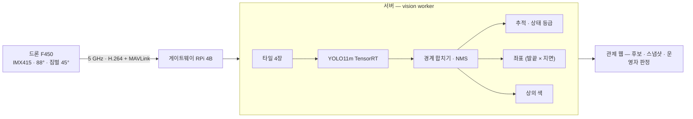

> [!summary] 자율 정찰 드론 관제 시스템 · 비전 파트 (정서인)
> 드론이 농촌 · 산지를 정찰하며 **사람 (쓰러진 사람 포함) 을 찾아** 관제 지도에 신고 · 비전 = 탐지 · 상태 (누움 · 멈춤 → 등급) · 추적 · 좌표 · 상의 색 — 후보를 거르지 않고 순위만 · 판단은 운영자
> 지난 홈 → [[00 홈 (11-08 판)]] · [[00 홈 (10-13 판)]]

> [!important] 일정 — 11-16 첫 비행 **추락 (프롭 2개)** → 11-18 (수) 회의 · 지상 리허설 · 프롭 도착 → **11-19 (목) 재비행** → 라벨 · D1 → **11-21 수치 동결** → **11-25 최종발표 + 페어** → [[29 실비행 재개 준비 (11-18 회의)]]

# 궁금할 때 여기부터

| 궁금한 것 | 볼 곳 |
|---|---|
| **지금까지 뭘 해 봤고 뭐가 됐나 / 안 됐나** | [[_실험 색인]] (학습 · 시행착오 원장 · 주제별 한 줄) |
| 그 실험의 판정 기준 · 표 원문 | [[_학습 큐]] (맨 위 찾아보기 표 → 11월 · [[_학습 큐 (10월)]] · [[_학습 큐 (09월)]]) |
| 다시 하면 안 되는 것 · 실수 | [[막다른 길]] · [[함정 모음]] |
| 지금 배포된 것 · 왜 그렇게 정했나 | [[_결정 색인]] · [[가중치 계보]] |
| 지금 할 일 · 정해야 할 것 | [[다음 할 일]] |
| 학습 계획 · 실제로 간 길 | [[00 학습 계획 한눈에]] |
| **실비행 재개 준비 · 추락 원인 · 회의 안건** | [[29 실비행 재개 준비 (11-18 회의)]] |
| 실비행 체크리스트 · 장면 · 기록 | [[28 첫 실비행 준비 (11-16 월)]] · [[24 실기체 비전 시험 시나리오 (11-04)]] · [[25 실기체 시험 세부 · 기록 · 로깅 (11-07)]] |
| 합격선 · 현재값 | [[성능 요구사항 한눈에]] |
| 데이터셋 · 평가셋 | [[_데이터셋 한눈에]] |
| 언제 무엇을 했나 | [[타임라인]] · [[_기록 색인]] |
| 파일 · 스크립트가 어디 있나 | [[문서와 코드 위치]] |
| 용어 · 개념 · 공부 | [[용어 및 약어]] · [[_개념 색인]] · [[_공부 색인]] |
| 과업 · 명세서 · 팀 | [[_프로젝트 색인]] · [[운용 조건]] |
| 서버 | [[서버 인계]] · [[학과 서버]] · [[데이터 다운로드]] |

# 지금 상태 (11-15)

| 영역 | 상태 | 핵심 수치 | 문서 |
|---|---|---|---|
| 기준 조건 | ✅ | 렌즈 88° (수평 80.2° · f 1,141 px) · 마운트 45° · 고도 16~20 m | [[결정 - 기본 마운트각 45°]] |
| **배포 탐지 모델** | ✅ 11-13 | **v12_f91_swa15** · 문턱 0.20 · 타일 4장 + 경계 합치기 · TensorRT 20.6 ms | [[결정 - 배포 탐지 모델 v12_f91_swa15 (11-13)]] |
| 탐지 정확도 V03 | ⚠ | AP50 숲 0.66 · 비스듬 0.63 · 한국 1.00 (목표 0.80) · **습관 보정 0.70 · 0.71 · 중심 일치 0.82 · 0.86** | [[NFR-V03 탐지 정확도]] · [[실험 - 성능 향상 방법 재탐색 (11-15)]] |
| 누운 사람 | ⚠ 실기체로 판정 | UE 0.96 · UAV-SAR 1.00 · Okutama (30 px) 0.58~0.73 · 합침 재분석 0.75 · 90° 회전 +9~19 %p | [[21 누운 사람 강건성 - 진단 · 문헌 · 파이프라인 점검 (10-30)]] |
| 시간 V01 · V02 | ✅ | 탐지 20.6 ms · 전체 38~51 ms (≈ 20 FPS) | [[NFR-V01 추론 시간]] |
| 오탐 V06 | ✅ | 사람 없는 장 0.17~0.55 건/장 | [[NFR-V06 프레임 오탐]] |
| 좌표 V04 | ✅ UE · ⏳ 실기체 | UE 중앙 0.34~0.61 m · 자체 보정 도구 준비 | [[NFR-V04 좌표 정확도]] |
| 상태 · 자세 | ⚠ | 누움 AUROC 0.92 · 잡힌 비율 0.41 · 물리 모델 0.95 · 여러 시점 5 초 0.98 (UE) | [[06 요구조자 상태 인지 계획]] |
| 추적 · 후보 | ⚠ | UE IDF1 0.36~0.46 · 사람당 후보 4~5 · 헛후보 多 → 최고 확신 순 | [[18 UE 비전 전 과정 검증 (10-14)]] |
| 상의 색 | ✅ 1.3 · ⏳ 보강 | SigLIP 2 제로샷 0.51~0.89 · 작은 화소 망 +4~9 · VLM +13~27 %p | [[결정 - 상의 색 SigLIP 2 제로샷 (worker 1.3)]] |
| 실시간 서비스 | ✅ 1.3 · 1.4 그림자 | REAL 1.3 배포 · 1.4 (2차 검증) 그림자 모드 | `deploy/vision_worker/` |
| 학습 (GPU) | ⏸ 비워 둠 | RT-DETR · R90 ❌ 끝 · D1 은 11-19 비행 뒤 (실측 회당 6.9 h) | [[_학습 큐]] |

> [!warning] 미결 (11-15)
> 1. **실기체 수치** — 우리 카메라 · 전송 · 장소에서 처음 잼 (11-16~) · 누움 재현율 ≥ 0.80
> 2. **NFR-V03 0.80** — 공개 셋 AP50 은 정답 박스 습관이 섞임 → 보고 방식 (AP50 · 습관 보정 · 중심 일치) · 실기체 C 장소 주 판정
> 3. **실기체 재비행 (11-19)** — 추락 원인 (Loiter 이륙 + GPS) 대책 · 녹화 상한 · 화각 · OSD · 영상 링크 → [[29 실비행 재개 준비 (11-18 회의)]]
> 4. 사람당 후보 쪼개짐 · 헛후보 정리 (통합 담당과)
> 5. worker 1.4 판정 · 색 작은 망 · 좌표 자체 보정 · 여러 시점 자세 — 실비행 「11-15 V15」

# 흐름 한 장

# 폴더

| 폴더 | 내용 |
|---|---|
| `01 프로젝트` | 과업 · 명세서 · 운용 조건 · 설계 |
| `02 데이터셋` · `03 모델` | 출처별 데이터 · 가중치 계보 |
| `04 실험` | **원장 [[_실험 색인]]** + 주제별 하위 폴더 (탐지 학습 · 추론 · 평가 · 자세 · 좌표 · 조건 · 초기) |
| `05 결정` · `06 이슈` | 유효한 결정 (지난 것은 `지난 결정/`) · 막다른 길 · 함정 |
| `07 개념` · `12 공부` | 개념 풀이 · YOLO 공부 |
| `08 서버` · `09 기록` | 서버 · 타임라인 · 일자별 · 할 일 · 보관 |
| `10 성능 요구사항` | NFR 별 합격선 · 현재값 |
| `11 서버 학습 계획` | 지금 계획 · [[_학습 큐]] · `검토 보고/` (10~11월 점검 보고) · `지난 계획/` |

# 규칙

- 데이터 원본 · 파생물 (크롭 · 추론 결과 이미지) 은 git 에 올리지 않는다 · 키 · 토큰 · 내부 주소 · 학번 금지 (공개 저장소)
- 기준 문서 우선순위: 캡스톤 디자인 계획서 (예산) · 요구명세서 v1.7 → 이 볼트
- 지난 판은 지우지 않고 `지난 …` · `보관/` 으로 — 맨 위에 대체 문서 링크
