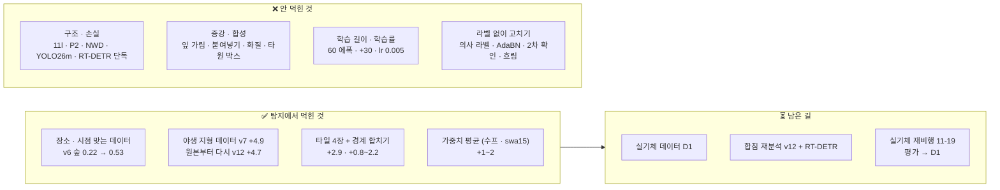

> [!summary] **학습 · 시행착오 원장** — 지금까지 해 본 것 전부를 주제별 한 줄로 (✅ 채택 · ❌ 기각 · △ 조건부 · ⏳ 대기)
> - 자세한 판정 기준 · 표 → [[_학습 큐]] (11월) · [[_학습 큐 (10월)]] · [[_학습 큐 (09월)]] — 「절」 칸의 이름으로 찾는다
> - 다시 하지 말 것만 → [[막다른 길]] · 실수 · 함정 → [[함정 모음]] · 날짜순 → [[타임라인]]
> - ⚠ 09-23 이전 탐지 수치는 장소가 섞인 평가 — 정직한 기준선은 v3_place 부터 · 숫자 표기 [[수치 표기 규칙]]
> - 지난 판 → [[_실험 색인 (11-15 이전 판)]] · 폴더: `1 탐지 학습` · `2 탐지 추론` · `3 평가 · 비교 · 진단` · `4 자세 · 상태 · 추적` · `5 좌표` · `6 조건 비교` · `7 초기`

## 한 장 — 무엇이 먹혔나

| 임무 | 지금 쓰는 것 | 핵심 수치 | 더 올릴 후보 |
|---|---|---|---|
| 탐지 | YOLO11m · v12 데이터 · swa15 · 타일 4장 + 경계 합치기 · 문턱 0.20 | 숲 0.66 · 비스듬 0.63 · 한국 1.00 (중심 일치 0.82 · 0.86) · 20.6 ms | D1 · R90 · 합침 재분석 |
| 자세 · 상태 | 박스 2특징 + 멈춘 시간 → 등급 (추적 문턱 0.15) | Okutama 누움 AUROC 0.92 · 잡힌 비율 0.41 | 물리 모델 · 여러 시점 묶음 · 키 회귀 · 관절점 |
| 좌표 | 발끝 광선 × 지면 (DEM · 평지 AGL) | UE 중앙 0.34~0.61 m | 자체 보정 `geo_selfcal.py` · 마주 보기 |
| 상의 색 | SigLIP 2 제로샷 + 잔디 문장 + 남색 문턱 | 색 균형 1순위 0.51~0.89 | 작은 화소 망 (+4~9) · VLM (+13~27) |

# 1. 탐지 — 학습

## 1-1. 데이터 (가장 크게 먹힌 손잡이)

| 무엇 | 날짜 · 절 | 결과 | 판정 |
|---|---|---|---|
| [[서버 v3_place - 장소 분리 학습]] — 처음으로 장소를 나눠 잼 | 09-23 | 숲 AP50 **0.22** (누수 모델은 0.856) | 기준선 |
| [[서버 v6_obl - 60° 데이터]] — 비스듬 시점 · 새 장소 | 09-25 | 숲 0.22 → **0.53** · 비스듬 0.19 → 0.62 | ✅ |
| v7 — SARD · HERIDAL (야생 지형) 추가 | 09-26 | 숲 **+4.9 %p** (반복 폭보다 큼) | ✅ |
| v8 — NII-CU 45° 야구장 추가 | 09-27 | ±0 | ❌ |
| AI-Hub 190 (고도 70~80 m · 18 px) | 09-28 | 조건 안 맞음 | ❌ |
| v9 — NOMAD 가림 · 누움 · 숨음 | 09-29 | 비스듬 +2.7 · 숲 −2.0 · 누움 재현율 0.33 → 0.50 | △ v12 에 포함 |
| v10 — LADD 추가 (R3 · D) | 10-04~09 | 맞바꿈 · 수프 붕괴 (한국 −6.2) | ❌ |
| S — 야생 지형 작은 사람 2,991장 (2×2 줄여 넣기) | 10-11~12 「V」 | 수프 대비 이득 없음 | ❌ (v12 에 포함) |
| A — Archangel-Real 3,149장 | 10-13 | v12 에 포함하고 멈춤 | — |
| **[[17 v12 데이터 재구성 - 파이프라인 점검 (10-12)\|v12 — 원본부터 다시]]** (확대 금지 · 시퀀스 상한 · 무시 영역 · 출처 11 · 18,601 창) | 10-12 「v12」 | 숲 **+4.7** · 한국 +1.3 · 비스듬 +1.1 | ✅ **배포** |
| H — 하드 네거티브 (틀린 탐지 되먹이기) | 10-15 「H」 | 뽑힌 창 절반 이상이 사람 → 학습 전 중단 | ❌ |
| [[서버 v3a - 하드 네거티브 음성 보강]] — 음성 15.8 % | 09-22 | 오탐 −64 % 인데 재현율 −7.3 %p | ❌ |
| C — 선생 모델 의사 라벨 (박스 1,770 추가) | 10-15 「C」 | 비스듬 +0.5 · 숲 −0.2 · 한국 −0.5 유의 | ❌ |
| M — 누운 마네킹 실영상 창 811 | 11-01 「M」 | 마네킹 누움 **+56 %p** · 도로 오탐 0.85 · 1.24 | ❌ (실기체 참고 후보) |
| MN — M + 같은 촬영장 빈 창 521 | 11-02 「MN」 | 도로 0.70 · 0.57 로 잡힘 · 숲 −1.2 유의 | ❌ (실기체 참고 후보) |
| N1 — 새 출처 2,099 창 (TinyPerson · RGBTDronePerson · VisDrone MOT) | 11-11 「N1」 · 「Q1」 | 2회 평균 비스듬 −0.4 · 숲 +0.7 | ❌ |
| D0 · D0b — 현장 적응 연습 (짧은 미세조정) | 11-01 「D0」 | 새 장소 +0.5~1.3 · **숲 −2.6 ~ −2.9** | ❌ → 처음부터 다시 |
| **D1 — v12 + 실기체 창 20 % 로 처음부터** | 11-08 「D1」 | 라벨 대기 | ⏳ |

## 1-2. 구조 · 손실 · 사전학습

| 무엇 | 날짜 · 절 | 결과 | 판정 |
|---|---|---|---|
| [[서버 L1 - yolo11l 1280]] — 11m → 11l | 09-18 | 운용 구간 재현율 −3 ~ −8 % | ❌ |
| [[서버 D - VisDrone 항공 사전학습]] | 09-22 | −2.3 %p | ❌ |
| [[NWD·P2 효과 없음 - 원인 분석]] — NWD 손실 · P2 머리 | 09-26 | NWD −2.4 · P2 ±0 (옛 데이터에선 +4.6) | ❌ |
| P2 머리 다시 (v12 위 · P1) | 11-11 「E」 | 비스듬 +0.5 · 숲 −0.4 · 도로 **5.57** | ❌ |
| [[YOLO26m 탐지기 Q2 - 기각]] | 10-04 | 숲 +2.8 · 비스듬 −1.8 · 한국 −1.9 (맞바꿈) | ❌ |
| [[외부 항공 검출기 비교 - FlyPose · VisDrone YOLO (E1 · E1b)\|FlyPose 검출기 · 공개 VisDrone 검출기]] | 10-10 | FlyPose 숲 +6.4 · 한국 −5.3 · VisDrone 계열 −8 ~ −17 | ❌ (합침 상대로만) |
| 기성 가중치 13개 ([[실험 - 기성 모델 대 우리 모델 (데이터셋 12개 · 11-01)]]) | 11-01 | v12 를 이긴 셋은 LADD 하나 · 도로 0.87~12.9 | ❌ |
| **RT-DETR-L (같은 데이터)** ([[실험 - 성능 향상 방법 재탐색 (11-15)]]) | 11-15 「RT」 | 단독 비스듬 +8.4 는 박스 습관 · 도로 38 건/장 / **합침 숲 +3.3 · 비스듬 +9.4** | ❌ 단독 · ✅ 합침 재분석 |

## 1-3. 학습 설정 · 증강

| 무엇 | 날짜 · 절 | 결과 | 판정 |
|---|---|---|---|
| translate 0.30 ([[타일 가장자리 효과]]) | 09-21 | −4.9 %p | ❌ |
| close_mosaic | 09-20 | 손해 → 0 고정 | ❌ |
| 60 에폭 (v7_e60) | 09-29 | val ↑ 인데 비스듬 **−4.0** | ❌ |
| v12 에서 30 에폭 더 (lr 0.002) | 10-13 「E」 | 비스듬 −2.4 · 숲 −1.9 | ❌ |
| 처음부터 낮은 학습률 0.005 (L1) | 11-11 「L1」 | 도로 2.5 | ❌ |
| scale 0.5 (S1) | 11-11 「E」 | 숲 +1.2 · 비스듬 +0.7 인데 도로 1.59 | ❌ |
| degrees 0 (회전 끄기) | 11-12 「Q1」 | 숲 −1.6 ~ −0.3 · 비스듬 +0.6 | ❌ |
| 나무 잎 가림 합성 (v13occ) | 10-14 「O」 | +0.8 구분 안 됨 · 한국 −0.5 유의 | ❌ |
| 누운 사람 사진 3배 (v12ly) | 10-30 「L」 | 누움 0.435 → 0.420 (test_obl +3.9 는 박스 습관 의심) | ❌ |
| 누운 사람 복사-붙여넣기 (CP) | 10-30 「CP」 | 숲 −4.9 · 도로 1.89 | ❌ |
| 회전 박스 타원 방식 (EL) | 10-30 「EL」 | 숲 −1.9 · 도로 1.39 | ❌ |
| 화질 열화 증강 × 2 (DG) | 10-31 「C」 | 학습에 안 쓴 WebP 누움 −16 %p · 도로 1.8 | ❌ |
| 90° 단위 회전 증강 (R90 · × 2) | 11-15~16 「R90」 | 누움 0.665 → 0.587 (반복 폭 안) · 비스듬 +1.7 · 숲 +1.4 · 도로 0.76 | ❌ (AP · 도로는 참고) |

## 1-4. 가중치 평균 · 반복

| 무엇 | 날짜 · 절 | 결과 | 판정 |
|---|---|---|---|
| 수프 (같은 설정 반복 평균) — soup_v7r2 | 09-27 | +1.6~2.2 · 숲 0.593 · 비스듬 0.633 | ✅ (09-28 최종) |
| 다른 데이터 모델끼리 수프 | 09-26 | 한국 −44 %p | ❌ |
| 수프에 BN 재계산 | 09-27 | 박스가 넓어져 test_obl 만 오름 | ❌ |
| 공통 출발 미세조정 수프 (R2 · R6) | 10-04~06 | 비스듬 −5.2 | ❌ |
| 진짜 반복 폭 측정 (목록 95 % 뽑기) | 10-09 「10-08 계획」 | 비스듬 1.1~3.1 · 숲 2.9~3.3 · 한국 1.2 %p · ⚠ seed · 순서는 효과 없음 | 규칙 |
| **넓은 평균 swa15 (에폭 15~29)** | 11-11 「H0」 · 「Q1」 | 비스듬 +1.0 유의 · 손해 없음 | ✅ **배포 (11-13)** |

# 2. 탐지 — 추론 · 후처리

| 무엇 | 날짜 · 절 | 결과 | 판정 |
|---|---|---|---|
| [[GSD 정규화 - 추론 입력 크기 스윕]] — 입력 1280 → 1920 | 09-19 | +6.1 %p · 1920 초과 확대는 손해 | ✅ / ❌ 확대 |
| [[타일 추론]] — 4×(1280×720) 겹침 50 % | 09-20 | 38 px 재현율 +2.9 · TensorRT FP16 20.6 ms | ✅ |
| 2×(1280×1080) 타일 | 09-20 | 이득 없음 (겹침이 핵심) | ❌ |
| [[F2 임계값 탐색]] → 운용 문턱 0.15 → **0.20** | 09-20 · 10-14 | F2 평평 → 도로 오탐 1.05 → 0.55 로 정함 | ✅ |
| **I1 타일 경계 잘린 박스 지우기** ([[16 v7 넘기 - 파이프라인 검토 (10-11)]]) | 10-11 「V」 | 숲 +0.8 · 한국 +2.2 (모델 5개 모두) | ✅ |
| 중심 소유 합치기 · 1.5배 확대 추론 | 10-11 | −1 ~ −2.5 | ❌ |
| T1 화면 가장자리 3 px 박스 막기 | 10-17 「T」 | 빈 경로 관측 34 → 1 | ✅ (SIM) |
| T2 확정된 것만 내보내기 | 10-17 | 사람까지 막음 | ❌ |
| 추적으로 약한 탐지 살리기 (Ra · Rb) | 10-30 | 효과 0 · 문턱 0.10 은 도로 2.26 | ❌ |
| 모양별 문턱 (넓은 박스만 낮춤) | 10-30 | +2.3 (오차 안) | △ |
| 추론 전 흐림 C0 | 11-01 「C0」 | Okutama 만 +1 · 독립 8셋 −4 ~ −5 | ❌ |
| AdaBN (현장 BN 통계) | 11-08 「W · A」 | 숲 −7.7 ~ −18 | ❌ |
| SigLIP 2차 확인 (제로샷 · 학습 머리) | 11-08 「V」 · 11-14 | 고를 문턱 없음 · 학습 머리는 미끼 물체에만 (숲 −2.7) | ❌ (현장 미끼 전용 △) |
| v12 + 개방형 (GDINO · YOLO-World) 합침 | 11-07 | +0~4 · GDINO 355 ms | ❌ 실시간 |
| v12 + FlyPose 합침 | 11-08 | 숲 +5.5 · 비스듬 +6.2 · 헛탐지 ↓ | ✅ 재분석 (비상업) |
| **v12 + RT-DETR 합침** | 11-15 「RT」 | 숲 +3.3 · 비스듬 +9.4 · 누움 0.667 → 0.751 | ✅ 재분석 |
| 전체 한 장 1088×1920 · 타일 점수 평균 | 11-15 | 숲 같은 헛탐지 재현율 −2.6 · ±0 | ❌ |
| 좌우 뒤집기 TTA | 11-15 | 시간 2배에 +0.6~1.8 | △ 재분석만 |
| 90° 돌려 한 번 더 | 11-15 | 누움 +9~19 (도로 맞춤) · 헛탐지 두 배 | △ 재분석만 (학습 증강 R90 으로는 안 옮겨 옴) |
| 크기 타당성 문 (물리 모델) | 11-14 | 헛 −20 % 에 사람 −0.14 % | △ 실비행 |
| 4K 원본 그대로 탐지 (타일 9 · 16 · 25장) · 애매한 후보만 4K 로 다시 | 11-17 | 같은 Okutama 954장 AP50 0.616 → 0.477~0.543 · 다시 보기 0.592 · 작은 사람만 조금 ↑ | ❌ 1080p 가 맞음 ([[29 실비행 재개 준비 (11-18 회의)]] 3-0) |

# 3. 누운 사람 (탐지의 가장 약한 곳)

| 무엇 | 날짜 | 결과 |
|---|---|---|
| [[21 누운 사람 강건성 - 진단 · 문헌 · 파이프라인 점검 (10-30)\|진단]] | 10-30 | 「하락」 대부분은 박스 모양 (v12 = Okutama 정답의 0.83배) · 회전 증강이 박스를 부풀림 · UE 0.96 · UAV-SAR 누움 75명 1.00 · Okutama (30 px) 0.58~0.73 |
| 반복 폭 ([[22 다음 학습 검토 (10-31)]]) | 10-31 | 누움 뜸 표준편차 **7.9 %p** → 한 번 학습으로 판정 금지 · JPEG 30 누움 −10 %p |
| 학습 쪽 4종 (LY · CP · EL · DG) · 추적 살리기 | 10-30~11-01 | 모두 ❌ (1-3 · 2절) |
| 마네킹 실영상 M · MN | 11-01~03 | 마네킹 +56 %p · 사람에게 옮겨 가는지는 실기체로 |
| 조건별 ([[실험 - 조건별 강건성 · 학습 전후 (11-08)]]) | 11-08 | 학습 전 → 후 누움 0.44 → 0.86 (같은 헛탐지) |
| 90° 회전 · v12 + RT-DETR | 11-15 | 누움 +9~19 · 0.667 → 0.751 |

# 4. 평가 · 비교 · 진단 (재는 법을 고친 것)

| 무엇 | 날짜 | 결과 |
|---|---|---|
| 장소 분리 평가셋 test_v2 · test_obl · test_kr | 09-23~25 | 누수 0.856 → 정직한 0.22 · Okutama 는 평가 전용 |
| 판정 = 짝 블록 부트스트랩 + 반복 폭 + 세 평가셋 | 09-25~26 | 단일 AP 차 ±0.01 로 판정 안 함 |
| test_v2 무시 영역 (라벨 구멍) | 10-12 | +1.0 · 확신 높은 오탐 대부분은 **물체** (수레 · 상자 · 표지물) |
| [[외부 평가셋 - LADD·AU-AIR·키프로스·UE level01]] | 10-04 | AU-AIR = 도로 오탐 확인용 (재현율 판정 ❌) |
| [[마운트각 태그 검증 - Okutama]] · [[okutama_90 첫 판정]] · [[실영상 테스트]] | 09월 | 태그는 Okutama 만 신뢰 |
| [[실험 - 기성 모델 대 우리 모델 (데이터셋 12개 · 11-01)]] | 11-01 | 12셋 · 34모델 |
| [[실험 - 공정성 검토 · 기성 비교 다시 (11-04)]] | 11-04 · 11-07 | 처음 보는 3곳 우리 0.685 · AeroNova 0.640 · GDINO 0.611 · COCO 0.524 |
| [[실험 - 조건별 강건성 · 학습 전후 (11-08)]] | 11-08 | 조건 16개 — 앞섬 7 · 비슷 8 · 뒤짐 1 |
| [[실험 - 성능 향상 여지 진단 (11-08)]] | 11-08 | **AP50 미달의 큰 몫 = 정답 박스 습관** (중심 일치 0.82 · 0.86) · 남은 여지 = 데이터 다양성 |
| [[실험 - 성능 향상 방법 독립 재검토 (11-14)]] | 11-14 | 물리 자세 모델 · 좌표 치우침 · 학습형 확인 머리 |
| [[실험 - 성능 향상 방법 재탐색 (11-15)]] | 11-15 | 박스 습관 몫 비스듬 +8.7 · 숲 +3.2 · RT-DETR · 90° 회전 · 여러 시점 자세 · 좌표 자체 보정 · 색 작은 망 |
| 1080p 원본 Okutama | 11-08 | 0.623 → 0.607 (평가셋은 공정) · JPEG 50 −2.4 |
| 후보 단위 증거 (UE) | 11-15 | 배우 48 에 헛후보 945 · 최고 확신 순으로 분리 |

# 5. 자세 · 상태 · 추적 · 후보

| 무엇 | 날짜 · 절 | 결과 | 판정 |
|---|---|---|---|
| 자세 분류 탐지기 1~9차 (`자세 판별 (종료)/`) | 08~09월 | SARD 0.974 → Okutama 0.091 (장소 바뀌면 무너짐) | ❌ → [[결정 - 자세 판별 제외]] |
| [[자세 크롭 분류 기준선 - 장소 분리]] | 09-30 | 기준선 | — |
| [[움직임 보정 속도 - Okutama]] — 드론 움직임 빼고 멈춤 판정 | 09-30 | 이동/정지 AUROC 0.56 → 0.93 | ✅ |
| [[자세 판별 P0~P5 - C2A·상대 키·미세조정·파이프라인]] | 10-03 | C2A 앉음 F1 −0.47 · 미세조정 ❌ · 5초 중앙값 누움 0.98 → 0.80 (ID 바뀜) | ❌ 대부분 |
| [[추적 고치기 Q1 - 추적 문턱·ID 바뀜 끊기]] | 10-03 「Q」 | 누움 AUROC 0.78 → **0.95** | ✅ |
| [[상태 판단 모델 비교 - Qwen3-VL · Clef · GPT-6 Luna]] | 10-06 | 기하 0.97 > VLM 0.89~0.92 | 기하 유지 |
| Archangel A2~A6 · K · K2 · M ([[11 자세 판별 - 방식 · 기하 원리 · 오차 · 개선]]) | 10-07 「A」 | 시선 방향 누움 57 % 를 서기로 · A4 방위 변화 ✅ → A5 실전 ❌ · UE 합성 더하기 앉음 F1 0.36 → 0.42 ✅ · 마네킹 ❌ · DINOv2 ❌ | △ |
| [[V4 상태 인지 worker 이식 - 진짜 추적]] | 10-07 「V4」 | ✅ · ⚠ 연구 `model.track` 추적 버그 발견 | ✅ |
| [[관절점으로 자세 판정 - FlyPose · ViTPose · RTMPose (C4 · K1~K3)]] | 10-09~10 「K2 · K3」 | 「서기처럼 보이는 누움」 박스 0.61 → ViTPose-B 0.79 · K2b UE 로 안 옮겨감 | △ 그림자 (1.4) |
| [[인상착의 비교 · 재관측 제안 - worker (C1~C3 · REVIEW_BEARING)]] | 10-09 「C」 | worker 구현 · 순위 보조로만 | ✅ |
| [[18 UE 비전 전 과정 검증 (10-14)]] | 10-14 「U」 | 시간 · 좌표 · 오탐 ✅ · IDF1 0.36~0.46 · 사람당 후보 4~5 ❌ | 부분 |
| 후보 묶기 G · 외형 잇기 R · R2 · BoT-SORT ReID B | 10-15~30 | −26 % · −28.5 % (아슬) · −19.7 % · IDF1 +0.01 | ❌ |
| 상태 판단을 v12 로 다시 | 10-30 「S」 | AUROC 0.922 · **잡힌 비율 0.405** (탐지 몫) | ❌ 기준 미달 |
| 임무별 2차 검증 (worker 1.4 그림자) | 11-13 「V14」 | 관제 수치 1.3 과 같음 ✅ · 판정은 실비행 | ⏳ |
| **물리 (기하) 자세 모델** | 11-14 | UE 누움 0.82 → 0.95 · 세로≥가로 0.67 → 0.91 | ⏳ 실비행 |
| **여러 시점 묶음 · 키 회귀** | 11-15 「V15」 | 5 초 0.910 → 0.982 · 서기 1.76 m · 앉음 0.46 m | ⏳ 실비행 |

# 6. 좌표

| 무엇 | 날짜 · 절 | 결과 | 판정 |
|---|---|---|---|
| [[좌표 변환 정확도]] | 09-08 | 시뮬레이터 0.50 m | — |
| [[좌표 산정 GeoResolver - 평지 교차 검증]] — 발끝 광선 × 지면 | 09-28 · 10-05 | 시뮬 비행 중앙 0.68 · P95 1.16 m | ✅ |
| [[좌표 평지 가정 vs DEM - 캠퍼스 지형 모의 (G1)]] | 10-11 「G1」 | 평지 P95 41.8 → DEM 20.7 m | ✅ DEM |
| UE 전 과정 (DEM) | 10-14~17 | 중앙 0.34~0.61 · P95 ≤ 2.3 m | ✅ |
| 치우침 몬테카를로 | 11-14 | 피치 2° = 한 방향 3.7 m ↔ 마주 보기 1.0 m · 렌즈 왜곡 미사용 | 설계 |
| **자체 보정** (`geo_selfcal.py`) | 11-15 「V15」 | 치우침 넣고 3.6 → 1.5 m · 시각 추정은 불안정 | ⏳ 실비행 |

# 7. 상의 색

| 무엇 | 날짜 · 절 | 결과 | 판정 |
|---|---|---|---|
| 규칙 V10 (HSV · 화이트밸런스) | ~10-17 | 색 균형 0.27~0.42 | 대체됨 |
| 규칙 계열 (색 이름표 · 국소 WB · 마스크 · Lab · 노출) | 10-29 「K」 | 검정 ↔ 흰 문턱 맞바꿈 | ❌ |
| **SigLIP 2 제로샷 (상의) + 잔디 문장 + 남색 문턱** | 10-29~30 「K」 | **0.51~0.89** · 3 ms | ✅ worker 1.3 |
| 선형 학습 (UAV-Human 85명) · 문장 묶음 · 동의어 · 큰 모델 · 배경 빼기 | 10-29 | 제로샷 못 넘음 · 배경 빼기는 손해 | ❌ |
| 색 후보 확장 (혼동 행렬) · VLM (Qwen3-VL-4B) | 11-13~14 「V14」 | VLM +0.13~0.27 (드론셋 3개 유의 · 65 ms) | ⏳ 그림자 |
| 선형 머리 — 옷 7,503벌 (PETA) | 11-15 | 드론셋 −0.6 ~ +3.6 | ❌ |
| **48×48 화소 작은 망 × 제로샷** | 11-15 「V15」 | 5셋 +4~9 (4셋 유의) | ⏳ 실비행 |

# 8. 조건 비교 (하드웨어 선정) · 초기

| 무엇 | 날짜 | 결과 |
|---|---|---|
| [[화각·고도 비교 실험]] · [[예산안 화각 비교 - 1안 vs 2안]] | 09-15~17 | 광각 손해는 선 사람에게 큼 · 75° > 90° ≈ 93° > 160° |
| [[기체 흔들림 내성 - 모션 블러]] | 09-17 | 블러가 사람 긴 변의 6 % 넘으면 붕괴 → 셔터 1/1000 s |
| 노트북 탐지 [[탐지 1 - NOMAD 배우 확장]] · [[탐지 2 - WiSARD 통합]] · [[탐지 3 - 임계값 조정]] · [[탐지 4 - 고도·해상도 평가]] | 08월 | 장소 섞인 평가 (참고) |
| [[서버 E1~E8]] · [[서버 M1 - yolo11m 1280]] · [[서버 M2 - yolo11m 1280 SARD]] · [[성능 개선 후보 - AP50 벽]] | 09-11~15 | AP50 0.65 벽 (장소 섞임) |
| [[Copy-Paste 준비]] | 09-05 | 보류 → 10-31 해 봄 ❌ |

# 시간순 (한 줄)

| 때 | 한 일 |
|---|---|
| 08월 | 노트북 탐지 1~4 |
| 09-04~15 | 자세 분류 6~9차 ❌ → 1클래스 · 서버 E · M1 · M2 · 화각 비교 |
| 09-17~22 | 모션 블러 · L1 ❌ · 타일 추론 ✅ · F2 · TensorRT · translate ❌ · 음성 보강 ❌ · 항공 사전학습 ❌ |
| **09-23~28** | **장소 분리 (0.22)** → v6 (0.53) → NWD · P2 ❌ → v7 · 수프 → **soup_v7r2 최종** · 좌표 GeoResolver |
| 09-29~10-07 | 60 에폭 ❌ · v9 · 움직임 보정 · 자세 P0~P5 · 추적 Q1 ✅ · YOLO26m ❌ · Archangel 자세 · V4 worker |
| 10-08~14 | v10 반복 ❌ · 관절점 · 외부 검출기 · DEM · **I1 경계 합치기 ✅ · v12 ✅ → 배포 · 문턱 0.20** · UE 전 과정 |
| 10-15~17 | 잎 가림 · 하드 네거티브 · 의사 라벨 · 후보 잇기 G · R · ReID ❌ · 가장자리 T1 ✅ |
| 10-29~31 | **상의 색 SigLIP 2 ✅** · 상태 v12 다시 · 누움 LY · CP · EL · DG ❌ |
| 11-01~08 | 흐림 C0 ❌ · 현장 적응 D0 ❌ · 마네킹 M · MN ❌ · 기성 비교 · 공정 비교 · 강건성 · 진단 (박스 습관 · AdaBN ❌) |
| 11-11~13 | P2 · scale · 새 출처 · 낮은 lr ❌ · **swa15 ✅ → 배포** · worker 1.4 그림자 |
| 11-14~15 | 물리 자세 모델 · RT-DETR (합침 ✅ · 단독 ❌) · 90° 회전 · 여러 시점 자세 · 좌표 자체 보정 · 색 작은 망 |

## 연결

[[00 홈]] · [[_학습 큐]] · [[막다른 길]] · [[함정 모음]] · [[_결정 색인]] · [[가중치 계보]] · [[타임라인]] · 표로 비교 [[실험 비교.base]]
