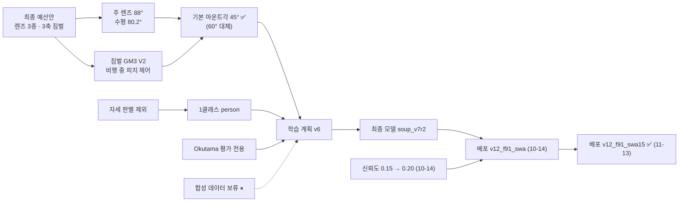

> [!summary] **지금 유효한 핵심 결정 (11-15)**: 배포 탐지 [[결정 - 배포 탐지 모델 v12_f91_swa15 (11-13)|v12_f91_swa15]] · 문턱 [[결정 - 배포 탐지 모델 v12_f91_swa · 임계값 0.20|0.20]] · 상의 색 [[결정 - 상의 색 SigLIP 2 제로샷 (worker 1.3)|SigLIP 2 (worker 1.3)]] · 마운트 [[결정 - 기본 마운트각 45°|45°]] · 1클래스 [[결정 - 자세 판별 제외|자세 판별 제외]]
> 유효한 결정은 이 폴더 · 대체 · 종료된 결정은 `지난 결정/` (맨 위에 대체 링크)

## 결정이 이어지는 모양

## 유효

| 결정 | 날짜 | 상태 | 한 줄 |
|---|---|---|---|
| **[[결정 - 상의 색 SigLIP 2 제로샷 (worker 1.3)]]** | 10-29 | ✅ (배포 대기) | 규칙 V10 → SigLIP 2 base 제로샷 + 남색 문턱 · 색 균형 0.27~0.42 → 0.51~0.89 · 3 ms/명 · 약점 풀밭 초록 질의 |
| **[[결정 - 배포 탐지 모델 v12_f91_swa15 (11-13)]]** | 11-13 | ✅ **지금 배포** | 에폭 15~29 넓은 평균 · 비스듬 +1.0 %p 유의 · 손해 없음 · 꾸러미 `_pack_v12w_real` · `_pack_v12w_sim` |
| [[결정 - 배포 탐지 모델 v12_f91_swa · 임계값 0.20]] | 10-14 | ✅ 문턱 0.20 · 모델은 ↪ swa15 | v12 데이터 · 숲 +4.8 · 한국 +1.0 %p (soup_v7r2 대비) · 20.6 ms · 임계값 0.20 |
| [[결정 - 최종 예산안 (2026-09-23 계획서)]] | 09-23 | ✅ | 15품목 1,867,810원 · 렌즈 대각 62·78·88° · GM3 V2 |
| **[[결정 - 기본 마운트각 45°]]** | 09-29 | ✅ | 설계명세서 D-03 · 재학습 불필요 (test_obl = Okutama 45°) · 16~20 m 권장 · 화면 위 1/4 좌표 보류 |
| [[결정 - 자세 판별 제외]] | 09-13 | ✅ | 도메인 이전 실패 (SARD 0.974 → Okutama 0.091) → 1클래스 |
| [[결정 - Okutama 평가 전용]] | 09-05 | ✅ | 정직한 잣대 — test_obl 의 근거 |
| [[결정 - Copy-Paste 보류]] | 09-05 | ❌ 10-31 해 봄 | 누운 사람 붙여넣기 — 누움 개선 없음 · 도로 오탐 ↑ |
| [[결정 - GPU 완화 설정과 자동 복구]] | 09-14 | ✅ | Xid 79 대응 |
| [[결정 - 서버에서 데이터 새로 받기]] | 09-10 | ✅ | |
| [[결정 - 저장소 통합]] | 09-14 | ✅ | Capstone 단일 저장소 |

### 실험 노트 안에서 내린 결정

| 결정 | 근거 노트 |
|---|---|
| 타일 추론 채택 (4×1280×720 · 겹침 50 %) | [[타일 추론]] |
| TensorRT FP16 `imgsz=[736,1280]` | [[NFR-V01 추론 시간]] |
| fitness = mAP50-95 만 | [[fitness와 조기 종료]] |
| 셔터 1/1000 s 우선 | [[기체 흔들림 내성 - 모션 블러]] |
| 음성 5 % 로 제한 | [[서버 v3a - 하드 네거티브 음성 보강]] |
| 판정 = 짝 부트스트랩 + 반복 폭 + 세 평가셋 | [[NWD·P2 효과 없음 - 원인 분석]] · [[_학습 큐]] |
| NWD · P2 쓰지 않음 · 작은 사람용 손실·구조 중단 | [[NWD·P2 효과 없음 - 원인 분석]] |
| 수프는 같은 데이터·설정 반복끼리 · BN 재계산 안 씀 | [[결정 - 최종 탐지 모델 soup_v7r2]] |
| NII-CU · AI-Hub 190 최종 모델에 안 씀 | [[NII-CU]] · [[9.28 최종 모델 확정]] |
| 학습 길이 30 에폭 유지 (60 에폭 기각) | [[9.29 60 에폭 기각과 v9]] |
| 가중치 = 에폭 15~29 넓은 평균 (swa15) | [[_학습 큐]] 「11-11 H0」 · 「11-12 Q1」 |
| RT-DETR 은 합침 재분석용 2차 모델로만 (단독 교체 ❌) | [[실험 - 성능 향상 방법 재탐색 (11-15)]] |
| 탐지기는 YOLO 로 고정 · 다른 임무는 바꿔도 됨 (11-10 사용자) | [[11.10~11 판넬 문안 · 0.80 새 학습 계획 · 다른 임무 후보]] |
| 칸 관측 완료 3초 · 수신 초당 10장 (제안) | [[관측 시간과 영상 수신 기준]] |

## 대체 · 종료 (`지난 결정/`)

| 결정 | 왜 끝났나 | 대신 |
|---|---|---|
| [[결정 - 최종 탐지 모델 soup_v7r2]] (09-28) | v12 로 대체 (10-14) | [[결정 - 배포 탐지 모델 v12_f91_swa15 (11-13)]] |
| [[결정 - 기본 마운트각 60° (잠정)]] (09-24) | 45° 로 대체 | [[결정 - 기본 마운트각 45°]] |
| [[결정 - 신뢰도 0.15]] (08-02) | 0.20 으로 (10-14 · 원칙 「놓친 조난자 > 헛탐지」 는 유효) | [[결정 - 배포 탐지 모델 v12_f91_swa · 임계값 0.20]] |
| [[결정 - 하드웨어 예산안 합의 v4]] | 최종 예산안으로 대체 (렌즈 1개 → 3종) | [[결정 - 최종 예산안 (2026-09-23 계획서)]] |
| [[결정 - 3클래스 체계]] | 자세 판별 제외 | 1클래스 person |
| [[결정 - 백본 동결]] | 자세 판별 제외 | — |
| [[결정 - WiSARD 자세 학습 제외]] | 자세 판별 제외 | — |
| [[결정 - 전환 구간 15프레임]] | 자세 판별 제외 | — |

## 연결
[[00 홈]] · [[_실험 색인]] · [[타임라인]]
