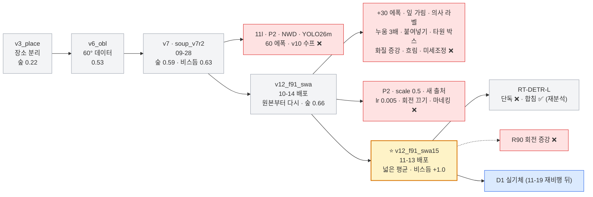

> [!summary] 비전 학습 · 평가 계획의 입구 — 판정 기준 · 결과 원문 → [[_학습 큐]] · 해 본 것 전부 → [[_실험 색인]]
> - **배포**: `v12_f91_swa15` (11-13) · 숲 0.66 · 비스듬 0.63 · 한국 1.00 · 20.6 ms
> - **11-15 판단**: 공개 데이터 위 손잡이 (데이터 추가 · 구조 · 증강 · 학습률 · 추론 방식) 는 거의 다 닫힘 · 남은 것 = **실기체 데이터 D1** · **90° 회전 증강 R90** (누움) · **합침 재분석** (v12 + RT-DETR)
> - 지난 판 → [[00 학습 계획 한눈에 (11-01 판)]] · [[00 학습 계획 한눈에 (10-04 판)]]

## 1. 지금 열려 있는 것

| 팔 | 무엇 | 상태 | 기준 |
|---|---|---|---|
| **D1** | v12 + 실기체 창 20 % 로 처음부터 (× 2) | ⏳ 실기체 라벨 대기 · 회당 ≈ 19 h | [[_학습 큐]] 「11-08 D1」 |
| ~~R90~~ | v12 + 90° 단위 회전 증강 | ❌ 11-16 (누움 안 오름 · AP +1.4~1.7 · 도로 0.76 참고) | 「11-15 R90」 |
| **실비행 재개** | 11-16 추락 → 날개 11-18 저녁 → 11-19 재비행 · 데이터 → D1 | ⏳ | [[29 실비행 재개 준비 (11-18 회의)]] |
| **V15** | 실비행 판정 — 여러 시점 자세 · 좌표 자체 보정 · 색 작은 망 | ⏳ 실비행 녹화 | 「11-15 V15」 |
| **V14** | worker 1.4 2차 검증 (관절점 · 색 후보 · VLM) | ⏳ 그림자 모드 | 「11-13 V14」 |
| 누움 모델 비교 | v12 · M · MN 을 같은 실기체 녹화로 | ⏳ 실비행 | 「11-04」 |
| 재분석 | v12 + RT-DETR (+ 90° 한 장) 비행 뒤 재분석 | 준비됨 | [[실험 - 성능 향상 방법 재탐색 (11-15)]] |

## 2. 지금 보는 문서

| 문서 | 무엇 |
|---|---|
| [[28 첫 실비행 준비 (11-16 월)]] · [[24 실기체 비전 시험 시나리오 (11-04)]] · [[25 실기체 시험 세부 · 기록 · 로깅 (11-07)]] · [[14 촬영 체크리스트 - 자세 × 가림 (10초)]] | 실비행 준비 · 장면 · 기록 |
| [[27 AP50 0.80 향한 새 학습 계획 (11-11)]] · [[26 요구사항 충족 위한 성능 향상 후보 (11-07)]] | 0.80 향한 팔 (E · N · D1 · K) · 후보 순위 |
| [[06 요구조자 상태 인지 계획]] · [[11 자세 판별 - 방식 · 기하 원리 · 오차 · 개선]] | 상태 등급 · 박스 모양 자세의 원리 |
| `검토 보고/` — [[16 v7 넘기 - 파이프라인 검토 (10-11)]] · [[17 v12 데이터 재구성 - 파이프라인 점검 (10-12)]] · [[18 UE 비전 전 과정 검증 (10-14)]] · [[19 상의 색 판별 개선 계획 (10-17)]] · [[21 누운 사람 강건성 - 진단 · 문헌 · 파이프라인 점검 (10-30)]] · [[22 다음 학습 검토 (10-31)]] | 큰 점검 보고 (결과가 든 노트) |
| `지난 계획/` | 9월 S0~S8 · v4~v6 · 중간발표까지 계획 (10-04 · 10-07) · 23 (11-01) · 9.21 아이디어 |

## 3. 실제로 간 길 (탐지 모델)

## 4. 판정 규칙 (모든 실험 공통)

- 판정은 **학습에 안 쓴 장소** 로만 — test_obl (Okutama 비스듬) · test_v2 (WiSARD 숲 · 경계 합치기 · 무시 영역) · test_kr (AI-Hub 한국)
- **판정 기준은 돌리기 전에** [[_학습 큐]] 에 적는다 · 한 번에 하나만 바꾼다
- 같은 설정도 다시 학습하면 흔들린다 (AP 최대 3.4 %p · 누움 뜸 표준편차 7.9 %p) → **반복 2회 평균 대 v12 세 회 평균** (`compare_means.py`)
- 함께 보는 것: 도로 오탐 (AU-AIR · ≤ 1 건/장) · 누움 묶음 (`lying_bench.py`) · 박스 가로 비 · 중심 일치 (구조가 다르면 박스 습관도 다르다 · 11-15)
- val mAP 로 고르지 않는다 (11l · RT-DETR: val 은 낮은데 평가셋은 반대)

## 5. 운용 화면 기하 (45°)

![[fig_45도_화면기하.svg]]

- 화면 위 = 먼 쪽 · 아래 = 가까운 쪽 → 상하 반전 증강 끔 · 16~20 m 에서 사람 키 50~100 px

## 연결

[[00 홈]] · [[_학습 큐]] · [[_실험 색인]] · [[_결정 색인]] · [[성능 요구사항 한눈에]] · [[다음 할 일]]
