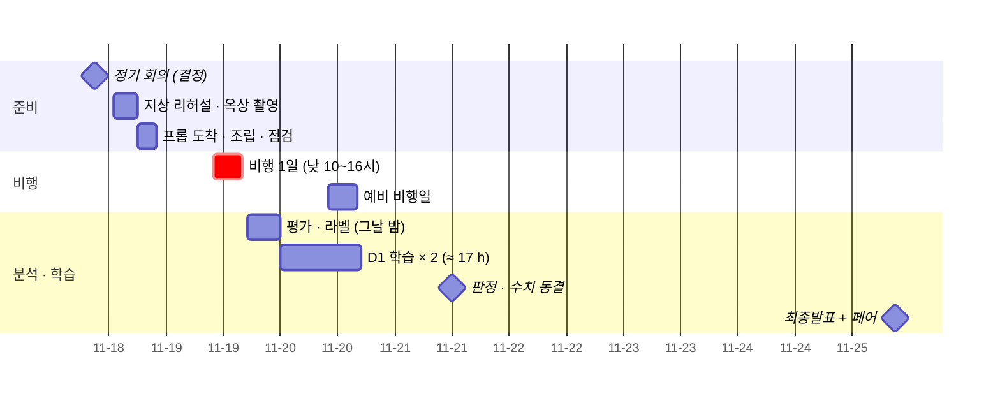
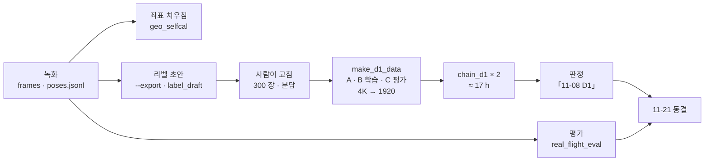

# 실비행 재개 준비 — 날개 오면 바로 (11-18 회의)

> [!summary] 한 장 요약
> - **상황**: 11-16 (월) 19:08 첫 비행 시도 → 이륙 직후 왼쪽으로 뒤집혀 프롭 2개 파손 · 새 프롭 11-18 (수) 저녁 도착 → **재비행 11-19 (목) 낮** · 예비 11-20 (금) · 수치 동결 11-21 (토) · 발표 11-25 (수)
> - **추락 원인 (로그)**: 기체 결함이 아니라 **「Loiter 로 머뭇거린 이륙 + 그 자리 GPS 가 나쁨」** — 날개만 바꾸면 같은 일이 또 날 수 있음 → 1 · 2절
> - **시스템에서 새로 찾은 문제 5개** (비행 전 고쳐야 그날 수치가 남음): 녹화가 약 8 분이면 멈춤 · 화각 설정 없음 (렌즈 확인) · 영상에 OSD 글자 박힘 · 4K 영상 링크 불안정 · 영상 촬영 시각 미검증 → 3절
> - **수요일 (날개 없는 하루) 이 가장 값짐** — 프롭 없이 시스템 전 구간을 지상에서 한 바퀴 돌려 문제를 미리 뽑는다 → 3절
> - **기체 점검 14개 (프롭 없이 · 2-1절)** → 비행 날은 **RC 단계 비행 S1 호버 → S4 RTL → S5 데이터 → S6~S7 자율 정찰** (4절) · 그날 밤 라벨 → D1 학습 (실측 회당 ≈ 8 h · 두 번 ≈ 17 h) → 11-21 판정 (5절)
> - 회의에서 정할 것 → 6절 · 내 의견 → 7절

## 0. 일정

| 날 | 할 일 | 막히면 |
|---|---|---|
| **11-18 (수) 오전** | 회의 — 6절 결정 | |
| 11-18 (수) 낮 | **지상 리허설** (프롭 없이 전 구간) · 렌즈 · 화각 · 시각 지연 재기 · (선택) 옥상 촬영 | 여기서 막힌 것은 목요일 비행 전에 고침 |
| 11-18 (수) 저녁 | 프롭 도착 → 조립 · 추락 뒤 점검 · 파라미터 · 지상 GPS 시험 | 점검에서 부품 이상 → 금요일로 |
| **11-19 (목) 10~16 시** | 비행 1일 — F0 점검 → F1 연결 → 데이터 → 자율 정찰 (4절) | 일몰 ≈ 17:15 · 비 · 바람 ≥ 5 m/s 면 금요일 |
| 11-19 (목) 밤 | 평가 · 좌표 · 라벨 (300 장 목표 · 분담) | |
| 11-20 (금) | D1 학습 × 2 (GPU) · 예비 비행 (낮 · 그 시간엔 학습 멈춤) | 비행이 금요일로 밀리면 D1 은 한 번만 (5절) |
| 11-21 (토) | D1 판정 · **수치 동결** | |

## 1. 11-16 추락 — 비행 로그로 본 원인

- 로그 `드론 조립/log/QUADROTOR/1/2026-11-16 19-07-02.bin` (ArduCopter 4.7.1 · KoaFC H743) · 앞 시도 `19-04-32.bin` (시동 안 됨 — 「Gyros not calibrated」 · 「High GPS HDOP」)
- 비행 모드 **Loiter (위치 유지)** 로 부팅 · 시동 · 이륙 — 모드 스위치 기본 위치 `FLTMODE1 = 5 (Loiter)` · 해 진 뒤 (일몰 ≈ 17:15)

| 로그 시각 | 일어난 일 | 근거 |
|---|---|---|
| 시동 전 1 분 (지상 정지) | **GPS 위치가 북 7.4 m · 동 4.5 m 떠돎** · 위성 10~13 · HDOP 1.34~1.78 (시동 기준 1.4 를 겨우 통과) · 수평 정확도 1.8 m | GPS · GPA |
| +69 s (19:08:11) | 러더로 시동 | RCIN · EV |
| +104 s (19:08:46) 이륙 | 스로틀 1,488~1,598 = **가운데 ± 100 데드존 안** → 상승 명령 없음 · 목표 고도 0.4 m → **0.4 m 에서 땅에 닿은 채 7 초** | CTUN · RCIN · `THR_DZ 100` |
| +104~111 s | Loiter 위치 유지가 떠도는 GPS 위치를 되돌리려 **왼쪽 기울기 명령 −1° → −18°** (조종기 좌우 · 앞뒤 입력은 0) · 실제 기울기는 0° (땅에 닿아 못 기움) → 명령이 계속 쌓임 · 2번 모터 최저 출력에 붙음 | ATT · PSCN/PSCE · RCOU |
| +111~112.5 s | 스로틀을 데드존 위로 → 무게가 빠지는 순간 **쌓인 명령대로 왼쪽 전복** (−13° → −23° → −69° · 1 초) → 프롭 파손 | ATT |
| +114.8 s | 충돌 감지로 시동 꺼짐 (`Crash: Disarming`) | MSG |
| +674~800 s (바닥에 누운 뒤) | `GPS Glitch` · `EKF variance` · `Bad fix` · 나침반 차 186 > 100 | **원인이 아니라 결과** (단 GPS 마스트 · 안테나 · 나침반 손상 확인 필요) |

- 결론: **위치 유지 모드로 머뭇거린 이륙 + 그 자리 GPS 가 나쁨** → 땅에 닿은 채 기울기 명령이 쌓였다가 뜨는 순간 뒤집힘 (ArduPilot 에서 흔한 「이륙 전복」 모양)
- 진동 (VibeZ 25~35 m/s²) · 모터 응답은 이 짧은 로그로는 이상 판단 불가 → 첫 호버 로그로 다시
- 그 밖에 파라미터에서 본 것: 지오펜스 꺼짐 · EKF 실패 동작 = Land · 저전압 2단계 동작 없음 · 전류 센서 없음 (전압만) · **짐벌 · 라이다 FC 미연결** (`MNT1_TYPE 0` · `RNGFND1_TYPE 0`) · 영상 OSD 켜짐 (`SERIAL4 = DisplayPort`)

## 2. 비행 쪽 — 다시 안 떨어뜨리기 (비행 담당 · 제안 · 결정은 회의)

| 항목 | 지금 | 제안 | 왜 |
|---|---|---|---|
| **이륙 모드** | Loiter | **AltHold 로 이륙** → 스로틀을 데드존 위로 확실히 (2 m 이상까지 빠르게) → 호버 안정 뒤 Loiter 전환 | GPS 와 상관없이 뜸 · 머뭇거림 막기 |
| 모드 스위치 | 아래 Loiter · 가운데 AltHold · 위 Stabilize | 아래 **AltHold** · 가운데 Loiter · 위 Stabilize (+ RTL 은 따로) | 기본 위치가 GPS 없이 안전 · 이상하면 아래로 |
| GPS 기준 | HDOP ≤ 1.4 | 이륙 전 지도에서 1~2 분 동안 **점이 2 m 안** · 위성 ≥ 14 · HDOP ≤ 1.0 · 못 미치면 **Loiter · Auto 금지 (AltHold 만)** | 11-16 은 정지 중 7 m 떠돎 |
| EKF 실패 동작 | `FS_EKF_ACTION 1` (Land) | **2 (AltHold)** | GPS 가 나빠질 때 조종사가 수동으로 |
| 저전압 | 10.5 V RTL · 10.2 V 동작 없음 | 10.2 V → Land (`BATT_FS_CRT_ACT 1`) · **비행 타이머 6~7 분** | 전류 센서 없음 → 잔량 % 못 믿음 |
| 지오펜스 | 꺼짐 | **켜기** (높이 30 m · 반경 100 m) | 자율 정찰 전 필수 |
| 시간 · 장소 | 19 시 (해 진 뒤) | **낮 10~16 시** · 트인 평지 (건물 · 나무 · 철망 · 전선에서 떨어진 곳) | 비전은 밤 영상 못 씀 · GPS 반사 줄이기 |
| 부팅 | 부팅 중 기체 움직임 (Gyros) | 평평한 곳에 놓고 전원 → 10 초 손대지 않기 | 「Gyros not calibrated · inconsistent」 |
| GPS 잡음 의심 | — | 지상에서 **영상 장비 (Pi · 카메라 · 송신기) 켠 때 · 끈 때** 위성 · HDOP · 점 흔들림 3 분씩 비교 → 나쁘면 GPS 마스트를 멀리 · 케이블 차폐 | 영상 장비 잡음이 GPS 를 흔드는 경우가 흔함 (의심 · 확인 필요) |
| 추락 뒤 점검 | — | 모터 4개 (손으로 돌려 걸림 · 소리 · 축 휨) · 암 · 다리 금 · GPS 마스트 · 안테나 · **나침반 다시 보정** · 짐벌 · 카메라 · 렌즈 · 프롭 방향 (CW · CCW) | 추락 뒤 나침반 차 186 > 100 |
| 예비 | 프롭 2개 파손 | 예비 프롭 **CW · CCW 각 2 세트 이상** | 한 번 더 부러지면 동결 전 비행 못 함 |
| 첫 호버 뒤 | — | 로그로 진동 (VIBE < 30) · 모터 출력 균형 · 호버 스로틀 학습값 확인 | |

### 2-1. 기체 점검 — 프롭 끼우기 전 (수요일 저녁 · 비행 담당)

| # | 점검 | 방법 | 통과 |
|---|---|---|---|
| 1 | 추락 손상 | 모터 4개 손으로 돌려 걸림 · 소리 · 축 휨 / 암 · 다리 · 프레임 금 / 짐벌 · 카메라 · 렌즈 · GPS 마스트 · 안테나 · 프롭 닿은 배선 | 모터 하나라도 걸리면 교체 |
| 2 | 가속도 · 수평 | 가속도 보정 (6면) → 수평 맞춤 (Calibrate Level) | 평평한 곳에서 0° ± 1° |
| 3 | 나침반 | **실외 · 쇠붙이 없는 곳**에서 다시 보정 → 재부팅 → 기체를 북 · 동 · 남 · 서로 돌려 GCS 방향 확인 · 외장 나침반 방향 (`COMPASS_ORIENT`) · 내장 나침반이 있으면 끄기 검토 | 방향 ± 5° · `Check mag field` 경고 없음 (추락 뒤 186 > 100) |
| 4 | 조종기 · 모드 | 무선 보정 · 모드 스위치 3단이 바꾼 배치 (아래 AltHold · 가운데 Loiter · 위 Stabilize) 대로 화면에 뜨는지 · RTL 스위치 · 스로틀 최저 982 와 `FS_THR_VALUE` 970 차이 (12 µs · 빠듯) | 스위치 = 화면 모드 |
| 5 | 모터 순서 · 방향 | Motor Test A~D (프롭 없이) = 앞오른 (1) → 뒤오른 (4) → 뒤왼 (2) → 앞왼 (3) · 1 · 2 반시계 / 3 · 4 시계 | 조립도와 같음 |
| 6 | **제어 방향** | 프롭 없이 Stabilize 시동 → 스로틀 조금 → ① 기체를 손으로 오른쪽으로 기울이면 **오른쪽 (내려간 쪽)** 모터가 빨라짐 ② 롤 스틱 오른쪽 → **왼쪽** 모터가 빨라짐 ③ 피치 스틱 앞 → **뒤** 모터가 빨라짐 | 셋 다 맞음 · 하나라도 반대면 비행 금지 |
| 7 | 실패 안전 | 프롭 없이 시동 → 조종기 끄기 → `Radio Failsafe` 뜨고 꺼짐 · 2절 값 (EKF · 저전압 · 펜스) 넣었는지 | GCS 에 표시 |
| 8 | 프롭 | 새 프롭 회전 방향 (CW · CCW) · 앞전 방향 · 너트 조임 | 손으로 돌려 흔들림 없음 |
| 9 | 무게 중심 · 고정 | 짐벌 · 카메라가 앞이라 앞쏠림 쉬움 → 배터리 위치로 맞춤 · 배터리 끈 · 배선 묶음 · 안테나 | 손가락 두 개로 가운데를 들면 수평 |
| 10 | 배터리 | 전압 보정 (멀티미터 vs GCS ± 0.1 V) · 완충 12.6 V · **개수 · 충전 시간 (≈ 1 h)** = 하루 비행 횟수 | |
| 11 | GPS (실외) | 영상 장비 켠 채 3 분 · 끈 채 3 분 — 위성 · HDOP · 지도 점 흔들림 비교 | 위성 ≥ 14 · HDOP ≤ 1.0 · 점 2 m 안 |
| 12 | 짐벌 · 카메라 | 기체를 손으로 기울여도 카메라 45° 유지 · 노출 고정 (셔터 1/1000 s 가능하면) · 화이트밸런스 고정 · OSD 끔 · 1080p | 영상 수평 · 흔들림 없음 |
| 13 | 임무 파일 | MissionMap 경로 → 업로드 → 다시 읽기 · 고도 기준 (이륙점 상대) · 속도 · 마지막 RTL · 펜스 안 · **같은 파일을 SIM (UE · SITL) 에서 먼저** | 경로 · 고도 · 속도 같음 |
| 14 | 조종 연습 | 조종사 SITL 시뮬레이터 20~30 분 — AltHold 이륙 · 모드 전환 · RTL | 데드존 위로 확실히 올리는 감각 |

## 3. 시스템 · 비전 — 날개 없이 수요일에 끝낼 것

### 3-0. 4K 로 받으면 탐지가 나아지나 — ❌ (11-17 측정 · `res4k_probe.py`)

- 같은 Okutama 프레임 954장을 **1080p (운용)** 와 **4K 원본** 으로 · 배포 모델 v12_f91_swa15 · 같은 셋 안 헛탐지를 맞춘 문턱에서 비교

| 방식 | AP50 | 중심 일치 AP | 같은 헛탐지 재현율 | 작은 사람 (< 24 px) 재현율 | 계산 |
|---|---|---|---|---|---|
| **1080p 타일 4장 (지금)** | **0.616** | **0.871** | **0.859** | 0.22 | 1 배 |
| 4K 그대로 타일 25장 | 0.542 | 0.833 | 0.802 | 0.30 | 5.7 배 |
| 4K 그대로 타일 16장 · 9장 | 0.543 · 0.477 | 0.840 · 0.820 | 0.809 · 0.784 | 0.18 · 0.26 | 3.8 · 2.1 배 |
| 1080p + 애매한 후보만 4K 로 다시 | 0.592 | 0.863 | 0.856 | 0.26 | 1.9 배 |

- 4K 에서 사람이 2 배 크게 (100~160 px) 보이면 모델이 학습한 크기 밖이라 오히려 놓침 · 이득은 아주 작은 사람 (< 24 px) 뿐인데 우리 고도 (16~20 m) 에선 거의 없음 → **실시간 탐지는 1080p 가 맞음 · 2K 도 같음**
- 렌즈 62° 면 1080p 에서도 사람이 ≈ 80~100 px (88° 는 50~60 px) — 모델이 가장 잘 보는 크기 · 4K 까지 갈 이유 없음
- 4K 의 쓸모는 사람이 보는 기록 · 발표 영상 · 아주 먼 사람 재분석 정도 → 링크로 보내지 말고 카메라 SD 원본으로

### 3-1. 새로 찾은 문제 (11-17 서버 · 로그 점검)

| # | 발견 | 영향 | 할 일 | 담당 |
|---|---|---|---|---|
| 1 | **녹화 상한 `VISION_RECORD_MAX_MB` 3,000** · 영상이 4K 로 옴 (장당 ≈ 1.3 MB) | 5 장/초면 **약 8 분 뒤 녹화 멈춤** (1080p 여도 ≈ 20 분) → 그날 대부분이 수치로 안 남음 | **30,000 이상** (서버 여유 3.6 TB) · 비행 전 폴더 비우기 · 비행 중 `record_frames` 늘어나는지 | 통합 |
| 2 | 카메라가 **4K (3840×2160) 30 fps** · 11-13 15 분 수신 시험 **FAIL** (최저 1.9 fps · 재접속 40회) · 11-16 저녁 영상 복호 오류 · 끊김 15회 | 비행 중 영상 끊김 · 지연 · 녹화 구멍 | **1080p 로 낮추기 권장** (모델 입력이 1080p · worker 가 4K 를 어차피 1080p 로 줄임 · 링크 · 녹화 부담 1/4) · **4K 를 그대로 봐도 탐지는 나빠짐 (아래 3-0)** · 4K 원본이 필요하면 카메라 SD 녹화 · 수신기에서 원본 영상 (MPEG-TS) 도 파일로 저장 | 통합 · 비행 |
| 3 | REAL vision 에 **화각 설정 (`VISION_HFOV_DEG`) 없음** → 기본 80.2° (88° 렌즈 가정) · 11-11 에 「lens62」 (62° 렌즈) 꾸러미 시도 흔적 | 렌즈가 62° 면 **모든 좌표가 크게 틀림** | 지금 달린 렌즈 확인 · 체커보드 10~20 장 (`camera_calib.py`) → 화각 · 왜곡 → 설정 | 비전 + 통합 |
| 4 | 영상에 **OSD 글자가 박혀 들어옴** (비행 모드 · 배터리 · 위경도) | 비전 판정 · 학습 데이터 · 발표 영상에 글자와 위치가 찍힘 | 비전으로 가는 영상은 OSD 끄기 (조종은 GCS 화면으로) | 비행 |
| 5 | 영상 **촬영 시각 미검증** (`capture_time_verified false`) | 영상 ↔ 기체 자세가 0.3~0.6 s 어긋나면 3.5 m/s 비행에서 1~2 m 좌표 오차 · 추적 · 등급 흔들림 | **폰 시계 (NTP) 를 카메라로 찍어 지연 1 분 재기** → 고정 보정 | 통합 + 비전 |
| 6 | 짐벌 각을 FC 가 모름 (`MNT1_TYPE 0`) · 라이다 안 씀 (`RNGFND1_TYPE 0`) | 카메라 각 = 고정값 가정 · 고도 = 이륙점 기준 → 경사지면 좌표 틀림 | 카메라 각 실측 (폰 기울기 · 45°) · **평평한 장소** · 비행 뒤 `geo_selfcal.py` 로 치우침 확인 | 비행 + 비전 |
| 7 | 11-16 비행 때 vision 녹화가 남았는지 모름 | | `/scratch/record` 확인 (있으면 비전에 전달) | 통합 |

> 이미 켜져 있음 ✅: 녹화 폴더 · 평지 AGL 좌표 · 그림자 2차 검증 · TensorRT (REAL 설정 확인 11-17) · 모델 이름은 권한이 없어 못 봄 → `v12_f91_swa15` 인지 상태 파일로 확인

### 3-2. 지상 리허설 (수요일 낮 · 프롭 뺀 채)

- [ ] 기체 전원 → 영상 · 자세 → 서버 → worker → 관제 화면 (시동은 걸지 않음)
- [ ] 2층 창 · 옥상에서 카메라를 45° 로 · 사람 1~2명 걷기 · 눕기 → 관제에 후보 · **좌표 VALID** · 색 · 등급 뜨는지
- [ ] 녹화 폴더에 `frames` · `poses.jsonl` 쌓이는지 (`pose` 채워짐 · `capture_at`) · `worker-status.json` 캡처 (fps · 지연 · `time_source` · `geo_ok_ratio`)
- [ ] 영상 링크 거리 시험 — 기체를 들고 50 · 100 m 떨어져 fps · 끊김
- [ ] 폰 시계 찍기 (지연) · 체커보드 (화각) · 카메라 각 실측
- [ ] 비전: 그 녹화로 `real_flight_eval.py` → `label_draft.py` → `make_d1_data.py` 한 바퀴 (비행 날 밤에 막히지 않게)
- [ ] **(선택 · 권장) 옥상 촬영** 15~20 m · 출연자 2~3명 · 자세 · 옷 색 기록 → 우리 카메라 · 우리 전송 실데이터 (평가 · D1) — 비행이 또 막혀도 남는 데이터

## 4. 비행 날 (11-19) — RC 단계 비행 → 데이터 → 자율 정찰

> [!important] 원칙 — 한 단계를 통과해야 다음 단계 · 못 넘으면 로그부터
> - 낮 (일몰 ≈ 17:15 전) · 바람 < 5 m/s · 트인 평지 50 m × 50 m 이상 (풀밭) · 건물 · 나무 · 전선에서 떨어진 곳
> - 사람은 이륙 · 착륙 지점에서 10 m 밖 · **사람 머리 위로 날지 않음** (카메라가 45° 라 옆 10~25 m 에서 봐도 됨)
> - 매 비행 전: 위성 ≥ 14 · HDOP ≤ 1.0 · 지도 점 고정 · 배터리 ≥ 12.5 V · 스위치 AltHold · 타이머 6~7 분
> - 조종사 손은 모드 스위치 근처 — 이상하면 **AltHold**, 그래도 이상하면 Stabilize 로 착륙 · 단계마다 로그 5 분 확인

| 단계 | 모드 · 높이 | 하는 것 | 통과 기준 | 배터리 |
|---|---|---|---|---|
| **S1 첫 호버** | AltHold · 1.5~2 m | 스로틀을 가운데 위로 **확실히** 올려 2 초 안에 1.5 m → 스틱 가운데 → 1 분 호버 → 착륙 | 제자리 ± 1 m · 떨림 · 한쪽 쏠림 없음 · 로그 진동 < 30 · 모터 4개 출력 차 < 10 % · 호버 스로틀 학습값 0.3~0.6 (넘으면 무게 · 배터리 문제) | 1 |
| S2 조작 | AltHold · 3~5 m | 앞뒤 · 좌우 · 제자리 회전 · 오르내림 작게 | 스틱 따라 움직이고 놓으면 멈춤 · 높이 ± 0.5 m | (S1 과 같이) |
| **S3 GPS 유지** | AltHold 5 m → **Loiter** | 손 떼고 30 초 → 10 m 옮겼다 손 떼기 | 1~2 m 안에 머묾 · **빙글빙글 돌면 (나침반) 바로 AltHold** | 1 |
| S4 자동 복귀 | Loiter 10 m → RTL | 20~30 m 떨어져 RTL 스위치 | 15 m 로 올라 돌아와 착륙 (조종사 대기) | (S3 과 같이) |
| **S5 비전 높이 · 데이터** | Loiter 16 · 20 m | 호버 1 분 · 사람 1명 → 녹화 · 관제 후보 · 좌표 VALID 확인 → [[24 실기체 비전 시험 시나리오 (11-04)]] 장면: T2 빈 장면 + 미끼 · **T3 누움** (16 · 20 m · 앞뒤좌우) · T8 표시점 4 방향 · T4 서기 · 앉음 · T7 옷 색 · **장소 A · B 먼저 → C (평가 전용)** | 녹화 장 수 늘어남 — 안 늘면 여기서 멈추고 고침 | 2~4 |
| S6 자율 짧게 | Loiter 10 m → AUTO | 30 m × 30 m 사각 4점 · 16 m · 3 m/s · 끝에 RTL · **펜스 켬** | 경로 · 고도 · 속도대로 · 조종사가 언제든 Loiter 로 빼앗음 | 1 |
| **S7 정찰 임무** | AUTO | MissionMap 정찰 경로 (16~20 m · 3~3.5 m/s · 마주 보는 왕복) · 출연자 배치 · **관제 화면 녹화 (발표 영상)** · 지상에서 폰으로 기체 영상 | 끝까지 비행 · 관제에 후보 · 운영자 확인 흐름 | 1~2 |

- 하루 배터리 ≈ 7~8 비행 (S1~S4 2 · S5 3~4 · S6~S7 2) · 배터리가 모자라면 **S5 (데이터) · S7 (시연) 우선** · 오전 S1~S4 → 점심 전후 S5 → 오후 S6~S7
- 자율 임무 들어가는 법: 이륙은 AltHold · Loiter 로 손으로 → 10 m 에서 AUTO 로 전환 (땅에서 AUTO 시동 안 함) · 임무 속도는 파일에 `DO_CHANGE_SPEED` 로 · 기수는 진행 방향 (카메라가 다리 방향을 봄)
- 비행마다 뒤: 프롭 · 모터 온도 (손) · 나사 · `.bin` · 녹화 장 수 · 기록지 한 줄

- 정찰 경로 (비전 요청): 16~20 m · 3~3.5 m/s (사람당 3 초 이상 보임) · **마주 보는 왕복 다리** (좌표 치우침 상쇄 · 여러 시점 자세) · 다리 간격은 렌즈 확정 뒤 화면 폭으로 계산
- 비행마다: 기록지 한 줄 (장면 코드 · 시각 · 고도 · 출연자 · 옷 색 · 표시점) · `.bin` 내려받기 · 녹화 장 수 → [[25 실기체 시험 세부 · 기록 · 로깅 (11-07)]]
- 역할: 조종 · 안전 관찰 · GCS · 서버 / 관제 화면 · 출연자 · 기록 — 사람 배정은 회의에서
- 표시점 K1~K6: 드론을 표시점 위에 놓고 GPS 30 초 평균 → `gt.json` · 이륙 지점 지면 고도 (`ground_msl_m`)

## 5. 비행 뒤 → 분석 → 추가 학습 (D1)

| 단계 | 명령 | 시간 | 누가 |
|---|---|---|---|
| 평가 (탐지 · 헛탐지 · 색 · 등급 · 좌표) | `real_flight_eval.py <녹화> --gt gt.json` | 1~2 h | 비전 |
| 좌표 치우침 | `geo_selfcal.py <녹화>` | 분 | 비전 |
| 라벨 초안 | `real_flight_eval.py --export 10` · `label_draft.py` | 30 분 | 비전 |
| 라벨 고치기 | FiftyOne · CVAT (사람 100명당 ≈ 61 곳 고침) | **2~3 h × 2명** | 팀 분담 |
| D1 학습 | `configs/d1_flights.json` → `bash chain_d1.sh` | 회당 ≈ 8 h (실측 6.9 h + 실기체 20 %) · 두 번 ≈ 17 h | GPU (비행 시간엔 멈춤) |
| 판정 | [[_학습 큐]] 「11-08 D1」 (실기체 C 장소 · 반복 2) | | 비전 |

- **일정**: 목요일 비행 → 그날 밤 라벨 → 금요일 새벽 D1 시작 → 금요일 밤 판정 → 토요일 동결 ✅ · 비행이 금요일로 밀리면 D1 두 번은 동결 전에 못 끝남 → **한 번만 (참고 수치)** 또는 동결 하루 미룸 (회의)
- **장소 나누기**: C (평가) 영상은 학습 금지 · 장소가 하나뿐이면 같은 운동장의 다른 구역 · 다른 시각
- 동의 · 얼굴: 출연 동의 · 녹화 · 크롭은 git 밖 · 발표용은 얼굴 흐림

## 6. 회의에서 정할 것

- [ ] **추락 원인 공유 · 이륙 절차 · 파라미터** (이륙 모드 · 모드 스위치 · `FS_EKF_ACTION` · 펜스 · 저전압) — 비행
- [ ] **영상 설정**: 1080p 로 낮출지 · OSD 끄기 · 렌즈 (88° / 62°) 확정 — 비행 + 통합
- [ ] 녹화 상한 · 화각 설정 · 시각 맞춤 · 11-16 녹화 확인 — 통합
- [ ] 수요일 지상 리허설 시간 · 장소 (옥상 촬영 같이 할지)
- [ ] 비행 일시 · 장소 (A · B · C) · 예비일 11-20 · 날씨 · 일몰 전
- [ ] 역할 · 출연자 · 동의서 · 옷 색 · **배터리 개수 · 예비 프롭 수**
- [ ] 자율 정찰 시험 범위 · 경로 (16~20 m · 3~3.5 m/s · 왕복) — 관제
- [ ] 동결 (11-21) 유지 · D1 한 번 / 두 번 · 라벨 분담
- [ ] **Plan B** — 또 못 날면: 옥상 · 지상 실데이터 + UE 전 과정 + 공개 평가셋으로 발표 · 시스템 연동은 지상 시연

## 7. 내 의견 (비전 담당)

1. **날개보다 「같은 사고를 막는 것」 이 먼저** — 로그상 원인은 절차 (Loiter 이륙 · 데드존 머뭇거림) 와 GPS 품질이라 고치는 비용은 거의 0 · 대신 한 번 더 떨어지면 동결 전 데이터가 없음 → 첫 비행은 AltHold 이륙 · 낮 · 트인 곳이 조건
2. **비전 데이터를 자율 정찰 성공에 묶지 말 것** — 비전 평가 · D1 에 필요한 건 16~20 m 에서 찍은 사람 영상 (수동 · Loiter 비행으로 충분) · 자율 정찰은 데이터를 확보한 뒤 같은 날 오후에 · 정찰 중 녹화도 데이터로 씀
3. **수요일이 가장 값진 하루** — 위 3절 문제 7개 중 6개는 날지 않고 지상에서 확인 · 해결 가능 · 특히 녹화 상한 · 화각 · OSD 는 안 고치면 비행이 수치로 안 남거나 좌표가 틀림
4. **동결 전에 꼭 있어야 할 것은 「평가」, 「학습 (D1)」 은 그다음** — 발표에 필요한 건 우리 기체 · 우리 카메라에서 탐지 · 헛탐지 · 좌표 · 색이 된다는 수치와 영상 · D1 이득은 시간 되면 붙이는 보너스 (공개 데이터 위 손잡이는 다 닫혀 실기체 데이터가 남은 유일한 길이긴 함)
5. **비전 품질을 가장 싸게 올리는 셋**: 낮 비행 · 1080p 전송 (링크 안정) · OSD 끄기
6. **옥상 촬영은 보험** — 반나절에 우리 카메라 실데이터가 생기고 비행이 또 막혀도 평가 · D1 을 진행할 수 있음

## 8. 비전 쪽에서 이미 해 둔 것 (11-17)

- 추락 로그 분석 (1절) · 서버 설정 점검 (3절)
- `make_d1_data.py` — 4K 녹화를 1920 폭으로 줄여 운용과 같은 배율로 (시험: 4K · 1080p 같은 창 · 같은 라벨)
- 학습 시간 실측 **회당 6.9 h** (D1 계획의 19 h 는 연기 실행 추정이 2.7 배 부풀린 값) → 두 번 ≈ 17 h
- R90 (90° 회전 증강) 두 번 돌려 ❌ 닫음 · 배포 `v12_f91_swa15` 그대로 · **GPU 비워 둠**
- 비행 뒤 도구 준비됨: `real_flight_eval.py` · `geo_selfcal.py` · `label_draft.py` · `chain_d1.sh` (연기 실행 통과)

## 연결

[[28 첫 실비행 준비 (11-16 월)]] · [[24 실기체 비전 시험 시나리오 (11-04)]] · [[25 실기체 시험 세부 · 기록 · 로깅 (11-07)]] · [[14 촬영 체크리스트 - 자세 × 가림 (10초)]] · [[_학습 큐]] 「11-08 D1」 · 「11-15 V15」 · [[다음 할 일]] · [[00 홈]]
