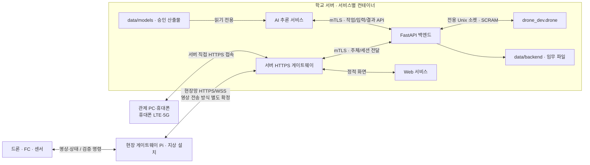

# 자율 정찰 드론 백엔드 설계명세서

- 문서 버전: v1.0
- 작성일: 2026-10-05 (KST)
- 상태: **SIM 업무 백엔드 구현·개발 서버 배포 — 실제 기체/모델/공개 접속 통합 전**
- 문서 위치: `D:\Capstone1\Backend\BE_docs`
- 대상 환경: 학교 Ubuntu 24.04 서버, `/home/se/sandboxes/drone-services-20261005`
- 핵심 구조: **드론 ↔ 현장 게이트웨이(Pi) ↔ 학교 서버 ↔ 관제 시스템(PC·휴대폰)**

이 문서는 백엔드의 목표 책임·API·데이터 계약·트랜잭션·인증·시험을 정의한다. 1~16절은 최초 설계 기준이며 전체 목표가 구현된 것은 아니다. 2026-10-05 구현 범위는 17절과 구축 결과를 따르고, 실제 요청 경로·필드는 OpenAPI를 기준으로 한다. 학습 폴더와 프론트엔드 코드는 변경하지 않았다.

## 1. 기준 자료와 현재 상태

### 1.1 기준 및 우선순위

| 자료 | 적용 범위 |
|---|---|
| [전체 시스템 구조 v1.1](../../Sever/docs/service_architecture_zero_trust_v1.1.md) | 서비스 배치, 현장/서버 게이트웨이 구분, 모바일 연결, 격리 경계 |
| [서버 인수인계서 v1.1](../../Sever/docs/drone_server_handover_v1.1.md) | 영상 우선, Pi 책임, RC 인수, 장애·재개·복구 정책 |
| [DB 설계 v1.1](../../Sever/docs/drone_database_design_spec_v1.1.md) | 18개 업무 테이블/298개 필드, 관계·개정·분석·명령·사건 계약 |
| [DB 구축 결과](../../Sever/docs/drone_database_deployment_20261005.md), [DB 수정 결과](../../Sever/docs/drone_database_fixes_20261005.md) | 실제 DB 대상·권한·migration 004·불변 기록·검증 범위 |
| [서비스 파일 구조](../../Sever/docs/server_file_structure_services_v1.0.md) | 기존 코드·저장소·소켓 위치 |
| [현재 backend 코드](../../Sever/drone-services/app/backend.py), [서비스 README](../../Sever/drone-services/README.md) | 현행 인증·SIM API·실행 제약 |

원본 설계명세서 v2.1은 위 DB 설계서·인수인계서의 추적 내용을 통해 반영한다. 이번 작성에서 원본 HWPX를 다시 검토한 것으로 표시하지 않는다. 문서의 오래된 경로·미배포 설명과 후속 배포 기록이 충돌하면 실제 위치·권한은 DB 구축/수정 결과 및 migration을 우선한다. 업무 안전 정책은 인수인계서를 따르고 미확정 값은 임의로 채우지 않는다.

### 1.2 최초 문서 작성 시 구현 경계 (후속 구현은 17절)

| 항목 | 현재 기록/코드 | 이 설계의 목표 |
|---|---|---|
| DB | `drone_dev.drone`, 업무 18개/298컬럼, 기술 `schema_migration`, 001~004 적용 기록 | 기존 스키마를 사용하는 업무 함수·DAO/API |
| DB 앱 역할 | `drone_api`: 업무 SELECT, 제한된 비분석 사건 함수; 일반 업무 DML 불허 | 검증된 업무별 쓰기 함수의 최소 EXECUTE 권한 |
| 백엔드 | SIM telemetry/heartbeat/result와 상태·probe 조회 | 운영자·임무·미디어·분석·명령·관제 이벤트 |
| 관제 인증 | 별도 개발 계정, HTTPS Basic, 조회 전용 | 운영용 서버 세션 및 객체별 권한 |
| 내부 통신 | `network_mode: none`, 명시적 Unix 소켓, mTLS+서비스 토큰 | 해당 경계 유지, 업무별 인가 추가 |
| 현장 Pi/FC·모바일 WAN | 실제 연동·공개 접속 미구현 | 별도 계약/외부 접속 승인 후 통합 |
| 모델·비행 | `model_loaded=false`, `flight_enabled=false` | 산출물·추론·안전 시험 후 별도 활성화 |

위 상태는 로컬 파일과 배포 기록을 확인한 결과다. 이 문서 작성 중 서버에 새로 접속해 실행 상태를 점검하지 않았다. DB 구조가 존재해도 업무 데이터 처리나 안전한 비행이 완성된 것은 아니다.

## 2. 전체 구조와 백엔드 책임



현장 게이트웨이는 드론 중계·기록·명령 검증 장비다. 서버 HTTPS 게이트웨이는 TLS·Web/API 접속을 처리하는 서버 서비스다. 관제 조회는 현장 Pi를 거치지 않으며, 명령은 관제 → 서버 → Pi → 드론 순서로 전달한다. 명령 수신·실행 확인은 반대 방향으로 반환한다.

| 주체 | 책임 | 책임 밖 |
|---|---|---|
| 백엔드 | 인증 후 인가, 임무/설정/제어권, DB 트랜잭션, 미디어 메타데이터·파일 확정, 분석 작업·결과, 사건 재생·관제 조회 | 자세 안정화, FC 직접 조종, 모델 학습, 브라우저 영상 디코딩 |
| Pi | 영상·MAVLink 중계, 현장 보호 원본·명령 저널, 생산 세대·실행 lease·TTL·RC 검증, FC 상태 확인 | 서버 AI 추론, 중앙 DB 접근 |
| AI | 승인 모델 로드·추론, 배정 입력 검증, 결과·heartbeat 제출 | DB 직접 쓰기, 기체 명령 생성/송신, 임무 저장소 전체 읽기 |
| 관제 | 로그인·상태/영상/탐지 확인, 임무/제어 요청, 재개 승인 | DB/AI 직접 접근, 장치·서비스 비밀 보유 |
| 서버 HTTPS 게이트웨이 | HTTPS 진입점, 요청 제한, 인증 정보의 안전한 전달, 허용 경로 중계 | 업무 승인 판단, DB 접속, Pi 실행권의 대체 |

백엔드는 단일 FastAPI 애플리케이션의 업무 모듈로 시작한다. 서비스별 컨테이너 격리와 백엔드 내부 모듈 구분을 혼동하지 않는다. Redis/Kafka/Celery나 추가 마이크로서비스는 이 설계의 필수 구성요소가 아니다.

## 3. 기술·실행·저장소 기준

| 항목 | 기준 |
|---|---|
| OS·런타임 | Ubuntu 24.04, 기존 Python/FastAPI/Pydantic/psycopg 조합 재사용; 정확한 패키지 버전은 구현 때 현재 이미지와 확인해 잠금 |
| 서버 실행 | 초기 ASGI worker 1개, DB에 영속 작업/사건을 보관하는 복구 가능한 poller. 메모리 큐는 유실 가능한 알림 보조 수단 |
| DB | PostgreSQL 16 / PostGIS 3.5, `drone_dev.drone`; 기존 배포 SQL 수정 금지 |
| DB 연결 | backend만 `/run/db-socket`; SCRAM, 제한된 연결 풀·timeout; 소유자·migrator 비밀 미마운트 |
| 내부 HTTP | Unix 소켓 위 TLS, CA·서버 이름·client 인증서·서비스 토큰 결합 검증 |
| 코드·권한 | 비root UID, 코드/루트 읽기 전용, capability drop, no-new-privileges, CPU/RAM/PID/로그 제한 유지 |
| 업무 파일 | `data/backend/missions/<mission_id>/...` 제안; DB에는 backend 저장소 기준 상대 경로/크기/해시/관계만 저장 |
| 모델 | `data/models`에 검증된 산출물만 배치, AI 읽기 전용; backend 임무 파일과 분리 |
| 개발 접속 | SSH 터널의 `https://localhost:18443`; 휴대폰 직접 접속은 후속 외부 HTTPS 구성 |

학습 환경·기존 DB·Jupyter·Conda 경로를 업무 컨테이너에 연결하지 않는다. CPU/RAM/디스크/GPU·호스트 커널은 공유 자원이다. 새 모델의 GPU 사용은 학습 부하와 별도 검증 후 결정한다.

`D:\Capstone1\Backend`는 백엔드 개발 프로젝트 위치다. 현재 서버 코드 원본은 `D:\Capstone1\Sever\drone-services`에 있다. 문서 작성만으로 코드 이동·이중 배포를 만들지 않는다. 구현 시작 시 프로젝트/배포 원본을 하나로 정하고 현재 SIM 인증·검증 코드를 검토해 재사용한다.

## 4. 업무 모듈과 DB 매핑

요청 흐름은 **router → 인증/인가 dependency → service → DAO/DB 업무 함수**다. router는 HTTP DTO 검증·응답 변환을 담당하고 service는 업무 승인·트랜잭션 경계를 관리한다. DAO는 전달받은 동일 연결을 사용하며 개별 commit을 하지 않는다.

| 모듈 | 주요 책임 | 업무 테이블 |
|---|---|---|
| auth | 운영자 로그인·세션·폐기·권한 조회 | `user_account`, `user_session` |
| devices | 등록 기체 조회, Pi 연결/생산 세대, 상태 수신, 제어권 | `drone`, `telemetry_sample` |
| configs | MODEL/COORDINATE/POLICY 등 설정 검증·승인 | `config_version` |
| missions | 임무·초안/승인본, 시작/재개 승인, 탐색 계획·구역 | `mission`, `mission_revision`, `search_plan`, `search_region` |
| reobservation | 후보 재관측 요청·순서·계획 연결 | `reobservation_request` |
| media | 원프레임·파일/묶음, 해시·저장 확인·권한 있는 다운로드 | `video_frame`, `media_asset` |
| analysis | 논리 작업·시도, 완료/실패, 현재 성공 결과 선택 | `mission_event`, `video_frame`, `detection_observation` |
| observations | 후보 연결·운영자 판단·좌표·실제 관측지도 | `person_candidate`, `detection_observation`, `observation_cell` |
| commands | 불변 명령 봉투, 승인·송신·결과/증거, RC/lease 처리 | `flight_command`, `drone`, `mission` |
| events/alerts | 불변 사건, snapshot/replay, 알림 확인 | `mission_event`, `alert` |

18개 테이블의 일반 CRUD를 외부에 그대로 노출하지 않는다. 예를 들어 승인·분석 완료·명령 결과는 업무 동작으로 처리하며 임의 `state` 변경 API는 제공하지 않는다. `schema_migration`은 관리용이며 업무 DTO에서 제외한다.

### 4.1 DB 쓰기 권한을 먼저 연결

현재 앱 역할은 일반 업무 쓰기를 할 수 없다. API 코드만 추가해 INSERT/UPDATE를 실행하면 권한 오류가 발생한다. 기존 001~004를 보존한 **다음 미사용 migration 번호**에서 다음을 구현한다. 현재 파일 목록상 다음 후보는 005이며 배포 직전 이력을 재확인한다.

| 업무 함수군(이름은 제안) | 같은 트랜잭션에서 처리할 내용 |
|---|---|
| session issue/revoke | 계정 상태·세션 생성/폐기·제어권 회수 근거 |
| telemetry ingest | 기체/생산 세대·표본 ID/hash 검증·원시 수신 |
| mission edit/approve | expected revision, 승인본 불변, 실행본/분모 고정, 사건 |
| control/command | 제어권 revision, 승인/세대/순번, 불변 봉투, 조건부 결과·사건 |
| media reserve/finalize | 동일 ID/hash, 검증된 파일 메타데이터, STORED·bundle 사건 |
| analysis admit/claim/finish | 작업/시도 원장, 관측·완료 건수, 선택 결과·후보/셀·사건 |
| judgement/alert acknowledge | 운영자 판단/알림 확인과 변경 사건 |

함수는 고정 `search_path`, 최소 소유자 권한, PUBLIC EXECUTE 회수, 매개변수 타입/관계/상태 검사로 제한한다. 앱에는 필요한 EXECUTE만 추가하며 DDL·TRUNCATE·일반 event INSERT·기존 이력 UPDATE 권한을 열지 않는다. 범용 SQL 실행·테이블명/필드명 조합 쓰기 함수도 만들지 않는다.

HTTP의 최종 사용자 인증·객체 인가는 backend가 수행한다. DB는 backend 서비스 주체를 신뢰 경계로 갖되 함수에서 전달된 actor/session의 실제 활성 상태·기체/임무 관계·현재 승인 문맥을 재확인한다. 사용자 JSON이나 임의 `SET app.user_id` 값만 신뢰하지 않는다. 서비스 계정이 침해됐을 때 DB가 사용자 신원을 독립적으로 입증하는 구성이라고 주장하지 않는다.

## 5. 인증·인가와 Zero Trust

### 5.1 신원은 세 종류로 분리

| 신원 | 제안 인증 | 인가 조건 |
|---|---|---|
| 운영자 | 서버 생성 불투명 세션, DB token_digest 저장 | 활성 계정·미폐기/미만료 세션·permissions·대상 기체/임무·제어권 |
| 현장 Pi | 장치별 인증서/토큰, 등록된 Pi↔기체 매핑 | 해당 기체·허용 생산 세대/임무·endpoint scope |
| AI/서버 서비스 | 서비스별 mTLS+토큰, 실제 TLS 지문 결합 | 배정 worker/run/attempt·입력 asset·scope |

운영용 세션은 현재 개발 Basic과 별도 구현이다. 서버 생성 난수 토큰의 원문은 쿠키에만 전달하고 DB에는 digest를 저장한다. 로그인/권한 변경 시 세션을 교체하며 로그아웃·계정 비활성화·권한 회수 시 기존 세션과 제어권을 차단한다. 로그인 실패 제한은 정상 자격증명을 가진 운영자를 전역 잠금 상태로 만들지 않게 설계한다.

관제 Web과 API는 같은 origin으로 제공하는 것을 초기 기준으로 한다. 쿠키는 `Secure`, `HttpOnly`, 명시적 `SameSite`, 제한된 Path/Domain을 설정하고 상태 변경에 CSRF token 및 Origin 검사를 적용한다. 세션 ID·서비스 토큰을 URL query나 Web 저장소에 넣지 않는다. [OWASP 세션 관리](https://cheatsheetseries.owasp.org/cheatsheets/Session_Management_Cheat_Sheet.html)

서버 HTTPS 게이트웨이는 외부의 신원 주장 헤더를 삭제/덮어쓴다. 관제용 내부 연결에서 backend는 허용된 gateway 인증서/서비스 토큰을 확인한 뒤 실제 운영자 세션을 별도로 조회한다. gateway workload 신원만으로 모든 사용자에게 제어 권한을 주지 않는다. 장치 진입점이 TLS를 종단한다면 검증한 외부 장치 신원을 인증된 내부 연결에 결합하는 계약이 먼저 필요하다. 현재 gateway가 실제 장치 인증·업무 프록시를 지원한다고 간주하지 않는다.

### 5.2 역할·대상·제어권

| 제안 권한군 | 허용 예 | 별도 조건 |
|---|---|---|
| 조회 | 배정 기체/임무 상태·사건·영상·후보 조회 | 모든 목록·파일·snapshot·replay에도 같은 대상 인가 |
| 운영 요청 | 임무 편집·재관측·후보 판단·알림 확인 | 활성 세션, 변경 대상·expected revision/row version |
| 제어 요청 | 제어권 확보, 시작/재개/복귀/착륙 요청 | 제어권·grant·Pi lease·세대·현장 상태·입력 신선도 |
| 관리 | 계정/기체 등록·키 폐기·모델 승인 | 일반 관제와 분리, 관리 경로 외부 기본 차단 |

권한 이름/permissions JSON은 구현 시 계약에 고정한다. 초기 시연은 인수인계서의 사전 생성 계정·동시 운영자 1명 기준이며 역할 확인·제어권 검사를 생략하지 않는다. 18개 테이블에는 조직/공유 ACL 테이블이 없으므로 초기 대상은 승인된 기체 allowlist와 임무 관계로 제한한다. 임의 사용자 간 소유권 이관·공유는 제공하지 않으며 다중 조직 요구가 생기면 별도 설계한다.

WS도 접속·구독·메시지·재접속마다 권한을 확인한다. 세션/장치 폐기는 다음 권한 검사에서 거부하고 제어 명령은 매번 검사한다. 장기 읽기 구독은 주기 재검사·회수 알림으로 닫으며 허용 회수 지연은 운영 설정으로 확정/시험한다. origin 검증과 허용 메시지 종류·크기·빈도·구독 수 제한을 적용한다. DB/AI/파일에는 브라우저가 직접 접근하지 않는다.

## 6. 공통 데이터 계약

### 6.1 API 공통 규칙

| 항목 | 계약 |
|---|---|
| prefix | 목표 공개 관제 `/api/v1`, 장치 `/device/v1`, 내부 AI `/internal/v1`; 실제 노출은 gateway allowlist로 제한 |
| 현행 SIM | `/v1/status`, `/v1/probes`, `/v1/device/telemetry`, `/v1/vision/heartbeat`, `/v1/vision/sim-results`는 현행 별도 계약 유지 |
| 충돌 방지 | 현행 `/api/v1/status`, `/api/v1/probes`를 업무 DTO로 덮어쓰지 않음; DEV/SIM endpoint는 운영 진입점에서 제외 |
| 필드 | 새 공유 DTO는 snake_case 기준안; 기존 DTO가 camelCase이면 alias를 명시. 자동 추측 변환 금지 |
| ID | UUID 표준 소문자 문자열, 자연키는 검증된 문자열; 생성 주체·유일 범위 명시 |
| bigint | sequence/epoch/event cursor/row version은 십진 문자열로 JSON 전달; int64 범위·음수 금지 검사 |
| 시간 | RFC3339 UTC 또는 명시적 timezone 입력, UTC 저장. 원시 시각·received_at·uncertainty를 분리 |
| 수치·좌표 | NaN/Infinity 금지, 위치 lon/lat·고도 기준·단위·ENU/NED 명시. 검증 실패를 0 좌표로 대체하지 않음 |
| body | 명시적 DTO, 미정의 필드 거부, 중첩 JSON/목록/bytes 상한 검사. 현재 개발 64KiB 제한을 대용량 파일에 그대로 적용하지 않음 |
| provenance | SIM/REAL/SAMPLE·장치 생산 세션·원촬영 세대 구분; 미등록 REAL 입력·평가 정답의 운용 혼입 거부 |
| 목록 | 대상 인가 후 커서 페이지네이션, limit 상한. 임의 order/column/SQL 필터 미허용 |
| 오류 | 안전한 code/message/request_id/details; SQL·경로·토큰·다른 임무 존재 여부 미노출 |

업무 응답은 리소스별 명시적 schema를 사용한다. 기존 개발 응답을 전부 새 공통 wrapper로 감싸지 않는다. 성공 상태에는 HTTP 200/201/202/204의 의미를 구분하며 **202는 접수/대기이지 실행 완료가 아니다**.

### 6.2 멱등성·충돌·오류

클라이언트는 재시도 전에 `request_id`/`command_id`/`analysis_run_id`/`asset_id` 등 작업 ID를 보존한다. 같은 작업 ID+같은 정규화 의미는 기존 진행/확정 응답을 반환한다. 같은 ID+다른 의미는 409이며 새 ID를 자동 발급해 다시 실행하지 않는다. command와 분석의 DB 해시 계약은 각 업무 절을 따른다.

로그인처럼 새 자격증명 발급이 필요한 동작은 범용 자동 재시도에서 제외한다. 다른 변경 API는 대상 revision·불변 ID·사건 correlation을 정의한 뒤 재시도를 허용한다. 범용 Idempotency-Key 저장 테이블은 이 문서에서 추가하지 않는다.

| HTTP | code 예 | 처리 |
|---|---|---|
| 401 | UNAUTHENTICATED / SESSION_EXPIRED | 재인증; 제어 요청 자동 재실행 금지 |
| 403/404 | FORBIDDEN / RESOURCE_NOT_FOUND | 인가되지 않은 객체는 공개 정책에 따라 404로 존재 숨김 |
| 409 | ID_CONFLICT / REVISION_CONFLICT / CONTROL_CONFLICT | 원래 작업 조회 또는 최신 상태 재확인 |
| 410 | CURSOR_EXPIRED | 권한 있는 새 snapshot부터 동기화 |
| 413/422 | BODY_TOO_LARGE / INVALID_CONTRACT | 입력·버전·좌표·시간 수정 |
| 429 | RATE_LIMITED | Retry-After 기준, 동일 작업 ID 유지 |
| 503 | DATABASE_UNAVAILABLE / NOT_READY / STORAGE_UNAVAILABLE | 저장 완료·비행 완료 응답 금지; 필요한 현장 보호는 Pi/FC가 수행 |

```json
{
  "error": {
    "code": "REVISION_CONFLICT",
    "message": "현재 개정과 요청 개정이 다릅니다.",
    "request_id": "f57e1ae3-c5b9-428a-bf5d-6dbd4ea2af80",
    "details": {"expected_revision": 2, "current_revision": 3}
  }
}
```

details는 이미 인가한 리소스의 안전한 값만 반환한다. 오류·성공·WS schema를 OpenAPI와 공유 계약에 고정하고 기존 SIM 계약의 변경 여부를 명시한다.

## 7. 목표 API 목록

아래는 **미구현 업무 API 제안**이다. base path와 상태값을 구현 때 고정하고 OpenAPI·DTO·계약시험을 함께 작성한다. 내부 AI 경로를 gateway의 일반 관제 경로로 공개하지 않는다.

### 7.1 관제 REST — `/api/v1`

| method/path | 주체 | 처리 |
|---|---|---|
| POST /auth/login | 로그인 요청자 | 계정 검증·세션 발급 |
| POST /auth/logout, GET /auth/me | 운영자 | 세션 폐기 / 자신의 권한·대상 조회 |
| GET /drones, GET /drones/{drone_id} | 조회 | 마지막 상태·신선도·단절·제어권 요약 |
| POST /drones/{drone_id}/control/acquire | 제어 | expected_control_revision 기반 제어권 확보 |
| POST /drones/{drone_id}/control/release | 보유자 | 동일 세션의 제어권 해제·관련 승인 검사 |
| POST /missions, GET /missions, GET /missions/{mission_id} | 운영 요청/조회 | 임무 생성·목록·상세 |
| POST /missions/{mission_id}/revisions | 운영 요청 | expected_draft_revision 기반 새 편집 개정 |
| POST /missions/{mission_id}/approve | 제어 | 실행 개정/분모·설정 고정, 승인 사건 |
| POST /missions/{mission_id}/start, POST /missions/{mission_id}/resume | 제어 | 현재 실제 상태·안전 gate 확인 후 실행 요청; 완료 아님 |
| GET /missions/{mission_id}/snapshot | 조회 | 한 DB 시점의 관제 상태+event cursor |
| GET /missions/{mission_id}/events | 조회 | after_cursor 이후 커밋 사건, limit/next_cursor |
| GET /missions/{mission_id}/candidates, GET /missions/{mission_id}/observation-cells | 조회 | 후보·판단·관측 지도, 품질/오래됨 표시 |
| POST /candidates/{candidate_id}/judgements | 운영 요청 | expected_row_version, 명시적 판단·근거 사건 |
| POST /candidates/{candidate_id}/reobservations | 운영 요청 | 동일 후보 임무의 재관측 요청 |
| POST /drones/{drone_id}/commands | 제어 | 허용 action의 불변 봉투 접수·발행 |
| GET /commands/{command_id} | 조회 | 접수·수락·수행·미확인 구분 |
| GET /media-assets/{asset_id}/content | 조회 | 인가된 확정 파일; 범위 요청·실제 무결성/형식 정책 적용 |
| GET /missions/{mission_id}/alerts, POST /alerts/{alert_id}/acknowledge | 조회/운영 요청 | 알림 조회·확인; 장애 해결과 구분 |

모델/설정 승인은 배포 관리자 전용 절차로 시작한다. 일반 관제 사용자에게 임의 모델 업로드·승인 API를 제공하지 않는다. 계획·구역은 임무 편집/계획 서비스 계약을 통해 처리하고 테이블 CRUD를 우회로 만들지 않는다.

### 7.2 현장 게이트웨이 — `/device/v1`

| method/path | 처리·검증 |
|---|---|
| POST /sessions | 인증 Pi의 접속 세대·생산 세션·기체/RC 실상태 등록·기존 문맥 무효화 판단 |
| POST /telemetry | 등록 기체/생산 세대, 원시 시각·순번·표본 멱등 저장 |
| POST /media-bundles, GET /media-bundles/{bundle_id} | manifest 예약·업로드 필요 목록 / 실제 persistence 상태 |
| PUT /media-assets/{asset_id}/content | 승인 ID의 파일 스트리밍, 실제 크기·hash 검증; JSON base64 미사용 |
| POST /media-bundles/{bundle_id}/finalize | 필수 파일·sidecar·프레임/시각 관계 검사 후 PERSISTED 확인 |
| GET /commands | 현재 기체·접속/제어 세대·lease·TTL에 맞는 송신 대상 조회 |
| POST /commands/{command_id}/reports | 동일 봉투 해시·status_revision·실제 FC/RC 근거 반영 |
| POST /safety-reports | RC 인수·링크/영상 장애·보호 동작·실제 상태 보고 |

Pi가 외부에서 도달 가능한 HTTP 서버를 열 필요는 없다. Pi가 서버 HTTPS/WSS 연결을 시작한다. 명령 알림을 받아도 DB 기반 현재 명령을 조회·검증한 뒤 실행하며 연결 복구 시 과거 명령 큐를 그대로 실행하지 않는다.

### 7.3 AI 내부 API — `/internal/v1`

| method/path | 처리·검증 |
|---|---|
| POST /workers/heartbeat | 인증 worker, 모델/config/hash·준비/품질 상태 보고 |
| POST /analysis-runs/claim | 승인 입력·모델의 작업 배정; worker/claim/attempt/만료를 원장으로 기록 |
| GET /analysis-runs/{run_id} | 해당 배정 worker의 불변 작업 계약 |
| GET /analysis-runs/{run_id}/input | 배정된 확정 asset만 API로 스트리밍, hash 검증 |
| POST /analysis-runs/{run_id}/attempt-failures | 재시도 가능한 계산 실패·attempt 근거 |
| POST /analysis-runs/{run_id}/completion | 고정 result_hash·관측/0건·좌표/품질·업무 원자 반영 |
| POST /analysis-runs/{run_id}/final-failure | 정책상 최종 실패, 완료와 배타 |

재분석 접수는 인가된 서비스/관리 동작에서 수행한다. worker가 임의 새 analysis_revision·모델 버전·다른 입력을 지정해 결과를 제출할 수 없다. worker claim 만료는 Pi 실행 lease와 별개다.

### 7.4 WebSocket

| 경로 | 초기 허용 메시지 | 기준 |
|---|---|---|
| /api/v1/ws | subscribe, resume_cursor, ping / 사건·sync_required | 관제 session+Origin+대상 인가; 상태 변경 명령은 REST로 통일 |
| /device/v1/ws | 장치 세션 확인·ping / command_available | 장치 신원/기체/세대; 실명령·결과는 동일 durable API 계약 |

WSS 메시지에 실제 영상 bytes를 섞지 않는다. 영상 전송/재생 프로파일은 10절을 따른다. WebSocket 연결/끊김 처리 자체와 업무 재생은 별개 구현이며 메모리 연결 목록을 영속 사건 저장소로 쓰지 않는다. [FastAPI WebSocket](https://fastapi.tiangolo.com/advanced/websockets/)

## 8. 트랜잭션·동시성·사건 동기화

### 8.1 공통 쓰기 규칙

1. 인증·구조 검증·가능한 파일/해시 검사를 잠금 밖에서 수행한다.
2. 사건을 포함하는 업무 트랜잭션은 기존 공통 `pg_advisory_xact_lock(20261005, 1)`을 **행 잠금보다 먼저** 취득한다.
3. 복수 대상을 잠글 때 기본 순서는 drone → mission → frame → candidate ID 정렬 → cell 복합키 정렬이다. 함수군의 실제 참조 순서를 대조해 모든 호출 경로에 동일하게 적용한다.
4. 현재 session/revision/grant/세대·상태를 잠금 안에서 재검증하고 업무 변경·불변 사건을 같은 연결/트랜잭션으로 기록한다.
5. 즉시 commit한 뒤 네트워크 응답·명령 송신·WS 알림을 수행한다. 파일 수신·AI 추론·외부 송신 중 DB 잠금을 보유하지 않는다.

migration 004에서 독립 계정/세션/원시 표본 등의 불필요한 잠금이 제거됐다. 이 쓰기에도 사건을 묶는 호출자는 반드시 공통 잠금을 먼저 얻는다. DB 트리거가 모든 애플리케이션 호출 순서를 대신하지 않는다.

교착 `40P01`, 직렬화 실패 `40001`, lock timeout은 rollback 후 최신 상태를 다시 읽는다. 미커밋·외부 부작용 없는 멱등 업무 트랜잭션만 설정된 횟수/시간 내 재시도한다. 이미 commit된 명령은 새 봉투를 만들지 않고 저장된 command_id를 조회/전송한다. 소유권·revision 충돌을 무조건 자동 재시도하지 않는다. [PostgreSQL 트랜잭션 격리](https://www.postgresql.org/docs/16/transaction-iso.html)

<!-- ponytail: 단일 기체 사건 커밋은 공통 잠금으로 직렬화; 실제 병목 측정 후 임무별 커서 계약과 함께 개정 -->

### 8.2 snapshot/replay

- snapshot은 REPEATABLE READ 읽기 트랜잭션에서 허용된 상태와 최대 커밋 event cursor를 함께 얻는다. 새 사건은 해당 cursor보다 큰 범위에서 가져온다.
- event cursor는 기존 DB의 공통 잠금 아래 발급/commit 순서를 따른다. 단순 sequence 번호를 커밋 순서라고 가정하지 않는다.
- replay는 `publish_state`와 무관하게 커밋된 사건을 대상으로 한다. 불변 event_id로 중복을 제거하며 global cursor의 빈 번호는 정상이다.
- 인가/임무 필터 적용 후 사건과 next_cursor를 반환한다. next_cursor는 고정 조회 상한 안에서 실제로 검사한 마지막 위치다. 미반환 허용 사건을 건너뛰도록 최댓값으로 무조건 점프하지 않는다. 반환 0건에서도 인가된 범위의 진행 규칙을 일관되게 사용한다.
- 사건/임무 권한은 요청마다 확인하고 사용자에게 다른 임무 payload·생산자 정보를 노출하지 않는다. cursor는 권한 증명이 아니다.
- 보존 범위를 벗어난 cursor는 410/SYNC_REQUIRED로 새 snapshot을 요구한다. WS 연결 복구·권한 변경에서도 구독 범위를 다시 확인한다.

### 8.3 배포와 프로세스 복구

`mission_event`를 초기 durable outbox로 사용한다. poller는 커밋된 PENDING을 읽고 전달 후 기존 배포 함수로 상태를 갱신한다. 재전송은 at-least-once이며 `published_at`은 모든 관제 단말의 수신 완료가 아니다. 단말별 미수신은 cursor replay로 복구한다.

프로세스 시작 시 미확정 업로드·종료 없는 분석·송신/응답 미확인 명령을 조회해 복구한다. 분석/파일은 동일 불변 작업을 복구할 수 있지만, 비행 명령은 실제 Pi 세대·TTL·grant·RC 상태를 다시 확인하기 전 재송신하지 않는다. 서비스 재시작/DB 복원/웹 재접속을 임무 시작·재개 승인으로 취급하지 않는다.

## 9. 임무·제어·명령 계약

### 9.1 서로 다른 세 권한

웹 session/기체 제어권, mission 실행 grant, Pi 실제 실행 lease는 구분한다. `drone.gateway_state`의 lease/RC 값은 서버가 받은 관측 사본이다. Pi는 현장에서 현재 lease·세대·TTL·중복·RC를 직접 확인해야 한다. 서버가 표시한 유효 상태가 현장 실행을 강제하지 않는다.

임무 초안은 expected_draft_revision으로 편집하고 승인된 mission_revision은 불변이다. 실행 시작/재개에는 현재 모델·설정·신선한 영상/비행정보·기체/RC·제어권·승인 실행본을 확인한다. mission·plan·region의 개정/격자가 같아야 한다. 승인 기록과 실제 이륙/수행 증거는 별도로 저장한다.

### 9.2 명령 발행·재시도

관제 요청은 `command_id`, 대상/action, expected 제어/임무 개정과 목표를 보낸다. 인증된 requester, issued/expires, sequence, 현재 control_epoch/lease/정책은 서버가 검증·고정한다. 아래는 발행 봉투의 핵심 필드 발췌 예다. policy_version·coordinate_config_id·requester·완료 정책 등 나머지 필수 값도 DB/공유 계약에 따라 포함하며 실제 운용 숫자·enum은 구현 때 확정한다.

```json
{
  "schema_version": "1.3",
  "command_id": "3b20ed29-6b4a-4a9e-9974-d7026162e03e",
  "drone_id": "demo-drone-01",
  "mission_id": "5f1f75df-36ce-40fd-becb-7b96fb52f05d",
  "mission_revision": 2,
  "control_epoch": "7",
  "sequence": "18",
  "action": "HOLD",
  "request_hash": "<서버에서 계산한 SHA-256 소문자 64자리>",
  "issued_at": "<서버 UTC>",
  "expires_at": "<POLICY로 산출한 UTC>",
  "payload": {"gateway_session_id": "<현재 접속 세션>", "lease_id": "<현재 Pi lease>"}
}
```

예시의 `<...>`는 설명용 placeholder이며 실행 가능한 DTO가 아니다. request_hash는 전체 불변 봉투 의미의 canonical SHA-256이고 해시 자체는 해시 입력에서 제외한다. 동일 command_id의 API 재전송은 원래 클라이언트 의미와 비교한 뒤 기존 봉투를 반환한다. 새로운 issued/expires/sequence를 매번 만들어 다른 해시로 비교하지 않는다.

DB commit 후 송신 직전에도 현재 승인·세대·TTL·입력 신선도를 재검증한다. 송신 재시도는 같은 봉투를 사용한다. 같은 ID·같은 hash는 기존 상태, 같은 ID·다른 내용은 409다. 다른 ID의 같은 행동은 정상 반복일 수 있으므로 hash 단독 전역 UNIQUE는 사용하지 않는다.

### 9.3 수신·수행과 안전

| 증거/상태 | 의미 |
|---|---|
| REQUESTED | 서버에 요청 기록; 실제 송신/수신 완료 아님 |
| ACCEPTED / FC_ACK 사건 | 정의된 수락 단계의 근거; 실제 이동/복귀 완료 아님 |
| EXECUTING | 현재 동작 수행 근거 |
| COMPLETED | action별 실제 모드·위치·착륙 등 완료 근거 충족 |
| REJECTED / FAILED | 거부·실패 사유와 원세대/시각 기록 |
| UNCONFIRMED | 수행 기한까지 결과를 확정하지 못함; 성공으로 표시 금지 |

허용 state transition·evidence 요구를 Pi/FC 계약과 함께 고정한다. 오래된 status_revision·gateway session·control_epoch 보고는 이력만 기록하고 현재 상태를 되돌리지 않는다. 봉투 TTL과 execution_deadline은 별개다. DB 멱등 처리만으로 기체 exactly-once 실행을 보장하지 않는다. Pi 명령 저널과 FC/RC 증거 시험이 필요하다.

영상만 단절과 WAN/상태/lease 단절은 다른 정책이다. 영상만 끊기면 자동 이동 중단·가능한 HOLD·운영자 판단을 적용하고 배터리/항법/경계 등 기체 보호가 우선한다. RC 인수·Pi 재접속은 이전 세대를 무효화하고 실제 상태 확인·새 승인 없이는 원격 이동을 재개하지 않는다. 영상 2초·필수 경로 3초는 감지 목표이며 명령 TTL/lease/FC 보호 타이머의 확정값이 아니다.

## 10. 미디어·파일·영상 계약

### 10.1 저장 완료 프로토콜

1. Pi는 bundle/asset ID, manifest_hash, 필수 영상·sidecar·시간/프레임 관계, 각 파일 크기/hash를 고정해 예약한다. 동일 ID/내용은 기존 진행 상태를 받는다.
2. backend는 대상 기체/임무·상대 경로·개수/크기/할당량·파일 역할을 검증하고 WRITING을 기록한다.
3. 파일은 임시 위치로 스트리밍하며 실제 bytes/hash를 검사한다. 서버 생성 경로만 사용하고 절대 경로·`..`·심볼릭 링크 이탈·기존 확정 파일 덮어쓰기를 차단한다.
4. 각 파일 fsync → 같은 파일시스템 최종 rename → 상위 디렉터리 fsync 후 짧은 DB 트랜잭션에서 STORED, bundle `meta.persistence_status=PERSISTED`, BUNDLE_PERSISTED 사건을 확정한다.
5. **commit 성공 뒤에만** bundle ID+manifest_hash+필수 파일 hashes의 저장 확인을 반환한다. Pi는 이 확인 전 보호 원본을 삭제하지 않는다.

파일 state는 기존 `WRITING/STORED/FAILED`를 유지한다. PERSISTED는 묶음 계약이고 분석 완료와 별개다. 저장된 파일·내용 메타데이터는 불변이며 변경 파일은 새 asset ID다. 보존/품질 필드만 기존 migration이 허용한 범위에서 갱신한다.

### 10.2 복구·용량·다운로드

| 상황 | 처리 |
|---|---|
| 부분 수신/해시 불일치/디스크 부족 | 저장 완료 응답 금지, 진행/실패·사유 기록, Pi 보호 원본 유지 |
| rename 후 DB commit 전 종료 | 동일 ID/manifest/hash로 파일 검사·재사용, DB 확정 재시도 |
| commit 후 응답 유실 | 상태 조회로 동일 확정 결과 반환 |
| PERSISTED 후 파일 손상/누락 | 무결성 실패 사건·알림, 다운로드/분석/운용 차단, 사본 복구 후 재검증 |
| 오래된 WRITING/고아 파일 | 원장/manifest/Pi 상태 대조·관리자 검토 후 정리; 시간만으로 자동 삭제 금지 |

파일과 DB는 분산 원자 트랜잭션이 아니다. 저장 confirmation은 같은 서버의 검증된 영속 저장을 뜻하며 외부 백업 완료는 아니다. 업로드 크기·파일 수·잔여 디스크·동시 업로드·임무 quota는 설정 및 경계 시험을 먼저 확정한다. worker 입력과 관제 파일 조회는 대상·asset 상태·할당 권한을 검사하고 호스트 경로를 응답하지 않는다.

### 10.3 영상·원본·표시

Pi→서버 원본 전송(SRT/RTSP/HTTPS 등)과 서버→관제 재생(HLS/파일/크롭 등)은 별도 계약이다. 모바일 화면 영상은 반드시 초저지연일 필요는 없으나 자동 정찰 판단에는 신선한 원본이 필요하다. 현재 MediaMTX sample 경로를 새 업무 임무로 자동 등록하지 않는다.

초기 표시 프로파일은 인수인계서의 `CROP_BASELINE`을 따른다. `CROP_GRACE`는 단말 디코더·호환·성능 시험 후 선택한다. GRACE 복원 크롭은 표시용이며 원본 탐지·좌표·실제 관측도 증거를 대신하지 않는다. 인증된 미디어 어댑터를 도입하면 backend가 발급/검증한 대상 권한·hash·임무 경로를 적용하고 무인증 영상 우회 포트를 열지 않는다.

## 11. AI 작업·결과·관측 계약

### 11.1 모델 준비와 작업 원장

학습 중 checkpoint를 자동 로드하지 않는다. 검증 산출물의 MODEL config/asset, 파일 hash, 추론 런타임·입력 전처리·class mapping·양자화 조건·출력 shape를 등록/승인한다. worker의 `model_loaded=true` 보고만으로 운용 준비를 인정하지 않으며 backend의 승인 기록·산출물 대조·실제 추론 시험을 통과해야 한다.

분석 작업은 기존 `mission_event` 원장을 사용한다. 별도 업무 테이블을 추가하지 않는다. STARTED는 접수이며 실제 계산 시작은 attempt 사건이다. 작업은 frame 행 잠금 아래 서버가 analysis_revision을 발급한다.

| 값 | 의미 |
|---|---|
| frame_id | 한 원관측; 압축/크롭/재분석마다 새 촬영 행을 만들지 않음 |
| analysis_run_id | 논리 작업 UUID; 접수/완료 응답 유실·worker 재시작에도 동일 |
| analysis_revision | 프레임별 서버 발급 개정; 모델/입력 변경·명시 재분석에 새 개정 |
| job_hash | 입력 asset/hash·모델/좌표 config·mode·pipeline·옵션의 정규화 의미 |
| attempt_no / claim | 같은 작업의 계산 재시도 및 배정 worker/만료 근거; 사건 JSON에 기록 |
| result_hash | 고정된 결과·순서·품질·결과 asset hash; 수신 시각·재시도 횟수 제외 |

claim은 짧은 DB 트랜잭션에서 원장을 잠그고 배정/attempt를 고정한다. 입력 조회·완료는 동일 worker/run/claim 문맥을 확인한다. 만료/재배정된 attempt는 결과 반영 권한이 없으며 이미 확정된 같은 결과의 재전송은 기존 응답만 돌려준다. 중복 계산이 생겨도 업무 효과는 최종 사건 유일성으로 1회 확정한다.

### 11.2 결과 DTO 예시 — 탐지 0건

```json
{
  "schema_version": "1.0",
  "analysis_run_id": "33c88241-b6b1-4637-b6aa-35d39af76c08",
  "frame_id": "f0fce334-e702-4553-8a1f-dfbaf9a28087",
  "analysis_revision": 2,
  "attempt_no": 1,
  "claim_id": "c6e7a1d6-df0f-4a23-92f2-5db24627d8d2",
  "job_hash": "<접수 때 고정한 SHA-256>",
  "result_hash": "<고정 결과의 SHA-256>",
  "analysis_mode": "LIVE_DETECT",
  "detection_count": 0,
  "observations": [],
  "quality": {"input_validation": "<승인 계약의 검사 결과>"}
}
```

placeholder는 실제 입력이 아니다. 좌표 있는 observation은 `geo_result.status` VALID/PENDING/INVALID, coordinate_config·pose/time 품질·오차 타원을 포함한다. PENDING/INVALID는 위치 NULL과 사유다. VALID 문자열만으로 실제 정확도가 입증되지 않는다. 모델/좌표/품질 계약은 DB 수정 결과의 최소 검사에 더해 실제 측정 근거를 검증한다.

완료 트랜잭션은 접수/배정·job_hash를 확인하고 observation 삽입 → 건수/좌표/관계 검증 → 완료 사건 → 선택 결과·후보/셀 갱신을 한 번 수행한다. 종료 사건이 먼저 commit된 뒤 관측을 추가하지 않는다. COMPLETED/최종 FAILED는 배타이고 0건도 COMPLETED를 기록한다. 같은 run/result hash는 기존 결과, 다른 결과는 충돌이다. 최종 FAILED 이후 재분석은 새 run ID/revision이다.

### 11.3 현재 요약·후보·지도

- 같은 frame은 검증된 성공 결과 중 가장 높은 analysis_revision을 선택한다. 낮은 개정의 늦은 완료는 이력만 남긴다. 새 작업의 진행/실패가 기존 성공 요약을 지우지 않는다.
- 후보 최신 관측은 원촬영 세대/순서·검증된 시각과 불확실도로 비교한다. 서로 다른 시계 범위의 순서를 확정할 수 없으면 자동 최신 교체를 하지 않는다.
- 후보 위치·최신 관측·품질/오차·config·last_seen은 하나의 선택 증거에서 원자 갱신한다. INVALID/PENDING 최신 증거를 과거 유효 위치로 숨기지 않는다. 운영자 judgement는 AI 갱신으로 덮어쓰지 않는다.
- 셀 적용은 임무/격자/cell/관측 group/evidence_revision의 사건 유일성으로 중복 집계를 막는다. 재분석은 기존 효과에 단순 덧셈하지 않고 선택 원증거를 재생해 합집합·시간·belief를 교체한다.
- HISTORICAL 복구 원본은 사후 정정·분석에 사용할 수 있지만 현재 자동 이동 근거가 아니다. 현재 요약 조회와 자동 제어 판단을 별도 함수로 분리한다.

## 12. 운영·관측·배포와 파일 구조

### 12.1 제안 코드 구조

아래는 구현 시작 때의 최소 구성안이다. 아직 이 디렉터리/코드가 생성됐다는 뜻이 아니다. 모듈은 업무 구현 순서에 따라 추가한다.

```text
D:/Capstone1/Backend/
├── BE_docs/
│   └── drone_backend_design_spec_v1.0.md
├── app/
│   ├── main.py                  # lifespan · router 등록
│   ├── auth.py                  # 서비스/사용자·대상 인가 공통 경계
│   ├── db.py                    # 연결 풀·transaction context
│   ├── contracts.py             # 공통 ID·시각·오류; 업무 DTO는 해당 모듈
│   ├── api/                    # 관제·device·internal·WS router
│   ├── services/               # 구현한 업무 단위만 분리
│   ├── dao/                    # 기존 명세의 18개 DAO; 필요한 순서로 구현
│   └── workers.py              # DB 원장 기반 poller·복구; 메모리 작업만 금지
├── tests/                      # 업무/계약·실제 PostgreSQL 통합시험
├── pyproject.toml              # 검증 버전·의존성 잠금 방식 확정
└── README.md                   # 실행·시험·배포 원본 안내
```

서버 배포 때 기존 Compose backend 서비스·UID·DB 소켓·비밀 마운트를 유지하고 backend 코드 원본을 명확히 연결한다. 업무 SQL은 기존 `Sever/drone-services/db/migrations`의 단일 이력을 사용한다. Backend에 같은 SQL의 별도 migration 이력을 만들지 않는다.

### 12.2 운영 기준

| 구분 | 기록·검사 |
|---|---|
| 건강 상태 | process liveness와 DB/schema/worker/model/media readiness 분리; readiness가 비행 승인 아님 |
| 로그·감사 | request/correlation/event/run/command ID, actor·대상·결과·지연; 비밀번호·쿠키·토큰·개인키·원본 bytes 제외 |
| 측정 | endpoint 지연/오류, DB lock/풀 대기, PENDING 사건·분석 대기/최대 나이, worker heartbeat, 영상/상태 신선도, 디스크/업로드 실패 |
| 설정 | 환경·계약/POLICY 버전, 상한·시간값 명시; 필수 운용값 미설정 시 해당 기능 NOT_READY |
| 인증서·키 | 서비스/장치별 발급·만료 경보·교체·개별 폐기 시험; CA 개인키는 일반 컨테이너/PC 미배포 |
| 장애 | DB/디스크 불가 시 저장 성공 금지, 오래된 데이터 표시, 새 자동 이동 승인 차단. 현장 보호는 서버 복구에 의존하지 않음 |
| 백업 | DB dump뿐 아니라 파일·manifest·설정/역할의 복구도 검증; 다른 임시 대상 복원 후 실제 hashes 대조 |

배포는 테스트 DB의 후속 migration/권한 시험 → 적용 전 백업 → 새 migration → backend SIM·업무 회귀 → readiness 확인 순서다. 적용한 migration은 수정하지 않는다. 앱 롤백은 DB 역삭제와 별개이며 이전 코드 호환성을 확인한다. 데이터/볼륨 삭제·기존 학습 환경 재설치는 배포 절차에 포함하지 않는다.

## 13. 구현 순서와 완료 조건

| 단계 | 구현 | 통과 기준 |
|---|---|---|
| BE-P0 | 현행 schema/함수/권한, 공통 DTO·잠금·업무 쓰기 함수 | 다음 migration이 기존 이력/18개 테이블을 보존, 앱 DDL/직접 event 쓰기 거부 |
| BE-P1 | 운영자 세션·대상 조회·기체 상태·snapshot/replay | 미인증/타 대상 차단, 재접속 누락/중복 처리, 개발 Basic과 분리 |
| BE-P2 | Pi SIM 생산 세대·상태·미디어 저장 및 복구 | file/hash/DB/PERSISTED 일치, 응답 유실 재시도, 보호 원본 삭제 gate |
| BE-P3 | 분석 claim·모의 결과·후보/지도 | 최종 1회, 0건/역순 완료/정정/불확실 시각 시험; 실모델 불필요 |
| BE-P4 | 임무·제어권·명령/결과, RC·장애 시뮬레이션 | 이전 세대/TTL/lease/승인 철회 차단, FC_ACK≠완료, 자동 재개 없음 |
| BE-P5 | 검증 모델·실제 Pi/FC·영상·휴대폰 외부 접속 | 학교 승인·실장비/모바일·부하/안전 인수시험과 별도 활성화 기록 |

파일/영상 우선 구현을 유지하면서 인증·상태·저장 계약을 먼저 연결한다. 실모델 학습 완료를 기다리지 않고 BE-P0~P4의 SIM 시험을 진행할 수 있다. 일부 단계 통과를 전체 시스템 완성으로 표시하지 않는다.

## 14. 인수시험

아래는 **실행할 시험 목록이며 이번 문서 작성의 통과 결과가 아니다**. 현재 DB 검증 41개/서비스 검증 26개의 배포 기록은 기준 자료로만 사용한다. 실제 서버·Pi·모바일 부하/안전 시험은 별도 증거를 남긴다.

| ID | 시험 | 합격 조건 |
|---|---|---|
| BE-01 | 서비스 mTLS·토큰 결합 | 토큰만/타 인증서/위조 신원 헤더/타 scope 거부 |
| BE-02 | 세션·CSRF·WS Origin | 만료/폐기 session·타 Origin·CSRF 없는 변경 거부, 로그인 실패로 정상 사용자 전역 잠금 없음 |
| BE-03 | 객체 인가·권한 회수 | 목록/파일/snapshot/replay/WS에 동일 인가, 폐기 후 제어 금지·구독 회수 지연 기준 충족 |
| BE-04 | DB 역할·함수 | 앱 일반 DML/DDL·직접 분석 event 거부, 업무 함수는 actor/관계/상태 검증 |
| BE-05 | 업무 rollback | 중간 실패 시 상태/사건/관측/후보/셀 부분 commit 없음 |
| BE-06 | 잠금·동시성 | 사건 공통 잠금 선취, publisher/쓰기 교착 회귀, 동일 개정 편집 한쪽만 성공 |
| BE-07 | snapshot/cursor | 선행 늦은 commit·rollback·필터/0건 페이지·cursor 만료에도 허용 사건 누락 없음 |
| BE-08 | WS 재접속/중복 | 프로세스 종료·전송 유실 뒤 replay, event_id 중복 제거, PUBLISHED를 전체 수신으로 해석하지 않음 |
| BE-09 | 시간/좌표/정밀도 | timezone 없음·NaN·위경도 오류·bigint overflow·시각 불확실을 검출, JS 정밀도 유지 |
| BE-10 | 생산 세대/SIM 분리 | 같은 표본 재시도 1회 반영, 새 session/epoch 구분, 타 기체/미등록 REAL 거부 |
| BE-11 | 파일 경로/한도 | traversal·symlink 이탈·확정 파일 덮어쓰기·과대 업로드/디스크 부족 차단 |
| BE-12 | 저장 확인/복구 | 수신/rename/commit/응답 각 중단 복구, PERSISTED 전 Pi 삭제 불허 |
| BE-13 | 저장 후 손상·복원 | 실제 파일/manifest/DB 불일치 알림·사용 차단, 임시 복원 hash 대조 |
| BE-14 | 분석 접수·claim | 응답 유실에 동일 run/revision, 타 worker/만료 claim 거부, 재계산 attempt 증가 |
| BE-15 | 분석 최종 멱등·0건 | 동일 hash 완료 재전송 1회, 다른 hash 충돌, 0건 완료/최종 실패 배타 |
| BE-16 | 역순 분석/정정 | 개정2→1 완료에서 현재값2 유지, 새 실패가 성공 지우지 않음, 증거 재생 집계 일치 |
| BE-17 | 후보 시각/품질 | 늦은 원촬영·불확실 순서 자동 최신 교체 금지, INVALID 최신 위치 NULL, judgement 보존 |
| BE-18 | 명령 멱등/승인 | ID/hash·임무/계획/구역 개정·제어권·grant 일치, 중복 송신이 새 봉투 생성하지 않음 |
| BE-19 | Pi/FC 상태 | TTL/lease/RC/epoch 위반 거부, 오래된 status report 현재값 퇴행 금지 |
| BE-20 | 완료/미확인 | FC_ACK만으로 COMPLETED 불가, action별 증거·execution_deadline·UNCONFIRMED 구분 |
| BE-21 | 장애·복구 | 영상만 단절/WAN 단절 정책 분리, 재접속/서버·DB 복구로 자동 재개 없음 |
| BE-22 | HISTORICAL/GRACE | 사후 정정 허용과 현재 자동 이동 차단, 복원 크롭 원본 증거 대체 금지 |
| BE-23 | 모델 준비 | 미승인/해시 다른 모델·추론 실패에서 운용 차단, SIM 성공이 실제 model ready로 승격되지 않음 |
| BE-24 | 격리·모바일·부하 | 기존 학습/DB 마운트 없음, 모바일 서버 직접 접속·로그인·영상/갱신, 계약한 지연/부하/갱신·폐기 기준 통과 |

각 시험에는 입력/환경(SIM/REAL/SAMPLE), 기대 결과, 실행 명령·시각·서버 코드/migration/정책 버전, 실제 결과·로그 경로를 기록한다. FC 관련 시험은 시뮬레이터→지상→승인된 현장 단계로 진행하고 보호/실행 시간값은 측정 근거와 함께 확정한다.

## 15. 구현 전 확정할 값과 담당 경계

| 미확정 항목 | 결정·검증 주체 | 기능 gate |
|---|---|---|
| 학교 공개 주소/HTTPS/WSS·UDP/VPN·DNS·TLS | 학교 관리자 + 서버 담당 | 모바일 WAN/실제 Pi 외부 접속 전 |
| Pi↔FC 인터페이스·영상망·SRT/RTSP/업로드·원시 clock | 하드웨어/통신 담당 + 백엔드 | 실장비 ingest/명령 전 |
| session idle/absolute 만료·권한 회수 지연·로그인 제한 | 백엔드/관제 담당 | 운영 인증 공개 전 |
| heartbeat·freshness·영상/상태 단절 기준 | Pi/FC/백엔드 담당, 시뮬레이션·실측 | 시작/재개·자동 판단 전 |
| 제어권/grant/Pi lease·command TTL·deadline·RC 보호 | Pi/FC/백엔드 담당, 안전 시험 | REAL 비행 명령 전 |
| 업로드/file 수·byte/quota·동시성·보존·디스크 수위 | 서버/백엔드 담당 | 파일 수신 공개 전 |
| worker claim 만료·재계산 한도·batch·성능 | AI/백엔드 담당 | 실제 추론 전 |
| 모델·전처리·좌표/오차·관측 그룹·belief 설정 | AI/좌표/백엔드 담당 | 실제 분석/탐색 판단 전 |
| 브라우저 영상 프로파일·GRACE 디코더 | Web/영상 담당, 실제 휴대폰 시험 | 해당 프로파일 제공 전 |
| 사건 보존·cursor 유효기간·로그 감사 접근·RPO/RTO | 서버/백엔드 담당 | 운영 배포·재해복구 완료 판정 전 |

미정 값은 검증된 POLICY/config에 등록할 때까지 관련 기능을 NOT_READY로 둔다. 공개 접속·모델 로드·비행 활성화는 서로 다른 완료 조건으로 기록한다.

## 16. 문서 검토 기록

- 기존 아키텍처·DB 설계와 최신 DB 구축/수정 기록, 로컬 backend/SQL 권한을 대조했다. 과거 문서의 구 DB 경로와 미배포 설명을 새 `drone_dev.drone` 적용 기록과 구분했다.
- BAZE quick(`gpt-6-luna`)에 자격증명 없이 핵심 계약의 누락 검토를 요청했다. 정상 종료(`finish_reason=stop`, `truncated=false`)했다.
- 조언 중 cursor 경계·객체 인가/폐기·DB 실패 재시도·파일 경로/용량/복구·운영 장애 기준을 기존 DB 계약과 대조해 5·8·10·12·14·15절에 반영했다. 외부 의견을 실행/시험 증거로 사용하지 않는다.
- 공식 참고 자료는 작성 시 확인했다. 프로젝트 설계 선택과 구현 완료 여부는 본 문서/로컬 코드·배포 기록으로 판단한다.

## 17. 2026-10-05 백엔드 구현 반영

학교 서버의 기존 서비스 격리 구조에 SIM 업무 API를 추가했다. 업무 18개 테이블·298개 컬럼을 유지하고 migration 005로 검증된 쓰기/행 잠금 함수를 추가했다. DB의 일반 DML·DDL 권한을 앱 역할에 개방하지 않았다.

사용자 세션·Origin/CSRF·드론별 인가, 임무 개정/승인·제어권, SIM 장치 세션/telemetry·명령 보고, 파일 해시/묶음 확정, 분석 작업/claim/원자적 완료·재분석, 후보 판정/재관측, snapshot/replay/WSS, SIM 수동 공간 등록을 구현했다. 세부 구현·검증과 미완료 기능은 [백엔드 구축 결과](backend_implementation_20261005.md)를 따른다.

실제 기체·카메라·좌표/커버리지/belief·자동 계획·영상 스트리밍·AI 추론 worker·모바일 공개 접속은 구현 완료로 표시하지 않는다. `model_loaded=false`, `flight_enabled=false`를 유지하고 시작/재개는 차단한다. SIM 타이머와 mock 설정은 운영 정책의 검증 근거가 아니다.

관제 연동은 [프론트 API 안내](frontend_api_integration_v1.0.md)와 [구현된 OpenAPI](openapi.json)를 사용한다. 본문 제안 경로·요청 필드와 다를 경우 구현 명세를 우선한다. 프론트 코드는 별도 담당자가 구현한다.
