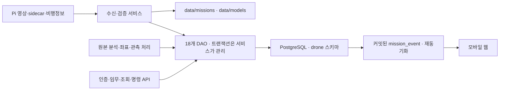
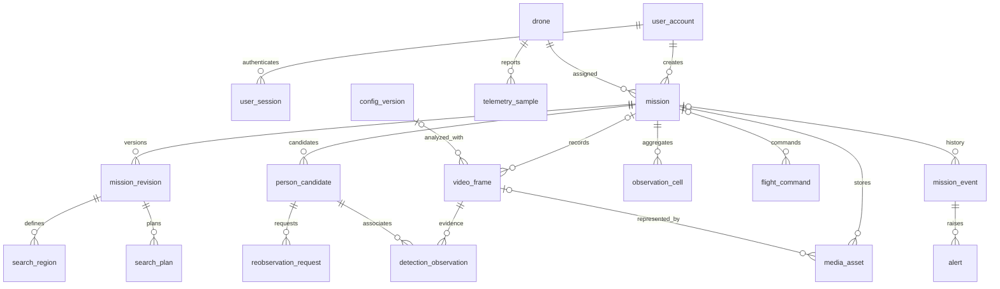

# 자율 정찰 드론 서버 DB 구축 설계명세서

- 문서 버전: v1.1
- 이전 버전: [DB 구축 설계명세서 v1.0](drone_database_design_spec_v1.0.md)
- 작성일: 2026-10-05
- 상태: **설계 기준안 — 2026-10-05 업무 스키마 배포 완료, 업무 API 연동 대기**
- 대상: 기존 Ubuntu 24.04 드론 샌드박스의 PostgreSQL 16 / PostGIS 3.5
- 목적: 설계명세서 v2.1의 중앙 DB 18개 테이블을 실제 서버 구축에 필요한 자료형·키·제약·트랜잭션·검증 절차로 구체화

> 배포 후 갱신: 최신 서비스 아키텍처에 따라 실제 구축 대상은 새 샌드박스의 `drone_dev.drone`이다. 18개 업무 테이블/298개 컬럼과 기술 이력 테이블을 생성했다. 아래 구 샌드박스 기준 경로·역할·통합시험 계획은 설계 당시 기록이며 실제 적용 위치·권한·검증 완료 범위는 [DB 구축 결과](drone_database_deployment_20261005.md)를 따른다. 업무 API·실모델·비행 활성화는 미완료다.

### v1.1 보완 내용

2026-10-05 검토에서 발견한 실행 개정 참조 누락(P1), 분석 재시도 식별 규칙 누락(P2), 지연 분석 결과의 현재값 선택 규칙 누락(P2)을 반영했다. 원문 18개 테이블과 298개 필드는 유지하고, 복합 키·기존 JSON 계약·사건 유일성·트랜잭션·인수시험을 보완한다. 이 문서는 v1.0을 대체하는 구축 기준안이며 SQL 실행 결과가 아니다.

| 검토 항목 | 보완 위치 | 검증 |
|---|---|---|
| 명령→계획→구역의 실행 개정 불일치 | 6.1~6.2, 8.4 | DB-19 |
| 응답 유실·작업자 재시작에 따른 분석 중복 | 6.3, 7.2~7.3, 8.3 | DB-20~21 |
| 늦은 결과에 의한 프레임·후보·관측지도 역행 | 7.4, 8.3 | DB-22~24 |

## 1. 기준 자료와 적용 범위

| 자료 | 반영 내용 |
|---|---|
| [설계명세서 v2.1](<3. 설계명세서(서성훈,이시원,정서인)_v2.1.hwpx>) | 2.2~2.3 ERD 그림, 4.2.1~4.2.12 Entity/DAO/DTO 명세의 테이블·필드·책임 |
| [서버 구축 인수인계서 v1.1](drone_server_handover_v1.1.md) | 단일 드론–Pi–서버, 원본 분석, 시각·명령·복구·보존 정책 |
| [배포 README](../drone-sandbox/README.md), [설정 기록](../drone-sandbox/SETTINGS-20261004.md) | 현재 배포 경로·DB·점검·백업 방법 |
| [현재 초기화 SQL](../drone-sandbox/db/init.sql) | PostGIS·drone 스키마·environment_info만 초기화하는 현행 코드 |
| [서버 파일 구조](server_file_structure.md) | 호스트/컨테이너 데이터 위치 |

원본 HWPX의 ERD 그림과 18개 Entity 필드 목록을 함께 확인했다. 사용자 지시에 따라 Ubuntu 24.04를 적용한다. 인수인계서 21장의 제안 계약을 원본 명세의 확정 테이블로 오인하지 않는다. 이 문서의 물리 자료형, NULL 허용, 추가 무결성 규칙, JSON 하위 계약은 **이번 구축 설계 제안**이다. 실제 API·Pi 계약과 대조한 뒤 마이그레이션에 고정한다.

원본 HWPX SHA-256: `1e99ca37476b41eedd57a60b46ca5bf78ce8c934465d844663b6f026a99b2e4b`.

이번 결과물은 문서다. 서버 접속·DB 스키마 생성·기존 데이터 수정은 수행하지 않았다. 아래 배포 상태는 2026-10-04 기록과 로컬 설정을 근거로 하며, 실제 구축 직전에 원격 카탈로그를 재확인한다.

### 1.1 현재 DB와 새 업무 DB의 관계

| 구분 | 현재 구성/설계 |
|---|---|
| DBMS | PostgreSQL 16.9 / PostGIS 3.5 배포 기록; 이미지 digest 고정 |
| 데이터베이스 | 기존 `drone` DB를 유지 |
| 업무 스키마 | 기존 `drone` 스키마에 18개 업무 테이블 추가 |
| 기존 테이블 | `drone.environment_info`; 그대로 유지, 비행 가능 판정의 근거로 사용하지 않음 |
| 기술 테이블 | 구축 시 `drone.schema_migration(version text PK, checksum text NOT NULL, applied_at timestamptz NOT NULL)` 1개 추가 제안 |
| 결과 테이블 수 | 원문 업무 18 + 기존 환경 1 + 마이그레이션 이력 1 = 20개; PostGIS 제공 테이블 제외 |
| 접속 | 서버 loopback `127.0.0.1:18432`; 외부 공개하지 않음 |
| 데이터 디렉터리 | `/home/se/sandboxes/drone-server-20261003/data/postgres` |
| 대용량 파일 | 같은 샌드박스 `data/missions/`, 모델은 제안 위치 `data/models/` |

기존 학교 Jupyter·Conda·비전 학습 폴더를 마운트하거나 학습 DB를 이관하지 않는다. 모델 파일은 검증된 내보내기 산출물만 별도로 복사하여 등록한다. 학습 중 체크포인트를 운용 모델로 자동 선택하지 않는다.

### 1.2 구축 범위와 다음 단계

DB는 계정·임무·영상 참조·탐지·공간 관측·명령·안전 이력을 저장한다. 비행 제어, 모델 추론, Pi 명령 검증, 파일 수신 프로토콜은 서비스 계층이 구현한다. DB 구성만으로 운용 준비 완료가 되지 않는다.

원문 18개 업무 테이블은 전체 설계에 포함한다. 모델 학습 완료 전에도 스키마와 샘플 데이터 검증은 가능하다. 모델·현장 입력·운영자 인증이 준비되지 않은 임무는 승인하지 않으며, 현재의 `model_loaded=false`, `flight_enabled=false` 경계를 유지한다.

## 2. 저장 책임과 흐름



- 영상·원본 크롭·양자화 가중치·엔진·내보내기 파일은 파일시스템에 둔다. DB에는 경로·해시·크기·버전·관계·상태만 저장한다. 모델 바이너리나 영상 전체를 JSONB/BYTEA에 넣지 않는다.
- SQL은 원문에 따라 테이블별 DAO에 둔다. 하나의 요청에서 여러 DAO를 호출할 때 같은 연결/트랜잭션을 공유하며 DAO가 임의로 커밋하지 않는다.
- Pi의 CommandJournalDAO·SegmentManifestStore는 현장 로컬 기록이다. 학교 서버 중앙 테이블과 동일 인스턴스가 아니다.
- DB 장애 중에는 저장 완료 응답을 하지 않는다. Pi의 원본 보호와 현장 안전 동작은 중앙 DB 연결에 의존하지 않는다.

## 3. 공통 물리 설계

| 항목 | 규칙 |
|---|---|
| 이름 | `drone.<snake_case>`; DTO의 camelCase와 명시적으로 매핑 |
| UUID | HWPX `CHAR(36)` 식별자는 PostgreSQL `uuid`; 식별자 생성은 서버/생산자에서 수행 |
| 자연키 | `drone_id`, 생산 세션, 스트림 ID는 원문 문자열 의미 유지 |
| 시각 | HWPX `DATETIME`을 `timestamptz`로 변환; 저장/DB 세션 UTC, 화면 KST 변환 |
| 순번·세대 | `bigint`는 0 이상 및 범위 검증; API JSON에서는 십진 문자열로 전달하여 JS 정밀도 손실 방지 |
| JSON | 원문 `JSON`을 `jsonb`; 필수 키·값·단위·버전을 입력 경계에서 검증 |
| 실수 | `double precision`; NaN/Infinity 거부, 단위·허용 범위 명시 |
| 상태 코드 | `text` + 합의된 목록의 CHECK. 원문에 열거가 없는 상태 집합은 구현 전 계약 확정 |
| 해시 | SHA-256 소문자 64자리; 파일 bytes와 정규화 JSON의 해시를 구분 |
| 변경 기록 | 상태 변경과 mission_event를 같은 트랜잭션에 기록 |
| 삭제 | 업무 기록 FK는 기본 RESTRICT/NO ACTION. 계정은 비활성화, 임무는 종료; 연쇄 영구 삭제 금지 |
| 기본값 | 서버 생성 시각은 `CURRENT_TIMESTAMP`; 카운터 0, 미검증 false. 임무·좌표·모델 유효 상태를 기본 성공값으로 채우지 않음 |

원문에 없는 UUID 생성 확장·시계열 DB·Redis·메시지 브로커는 이번 구축에 추가하지 않는다. 관계 무결성은 PK/FK/UNIQUE, 행 내부 값은 CHECK/NOT NULL로 처리한다. 다른 행·테이블 또는 현재 시각에 의존하는 검증은 행 CHECK에 넣지 않는다. [PostgreSQL 제약조건](https://www.postgresql.org/docs/16/ddl-constraints.html)

### 3.1 공간 좌표와 고도

지도 저장 형상은 WGS84 2D `geometry(...,4326)`로 통일하는 구축안이다. Point는 경도(X), 위도(Y) 순서이며 한국 지역이라고 축을 반대로 저장하지 않는다. 구역·격자는 MultiPolygon으로 정규화하고 빈 형상·잘못된 위상·위경도 범위를 거부한다.

내부 ENU/NED 계획 좌표는 `config_version(kind=COORDINATE)`에 원점·축·단위·변환 버전·고도 기준을 고정해 기록한다. 변환 전 로컬 좌표는 JSON에서 기준을 명시한다. 미터 단위 로컬 좌표에 SRID 4326만 붙여 저장하지 않는다. SRID 지정은 좌표 변환이 아니다. [ST_SetSRID](https://postgis.net/docs/ST_SetSRID.html)

면적은 `ST_Area(geom::geography)` 또는 검증된 로컬 투영계로 제곱미터를 계산한다. 4326 geometry의 평면 면적을 제곱미터로 해석하지 않는다. `ST_IsValid`는 2D 형상 유효성 검사이며 촬영 자세·고도·좌표 정확도까지 증명하지 않는다. [ST_Area](https://postgis.net/docs/ST_Area.html), [ST_IsValid](https://postgis.net/docs/ST_IsValid.html)

고도는 `pose`/`geo_result`/`route`에 값(m)과 AGL/AMSL/원점 기준을 함께 기록한다. 기준을 알 수 없는 고도를 0으로 대체하지 않는다. geo_status가 PENDING/INVALID이면 지도 위치는 NULL과 사유로 표현한다.

### 3.2 NULL·JSON 기준

데이터 사전의 `N`은 NOT NULL, `Y`는 NULL 허용이다. `Y`라도 승인·완료 상태에서 필수인 값은 해당 상태 전이에 검증한다. 미수신 값은 NULL, 명시적 빈 목록은 `[]`; 둘을 바꾸어 숨기지 않는다. JSON object/array 자료형을 DB CHECK로 제한하고 업무별 필수 구조는 버전 있는 계약으로 검증한다. [PostgreSQL JSON](https://www.postgresql.org/docs/16/datatype-json.html)

비행 시각과 서버 수신 시각은 별개다. `received_at`을 `capture_at`/`source_time_utc`에 복사하지 않는다. 원장치 시간·환산 근거가 없으면 UTC 필드는 NULL로 두고 신선도/자동 이동 판정을 차단한다.

## 4. 논리 ERD와 테이블 목록

아래 ERD는 주요 조회 경로를 나타낸다. 선택 참조와 순환 FK의 정확한 목록은 6장을 따른다.



| 테이블 | 원문 Entity | 용도 |
|---|---|---|
| `user_account` | C-0121 | 운영자 계정 |
| `user_session` | C-0104 | 웹 인증 세션 |
| `drone` | C-0217 | 기체 및 현재 제어권 |
| `telemetry_sample` | C-0204 | 비행정보 표본 |
| `config_version` | C-0314 | 설정 및 모델 버전 |
| `mission` | C-0402 | 임무 현재 상태와 실행 승인 |
| `mission_revision` | C-0416 | 임무 편집본 및 고정 실행본 |
| `search_plan` | C-0534 | 탐색 계획 및 재계획 이력 |
| `search_region` | C-0535 | 탐색 후보 구역 |
| `reobservation_request` | C-0536 | 재관측 요청 및 대기열 |
| `video_frame` | C-0624 | 원관측 프레임과 현재 분석 상태 |
| `media_asset` | C-0625 | 파일·영상 구간·크롭·모델 자산 |
| `person_candidate` | C-0744 | 동일 사람 후보의 현재 요약 |
| `detection_observation` | C-0745 | 프레임별 탐지·연결·좌표 증거 |
| `observation_cell` | C-0818 | 상황지도 실제 관측 집계 |
| `flight_command` | C-0925 | 비행 요청 및 실제 처리 상태 |
| `alert` | C-1104 | 알림 및 운영자 확인 |
| `mission_event` | C-1217 | 불변 임무·안전·분석 이력 및 웹 재생 |

## 5. 전체 데이터 사전

18개 테이블의 필드명은 원문 Entity와 1:1로 대응한다. 아래 자료형과 필수 여부는 PostgreSQL 구축안이다. 종류별 config 참조·임무 일치·상태 조건은 6~8장에서 추가로 제한한다.

### 5.1 `user_account` — 운영자 계정

원문: C-0121, 6개 필드.

| 컬럼 | PostgreSQL 자료형 | NULL 허용 | 의미/조건 |
|---|---|---|---|
| `user_id` | `uuid` | N | 계정 PK |
| `login_id` | `varchar(255)` | N | 정규화된 로그인 ID; UNIQUE |
| `credential_hash` | `text` | N | 비밀번호 해시; 원문 비밀번호 금지 |
| `permissions` | `jsonb` | N | 조회·제어 요청 기능 목록 |
| `status` | `text` | N | ACTIVE 또는 DISABLED; 제안 상태 집합 |
| `created_at` | `timestamptz` | N | 계정 생성 시각 |

### 5.2 `user_session` — 웹 인증 세션

원문: C-0104, 6개 필드.

| 컬럼 | PostgreSQL 자료형 | NULL 허용 | 의미/조건 |
|---|---|---|---|
| `session_id` | `uuid` | N | 세션 PK |
| `user_id` | `uuid` | N | user_account FK |
| `token_digest` | `varchar(255)` | N | 고엔트로피 세션 토큰의 digest; UNIQUE; 원문 금지 |
| `issued_at` | `timestamptz` | N | 발급 시각 |
| `expires_at` | `timestamptz` | N | 만료 시각; issued_at보다 뒤 |
| `revoked_at` | `timestamptz` | Y | 로그아웃·강제 폐기 시각 |

### 5.3 `drone` — 기체 및 현재 제어권

원문: C-0217, 13개 필드.

| 컬럼 | PostgreSQL 자료형 | NULL 허용 | 의미/조건 |
|---|---|---|---|
| `drone_id` | `varchar(255)` | N | 기체 자연키 PK |
| `name` | `text` | N | 기체 표시명 |
| `gateway_id` | `text` | Y | 배정 Pi 식별자; 연결 전 NULL |
| `camera_config_id` | `uuid` | Y | CAMERA config_version FK |
| `control_user_id` | `uuid` | Y | 웹 제어권 보유 user_account FK |
| `control_session_id` | `uuid` | Y | 보유 user_session FK; 사용자와 일치해야 함 |
| `control_revision` | `bigint` | N | 웹 제어권 변경 번호; 초기 0 |
| `control_acquired_at` | `timestamptz` | Y | 웹 제어권 확보 시각 |
| `control_expires_at` | `timestamptz` | Y | 웹 제어권 만료 시각 |
| `control_epoch` | `bigint` | N | 확인된 Pi 제어 세대; 초기 0은 미검증 |
| `gateway_state` | `jsonb` | N | Pi 접속 세션·RC 인수·실행 lease의 후행 관측 상태 |
| `link_state` | `jsonb` | N | 영상·텔레메트리·WAN 등 구간별 관측 상태 |
| `updated_at` | `timestamptz` | N | 서버 상태 갱신 시각; 측정 시각과 구분 |

### 5.4 `telemetry_sample` — 비행정보 표본

원문: C-0204, 15개 필드.

| 컬럼 | PostgreSQL 자료형 | NULL 허용 | 의미/조건 |
|---|---|---|---|
| `sample_id` | `uuid` | N | 표본 PK |
| `mission_id` | `uuid` | Y | mission FK; 비임무 상태 표본은 NULL |
| `drone_id` | `varchar(255)` | N | drone FK |
| `producer_id` | `text` | N | 원 생산자 식별자 |
| `producer_session_id` | `varchar(255)` | N | 재시작마다 달라지는 생산 세션 |
| `sample_kind` | `varchar(255)` | N | GNSS / ATTITUDE / GIMBAL / STATUS |
| `sequence` | `bigint` | N | 세션·종류 범위의 순번; 0 이상 |
| `sample_time_raw` | `bigint` | Y | 원 장비 시각 수치; 단위는 clock_domain 계약 |
| `clock_domain` | `text` | N | UTC / 부팅 시각 등 시계 기준 |
| `source_time_utc` | `timestamptz` | Y | 근거가 있을 때만 환산한 UTC 측정 시각 |
| `received_at` | `timestamptz` | N | 서버 수신 시각 |
| `time_evidence` | `jsonb` | N | 오프셋·오차·동기화 방법·품질 |
| `pose` | `jsonb` | Y | 위치·고도·자세·짐벌; 미제공 필드는 NULL |
| `flight_state` | `jsonb` | Y | 속도·배터리·모드·RC 및 필드별 측정 시각 |
| `validity` | `jsonb` | N | 필드별 VALID / STALE / UNKNOWN과 사유 |

### 5.5 `config_version` — 설정 및 모델 버전

원문: C-0314, 13개 필드.

| 컬럼 | PostgreSQL 자료형 | NULL 허용 | 의미/조건 |
|---|---|---|---|
| `config_id` | `uuid` | N | 설정 버전 PK |
| `kind` | `varchar(255)` | N | SPATIAL / COORDINATE / POLICY / MODEL / CAMERA 등 |
| `version` | `varchar(255)` | N | 종류별 버전; kind와 UNIQUE |
| `schema_version` | `text` | N | payload 계약 버전 |
| `payload` | `jsonb` | N | 정규화된 설정 내용; 인증 값 금지 |
| `content_hash` | `text` | N | 정규화 설정 내용의 SHA-256 |
| `parent_id` | `uuid` | Y | 이전 config_version FK |
| `asset_id` | `uuid` | Y | 모델·지도 파일 media_asset FK |
| `status` | `text` | N | DRAFT / VALIDATED / APPROVED / RETIRED; 제안 집합 |
| `validation_report` | `jsonb` | Y | 설정·엔진 호환성 시험과 검증 결과 |
| `approved_by` | `uuid` | Y | 승인 user_account FK |
| `created_at` | `timestamptz` | N | 버전 생성 시각 |
| `approved_at` | `timestamptz` | Y | 승인 시각; 승인자와 함께 기록 |

### 5.6 `mission` — 임무 현재 상태와 실행 승인

원문: C-0402, 17개 필드.

| 컬럼 | PostgreSQL 자료형 | NULL 허용 | 의미/조건 |
|---|---|---|---|
| `mission_id` | `uuid` | N | 임무 PK |
| `drone_id` | `varchar(255)` | N | 배정 drone FK |
| `creator_user_id` | `uuid` | N | 생성 user_account FK |
| `draft_revision` | `integer` | Y | 현재 편집 개정; mission_revision 복합 FK |
| `active_revision` | `integer` | Y | 승인된 실행 개정; mission_revision 복합 FK |
| `state` | `text` | N | 실제 임무 상태; 입력 계약의 상태 목록 사용 |
| `state_evidence` | `jsonb` | N | 현재 상태의 실제 근거와 근거 시각 |
| `readiness` | `jsonb` | N | 운용 점검 결과·미확인·차단 사유 |
| `appearance_query` | `jsonb` | Y | 인상착의 검색 조건 |
| `test_conditions` | `jsonb` | N | SIM / REAL / SAMPLE 및 시험 조건 |
| `grant_status` | `text` | N | 자동 임무 실행 승인 상태; 초기 미승인 |
| `approved_by` | `uuid` | Y | 실행 승인 user_account FK |
| `approved_at` | `timestamptz` | Y | 실행 승인 시각 |
| `grant_revoked_at` | `timestamptz` | Y | 실행 승인 철회 시각 |
| `started_at` | `timestamptz` | Y | 실제 시작 확인 시각 |
| `ended_at` | `timestamptz` | Y | 실제 종료 확인 시각 |
| `termination_reason` | `text` | Y | 종료·중단 사유 |

### 5.7 `mission_revision` — 임무 편집본 및 고정 실행본

원문: C-0416, 15개 필드.

| 컬럼 | PostgreSQL 자료형 | NULL 허용 | 의미/조건 |
|---|---|---|---|
| `mission_id` | `uuid` | N | mission FK; 복합 PK 일부 |
| `revision` | `integer` | N | 개정 번호; 1 이상; 복합 PK 일부 |
| `area_geom` | `geometry(MultiPolygon,4326)` | Y | 수색 구역; 편집 중 미정 가능; 승인 시 필수 |
| `priority_geom` | `geometry(MultiPolygon,4326)` | Y | 우선 수색 구역 |
| `priority_sources` | `jsonb` | N | 우선순위 근거 목록; 초기 [] |
| `conditions` | `jsonb` | N | 고도·속도·복귀 조건과 단위 |
| `area_denominators` | `jsonb` | Y | 실행 시작 시 고정한 전체·관측가능 면적 분모 |
| `spatial_config_id` | `uuid` | Y | SPATIAL config_version FK; 실행 전 필수 |
| `coordinate_config_id` | `uuid` | Y | COORDINATE config_version FK; 실행 전 필수 |
| `policy_config_id` | `uuid` | Y | POLICY config_version FK; 실행 전 필수 |
| `model_config_id` | `uuid` | Y | MODEL config_version FK; 모델 대기 시 NULL |
| `planner_modes` | `jsonb` | N | 전역·구역 계획 방식과 파라미터 |
| `grid_version` | `text` | Y | 관측 격자 버전; 실행 전 필수 |
| `created_at` | `timestamptz` | N | 개정 생성 시각 |
| `approved_at` | `timestamptz` | Y | 실행본으로 승인한 시각 |

### 5.8 `search_plan` — 탐색 계획 및 재계획 이력

원문: C-0534, 19개 필드.

| 컬럼 | PostgreSQL 자료형 | NULL 허용 | 의미/조건 |
|---|---|---|---|
| `plan_id` | `uuid` | N | 계획 PK |
| `mission_id` | `uuid` | N | mission FK |
| `mission_revision` | `integer` | N | mission_revision 복합 FK |
| `plan_version` | `integer` | N | 임무 내 계획 번호; 1 이상 |
| `plan_kind` | `text` | N | 전역 / 구역 / 정밀 관측 종류; 계약으로 제한 |
| `parent_plan_id` | `uuid` | Y | 상위 search_plan FK |
| `supersedes_plan_id` | `uuid` | Y | 대체한 search_plan FK |
| `region_id` | `uuid` | Y | search_region FK |
| `input_versions` | `jsonb` | N | 모델·정책·격자·관측지도·비용 어댑터 버전 |
| `objective_mode` | `text` | N | 계획 목적; 실제 계약의 코드 사용 |
| `visit_order` | `jsonb` | N | 영역 방문 순서 |
| `task` | `jsonb` | N | 계획할 구역 작업 |
| `candidates` | `jsonb` | N | 검토한 관측점·후보 목록 |
| `route` | `jsonb` | N | 경로·좌표 기준·복귀 예산 |
| `status` | `text` | N | 생성·검증·활성·대체·실패 등 계획 상태 |
| `generated_at` | `timestamptz` | N | 계획 생성 시각 |
| `expires_at` | `timestamptz` | Y | 계획 사용 만료 시각 |
| `summary` | `jsonb` | N | 예상 이득·비용·도달 가능성 요약 |
| `decision_log` | `jsonb` | N | 선택·제외 사유; 실제 관측과 분리 |

### 5.9 `search_region` — 탐색 후보 구역

원문: C-0535, 15개 필드.

| 컬럼 | PostgreSQL 자료형 | NULL 허용 | 의미/조건 |
|---|---|---|---|
| `region_id` | `uuid` | N | 구역 PK |
| `mission_id` | `uuid` | N | mission FK |
| `mission_revision` | `integer` | N | mission_revision 복합 FK |
| `grid_version` | `text` | N | 연결 관측 격자 버전 |
| `region_type` | `text` | N | 구역 분류; 입력 계약으로 제한 |
| `source_features` | `jsonb` | N | 지도·지형·우선구역 등 생성 근거 |
| `region_geom` | `geometry(MultiPolygon,4326)` | N | 구역 영역 |
| `representative_point` | `geometry(Point,4326)` | N | 방문 기준점 |
| `total_area_m2` | `double precision` | N | 구역 면적; 제곱미터 |
| `remaining_area_m2` | `double precision` | N | 아직 유효 관측되지 않은 면적 |
| `state` | `text` | N | 구역 실제 처리 상태 |
| `pass_index` | `integer` | N | 관측 회차; 초기 0 |
| `service_estimate_s` | `double precision` | Y | 예상 구역 서비스 시간; 초 |
| `reason` | `text` | Y | 보류·제외·완료 사유 |
| `row_version` | `bigint` | N | 낙관적 동시성 번호; 초기 0 |

### 5.10 `reobservation_request` — 재관측 요청 및 대기열

원문: C-0536, 15개 필드.

| 컬럼 | PostgreSQL 자료형 | NULL 허용 | 의미/조건 |
|---|---|---|---|
| `request_id` | `uuid` | N | 재관측 요청 PK |
| `candidate_id` | `uuid` | N | person_candidate FK |
| `mission_id` | `uuid` | N | mission FK; 후보의 임무와 일치 |
| `requester_kind` | `text` | N | USER / SYSTEM |
| `requested_by` | `uuid` | Y | 요청 user_account FK; USER이면 필수 |
| `requested_at` | `timestamptz` | N | 요청 시각 |
| `status` | `text` | N | 대기·계획·진행·완료·보류·실패 상태 |
| `queue_order` | `integer` | Y | 실행 대기 순서 |
| `plan_id` | `uuid` | Y | 배정 search_plan FK |
| `hypothesis` | `jsonb` | N | 추가 관측으로 확인할 가설 |
| `desired_view` | `jsonb` | N | 원하는 시선·위치·고도와 기준 |
| `limits` | `jsonb` | N | 최대 시간·회수·안전 제한 |
| `usage` | `jsonb` | N | 사용한 시간·회수 |
| `result_evidence` | `jsonb` | Y | 실제 추가 관측 결과 참조 |
| `deferred_reason` | `text` | Y | 재관측 불가·보류 사유 |

### 5.11 `video_frame` — 원관측 프레임과 현재 분석 상태

원문: C-0624, 36개 필드.

| 컬럼 | PostgreSQL 자료형 | NULL 허용 | 의미/조건 |
|---|---|---|---|
| `frame_id` | `uuid` | N | 원관측 프레임 PK; 표현·재분석마다 새로 만들지 않음 |
| `mission_id` | `uuid` | Y | mission FK; 비임무 수신은 NULL |
| `drone_id` | `varchar(255)` | N | drone FK |
| `stream_id` | `varchar(255)` | N | 발급된 스트림 식별자 |
| `stream_epoch` | `integer` | N | 스트림 연속 구간; 0 이상 |
| `frame_seq` | `bigint` | N | 해당 구간의 원 프레임 순번; 0 이상 |
| `identity_scope` | `text` | N | 원 생산 세션 등을 포함한 정체성 범위 |
| `capture_at` | `timestamptz` | Y | 원촬영 UTC 시각; 신뢰할 근거 없으면 NULL |
| `gateway_received_at` | `timestamptz` | Y | Pi 수신 시각 |
| `received_at` | `timestamptz` | N | 서버 수신 시각 |
| `capture_time_verified` | `boolean` | N | 촬영 시각 근거 검증 여부; 초기 false |
| `time_evidence` | `jsonb` | N | 원시 시각·시계·환산 오차·근거 |
| `width` | `integer` | N | 원본 가로 픽셀; 양수 |
| `height` | `integer` | N | 원본 세로 픽셀; 양수 |
| `format` | `text` | N | 디코딩 프레임/입력 형식 |
| `source_quality_status` | `text` | N | 원본 손상·품질 상태 |
| `metadata_state` | `text` | N | 시각·자세 연결 상태 |
| `coordinate_config_id` | `uuid` | Y | COORDINATE config_version FK |
| `pose` | `jsonb` | Y | 표본 참조·보간 자세·오차·단위 |
| `pose_status` | `text` | N | 자세 유효·대기·계산 불가 상태 |
| `pose_reason` | `text` | Y | 자세 보류·불가 사유 |
| `footprint_geom` | `geometry(MultiPolygon,4326)` | Y | 계산한 카메라 투영 영역 |
| `visible_geom` | `geometry(MultiPolygon,4326)` | Y | 가림을 제외한 실제 가시 영역 |
| `coverage` | `jsonb` | N | 셀별 실제 관측 증거; 초기 미반영 |
| `obs_group` | `text` | Y | 상관 프레임의 관측 그룹 식별자 |
| `plan_id` | `uuid` | Y | 촬영 당시 search_plan FK |
| `analysis_mode` | `text` | Y | LIVE_DETECT / LIVE_TRACK_ONLY / HISTORICAL |
| `analysis_state` | `text` | N | 미배정·대기·진행·완료·건너뜀·실패; 제안 집합 |
| `skip_reason` | `text` | Y | 분석하지 않은 이유 |
| `model_config_id` | `uuid` | Y | 현재 요약 분석의 MODEL config_version FK |
| `pipeline_version` | `text` | Y | 현재 요약 분석의 파이프라인 버전 |
| `analysis_times` | `jsonb` | N | 선택된 분석의 시작·종료 시각, run_id·analysis_revision·선택 근거; 전체 작업 이력은 event |
| `pre_ms` | `double precision` | Y | 현재 분석 전처리 시간; ms |
| `infer_ms` | `double precision` | Y | 현재 분석 추론 시간; ms |
| `post_ms` | `double precision` | Y | 현재 분석 후처리 시간; ms |
| `task_quality_status` | `text` | N | 표시·탐지·좌표·완료도·자동 이동 사용 품질 판정 |

### 5.12 `media_asset` — 파일·영상 구간·크롭·모델 자산

원문: C-0625, 19개 필드.

| 컬럼 | PostgreSQL 자료형 | NULL 허용 | 의미/조건 |
|---|---|---|---|
| `asset_id` | `uuid` | N | 파일/묶음 PK; 구간 묶음은 segment_id와 동일하게 사용 |
| `mission_id` | `uuid` | Y | mission FK; 공용 모델 자산이면 NULL |
| `frame_id` | `uuid` | Y | 원본 video_frame FK |
| `candidate_id` | `uuid` | Y | 연결 person_candidate FK |
| `observation_id` | `uuid` | Y | 연결 detection_observation FK |
| `asset_type` | `text` | N | 영상 묶음·영상 파일·sidecar·원본 크롭·모델·결과 등 |
| `storage_uri` | `text` | N | data/ 기준 상대 경로; 웹 URL·임의 외부 주소 금지 |
| `content_hash` | `text` | Y | 확정 파일/묶음의 SHA-256; STORED이면 필수 |
| `time_start` | `timestamptz` | Y | 원촬영/자산 시간 범위 시작 |
| `time_end` | `timestamptz` | Y | 원촬영/자산 시간 범위 끝 |
| `state` | `text` | N | WRITING / STORED / FAILED; DTO와 동일 |
| `gaps` | `jsonb` | N | 결손 시간·프레임 범위와 사유; 초기 [] |
| `quality_status` | `text` | N | 손상·검증 상태; 모델 자산은 적용 가능 범위 명시 |
| `historical` | `boolean` | N | 복구·과거 자료 여부; ingest 분류로 명시 |
| `retention_class` | `text` | N | 보존 분류; 초기 자동 삭제 금지 |
| `retained_until` | `timestamptz` | Y | 보존 종료일; NULL은 무기한 보호 |
| `source_asset_id` | `uuid` | Y | 원본/상위 묶음 media_asset FK |
| `meta` | `jsonb` | N | 버전 있는 manifest·크기·모델·분석 시도 연결 정보 |
| `created_at` | `timestamptz` | N | 서버 등록 시각 |

### 5.13 `person_candidate` — 동일 사람 후보의 현재 요약

원문: C-0744, 19개 필드.

| 컬럼 | PostgreSQL 자료형 | NULL 허용 | 의미/조건 |
|---|---|---|---|
| `candidate_id` | `uuid` | N | 후보 PK |
| `mission_id` | `uuid` | N | mission FK |
| `first_frame_id` | `uuid` | N | 최초 video_frame FK |
| `first_asset_id` | `uuid` | Y | 최초 원본 크롭 media_asset FK |
| `first_seen` | `timestamptz` | Y | 최초 원관측 시각; 불명확하면 NULL |
| `last_seen` | `timestamptz` | Y | 최근 원관측 시각; 도착 시각 아님 |
| `association_state` | `text` | N | 동일 대상 연결 상태 |
| `evidence_count` | `integer` | N | 선택된 유효 증거 수; 초기 0 |
| `valid_group_count` | `integer` | N | 중복 제거된 유효 관측 그룹 수; 초기 0 |
| `latest_position` | `geometry(Point,4326)` | Y | VALID일 때만 신뢰하는 최근 위치 |
| `geo_status` | `text` | N | VALID / PENDING / INVALID |
| `geo_reason` | `text` | Y | 좌표 보류·불가 사유 |
| `ellipse` | `jsonb` | Y | 수평 오차 타원과 단위·기준 |
| `coordinate_config_id` | `uuid` | Y | COORDINATE config_version FK |
| `appearance` | `jsonb` | Y | 상의 색상 등 인상착의와 근거 |
| `judgement` | `jsonb` | Y | 운영자 판단 현재값; 변경 이력은 mission_event |
| `tracking` | `jsonb` | Y | 선택 추적 상태·유실 사유·실제 관측 시각 |
| `latest_observation_id` | `uuid` | Y | detection_observation FK; 같은 후보여야 함 |
| `row_version` | `bigint` | N | 조건부 갱신 번호; 초기 0 |

### 5.14 `detection_observation` — 프레임별 탐지·연결·좌표 증거

원문: C-0745, 16개 필드.

| 컬럼 | PostgreSQL 자료형 | NULL 허용 | 의미/조건 |
|---|---|---|---|
| `observation_id` | `uuid` | N | 관측 결과 PK |
| `candidate_id` | `uuid` | N | person_candidate FK |
| `frame_id` | `uuid` | N | 원본 video_frame FK |
| `analysis_mode` | `varchar(255)` | N | LIVE_DETECT / LIVE_TRACK_ONLY / HISTORICAL |
| `detection_index` | `integer` | N | 한 분석 시도 안의 탐지 번호; 0 이상 |
| `track_id` | `text` | Y | 트래커의 지역 식별자; 후보 PK와 구분 |
| `bbox` | `jsonb` | N | 원본 픽셀 xyxy; 타일 좌표는 변환 후 저장 |
| `confidence` | `double precision` | N | 모델 출력 점수; 0~1; q·AP50과 구분 |
| `class_name` | `text` | N | 모델 label map의 클래스명 |
| `observation_kind` | `text` | N | DETECTION / TRACK 등 근거 종류; 계약으로 제한 |
| `model_config_id` | `uuid` | N | 이 시도의 MODEL config_version FK |
| `coordinate_config_id` | `uuid` | Y | COORDINATE config_version FK |
| `association_evidence` | `jsonb` | N | 동일 후보 연결 근거와 analysis_run_id |
| `geo_result` | `jsonb` | N | VALID/PENDING/INVALID·위치·오차·사유 |
| `historical` | `boolean` | N | 과거 분석 여부; mode와 일관돼야 함 |
| `supersedes_id` | `uuid` | Y | 정정하는 이전 detection_observation FK; 과거 행 보존 |

### 5.15 `observation_cell` — 상황지도 실제 관측 집계

원문: C-0818, 20개 필드.

| 컬럼 | PostgreSQL 자료형 | NULL 허용 | 의미/조건 |
|---|---|---|---|
| `mission_id` | `uuid` | N | mission FK; 복합 PK 일부 |
| `grid_version` | `varchar(255)` | N | 고정 격자 버전; 복합 PK 일부 |
| `cell_id` | `varchar(255)` | N | 격자 셀 ID; 복합 PK 일부 |
| `region_id` | `uuid` | Y | 대표 search_region FK |
| `region_allocations` | `jsonb` | N | 구역별 셀 면적 배분; 중복 합산 금지 |
| `spatial_config_id` | `uuid` | N | SPATIAL config_version FK |
| `cell_geom` | `geometry(MultiPolygon,4326)` | N | 격자 영역 |
| `cell_area_m2` | `double precision` | N | 셀 면적; 제곱미터; 양수 |
| `state` | `text` | N | 미관측·관측·가림·접근 제한 등 실제 상태 |
| `valid_union_geom` | `geometry(MultiPolygon,4326)` | Y | 유효 실제 관측 영역의 합집합 |
| `valid_area_m2` | `double precision` | N | 합집합 유효 면적; 초기 0 |
| `valid_count` | `integer` | N | 원관측 중복 제거 후 유효 프레임 수 |
| `valid_group_count` | `integer` | N | 유효 관측 그룹 수 |
| `valid_duration_s` | `double precision` | N | 실제 유효 시간 합집합; 초 |
| `last_valid_at` | `timestamptz` | Y | 최근 유효 원관측 시각 |
| `excluded_reasons` | `jsonb` | N | 가림·품질 부족·제한 등의 제외 근거 |
| `priority` | `double precision` | N | 계획에 사용하는 우선순위; 유한값 |
| `belief` | `double precision` | N | 사람 존재 가능성; 0~1 |
| `belief_detail` | `jsonb` | N | 모델·사전값·사용 관측 그룹·수정 근거 |
| `row_version` | `bigint` | N | 조건부 갱신 번호; 초기 0 |

### 5.16 `flight_command` — 비행 요청 및 실제 처리 상태

원문: C-0925, 23개 필드.

| 컬럼 | PostgreSQL 자료형 | NULL 허용 | 의미/조건 |
|---|---|---|---|
| `command_id` | `uuid` | N | 멱등 명령 PK |
| `request_hash` | `varchar(255)` | N | 불변 명령 봉투의 정규화 SHA-256 |
| `mission_id` | `uuid` | Y | mission FK; 비임무 보호 요청은 NULL 가능 |
| `mission_revision` | `integer` | Y | mission_revision 복합 FK; mission_id와 쌍 |
| `plan_id` | `uuid` | Y | search_plan FK |
| `segment_order` | `integer` | Y | 계획 안의 이동 구간 순서 |
| `drone_id` | `varchar(255)` | N | drone FK |
| `control_epoch` | `bigint` | N | 발행 기준 Pi 제어 세대 |
| `sequence` | `bigint` | N | 기체·제어 세대 범위 명령 순번 |
| `issued_at` | `timestamptz` | N | 서버 발행 시각 |
| `expires_at` | `timestamptz` | N | 발행 봉투 TTL 종료; issued_at보다 뒤 |
| `schema_version` | `varchar(255)` | N | 공유 명령 계약 버전; 원문 기준 1.3 |
| `policy_version` | `text` | N | 검증 POLICY 버전; 종류와 함께 해석 |
| `coordinate_config_id` | `uuid` | N | COORDINATE config_version FK |
| `requester` | `jsonb` | N | USER/SYSTEM과 계정·세션·승인·lease 참조 |
| `action` | `text` | N | GOTO / HOLD / RETURN / LAND / PAUSE / MISSION_UPLOAD |
| `payload` | `jsonb` | N | 불변 목표·단위·현재 세션/lease 문맥 |
| `state` | `text` | N | REQUESTED / ACCEPTED / REJECTED / EXECUTING / COMPLETED / FAILED / UNCONFIRMED |
| `status_revision` | `integer` | N | 결과 갱신 번호; 초기 0 |
| `reason_code` | `text` | Y | 거부·실패·미확인 사유 |
| `last_evidence_at` | `timestamptz` | Y | 마지막 실제 수행 근거의 관측 시각 |
| `execution_deadline` | `timestamptz` | Y | 실제 수행 완료를 기다리는 기한; TTL과 별개 |
| `completion_policy` | `jsonb` | N | 동작별 완료 조건과 검사 정책 버전 |

### 5.17 `alert` — 알림 및 운영자 확인

원문: C-1104, 10개 필드.

| 컬럼 | PostgreSQL 자료형 | NULL 허용 | 의미/조건 |
|---|---|---|---|
| `alert_id` | `uuid` | N | 알림 PK |
| `mission_id` | `uuid` | Y | mission FK; 기체 공통 알림은 NULL 가능 |
| `source_event_id` | `uuid` | N | 근거 mission_event FK |
| `dedup_key` | `varchar(255)` | N | 임무/기체·사건 세대를 포함한 중복 키; UNIQUE |
| `type` | `text` | N | 알림 종류 |
| `priority` | `integer` | N | 우선순위; 숫자-의미 계약 별도 |
| `raised_at` | `timestamptz` | N | 발생/발행 시각; 정의를 계약에 명시 |
| `evidence_refs` | `jsonb` | N | 원관측·명령·장애 근거 참조 |
| `ack_user_id` | `uuid` | Y | 확인 user_account FK |
| `acknowledged_at` | `timestamptz` | Y | 읽음/확인 시각; 해결 시각 아님 |

### 5.18 `mission_event` — 불변 임무·안전·분석 이력 및 웹 재생

원문: C-1217, 21개 필드.

| 컬럼 | PostgreSQL 자료형 | NULL 허용 | 의미/조건 |
|---|---|---|---|
| `event_id` | `uuid` | N | 사건 PK; 재전달 시 같은 ID |
| `event_seq` | `bigint` | N | 전역 저장 커서; UNIQUE; 커밋 순서 보장 절차 필요 |
| `mission_id` | `uuid` | Y | mission FK; 임무 전/공용 사건은 NULL |
| `drone_id` | `varchar(255)` | Y | drone FK; 공용 모델/계정 사건은 NULL |
| `event_type` | `varchar(255)` | N | 임무·관측·분석·명령·안전·운영자·저장 사건 종류 |
| `code` | `text` | N | 사유/결과 코드 |
| `use_case_id` | `text` | Y | UC-ggnn 원문 추적 식별자 |
| `actor_user_id` | `uuid` | Y | 운영자 user_account FK; 시스템이면 NULL |
| `ref_table` | `text` | Y | 허용된 테이블명; 동적 SQL로 사용 금지 |
| `ref_id` | `text` | Y | 참조 PK; 복합키면 정규화 문자열 |
| `source_time` | `timestamptz` | Y | 원 사건 시각; 환산 불가하면 NULL |
| `stored_at` | `timestamptz` | N | 서버 DB 기록 시각 |
| `source_epoch` | `text` | Y | 원 생산 세대·시계 문맥 |
| `correlation_id` | `text` | Y | 요청·분석 시도·저장 묶음의 연계 ID |
| `payload` | `jsonb` | N | 버전 있는 상세 사건 내용; 비밀 값 금지 |
| `refs` | `jsonb` | N | 복수 근거 참조; 초기 [] |
| `producer_id` | `varchar(255)` | N | 서버/Pi 원 생산자 |
| `producer_session_id` | `varchar(255)` | N | 원 생산 세션 |
| `sequence` | `bigint` | N | 세션 범위 원 사건 순번 |
| `publish_state` | `text` | N | PENDING / PUBLISHED; 제안 집합 |
| `published_at` | `timestamptz` | Y | 배포 시도 성공 시각; 웹 개별 수신 ACK가 아님 |

## 6. 키·관계·무결성 설계

### 6.1 PK와 유일성

| 테이블 | PK / 추가 UNIQUE |
|---|---|
| user_account | user_id PK; login_id UNIQUE. 로그인 ID는 strip+소문자 정규화하는 구현안; UI 계약으로 확정 |
| user_session | session_id PK; token_digest UNIQUE; `(session_id,user_id)` UNIQUE로 보유자 복합 FK 지원 |
| drone | drone_id PK; control_session_id는 선택 참조 |
| telemetry_sample | sample_id PK; `(drone_id,producer_id,producer_session_id,sample_kind,sequence)` UNIQUE |
| config_version | config_id PK; `(kind,version)` UNIQUE; `(config_id,kind)` UNIQUE로 종류 검증 지원 |
| mission | mission_id PK; `(mission_id,drone_id)` UNIQUE로 기체 일치 FK 지원 |
| mission_revision | `(mission_id,revision)` PK; `(mission_id,revision,grid_version)` UNIQUE로 격자 일치 FK 지원 |
| search_plan | plan_id PK; `(mission_id,plan_version)` UNIQUE; `(plan_id,mission_id,mission_revision)` UNIQUE로 명령 개정 일치 지원; 부모는 같은 임무·개정, 대체는 명시적 개정 전환 이력 가능 |
| search_region | region_id PK; `(region_id,mission_id,grid_version)` 및 `(region_id,mission_id,mission_revision)` UNIQUE로 셀·계획 일치 검증 지원 |
| reobservation_request | request_id PK. queue_order는 재정렬 가능하므로 영구 UNIQUE로 만들지 않음 |
| video_frame | frame_id PK; `(drone_id,identity_scope,stream_id,stream_epoch,frame_seq)` UNIQUE |
| media_asset | asset_id PK; storage_uri는 WRITING/STORED 행에 대해 partial UNIQUE; 해시는 전역 UNIQUE 아님 |
| person_candidate | candidate_id PK; `(candidate_id,mission_id)` UNIQUE |
| detection_observation | observation_id PK; `(observation_id,candidate_id)` UNIQUE; 분석 시도 중복은 아래 JSON 계약의 run_id와 detection_index로 UNIQUE |
| observation_cell | `(mission_id,grid_version,cell_id)` PK |
| flight_command | command_id PK; `(drone_id,control_epoch,sequence)` UNIQUE; request_hash 단독 UNIQUE 금지 |
| alert | alert_id PK; 임무/기체/사건 세대를 포함한 dedup_key UNIQUE |
| mission_event | event_id PK; event_seq UNIQUE; `(producer_id,producer_session_id,sequence)` UNIQUE |

UUID PK 자체가 업무 내용의 동일성까지 보장하지 않는다. 멱등 입력은 원 생산 범위+순번 또는 불변 ID+내용 해시를 대조한다. 같은 ID에 다른 내용은 ID_CONFLICT 사건으로 남기고 기존 기록을 변경하지 않는다. FAILED 자산 재시도는 같은 ID를 잠가 처리하고 확정 경로가 다른 활성 자산과 충돌하지 않게 검사한다.

프레임 identity_scope는 인증된 입력 어댑터가 생산 세션으로 결정하며 호출자가 임의로 바꾸어 중복 키를 우회할 수 없다. 원문 DAO의 스트림·epoch·순번 유일성을 유지하도록 stream_id의 발급 범위도 함께 고정한다. telemetry/event 재전송의 내용 비교에서는 서버의 새 received_at/stored_at 등 수신 처리 값을 제외하고 원 생산 메시지를 비교한다.

### 6.2 FK와 순환 관계

기본 FK는 데이터 사전의 참조 대상을 따른다. 다음 복합/조건 관계를 추가한다.

1. `drone(control_session_id,control_user_id)` → `user_session(session_id,user_id)` **MATCH FULL**. 두 값은 함께 NULL 또는 함께 존재해야 한다. 제어권 시각도 쌍으로 존재하고 만료>확보여야 한다.
2. `mission(mission_id,draft_revision)`와 `(mission_id,active_revision)` → `mission_revision(mission_id,revision)`. mission_id는 항상 있으므로 기본 MATCH SIMPLE. revision NULL은 선택 참조를 뜻한다. mission_revision→mission 순환 때문에 FK는 테이블 생성 뒤 ALTER로 추가하고 **DEFERRABLE INITIALLY DEFERRED**로 처리한다.
3. search_region/search_plan/flight_command의 `(mission_id,mission_revision)` → mission_revision. flight_command는 **MATCH FULL**로 쌍 유무를 제한한다. 임무 없는 보호 요청은 둘 다 NULL이다.
4. 임무를 갖는 telemetry_sample/video_frame/flight_command는 `(mission_id,drone_id)` → mission의 복합 FK로 다른 기체 임무 연결을 차단한다.
5. reobservation_request의 `(candidate_id,mission_id)` → person_candidate. 선택 plan_id와 프레임/자산/후보의 mission 연결도 일치해야 한다. 필드에 mission_id가 존재하면 참조 대상의 `(id,mission_id)` UNIQUE+복합 FK로 검증한다. 선택 참조 NULL은 기본 MATCH SIMPLE로 둔다.
6. `person_candidate(latest_observation_id,candidate_id)` → detection_observation의 복합 FK. 최신 관측의 후보가 다른 행을 가리키지 않도록 한다. candidate↔observation↔asset 순환 참조는 NULL로 먼저 등록하고 같은 트랜잭션에서 채우거나 deferred FK를 사용한다.
7. observation_cell의 선택 region 참조는 `(region_id,mission_id,grid_version)`을 함께 검증한다. 셀의 임무+grid_version이 승인 실행본의 격자와 맞는지 서비스가 확인한다. 격자 변경은 새 실행 개정으로 처리한다.
8. config_version.parent_id, search_plan.parent_plan_id/supersedes_plan_id, media_asset.source_asset_id, detection_observation.supersedes_id는 자기참조 FK. 자기 자신과 다단계 순환을 거부하며 이전 행은 보존한다. 같은 임무·프레임·설정 종류를 요구하는 관계는 서비스에서 검증한다.
9. config_version.asset_id ↔ media_asset의 참조는 선택 FK다. 공용 모델 asset의 mission_id=NULL은 정상이며 임무 일치 검사에서 예외를 명시한다. 존재하는 UUID를 다른 kind의 config로 연결하는 것을 막기 위해 config 연결 시 kind를 검사하는 작은 DB constraint trigger를 두고 APPROVED 설정의 kind 변경을 금지한다.
10. mission_event.ref_table/ref_id와 JSON refs는 범용 참조라 일반 FK가 아니다. 허용 테이블명과 파싱 가능한 PK만 받아 서비스에서 존재·접근 권한을 검사한다. 강한 관계(알림 source_event_id, 후보 최신 관측 등)는 직접 FK를 유지한다.
11. detection_observation에는 mission_id 컬럼이 없으므로 frame의 임무와 candidate의 임무 일치는 같은 트랜잭션에서 검사한다. media_asset이 observation·candidate·frame을 함께 참조하면 observation의 실제 후보/프레임과 모두 일치해야 한다. 사건/JSON 속 참조도 같은 임무 범위를 벗어나는 경우를 거부한다.
12. `flight_command(plan_id,mission_id,mission_revision)` → `search_plan(plan_id,mission_id,mission_revision)` 및 `search_plan(region_id,mission_id,mission_revision)` → `search_region(region_id,mission_id,mission_revision)` 복합 FK를 추가한다. 두 선택 참조에는 MATCH SIMPLE을 사용하되 `plan_id IS NULL OR (mission_id IS NOT NULL AND mission_revision IS NOT NULL)` 행 CHECK를 명령에 추가하여 NULL로 검사를 우회하지 못하게 한다. 비임무 보호 명령의 plan_id는 NULL이다. 같은 임무의 개정 2 명령에 개정 1 계획을 연결하거나 개정 2 계획에 개정 1 구역을 연결하면 거부한다.
    search_plan의 mission_id와 mission_revision은 데이터 사전에서 NOT NULL이므로 region_id가 존재할 때 복합 FK를 NULL로 우회할 수 없다. region_id만 NULL인 선택 관계는 정상 허용한다.
13. `search_region(mission_id,mission_revision,grid_version)` → `mission_revision(mission_id,revision,grid_version)` 복합 FK로 구역 격자를 해당 개정에 고정한다. search_plan의 parent_plan_id도 `(parent_plan_id,mission_id,mission_revision)` → search_plan 복합 FK로 동일 실행 개정을 요구한다. supersedes_plan_id는 과거 개정 대체 이력일 수 있어 같은 임무만 강제하며, 새 개정 승인·전환 근거를 사건으로 남긴다. 대체 이력은 이전 계획을 실행하도록 허용하는 참조가 아니다.

실행 시에는 FK 검사에 더해 명령의 mission_revision이 현재 승인된 active_revision이며 참조 계획이 사용 가능한 상태·기한인지 검사한다. FK는 과거 기록의 보존도 허용하므로 현재 실행 가능 여부를 대신하지 않는다. video_frame.plan_id는 촬영 당시 계획 이력으로 보존하고 현재 active_revision으로 소급 변경하지 않는다.

`grid_version`, config 종류, JSON 속 FK를 전부 일반 CHECK로 강제할 수 있다고 가정하지 않는다. 관계형 FK로 가능한 부분부터 적용하고 나머지는 서비스 검증/필요한 constraint trigger의 책임을 명시한다. 논리 변경 없이 검증 수단을 구현 SQL에서 구체화한다.

### 6.3 행 값 CHECK와 상태 조건

- 카운터·순번·세대·row_version은 음수 금지, revision/plan_version은 1 이상, width/height는 양수.
- confidence/belief는 유한한 [0,1]. 면적·시간·오차·처리 시간은 유한한 0 이상. valid_area_m2≤cell_area_m2, remaining_area_m2≤total_area_m2. 공간 계산의 미세 오차는 계산 단계에서 정의한 허용오차와 정규화로 처리한다.
- 세션/명령 expires_at>issued_at. 알려진 파일 time_end≥time_start, 종료 ended_at≥started_at. 서로 다른 장비 시각에는 근거 없이 수신≥촬영 CHECK를 강요하지 않는다.
- 승인자/승인시각, 알림 확인자/확인시각은 모두 NULL이거나 모두 존재. APPROVED 설정은 승인 정보 필수. 임무 GRANTED는 승인·실행 개정·준비 근거 필수이며 정책별 모델 필요 여부도 검사한다.
- capture_time_verified=true이면 capture_at와 검증 근거 필수. 좌표 VALID이면 위치·좌표 설정·품질 근거 필수. PENDING/INVALID는 신뢰 위치 NULL과 사유를 제공한다.
- STORED 자산은 유효한 hash와 검증된 meta 필수. manifest 전체 완결성과 파일의 실제 존재/해시 일치는 DB CHECK가 아닌 파일 저장 서비스가 검사한다.
- detection_observation에서 HISTORICAL이면 historical=true. LIVE_TRACK_ONLY 관측은 원문 처리 규칙대로 신규 사람 탐지/관측 완료 증거로 오용하지 않는다.
- `state`·`grant_status`·`source_quality_status` 등 원문에 구체 열거가 없는 값은 입력/상태 전이 계약 확정 후 CHECK 목록을 만든다. 미정 값을 임의 성공 상태로 초기화하지 않는다.
- expression UNIQUE에 쓰는 JSON 키는 해당 사건/관측에서 반드시 존재하고 올바른 자료형이어야 한다. 특히 OBS_GROUP_APPLIED의 mission_id·grid_version·cell_id·obs_group·evidence_revision을 NOT NULL 상당의 CHECK로 제한해 NULL 유일성 우회를 막는다. mission_id는 사건 행의 관계형 값과도 같아야 한다.
- 분석 사건과 observation의 analysis_run_id·frame_id·analysis_revision·job_hash는 7.3절 계약으로 검증한다. UUID는 입력 단계에서 파싱 후 표준 소문자 표기로 저장하여 문자열 expression UNIQUE를 다른 표기로 우회하지 못하게 한다. revision은 1 이상의 정수이고 해시는 SHA-256 표준 형식이다.

## 7. JSON 하위 계약과 모델 재현성

JSON은 관계형 컬럼에 없는 복합 데이터만 저장한다. 모든 주요 객체에는 `schema_version`을 둔다. 아래 키 이름은 구축용 제안이며 기존 schema 1.3 메시지 매핑은 별도로 작성한다. 큰 배열·영상 바이트·비밀 토큰은 넣지 않는다.

| 위치 | 필수 내용 및 검증 |
|---|---|
| telemetry_sample.time_evidence / video_frame.time_evidence | 원시 시각·clock_domain·단위·UTC 오프셋·불확실도(ms)·동기화 근거·검증 상태 |
| pose / flight_state | 측정 값마다 시각·단위·기준·validity; 위치 lon/lat, 고도 기준, ENU/NED 및 자세 순서; frame pose는 표본 ID와 보간 가중치·오차 |
| mission.test_conditions | environment=SIM/REAL/SAMPLE, 입력 어댑터·장소·시험 조건. SIM 정답은 평가 전용이며 실제 판단 증거와 분리 |
| mission_revision.conditions / area_denominators | 고도(m)·속도(m/s)·복귀 조건; 실행 시 고정한 total_m2/observable_m2와 제외 근거, 산출 설정 버전 |
| config_version.payload (MODEL) | format, precision, input_shape, layout, preprocessing, class_map, thresholds, source_export_hash, parent_model_config_id, runtime/version, target_gpu/compute_capability, engine_build_options |
| config_version.validation_report | 입력/출력 호환, 실제 GPU 시험, 평가셋·AP50, 평균 infer_ms·완료fps·오차, 시험 조건; 미측정 값은 미검증 |
| media_asset.meta (파일) | schema_version, byte_size(64비트 문자열), media type, 원본 입력/생산 세션, 프레임/PTS 범위와 timebase, representation_kind |
| media_asset.meta (SEGMENT_BUNDLE) | segment_id, mission_id, stream/epoch, 원촬영 범위, required_files 목록(asset_id/role/relative_path/byte_size/sha256), canonical manifest hash, persistence_status |
| detection_observation.bbox | x1/y1/x2/y2, source_width/height, convention=PIXEL_XYXY; 0≤x1<x2≤width 및 y 범위. 원본 프레임과 일치 |
| detection_observation.association_evidence | analysis_run_id(UUID), analysis_revision, job_hash, pipeline_version, frame input asset/hash, 모델/좌표 설정, 타일/병합/연결 근거 |
| detection_observation.geo_result | status, reason, lon/lat 또는 NULL, altitude/ref, error_ellipse, 변환·보정 버전, time/pose 품질 |
| video_frame.coverage / observation_cell.belief_detail | 실제 적용한 frame/group/revision, 합집합·분모·관측 모델/보정 근거. 예상 계획 이득과 분리 |
| flight_command.requester / payload | USER/SYSTEM, user/session 또는 mission grant 참조, gateway_session_id, lease_id, lease_expires_at, 승인 문맥, 목표·좌표 기준 |
| mission_event.payload (분석 사건) | 7.3절의 run_id·frame_id·analysis_revision·job_hash·attempt_no·불변 입력 계약; COMPLETED에는 결과 hash·detection_count(0 가능)·품질·결과 asset 참조 |
| video_frame.analysis_times | selected_run_id, selected_analysis_revision, selection_reason, selected_at, 해당 분석 시작/종료 시각; 선택 전에는 ID·개정 미설정 |
| mission_event.payload (안전·운영자·정정) | 전/후 상태, 관측 시각, 원세대, 사유, 실제 FC/RC 근거, 요청/응답/수행 구분 |

### 7.1 학습 중인 양자화 모델 배치

제안 경로는 `data/models/<config_id>/`이며 아직 생성/모델 업로드를 수행했다는 뜻은 아니다. 컨테이너에서는 `/data/models/<config_id>/`로 보인다.

가중치·ONNX·TensorRT 엔진은 media_asset에 MODEL_WEIGHTS / MODEL_ONNX / MODEL_ENGINE 등의 asset_type으로 등록하고 config_version(kind=MODEL)이 실제 사용할 산출물을 가리킨다. TensorRT 엔진은 운용 GPU·런타임 호환을 확인한다. 양자화 precision은 내보내기 산출물의 실제 FP16/INT8 등으로 기록하며 확장자만 보고 판정하지 않는다.

새 모델을 같은 config_id/path에 덮어쓰지 않는다. 새 asset_id/config_id와 해시로 등록하고 검증 후 승인한다. 임무 실행본의 model_config_id는 고정한다. 실행 중 교체하려면 새로운 실행 개정과 명시적 절차를 사용한다. 학습/평가 데이터와 학습 코드는 본 DB에 자동 수집하지 않는다.

### 7.2 원관측·표현·분석 시도 구분

1. `video_frame.frame_id`는 한 원관측이다. 원본/크롭/압축·복원 표현은 media_asset로 연결한다. 크롭 frame DTO의 ID는 meta/event의 crop_frame_id로 기록하며 원관측 테이블에 별도의 촬영 행을 만들지 않는다.
2. 논리 분석 작업을 최초 접수할 때 analysis_run_id를 한 번 발급한다. 같은 작업의 재전송·완료 응답 유실·작업자 재시작은 이 ID를 유지한다. 모델/입력/설정 변경 또는 명시적인 재분석은 새 ID와 새 analysis_revision을 발급한다. detection_observation의 멱등 UNIQUE는 `(frame_id, association_evidence->>'analysis_run_id', detection_index)` expression index로 구현한다. ID는 UUID 표준 표기, detection_index는 고정된 결과 내 번호이며 완료 재전송에서 다시 번호를 매기지 않는다.
3. video_frame의 model/analysis/시간 필드는 **선택된 현재 요약**이다. 과거 분석은 observation 행, ANALYSIS_STARTED/COMPLETED/FAILED 사건, 필요 시 results 자산으로 보존한다. 탐지 0건도 COMPLETED 사건을 남겨 미분석과 구분한다.
4. 정정은 새 observation과 supersedes_id로 연결한다. 결과 변경에 따른 후보·관측지도는 증거를 재생하여 수정하고 기존 프레임/관측 결과를 삭제하지 않는다.
5. LIVE_DETECT의 검증된 원본만 탐지·좌표·실제 완료도 증거로 사용한다. HISTORICAL 복구 원본은 사후 정정/결과에는 반영할 수 있지만 현재 자동 이동을 허용하는 근거로 사용하지 않는다. GRACE 복원 크롭은 표시용이며 원본 분석 증거를 대체하지 않는다.

### 7.3 논리 분석 작업과 재시도 계약

별도 업무 테이블을 추가하지 않고 기존 mission_event를 작업 원장으로 사용한다. 신규 접수는 8.5절 공통 잠금 후 video_frame 행을 잠그고 해당 프레임의 기존 ANALYSIS_STARTED에서 최대 analysis_revision+1을 발급한다. STARTED는 작업 접수 사실이며 실제 추론 시작 시각은 attempt 사건에 기록한다. 프레임별 revision은 서버가 발급하며 요청자가 지정할 수 없다.

| 구분 | 계약 |
|---|---|
| 작업 ID | analysis_run_id는 호출자가 재시도 전에 보존하거나 접수 응답 유실 시 동일 ID로 조회할 수 있어야 함. 같은 ID는 다른 프레임/임무에 재사용 금지 |
| 불변 작업 입력 | frame_id, 입력 asset_id/hash, analysis_mode, model_config_id, coordinate_config_id(선택), pipeline_version, 분석 옵션을 canonical JSON으로 묶어 job_hash 생성 |
| 같은 ID·같은 입력 | 기존 대기/진행/최종 결과 반환; 완료 업무 갱신을 다시 적용하지 않음 |
| 같은 ID·다른 입력 | ID_CONFLICT; 기존 입력/결과 보존. 변경된 입력은 명시적 새 작업으로 접수 |
| 계산 재시도 | 동일 run_id·revision·입력 유지, attempt_no 증가. ANALYSIS_ATTEMPT_STARTED/FAILED에 근거 기록; 자동 재계산 한도는 POLICY로 설정 |
| 최종 종료 | ANALYSIS_COMPLETED 또는 ANALYSIS_FAILED 중 하나만 허용. 최종 FAILED 이후 다시 분석하려면 새 run_id/revision 발급 |
| 완료 재전송 | 결과를 canonical result_hash로 고정. 동일 run_id·같은 result_hash는 기존 결과 반환, 다른 hash는 충돌 거부. 계산이 비결정적이어도 먼저 커밋된 결과가 해당 작업의 확정 결과 |
| 탐지 0건 | observation 행이 없어도 COMPLETED와 result_hash·detection_count=0은 필수. 최종 사건 유일성으로 반복 완료를 차단 |
| 재시작 복구 | STARTED는 있으나 최종 사건 없는 작업을 조회하여 동일 ID로 복구. 이미 완료된 작업은 재배정하지 않음. 중복 계산이 발생해도 DB 반영은 1회 |

result_hash는 run_id·job_hash·고정된 detection_index 순의 결과·좌표/품질·결과 asset hash 등 확정 의미를 대상으로 하며 재전송 수신 시각·attempt_no·새로 측정한 처리 시간은 제외한다. 결과 재전송은 확정 observation_id와 결과 봉투도 재사용한다. 관측 ID를 다시 발급하며 기존 결과를 덮어쓰지 않는다.

다음 partial expression UNIQUE를 mission_event에 지정한다. event 종류 필드명은 기존 `event_type`을 사용하며 모든 대상 payload 키를 NOT NULL 상당 CHECK로 검증한다.

- ANALYSIS_STARTED: `(payload->>'analysis_run_id')` UNIQUE 및 `(payload->>'frame_id', payload->>'analysis_revision')` UNIQUE.
- ANALYSIS_COMPLETED/ANALYSIS_FAILED 전체에 하나의 인덱스: `(payload->>'analysis_run_id')` UNIQUE. event_type을 키에 넣지 않아 완료와 최종 실패가 동시에 저장되지 않게 한다.
- ANALYSIS_ATTEMPT_STARTED와 ANALYSIS_ATTEMPT_FAILED 각각: `(payload->>'analysis_run_id', payload->>'attempt_no')` UNIQUE. 두 종류는 시작과 실패를 각각 기록하므로 별도 predicate 사용.

STARTED 원장과 observation/최종 사건의 frame·임무·revision·job_hash가 일치하는지는 분석 기록 함수가 같은 트랜잭션에서 검사한다. 범용 사건 INSERT만으로 분석 상태를 변경하지 못하게 한다. 작업 원장 조회 인덱스는 run_id와 frame_id/revision의 위 인덱스를 활용한다. 작업 처리량이 커져 사건 조회가 병목이라는 측정이 생기면 기술 작업 테이블을 별도 검토한다.

### 7.4 현재 요약 선택과 지연 결과

분석 완료 시각이나 DB 도착 순서를 최신 관측 순서로 사용하지 않는다. 모든 유효 분석 결과는 이력으로 보존하되 현재 요약은 다음 규칙으로 선택한다.

| 대상 | 선택·갱신 규칙 |
|---|---|
| 같은 프레임의 분석 요약 | 성공·입력 검증을 마친 작업 중 가장 높은 analysis_revision 선택. 선택된 run_id/revision을 analysis_times에 함께 저장. 낮은 revision이 늦게 완료되면 이력만 추가하고 현재 모델·품질·시간 요약은 변경하지 않음 |
| 새 작업 진행/실패 | 선택된 성공 결과를 진행/실패 상태로 덮어쓰지 않음. 새 작업 상태는 원장으로 조회하고, 성공 결과가 없는 프레임만 최신 작업의 대기/진행/실패 상태를 표시 |
| 후보의 최근 관측 | 동일 identity_scope·stream_id에서는 검증된 연속 세대의 stream_epoch/frame_seq로 원촬영 순서를 비교. 서로 다른 생산 범위/스트림은 검증된 capture_at와 시각 불확실도 구간으로 비교하고, 범위가 겹쳐 순서를 확정할 수 없으면 자동 교체하지 않고 불확실 근거를 기록 |
| 같은 원프레임의 후보 정정 | 선택된 더 높은 분석 개정만 이전 결과를 대체. 후보 연결 변경·탐지 철회는 관련 후보 전체의 유효 증거를 재생하여 재계산하고 정정 사건에 전/후 관측 ID와 사유 기록 |
| 후보 위치·시간 | latest_observation_id, latest_position, geo_status/reason, ellipse, coordinate_config_id, last_seen을 하나의 선택 결과에서 원자적으로 갱신. 선택된 관측 좌표가 INVALID/PENDING이면 위치 NULL; 더 오래된 유효 위치를 최신 위치로 표시하지 않음 |
| HISTORICAL | 사후 후보·관측지도 정정 허용. 자동 이동은 선택값만 보고 허용하지 않고 현재 LIVE 입력·시간·품질·권한을 별도 검사 |

각 프레임에서 선택된 개정의 결과만 현재 증거 집합에 포함한다. 새 개정에서 탐지 0건이면 이전 개정 탐지를 현재 증거에서 제외하지만 기존 observation/event는 삭제하지 않는다. 정정으로 후보의 유효 마지막 증거가 바뀌는 경우 과거 위치로 재계산될 수 있으며, 이는 명시적 정정 사건과 함께 표시한다. 단순한 늦은 응답은 이러한 정정 권한을 갖지 않는다. 운영자 judgement는 분석 갱신으로 덮어쓰지 않는다.

후보 갱신은 row_version 비교와 위 의미상 선택 조건을 함께 검사한다. 경쟁 갱신 실패 시 현재 증거를 다시 읽어 선택을 재계산하며 이전 결과를 무조건 재시도하지 않는다. 프레임에는 row_version 컬럼이 없으므로 행 잠금 아래 selected_analysis_revision을 비교한다.

## 8. 핵심 트랜잭션과 복구 규칙

### 8.1 임무 편집·시작·재개

편집은 expected draft_revision과 현재값을 비교한다. 새 revision을 삽입하고 draft_revision과 편집 event를 한 트랜잭션에 갱신한다. 승인된 실행본은 불변이다. 수정은 새 개정으로 생성하며 실행 중 active_revision을 조용히 바꾸지 않는다.

시작/재개 승인에서는 인증·웹 제어권·현재 Pi 세대·현장 RC·모델·신선한 영상/상태·운용 점검을 검사하고 실행본/분모를 고정한다. DB의 승인 상태는 요청 권한 기록이지 실제 이륙/재개 완료가 아니다. 실제 FC 근거를 별도 반영한다. 서비스 재시작·웹 재접속·DB 복구만으로 자동 재개하지 않는다.

### 8.2 영상 파일과 PERSISTED

원문 media_asset.state는 WRITING/STORED/FAILED다. 이를 무단으로 PERSISTED/ANALYZED enum으로 바꾸지 않는다. **파일 state=STORED**, 묶음 meta.persistence_status=PERSISTED 및 BUNDLE_PERSISTED event, **프레임 analysis_state/분석 event**를 분리한다.

1. 입력 경로·임무·ID·manifest·파일 크기 제한을 검사한다. 상대 경로를 data/ 아래로 resolve하여 `..`, 절대 경로, 심볼릭 링크 이탈을 차단한다. 모델 경로에도 같은 규칙을 적용한다.
2. asset/bundle을 WRITING으로 등록한다. 같은 ID는 행 잠금으로 원 manifest/hash를 비교한다. 같으면 진행/완료 상태를 반환하고, 다르면 ID_CONFLICT로 거부한다.
3. 임시 파일로 스트리밍 수신하면서 실제 bytes와 SHA-256을 대조한다. 필수 영상·sidecar·시간/프레임 연결을 검증한다. 각 파일을 fsync 후 같은 파일시스템의 최종 경로로 rename하고 상위 디렉터리도 fsync한다. 기존 확정 파일을 다른 내용으로 덮어쓰지 않는다.
4. DB 트랜잭션에서 필수 자산을 STORED로 확정하고 bundle manifest의 실제 파일/임무 관계를 대조한다. persistence_status=PERSISTED, BUNDLE_PERSISTED 사건을 같은 트랜잭션으로 커밋한다.
5. 커밋 성공 후에만 ID+manifest_hash+필수 파일 hashes를 담은 저장 완료 응답을 보낸다. 단순 수신 ACK와 구분한다. DB의 fsync/synchronous_commit을 끄지 않는다.
6. 응답 유실 시 Pi가 ID+hash로 재조회한다. 확인된 PERSISTED 응답 이전에는 Pi 보호 원본을 삭제하지 않는다. 서버의 같은 디스크 저장은 별도 재해복구 백업 완료를 뜻하지 않는다.

파일과 DB는 하나의 원자적 트랜잭션이 아니다. 각 종료 지점을 복구 대상으로 명시한다.

| 중단 위치 | 복구 동작 |
|---|---|
| 부분 수신/해시 불일치 | WRITING/FAILED·사유 기록; 저장 완료 응답 금지; Pi 재전송 |
| 파일 확정 후 DB 커밋 전 | manifest/ID/hash로 검사해 동일 파일 재사용, DB 확정 재시도; 고아 파일 자동 삭제 금지 |
| DB 커밋 후 응답 전 | ID/hash 상태 조회로 기존 PERSISTED 결과 반환 |
| PERSISTED 후 파일 누락/손상 | 무결성 실패 사건·알림, 조회/운용 차단; 정상 저장 응답 재사용 금지; Pi 사본/백업에서 복구 |

현재 MediaMTX sample 녹화는 파일을 만들지만 이 업로드·DB 확정 프로토콜은 구현하지 않았다. 기존 sample 파일을 실제 mission bundle로 자동 등록하지 않는다. 별도 SAMPLE 임무와 해시 검증을 거쳐 도입한다.

### 8.3 분석·후보·관측지도

분석 입력 프레임+asset/hash+config+pipeline을 고정하고 run 사건을 기록한다. 분석 완료 트랜잭션은 결과 observation 삽입, 후보 조건부 갱신, 검증된 coverage/belief 반영, ANALYSIS_COMPLETED 및 관측 event 저장을 함께 처리한다. 원본 크롭 등 필수 결과 파일은 8.2절과 동일한 별도 파일 확정 절차를 사용한다.

완료 반영은 다음 순서로 수행한다. 모든 단계는 같은 연결의 단일 트랜잭션이며 파일 저장·추론은 밖에서 끝낸다.

1. 공통 사건 잠금 → 해당 video_frame 행 → 관련 candidate_id 정렬 순 → 관련 cell 복합키 정렬 순으로 잠근다. 다른 분석/정정 경로도 같은 순서를 사용한다.
2. STARTED의 불변 입력과 완료 요청을 대조하고 기존 최종 사건을 조회한다. 이미 완료됐으면 result_hash를 비교해 기존 결과를 반환한다. 최종 실패나 입력/결과 충돌이면 업무 행을 변경하지 않는다.
3. observation/result 참조와 최종 COMPLETED를 등록한다. 현재 요약 선택은 7.4절의 성공 revision 비교로 결정한다. 낮은 revision 결과는 이력만 보존한다.
4. 선택 개정이 바뀌면 기존·새 결과에 연결된 후보를 모두 재계산하고, 영향받는 관측 그룹의 유효 증거를 재생한다. 탐지 0건 완료에도 이전 후보 증거 철회를 실행한다. 선택값·row_version·정정/집계 사건을 함께 갱신한다.
5. 커밋 이후 완료 응답을 반환한다. 중단 시 전체 rollback하며 동일 ID로 조회/재시도한다. UNIQUE 충돌 시 실패한 트랜잭션을 rollback하고 새 읽기 트랜잭션에서 기존 확정 결과와 hash를 비교한다.

같은 원프레임·관측 그룹의 반복 전송/표현/분석을 새로운 관측으로 누적하지 않는다. `(mission_id,grid_version,cell_id)` 셀과 obs_group의 적용 여부는 불변 mission_event의 `OBS_GROUP_APPLIED` payload에 기록한다. 동일 임무+격자+cell+group+evidence_revision의 expression UNIQUE를 두고 셀 row_version 갱신과 한 트랜잭션으로 반영한다. 재분석 정정은 기존 효과에 덧셈하지 않고 원증거 재생으로 합집합·시간·belief를 교체한다.

evidence_revision은 analysis_revision과 별개인 관측 그룹 증거 집합의 서버 발급 정수다. 그룹 구성/선택 분석이 변경될 때 공통 사건 잠금 아래 해당 임무·격자·group의 최신 개정+1을 발급하고 같은 그룹의 모든 영향 셀에 동일 개정을 적용한다. 늦은 결과는 현재 선택 집합을 다시 계산한 뒤 처리하므로 낮은 과거 증거 개정을 그대로 적용하지 않는다. revision이 다르면 UNIQUE가 허용하더라도 오래된 집계를 덮어쓸 권한은 생기지 않는다. 정정으로 셀 기여가 0이 되는 경우도 적용 사건과 재생 결과를 기록한다. <!-- ponytail: 초기 그룹 개정 조회는 사건 원장 사용; 실제 병목 측정 시 별도 집계 원장 검토 -->

valid_area는 합집합, valid_duration은 실제 유효 시간 합집합이다. 그룹 수로 초를 대체하거나 반복 프레임마다 영역을 더하지 않는다. 완료도는 실행본의 고정 total/observable 분모를 각각 보고한다. 관측가능 완료도 90% 목표가 전체 구역 관측 90%를 뜻하지 않는다.

### 8.4 제어권·명령·RC 및 안전

제어권 획득은 drone 행을 잠그고 control_revision·사용자·세션·만료를 함께 갱신한다. 웹 세션과 mission의 자동 실행 grant, Pi의 실행 lease는 서로 다른 권한이다. lease는 gateway_state의 관측 사본과 command 문맥/event로 보존하고 Pi의 실제 검증을 대체하지 않는다.

발행 트랜잭션은 drone을 잠가 현재 control_epoch·sequence·승인 문맥을 고정하고 command_id/request_hash를 저장한다. 발행 봉투(대상·세대·TTL·payload)는 불변이고 state/status_revision 등 결과 필드만 조건부 갱신한다. 정규화 request_hash에는 command_id, 기체·임무·세대·순번·issued/expires·목표·lease 문맥 등 실제 봉투를 포함한다.

임무 명령은 발행 시 mission의 승인 상태·active_revision과 plan의 mission_revision·사용 가능 상태·expires_at을 함께 확인한다. active_revision 변경/승인 철회 경로와 같은 mission 잠금 규칙을 공유한다. 계획과 구역의 복합 FK는 6.2절을 따른다. 과거 개정 명령은 이력으로 유지하며 새 개정에서 재사용하지 않는다. 전송 직전에도 현재 승인/현장 세대를 재검증하고, 자동 판단 입력은 HISTORICAL 여부와 원촬영 신선도를 별도로 확인한다.

정규화 해시에서는 request_hash 자체와 수신/재시도 처리 필드를 제외한다. JSON 키 순서·숫자/64비트 문자열·시간 표기를 동일 canonical 계약으로 고정하여 서버/Pi에서 같은 bytes를 계산하게 한다. JSONB의 화면 출력 문자열을 임의 해시 입력으로 사용하지 않는다.

같은 command_id+hash이면 이전 결과를 반환한다. 같은 ID+다른 hash는 거부한다. 다른 ID의 같은 행동은 정상 반복 요청일 수 있어 request_hash 자체를 전역 중복 키로 사용하지 않는다. 전송 재시도는 같은 봉투를 사용하며 재시도 횟수/응답 event를 기록한다. exactly-once 기체 실행을 DB만으로 보장한다고 주장하지 않는다.

FC_ACK는 수락 근거이고 COMPLETED는 동작별 실제 모드·위치·착륙 근거가 있을 때만 기록한다. TTL과 execution_deadline은 별개다. 결과 미확인은 UNCONFIRMED로 남긴다. 오래된 status_revision·gateway session·control_epoch의 보고는 현재 상태를 되돌리지 않고 사건으로만 남긴다.

RC 인수·Pi 재접속은 실제 현장 세대와 상태를 확인한 뒤 후행 반영한다. 이전 세대 명령을 재전송하여 실행하지 않는다. 영상만 단절과 WAN/서버/lease 단절의 정책은 다르며, 2초/3초 감지 목표를 명령 TTL·lease·FC 보호 타이머로 복사하지 않는다. 모든 보호 사건과 운영자 재개 승인 근거를 저장한다.

### 8.5 이벤트 저장·배포·커서

단순 bigserial 순번은 동시 트랜잭션의 커밋 순서와 같지 않아 `event_seq > cursor` 조회에서 늦은 커밋을 건너뛸 수 있다. 이번 단일 기체 구축안은 **짧은 사건 커밋 구간을 전역 직렬화**한다.

- 이벤트를 남기는 모든 업무 트랜잭션은 공통 transaction advisory lock을 먼저 얻는다. 그 후 업무 행 잠금/갱신과 사건 번호 발급·INSERT를 하고 즉시 커밋한다. 모든 작성 경로가 같은 잠금 순서를 사용한다.
- 파일 수신·모델 추론·네트워크 송신은 이 잠금 밖에서 수행한다. 고정 search_path와 검증된 입력을 쓰는 DB 기록 함수로 사건 INSERT를 제한하고 앱 역할의 임의 event INSERT를 막는다. 함수 권한/보안 검증을 구축 SQL에 포함한다.
- rollback 번호 공백은 허용하지만 낮은 순번이 더 높은 커밋 뒤에 나타나지 않게 한다. 구현 시 동시 작성·rollback 시험으로 확인한다.
- 사건 내용은 불변이다. publish_state/published_at만 별도 배포 함수로 갱신한다. publisher는 커밋된 PENDING 사건을 보내고 실패 시 재시도한다. at-least-once이므로 웹은 event_id로 중복 제거한다.
- replay는 publish_state와 무관하게 **커밋된 사건**을 mission+event_seq 순으로 조회한다. snapshot은 한 REPEATABLE READ 읽기 트랜잭션에서 상태와 최대 커서를 함께 고정하고, 그 뒤 커서보다 큰 사건을 가져온다. 보존 범위 밖 cursor는 전체 snapshot을 요구한다.
- `published_at`은 전체 연결 사용자의 수신 완료가 아니다. 웹의 개별 cursor는 클라이언트가 관리하고 재접속 시 서버 권한·실제 상태를 다시 확인한다.

단일 기체의 초기 쓰기량에는 이 방식으로 시작한다. 전역 잠금이 실제 지연 병목이면 임무별 커서와 snapshot 계약을 개정한다. 통신·비행 긴급 대응은 이 DB 순서 잠금을 기다리지 않는 현장 경로로 수행한다. [PostgreSQL 잠금](https://www.postgresql.org/docs/16/explicit-locking.html)

### 8.6 알림 확인과 해결

알림 acknowledge는 ack_user_id/acknowledged_at과 ACK event를 한 트랜잭션에 기록한다. 확인은 장애 해결·명령 완료가 아니다. 원문 alert에 resolved_at이 없으므로 해결 여부는 원 사건의 후속 SAFETY_RESOLVED 등 사건/실제 상태로 조회한다. 존재하지 않는 해결 컬럼을 이미 구현된 것으로 설명하지 않는다.

## 9. 조회·인덱스·성능

PK/UNIQUE로 생성되는 인덱스를 중복 생성하지 않는다. 아래는 초기 조회 요구에 필요한 추가 인덱스안이다. FK에 자동 인덱스가 생긴다고 가정하지 않는다. 실제 EXPLAIN과 쓰기 비용을 확인하며 JSONB 전체 GIN/월별 파티션은 이번 초기에 넣지 않는다.

| 테이블 | 추가 인덱스 / 주요 조회 |
|---|---|
| user_session | `(user_id,expires_at)` WHERE revoked_at IS NULL; now() 기준을 partial predicate에 넣지 않음 |
| mission | `(drone_id,state)`; 생성/종료 목록 요구가 정해지면 시간 인덱스 추가 |
| telemetry_sample | `(drone_id,sample_kind,source_time_utc DESC)`; `(mission_id,received_at)`; 원 생산순과 늦은 업로드 구분 |
| config_version | `(kind,status)`; asset_id FK 참조 조회 |
| search_plan | `(mission_id,status,generated_at DESC)`; parent/supersedes/region FK 조회 |
| search_region | `(mission_id,grid_version,state)`; GiST(region_geom) |
| reobservation_request | `(mission_id,status,queue_order)`; candidate_id/plan_id FK 조회 |
| video_frame | `(mission_id,capture_at DESC)`; `(drone_id,received_at DESC)`; `(analysis_state,received_at)` WHERE analysis_state가 합의된 대기 상태 |
| media_asset | `(mission_id,asset_type,time_start)`; frame_id/candidate_id/observation_id/source_asset_id FK 조회; MODEL에는 config 역참조 |
| person_candidate | `(mission_id,last_seen DESC)`; `(mission_id,geo_status)`; GiST(latest_position) |
| detection_observation | `(candidate_id,frame_id)`; frame_id FK 조회; run_id expression UNIQUE |
| observation_cell | PK prefix mission+grid 조회; `(region_id)`; GiST(cell_geom) |
| flight_command | `(drone_id,state,issued_at DESC)`; `(mission_id,issued_at)`; plan_id FK 조회 |
| alert | `(mission_id,raised_at DESC)`; source_event_id FK 조회; 미확인 목록 WHERE acknowledged_at IS NULL |
| mission_event | `(mission_id,event_seq)`; PENDING용 event_seq partial index; `(correlation_id)`; OBS_GROUP_APPLIED 멱등 expression UNIQUE; 분석 원장의 7.3절 partial UNIQUE |

폴리곤 조회가 없는 컬럼까지 모두 GiST 인덱스를 만들지 않는다. 승인 설정/실행본은 변경이 적고 frame/telemetry/event는 append가 많으므로 큰 JSON 중복 기록을 피한다.

### 9.1 용량 산정과 성능 목표

촬영 목표 30fps를 모두 프레임 원장에 기록하면 시간당 108,000행, 분석 완료 목표 5fps이면 시간당 최소 18,000개 분석 완료다. 비행정보는 표본 종류별 실제 수신률로 `3600 × 합계 Hz`를 계산한다. 이 숫자는 목표 조건의 산술 예시이며 실제 장비 처리량 측정 결과가 아니다.

영상 저장량(GB/h, 십진)은 `비트레이트(Mbps) × 0.45`다. 예를 들어 8Mbps는 3.6GB/h다. 실제 비트레이트·임무 시간·크롭·WAL·인덱스·백업을 더해 측정한다. 5TB 할당/보존이 확인됐다고 가정하지 않고 df와 학교 정책을 따로 확인한다.

검증은 수신·파일 저장·실제 GPU 분석·DB 기록을 동시에 수행하며 분석 완료fps와 infer_ms를 분리한다. DB 지연(p50/p95), 큐 대기, 누락/재시도, pg_total_relation_size를 기록한다. DB p95 합격 숫자는 실제 처리 예산을 정한 뒤 확정한다. 원문 목표 평균 추론≤30ms/분석≥5fps를 DB 단독 합격 기준으로 바꾸지 않는다.

## 10. 권한·보존·백업

### 10.1 접속 역할

현행 `drone` DB 계정은 초기화용 고권한 계정이므로 업무 운영 전 분리한다. 아래 역할명은 구축안이며 아직 생성된 계정이 아니다.

| 역할 | 권한 |
|---|---|
| drone_owner (NOLOGIN) | 업무 schema/table/function 소유자 |
| drone_migrator | 배포 시에만 owner 역할로 migration 수행; 일반 서비스에서 사용 금지 |
| drone_api | 업무 조회/필요한 상태 변경·검증 함수만; DDL/TRUNCATE/임무 삭제 금지 |
| drone_vision | 프레임·분석·후보·관측 처리에 필요한 최소 쓰기; 계정/명령 발행 권한 없음 |
| drone_reader | 점검·개발용 조회; credential_hash/token_digest 제외한 안전 view만 |

DB 사용자 비밀번호는 secrets/배포 환경으로 주입한다. 웹 운영자 계정은 user_account에 별도로 두고 OS/Jupyter 인증을 재사용하지 않는다. 비밀번호는 검증된 비밀번호 해시 라이브러리를 구현 단계에서 선정한다. 토큰 원문은 DB·로그·문서에 저장하지 않는다. 세션 cookie·만료·권한 확인은 API가 책임진다.

공용 스키마 CREATE와 새 객체 PUBLIC 권한을 제한하고 default privileges를 설정한다. 읽기 역할의 사용자/세션 테이블 접근을 차단한다. 파라미터 SQL만 사용하며 event ref_table로 임의 SQL을 구성하지 않는다. DB는 loopback 유지, 웹/Pi는 API를 통해 접근한다.

### 10.2 보존

초기 자동 삭제는 비활성화한다. `retained_until=NULL`은 무기한 보호, 날짜 도달은 삭제 승인 자체가 아니다. 임무/학기말 시연 보호, 파생 자산의 원본 의존성, 외부 백업 확인, 승인자/event를 확인한 뒤 별도 삭제 절차를 만든다. FK CASCADE나 오래된 파일 자동 prune으로 정리하지 않는다.

용량 부족은 경고·새 기록/임무 제한으로 드러낸다. 저장 실패를 STORED/PERSISTED로 표시하지 않는다. 계정은 비활성화하고 감사 기록의 actor FK를 유지한다. 시연/학기 종료의 정확한 보존일, 학교 저장 영속성, 영상·좌표 접근 범위는 구축 전 확정 항목이다.

### 10.3 백업·복원

기존 scripts/backup.sh는 custom pg_dump와 코드/설정 tar·SHA256SUMS를 같은 디스크에 만든다. secrets와 원본 영상은 포함하지 않는다. scripts/verify-backup.sh는 임시 DB 복원 뒤 environment_info만 확인하므로 **업무 18개 테이블 검증을 대신하지 않는다**. 구축 시 업무 FK·행 수·시나리오 검증을 이 절차에 추가한다.

DB 백업은 일관된 DB 스냅샷이며 파일 저장소까지 동시에 백업하는 것은 아니다. 파일과 함께 복구하려면 manifest/hash 기준으로 보호 자산을 복사하고 DB+manifest의 복구 기준 시각을 남긴다. 실행 중 data/postgres를 단순 tar하는 방식은 사용하지 않는다. 역할/권한 복원, 비밀 정보의 별도 복구, 다른 디스크/학교 승인 저장소에 사본 보관을 운영 절차에 포함한다. [PostgreSQL SQL dump](https://www.postgresql.org/docs/16/backup-dump.html)

RPO/RTO·백업 주기·원본 영상 백업 범위는 사용자/학교 정책 확인 후 확정한다. 기존 성공 기록은 환경 DB의 복원 시험이며 새 업무 스키마의 복원 성공은 아니다.

## 11. 구축 순서와 마이그레이션 산출물

아래 파일은 **앞으로 작성할 구현 산출물**이다. 이번 문서 작성으로 생성/실행한 SQL 파일이 아니다. 현행 db/init.sql을 수정하는 것만으로 기존 PostgreSQL 데이터 디렉터리에 업무 스키마가 적용된다고 가정하지 않는다.

| 순서 | 제안 산출물/작업 | 완료 기준 |
|---|---|---|
| 0 | 실제 버전·테이블·확장·권한·디스크 카탈로그 조회, 기존 DB 백업 | 원격 현황과 baseline 증거 |
| 1 | 임시 구축 검증 DB 생성; 기존 drone DB 유지 | 실제 운용 데이터에 영향 없음 |
| 2 | db/migrations/001_business_schema.sql | 18 테이블+schema_migration, 기본 자료형/키 |
| 3 | db/migrations/002_constraints_and_indexes.sql | 순환/복합 FK, CHECK, 멱등/조회 인덱스 |
| 4 | db/migrations/003_event_and_role_rules.sql | 사건 기록/배포 함수, 잠금 순서, 최소 권한 |
| 5 | db/checks/001_acceptance.sql 및 파일/서비스 시나리오 | 12장 합격; 오류는 기대한 제약 위반 |
| 6 | DB dump→다른 임시 DB 복원, 업무 검증 재실행 | 키·공간·이벤트·권한/필수 함수 포함 확인 |
| 7 | 기존 drone DB에 동일 해시 migration 적용 | 버전/체크섬 기록, 서비스 회귀 점검 |
| 8 | DAO·입력 계약 연결 | 실제 샘플/모델/Pi 연동 범위별 증거 |

migration은 version과 SHA-256을 schema_migration에 기록하고 순서대로 적용한다. 실패 시 rollback, 동일 버전의 다른 체크섬은 거부한다. `IF NOT EXISTS`로 다른 스키마를 무시해 성공 처리하지 않는다. 기본 transactional DDL을 사용한다. 데이터가 큰 기존 테이블의 CREATE INDEX CONCURRENTLY는 별도 절차가 필요하므로 초기 새 테이블에서는 일반 CREATE INDEX를 사용한다. [CREATE INDEX](https://www.postgresql.org/docs/16/sql-createindex.html)

잘못된 데이터 정리는 분석/백업 후 명시적 이관으로 수행한다. down -v, 데이터 디렉터리 삭제, 기존 DB drop/recreate를 구축 방법으로 쓰지 않는다. 이미 적용한 수정은 기록된 새 migration으로 전진 수정한다.

### 11.1 구축 전 읽기 전용 확인 예시

```bash
cd /home/se/sandboxes/drone-server-20261003
scripts/stack.sh exec -T database psql -U drone -p 18432 -d drone -c \
  "SELECT version(), PostGIS_Version();"
scripts/stack.sh exec -T database psql -U drone -p 18432 -d drone -c \
  "SELECT table_name FROM information_schema.tables WHERE table_schema='drone' ORDER BY table_name;"
scripts/backup.sh
```

마지막 명령은 백업 파일을 만드는 쓰기 작업이다. 실제 구축 때 실행하며 이번 문서 작성에서는 실행하지 않았다. migration 적용 명령은 실제 파일·권한·검증 DB 이름이 결정된 뒤 배포 문서에 추가한다.

## 12. 구축 인수시험

각 시험은 임시 DB에서 seed→시나리오→assert/기대 오류 확인을 수행한다. 성공 예제만으로 완료 처리하지 않는다. 비행 없이 SAMPLE/SIM 입력으로 DB 규칙부터 검증한다.

| ID | 시험 | 합격 조건 |
|---|---|---|
| DB-01 | 스키마/명세 대조 | 업무 18개와 모든 원문 필드, 기술 테이블 수, 타입·PK/FK/index 목록 일치 |
| DB-02 | 계정/세션 | 중복 login/token 거부, 만료·폐기 세션 차단, 읽기 역할 비밀 필드 접근 거부 |
| DB-03 | 임무 개정/실행본 | 같은 expectedRevision 동시 수정 한쪽만 성공; 승인본 불변; 다른 임무 revision FK 거부 |
| DB-04 | 기체/제어권 | 다른 세션 사용자·임무 기체 연결 거부; 동시 확보 1명; RC 이전 epoch 명령 차단 |
| DB-05 | 프레임/비행정보 중복 | 같은 원키 재입력 멱등; 다른 내용 충돌; 신규 생산 세션/epoch 정상 등록 |
| DB-06 | 시간·단위 | 촬영 불명확 NULL 유지; 64비트 seq 왕복 무손실; ENU/NED·고도 미정 자동 판단 차단 |
| DB-07 | 파일 저장 | 영상만 수신·sidecar 누락·크기/hash 불일치 시 PERSISTED 없음; 강제 종료 각 지점 복구 |
| DB-08 | ACK 유실/충돌 | 재조회 같은 ID/hash 완료 반환; 다른 hash 충돌; 파일 누락시 성공 반환 차단 |
| DB-09 | 모델/분석 이력 | 모델 미연결 기록 허용·실행 승인 차단; 새 모델 불변 등록; 탐지0건 완료와 미분석 구분 |
| DB-10 | 원관측 재분석/GRACE | 재분석이 observation/event 이력 보존; 복원 표현 중복 집계 없음; HISTORICAL 현재 명령 근거 제외 |
| DB-11 | 공간/후보 | 위경도 축·SRID·면적 m² 검증; INVALID 형상 거부; PENDING 좌표 NULL; 다른 후보 latest observation FK 거부 |
| DB-12 | 관측 집계 | 중복 group/cell 같은 증거 1회; 정정 재생 후 합집합/유효시간 일치; 가상 계획이 실제 지도 변경 안함 |
| DB-13 | 명령 멱등/실제 수행 | 같은 ID/hash 기존 결과, 다른 hash 거부; FC_ACK만으로 COMPLETED 안됨; TTL/lease/세대 각각 차단 |
| DB-14 | 동시 사건/커서 | 느린 먼저 작성+빠른 나중 작성+rollback에서 replay 누락0; snapshot 이후 cursor 재생 일관성 |
| DB-15 | 배포 실패/알림 | 커밋 전 웹 공개 없음; 중복 배포 event_id 제거; ACK가 장애 해결로 표시되지 않음 |
| DB-16 | DB/저장 장애 | 파일 공간 부족·DB 중단에 저장 완료 응답 없음; 데이터 보호; 복구로 비행 자동 시작 안함 |
| DB-17 | 백업/복원 | 임시 복원 DB에서 원 FK·공간값·사건 커서·행 수·필수 함수 검증; 원 DB 불변 |
| DB-18 | 부하/회귀 | 녹화+분석+DB 동시 처리 지표·오류 기록, 목표 분석fps 검증; 기존 학습/학교 Jupyter 무변경 |
| DB-19 | 실행 개정 참조 | 동일 임무 개정2 명령→개정1 계획, 개정2 계획→개정1 구역, 개정과 다른 grid 연결 거부; 비임무 plan 참조 거부; 정상 선택 NULL 허용; 과거 대체 이력 보존 |
| DB-20 | 분석 접수·응답 유실 | STARTED 접수 응답 유실/작업자 재시작/완료 응답 유실에 동일 run_id·revision 유지; observation·후보·셀 반영 1회; 같은 ID 다른 입력/hash 충돌 거부 |
| DB-21 | 0건·동시 완료·최종 실패 | 0건 완료를 반복해도 COMPLETED 1건; 같은 run의 동시 동일 결과 1회 반영; 다른 결과 충돌; COMPLETED와 최종 FAILED 동시 등록 거부; 중간 attempt 실패 후 동일 run 재시도 허용 |
| DB-22 | 분석 완료 역순 | frame A의 분석 개정2→1 순서로 완료해도 선택값2 유지; frame B(새 촬영)→A(이전 촬영) 순 완료에서 후보 최근값 B 유지; 실패한 새 작업이 기존 성공 요약 삭제하지 않음 |
| DB-23 | 정정·철회·품질 | 동일 프레임 상위 개정에서 후보 연결 변경/탐지0건이면 이전 증거 철회·관련 후보 재계산; INVALID/PENDING 최신 관측은 위치 NULL; judgement 보존; HISTORICAL 자동 이동 차단 |
| DB-24 | 집계 개정·시간 불확실 | 지연 분석/정정의 증거 재생 결과가 도착 순서와 무관하게 일치; 그룹 전체 영향 셀에 동일 evidence_revision; 서로 다른 시계 범위의 불확실 순서 자동 최신 교체 차단 |

## 13. 구현 전 확정할 값

| 항목 | 확정해야 하는 내용 |
|---|---|
| 공유 계약 | schema 1.3 메시지와 본 컬럼/JSON 매핑, 상태 enum·사유 코드·raw time 단위 |
| 모델 | 학습 완료 산출물·양자화 형식·입력/출력·전처리·class_map·runtime·검증 조건 |
| 좌표/시각 | 원점·축·고도 기준·보정·허용 동기화 오차·프레임 유효기간 |
| 권한/안전 | 웹 lease·자동 실행 grant·Pi lease·command TTL·완료 deadline·복귀 조건 |
| 관측 | 그룹 분할/최대 공백·정정 revision·고정 분모·belief 모델과 품질 조건 |
| 분석 계약 | run_id 조회/재시도 전달 방법·canonical job/result hash·attempt 한도·분석 옵션; 7.3~7.4의 ID 재사용·선택 순서는 확정 규칙이며 가변 정책으로 완화하지 않음 |
| 파일 복구 | 구간 파일/sidecar 계약·manifest canonical 형식·최대 크기·중단 재시도·고아 검증 |
| 보존/운영 | 5TB 실제 할당/영속성·보존 종료/승인·RPO/RTO·외부 백업·부하 예산 |

미정 값은 설정 kind=POLICY/COORDINATE/MODEL 등의 버전으로 관리한다. 필요한 설정이 없는 기능은 검증 불가 상태로 두며, 숫자를 임의 기본값으로 채워 운용하지 않는다.

## 14. 근거와 검토 기록

### 14.1 v1.0 작성 기록

- 원본 HWPX의 ERD 이미지 2~6 및 4.2 Entity 목록을 대조했다. 원문 18개 테이블 이름·Entity ID·필드명·필드 수를 생성 문서와 기계적으로 검사했다.
- 배포 경로·환경 분리는 기존 배포 기록과 현재 로컬 compose/db 코드를 대조했다. 오늘 원격 DB의 상태를 확인하거나 변경한 결과로 표현하지 않는다.
- BAZE quick(gpt-6-luna)에 비밀 정보 없는 요구/테이블 요약만 보내 중복·시각·파일/DB 확정·재분석·명령·커서·FK 누락을 점검했고, 결과를 원문과 PostgreSQL 문서로 검토하여 반영했다. 응답은 완료됐고 잘림/실패는 없었다.
- 추가 BAZE 일관성 검토는 토큰 한도로 본문을 받지 못했다(finish_reason=length). 해당 검토를 통과한 것으로 기록하지 않으며, 더 비싼 모델로 대체하지 않고 위 관계·멱등·순서 조건을 직접 점검했다.
- 기술 자료: [PostgreSQL 16 제약조건](https://www.postgresql.org/docs/16/ddl-constraints.html), [JSON](https://www.postgresql.org/docs/16/datatype-json.html), [잠금](https://www.postgresql.org/docs/16/explicit-locking.html), [인덱스](https://www.postgresql.org/docs/16/sql-createindex.html), [SQL dump](https://www.postgresql.org/docs/16/backup-dump.html), [PostGIS SRID](https://postgis.net/docs/ST_SetSRID.html), [면적](https://postgis.net/docs/ST_Area.html), [형상 유효성](https://postgis.net/docs/ST_IsValid.html).

이 문서의 완료는 구축 설계·원문 대조 완료를 뜻한다. DB 구현 완료는 실제 migration, 인수시험, 복원 시험과 서비스 연결 증거로 별도 판정한다.

### 14.2 v1.1 보완·검증 기록

- 2026-10-05 문서 검토의 P1 1건/P2 2건을 6~8장에 반영하고 DB-19~24를 추가했다. 원문 필드 추가 없이 업무 테이블 18개·필드 298개를 유지한다.
- v1.0 검토 때 BAZE review(claude-sonnet-5-5)는 finish_reason=length로 본문을 받지 못했으므로 외부 검토 통과로 기록하지 않는다.
- v1.1의 외부 보완 검토와 로컬 문서 검증 결과는 아래 완료 기록에 남긴다. 문서 검증은 실제 PostgreSQL 제약/동시성 인수시험을 대신하지 않는다.
- BAZE quick(gpt-6-luna)의 v1.1 핵심 규칙 검토는 정상 완료됐다(finish_reason=stop, truncated=false). 지적한 최종 FAILED 후 새 ID 발급, 선택 구역 참조의 NULL 우회, 분석 개정 원자 발급을 전체 문서와 대조했다. 각각 7.3절, search_plan의 NOT NULL+6.2절, STARTED의 frame/revision UNIQUE+행 잠금으로 명시했으며 외부 요약의 생략을 실제 설계 결함으로 오인하지 않았다.
- 로컬 검사: v1.0 대비 18개 업무 테이블·298개 필드의 이름/순서/자료형/NULL 허용 동일, DB-01~24 인수시험 목록, 코드 블록 닫힘 및 상대 Markdown 문서 링크를 확인했다. PostgreSQL 16 공식 문서의 복합 FK·MATCH/NULL·partial UNIQUE 규칙과 대조했다. [partial index](https://www.postgresql.org/docs/16/indexes-partial.html)
