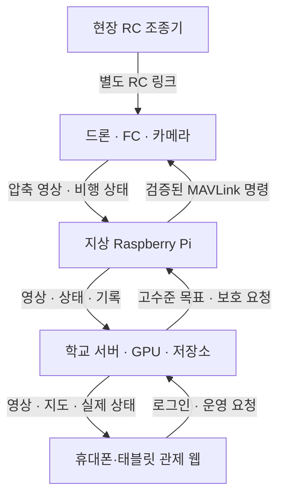

# 자율 정찰 드론 서버 구축·통신 설계 인수인계서

- 문서 버전: v1.1 / 인수인계 통합본
- 작성일: 2026-10-04
- 기준: 설계명세서 v2.1, 운용구조·예산안 v2.1, 환경 설계 인터뷰
- 담당 범위: 드론·게이트웨이·서버 하드웨어, OS, 통신, 장애 대응
- 상태: 운용 정책 확정 / 내부 개발 환경 구축 기록 확인 / 현장 연동·관제·안전 기능 미완료


## 0. 다음 담당자가 먼저 읽을 내용

### 0.1 문서 목적과 근거 수준

서성훈이 담당하는 드론·지상 게이트웨이·학교 서버의 하드웨어, OS, 통신과 서버 구축을 다른 담당자가 이어갈 수 있도록 정리했다. 인터뷰의 결론, 예산 기준, 기존 설계, 로컬 구축 기록을 함께 반영한다.

- **확정 정책**: 사용자 인터뷰에서 의미가 확인되는 결정과 기존 환경·통신 설계에 정리된 결론.
- **구축 기록 확인**: 2026-10-03 배포 문서·설정·검증 JSON을 2026-10-04 로컬 파일에서 읽어 확인한 내용. 이번 작성 중 원격 서버에 접속하거나 시험을 재실행하지 않았다.
- **미완료/미확정**: 현장 장비, 학교 외부 접속, 실제 추론·관제·안전 기능 등 추가 작업이 필요한 내용.
- **구현 제안**: 인수인계를 위해 정리한 데이터 계약·작업 분해. 실제 구현이나 사용자 확정 결정과 구분한다.

질문 원문이 남아 있지 않은 단독 A/B/C 답변은 의미를 새로 추정하지 않았다. 이 문서는 확인 가능한 결정 전체를 주제별로 정리한 것이며 인터뷰의 축어록은 아니다. 인증 비밀번호·토큰·개인키 값은 포함하지 않는다.

### 0.2 가장 중요한 결정

1. 단일 드론 ↔ 지상 Raspberry Pi ↔ 학교 서버의 3티어 구조다.
2. Pi는 가볍게 유지한다. 압축 영상 중계·현장 기록·MAVLink·명령 검증을 맡고, 추론과 분석은 서버가 수행한다.
3. 휴대폰·태블릿 관제 웹은 서버와 직접 연결한다. 화면 영상은 실시간일 필요가 없지만 비행 상태와 갱신 시각은 확인해야 한다.
4. 자동 정찰에는 최신 유효 원본 영상이 필요하다. 영상이 끊기면 자동 이동을 멈추며, 공중에서 모터를 끄는 의미가 아니다.
5. 영상만 끊기고 상태·명령 경로가 살아 있으면 HOLD 후 운영자 판단을 기다린다. 기체 상태 악화 시에는 보호 동작이 우선한다.
6. WAN·서버·실행권 단절은 영상만 단절된 경우와 구분하며, 현장 대기 후 복귀 정책의 시간값을 별도로 확정한다.
7. 자동 복귀가 실제로 실패한 경우 현장 RC로 인수한다. 영상 없는 상태의 웹 수동 이동은 제공하지 않는다.
8. 연결·서비스 복구만으로 임무를 시작하거나 재개하지 않는다. 실제 상태 확인과 운영자 재개 승인이 필요하다.
9. 수신한 기록은 서버 저장 확인 전까지 Pi에서 보호한다. Pi가 받지 못한 영상은 임시저장·복구할 수 없다.
10. 중간발표는 2026-10-28, 최종발표는 2026-11-25이며 각각 발표 전에 구축·검증을 끝내야 한다.

### 0.3 기존 설계에서 달라진 배포 정보

| 항목 | 초기 인터뷰·v1.0 설계 | 현재 로컬 구축 기록 | 이어받을 기준 |
|---|---|---|---|
| 서버 OS | Ubuntu 22.04로 안내 | 호스트 24.04.4, 앱 컨테이너 24.04.5 | 기존 배포를 이어갈 때 Ubuntu 24.04 기준. 22.04는 초기 기록 |
| Python | 실제 확인 후 고정 | 3.12.3 | requirements.lock과 이미지 기록 확인 |
| IP | 사용자 안내에서 비공개 | <SERVER_HOST> | 최초 SSH 접속 시 실제 배정 서버인지 확인 |
| 개발 Jupyter | 학교 스크립트의 배정 포트 | 전용 18459, 기존 학교 8359 별도 기록 | 전용 환경은 18459 사용. 학교 포트는 재배정 가능 |
| GPU | RTX 3090, CUDA 사용 가능 사용자 확인 | CUDA 텐서 연산 통과 기록 | 모델 추론은 미검증 |
| 저장 | 5TB 제공 사용자 확인 | 호스트 루트 파일시스템 가용 약 4TiB 기록 | 개별 할당·보존·재생성 정책 별도 확인 |
| 실행 관리 | 제공 환경 확인 필요 | 전용 Docker/Compose와 systemd 구성 기록 | 기존 scripts/stack.sh 사용 |
| 웹 | 모바일 관제 설계 | 내부 환경 상태 페이지 | 운영자 인증·관제 화면은 앞으로 구현 |
| 비행·추론 | 기능 연결 예정 | flight_enabled=false, model_loaded=false | 활성화 완료로 간주하지 않음 |

### 0.4 읽는 순서

- 정책과 구조: 1~5장.
- 접속·포트·영상·저장: 6~9장.
- 명령·장애·운영 절차: 10~12장.
- 진행 순서·검증·일정: 13~16장.
- 명세 연결·출처: 17~18장.
- 현재 배포의 실제 경로·명령·검증 근거: 19장.
- 인터뷰 결정 목록: 20장.
- 후속 구현 계약·작업 순서·인계 완료 기준: 21~23장.

## 1. 설계 목표

드론과 학교 서버 사이의 통신을 지상 Raspberry Pi 게이트웨이로 중계한다.

서버는 영상 분석·탐색 계획·저장을 담당한다. Pi는 영상·비행정보 중계, 현장 기록, 명령 검증을 담당한다. FC는 자세 안정화와 실제 비행 제어를 수행한다.

영상 수신을 자동 정찰의 필수 조건으로 둔다. 최신 유효 영상이 끊기면 진행 중 자동 이동을 중단한다. 관제 웹의 재생 지연은 서버 분석용 원본 영상의 단절과 구분한다.

시연은 운영자 1명이 휴대폰 또는 태블릿의 웹에 로그인해 수행한다.

## 2. 확정 사항과 미확정 사항

| 항목 | 설계 기준 | 상태 |
|---|---|---|
| 운용 구조 | 단일 드론 ↔ 지상 Pi ↔ 학교 서버 | 확정 |
| 게이트웨이 | Raspberry Pi 4B 2GB / microSD 64GB | 예산 기준, 구매 전 |
| 게이트웨이 OS | Raspberry Pi OS Lite 64bit | 후보, 수신 드라이버 확인 후 버전 확정 |
| 서버 환경 | Ubuntu 24.04 앱 컨테이너 / Python 3.12 / JupyterLab | 초기 22.04에서 변경된 구축 기록 확인 |
| 서버 자원 | i9-11900 / RTX 3090 / RAM 64GB | 제공 사양 |
| GPU 사용 | nvidia-smi 및 PyTorch CUDA 사용 | 사용자 확인 완료 |
| 서버 저장 공간 | 사용자 안내 5TB / 현재 개발 데이터는 호스트 루트 파일시스템 | 가용 약 4TiB 기록, 개별 할당·장기 영속성 미확정 |
| SSH | 외부 포트 7540, 계정 se | 확정 |
| JupyterLab | 배정된 내부 포트에 SSH 터널로 접속 | 학교 안내 기준 |
| Pi 인터넷 | Android 스마트폰 USB 테더링 | 채택 |
| 관제 단말 | 휴대폰·태블릿 반응형 웹/PWA | 확정 |
| 시연 동시 접속 | 운영자 1명 | 확정 |
| 운영자 계정 | 시연 전에 생성, 웹에는 로그인 제공 | 확정 |
| 외부 서비스 접근 | 모바일 웹과 SRT 수신 경로 | 학교 관리자 확인 필요 |
| 원본 영상 코덱 | 명세서의 H.264 기준 | 실제 장비 출력 확인 필요 |
| 개발 PC 접속 도구 | Ubuntu/WSL OpenSSH 또는 MobaXterm | 최종 선택 미지정 |

사용자 확인·설계 결정과 로컬 구축 기록을 구분한다. 서버 내부 시험 기록은 19장에 정리했으며, 실장비 설치·현장 링크·추론·비행 시험 완료를 뜻하지 않는다.

## 3. 구성과 책임 경계



| 구성 | 담당 기능 |
|---|---|
| 드론 FC | 자세·고도 안정화, 목표 추종, 위치·배터리·모드 보고, FC 보호 동작 |
| 드론 영상 장비 | 촬영, 압축 영상 송신 |
| 현장 RC | 자동 복귀 실패 등 비상 상황에서 제어권 인수 |
| Pi | 영상·MAVLink 중계, 시각 기록, 현장 저장, 명령 검증, 링크·실행권 감시 |
| 서버 | 영상 수신·디코딩·추론, 좌표·지도·경로 계획, 영상·결과·로그 저장 |
| 관제 웹 | 로그인, 상태·영상 확인, 임무 요청, 복귀·착륙 요청, 재개 승인 |

웹과 서버는 FC의 저수준 자세 제어를 직접 수행하지 않는다. 비행 요청은 서버의 권한 확인과 Pi의 현장 검증을 거쳐 전달한다.

## 4. 하드웨어와 현장 연결

예산안 v2.1의 품목을 기준으로 한다. 별도 라우터나 GPU 컴패니언 컴퓨터는 추가하지 않는다.

| 구간 | 예산 기준 장비·방식 | 확인할 항목 |
|---|---|---|
| FC·위치 | F450 패키지 / KoA H743 / M10 GPS | 펌웨어·보드 지원, 센서·포트 연결 |
| 거리 센서 | TF02-Pro | 전원·인터페이스·FC 설정 |
| 영상 | RunCam WiFiLink 2-G / 독립 5GHz 링크 | 지상 수신 구성, USB 장치, Linux 드라이버, 출력 코덱 |
| MAVLink | KoAFC 텔레메트리 | FC↔Pi 양방향 통신, 장치 경로·속도 |
| 비상 RC | TX12 MKII CC2500 / R81 V2 / SBUS | 모드 전환·제어권 인수·단절 보호 |
| 카메라 장착 | GM3 V2와 렌즈 비교 구성 | 물리적 호환, 하향 45° 유지, 보정 |
| WAN | 스마트폰 USB 테더링 | Pi 인식, 야외 연결, 재접속, 전원 안정성 |

R81 V2는 RC 수신기다. MAVLink 상태·명령은 KoAFC 경로로 분리한다.

영상 수신용 무선 장치와 로컬 상태 페이지용 Wi-Fi의 인터페이스 배정을 확인한다. Pi 내장 Wi-Fi 하나로 두 기능을 동시에 처리할 수 있다고 가정하지 않는다.

## 5. OS와 실행 환경

### 5.1 게이트웨이

Raspberry Pi OS Lite 64bit를 후보로 둔다. 영상 수신 장치의 드라이버·커널·수신 프로그램 호환성을 확인한 뒤 배포 버전을 확정한다.

운영 기능은 다음과 같이 구성한다.

- 영상 수신·중계·현장 기록
- MAVLink 라우팅
- 명령 검증·실행권 감시
- 링크·기체 상태 감시
- 복구 업로드
- 읽기 전용 로컬 상태 조회

Pi에서 무거운 영상 추론이나 GRACE 인코딩을 수행하지 않는다.

서비스는 부팅 시 자동 실행하고, 종료 시 자동 재시작하도록 구성한다. 서비스 재시작이나 연결 복구만으로 비행 임무를 시작·재개하지 않는다.

### 5.2 서버

초기 인터뷰는 Ubuntu 22.04였으나, 현재 구축 문서에는 Ubuntu 24.04 기반 앱·GPU 컨테이너로 변경되어 있다. 기존 배포를 이어갈 때는 19장의 버전과 잠금 파일을 기준으로 한다.

JupyterLab은 개발·실험에 사용한다. 운영 수신·API·저장 서비스는 노트북 실행 상태에 의존하지 않도록 구성한다.

FastAPI, 미디어 수신·저장, 비전 처리, 임무·안전 처리, PostgreSQL/PostGIS는 설계명세서의 책임 경계를 따른다. 현재 설치 버전은 requirements.lock과 evidence의 패키지·이미지 기록으로 관리한다. 실제 애플리케이션 모듈 구현 완료 여부는 별도로 확인한다.

현재 기록에는 서버 측 전용 Docker 엔진과 systemd 자동 기동, 컨테이너 unless-stopped 정책이 구성되어 있다. 앱 컨테이너 내부에서 systemd나 Docker를 실행하는 구조로 가정하지 않는다. 엔진 재시작 시험 기록은 있으나 호스트 재부팅 시험은 미실시다.

## 6. SSH·JupyterLab 접속 원칙과 학교 기본 안내

현재 구축된 전용 환경의 구체적인 접속 명령은 19.3절을 우선 사용한다. 아래는 학교 제공 JupyterLab의 기본 접속 절차를 보존한 것이다.

SSH 7540은 외부 접속 포트다. JupyterLab과 관제 웹의 내부 서비스 포트는 별도다.

1. 내 PC에서 학교 서버에 SSH로 접속한다.
2. 서버에서 학교 제공 JupyterLab 실행 스크립트를 실행한다.
3. 실행 결과에 표시된 정보 파일을 읽어 배정 포트를 확인한다.
4. 내 PC의 새 터미널에서 안내된 SSH 터널 명령을 실행한다.
5. 터널을 유지한 상태로 내 PC 브라우저에서 접속한다.

내 PC에서 실행:

```bash
ssh -p 7540 se@SERVER_IP
```

SSH로 접속한 서버에서, 스크립트가 있는 디렉터리에서 실행:

```bash
bash jupyter_lab_execute.sh
cat /home/se/JupyterLAB/jupyter_info_PORT_NUMBER.txt
```

PORT_NUMBER는 스크립트가 안내한 실제 숫자로 바꾼다.

터널은 서버가 아닌 내 PC의 새 터미널에서 실행한다.

```bash
ssh -p 7540 -N -L LOCAL_PORT:localhost:JUPYTER_PORT se@SERVER_IP
```

브라우저 주소는 `http://localhost:LOCAL_PORT`다. 학교 안내는 로컬 포트와 서버 Jupyter 포트를 같은 숫자로 사용한다.

MobaXterm은 접속 정보·SFTP 파일 전송·터널을 GUI로 관리하는 선택 도구다. Ubuntu/WSL이나 Windows OpenSSH로도 접속할 수 있다.

서버·JupyterLab 비밀번호, 토큰, SSH 키는 문서에 기록하지 않는다. 관제 웹의 운영자 인증은 서버 OS·JupyterLab 인증과 별도로 구성한다.

## 7. 통신 경로와 포트 조건

| 경로 | 목적 | 방식 | 확인 상태 |
|---|---|---|---|
| 드론→Pi | 영상 수신 | WiFiLink 5GHz 링크·지상 수신 장치 | 장비 호환 시험 필요 |
| FC↔Pi | 상태·명령 | KoAFC 기반 MAVLink | 장치·속도 확인 필요 |
| Pi→서버 | 압축 원본 영상 | SRT | UDP 경로 미확정 |
| Pi↔서버 | 상태·실행권·명령·결과 | WSS/API | 접속 경로 미확정 |
| 웹↔서버 | 로그인·조회·운영 요청·영상 조회 | HTTPS/WSS | 모바일 직접 접속 경로 미확정 |
| 개발 PC↔서버 | 관리·JupyterLab | SSH 7540 / TCP 포워딩 | 학교 안내로 확인 |
| 현장 단말↔Pi | WAN 장애 시 상태 조회 | 현장 로컬 웹 | 단말·인터페이스 시험 필요 |

SRT는 Pi→서버 구간에 적용한다. 드론→Pi의 무선 수신 방식과 구분한다.

SSH의 일반적인 `-L` 포워딩은 TCP 기반이다. 이 터널에 SRT의 UDP 전송을 그대로 연결하지 않는다. 학교에 UDP 포트·컨테이너 연결 경로 또는 허용되는 VPN 경로를 확인한다.

관제 웹은 휴대폰·태블릿에서 서버에 직접 접속하는 방향을 유지한다. 개발 PC의 localhost 터널을 모바일 직접 접속 경로로 간주하지 않는다.

외부 포트가 7540으로만 제한된다는 사실은 확인되지 않았다. 추가 접근이 불가능하면 전송·배포 대안을 결정하고 문서를 개정한다.

## 8. 영상 처리와 표시

1. 드론에서 받은 압축 영상을 Pi에 기록하고 서버로 중계한다.
2. 실제 출력 형식이 호환되면 Pi에서 재인코딩하지 않는다.
3. 서버가 원본을 디코딩해 탐지·좌표·관측 품질을 판정한다.
4. 서버가 영상·크롭·분석 결과를 보관한다.
5. 관제 웹은 서버가 제공하는 재생·크롭·상태 정보를 조회한다.

관제 재생은 실시간일 필요가 없다. 서버 분석·자동 이동에는 최신 원본 영상과 촬영 시각·자세 정보의 유효성을 사용한다.

초기 제공 프로파일은 `CROP_BASELINE`이다. `CROP_GRACE`는 단말 디코더 가용성, 모델·패킷 호환, 디코딩 성능을 통과한 경우에만 사용한다.

PWA나 WebCodecs가 GRACE를 기본 지원한다고 가정하지 않는다. 복원 크롭은 원본 분석 영상과 구분하고, 촬영 시각과 오래된 영상 여부를 표시한다.

1080p 30fps는 촬영·송신 목표이고, 최소 5fps는 실제 분석 목표다. 달성 여부는 장비·대역폭·저장 동시 시험으로 확인한다.

## 9. 저장과 복구 업로드

### 9.1 서버

전체 임무 영상, 탐지 결과·크롭, 비행 상태, 명령·안전·운영자 조치 로그를 저장한다.

학기 말과 최종 시연에 필요한 기록을 보호한다. 삭제 정책은 보존 기간·보호 대상·용량을 확인한 뒤 설정한다.

5TB 영구 저장 공간은 사용자 확인 사항이다. 현재 기록의 서버 ./data → 컨테이너 /data 매핑과 약 4TiB 가용량을 출발점으로 삼고, 개별 할당량·보존 정책·재생성 후 유지 조건을 추가 확인한다.

실제 저장 루트 아래에 다음 구조를 적용한다.

| 상대 경로 | 내용 |
|---|---|
| missions/<mission_id>/video/ | 임무 원본 영상 |
| missions/<mission_id>/metadata/ | 촬영 시각·자세·구간 정보 |
| missions/<mission_id>/crops/ | 원본 크롭과 표시 자료 |
| missions/<mission_id>/results/ | 탐지·좌표·임무 결과 |
| missions/<mission_id>/logs/ | 상태·명령·장애·운영자 조치 |

### 9.2 Pi

서버에 저장되지 않은 수신 영상은 `RETAIN_UNTIL_PERSISTED` 정책으로 보호한다.

- 압축 영상과 시각·상태 sidecar를 구간 단위로 확정한다.
- 구간 ID, 크기, 해시, 업로드·저장 확인 상태를 기록한다.
- 연결 복구 후 최신 영상·상태·보호 명령을 우선 처리한다.
- 누적 기록 업로드는 대역폭을 제한해 별도로 수행한다.
- 필수 파일의 서버 저장 확인 후 Pi 사본을 정리한다.
- 중복 업로드는 구간 ID·해시로 대조한다.

저장 공간이 부족해도 미저장 보호 구간을 조용히 덮어쓰지 않는다. 저장 압력 경고와 자동 정찰 제한을 적용한다. 임계값은 실제 가용량·영상 비트레이트 시험 후 확정한다.

Pi가 받지 못한 드론→Pi 영상은 재업로드로 복원할 수 없다. 장비·전원 장애에 따른 결손은 누락 구간으로 기록한다.

## 10. 상태·명령 처리

서버는 웹 사용자 권한과 제어권을 확인한다.

Pi는 다음 조건을 재검증한다.

- 기체·임무 식별자
- 명령 유효기간·세대·중복 여부
- 실행권
- 현재 비행 모드
- 위치·배터리·비행경계 조건

FC의 명령 수락과 실제 동작 수행을 구분한다. 명령 수락만으로 복귀 성공을 표시하지 않는다.

연결 복구 시 실제 FC·RC 상태를 대조하고 이전 세대의 명령을 무효화한다. 과거 영상·누적 업로드를 현재 자동 이동의 근거로 사용하지 않는다.

RC 인수 또는 FC 보호 상태에서는 서버의 자동 이동이 이를 덮어쓰지 않도록 제한한다. 재접속만으로 진행 중인 복귀·착륙을 취소하지 않는다.

## 11. 영상 우선 장애 대응

비행 중지는 공중에서 모터를 끄는 뜻이 아니다. 진행 중 자동 이동을 중단하고, 현재 상태에서 가능한 보호 동작으로 전환한다.

| 장애 | 현장 동작 | 저장·복구 | 운영자 처리 |
|---|---|---|---|
| 드론→Pi 영상 단절 | 자동 이동 중단, 가능한 경우 HOLD | 단절 구간은 Pi 임시저장도 불가 | 상태를 보고 복귀·착륙 판단 |
| Pi→서버 영상만 단절, 상태·명령 정상 | 자동 이동 중단, 가능한 경우 HOLD | Pi 기록 유지, 복구 업로드 | 상태를 보고 복귀·착륙 판단 |
| 서버/WAN·실행권 단절 | 새 원격 이동 차단, 가능한 경우 HOLD | 현장 기록 유지 | 기존 대기 후 복귀 정책 적용 |
| FC↔Pi 기체 링크 단절 | FC의 설정된 보호 동작 | 마지막 확인 상태·미확인 동작 구분 | 현장 확인·필요 시 RC 개입 |
| 웹 재생·브라우저만 단절 | 원본 영상·제어 경로가 정상이면 임무 유지 | 서버 기록 유지 | 재접속·상태 동기화 |
| 기체 상태 악화 | 가능한 경우 복귀 우선, 불가능하면 대체 보호 | 적용 동작·이유 기록 | 복귀 실패 시 RC 인수 |
| Pi 서비스 재시작 | 실행권 재확인, 실제 상태 확인 | 기록·구간 대조 | 필요 시 재개 승인 |

영상만 끊긴 HOLD 상태에서는 운영자 판단을 기다린다. 고정 시간이 지났다는 이유만으로 자동 복귀하는 정책은 채택하지 않는다.

대신 배터리·항법·경계 등 기체 보호 조건에 도달하면 운영자 승인보다 보호 동작을 우선한다.

복귀가 가능한 상태에서는 복귀를 우선한다. 위치·항법 문제로 복귀가 불가능하면 설정된 대체 보호 동작을 적용한다. 구체적인 FC 보호 조건은 펌웨어와 현장 시험으로 확정한다.

서버/WAN 단절 시의 기존 대기 후 복귀 정책은 영상만 단절된 경우와 구분한다. WAN 대기 시간은 시험 후 확정한다.

### 감지 기준

- 명세서의 영상 2초, 서버/WAN/필수 상태 3초는 장애 감지 목표다.
- 최신 유효 프레임·메시지 시각을 기준으로 판정한다.
- 무선 연결 표시나 MAVLink heartbeat만으로 서버 영상 수신 정상을 판단하지 않는다.
- 서버 영상 수신 상태를 Pi에 보고한다.
- 그 보고 자체가 끊기면 서버 연결·실행권 장애로 판정한다.
- 화면 재생 지연과 원본 수신 단절을 별도로 표시한다.
- FC·RC 보호 타이머는 별도로 확인하고 중복 동작을 시험한다.

## 12. 운영자 판단·RC 개입·재개

시연 운영자 계정은 사전에 생성한다. 로그인과 권한 확인 후 임무 시작·조회·복귀·착륙 요청을 허용한다.

영상 없는 HOLD 상태의 웹 조작은 상태 확인·복귀·착륙 요청으로 제한한다. 웹에 비상 수동 이동 기능은 추가하지 않는다.

자동 복귀가 필요한데 실제로 복귀하지 않으면 현장 조종자가 RC 조종기로 제어권을 인수한다. Pi는 RC 인수를 확인하고 원격 이동 명령·이전 실행권을 무효화한다.

영상 또는 연결 복구 후에는 실제 모드·위치·배터리·제어권·영상 품질을 재확인한다. 운영자가 재개를 승인해야 새 정찰 목표를 허용한다.

수동·복귀·착륙·미확인 상태에서는 정찰을 재개하지 않는다.

WAN 장애 시 Pi의 읽기 전용 상태 페이지를 조회하도록 설계한다. 위치·고도·배터리·모드·링크 상태와 마지막 갱신 시각을 표시한다.

USB 테더링용 스마트폰에서 Pi 로컬 Wi-Fi 접근이 가능한지는 실제 기기로 시험한다. 로컬 조회 화면은 비행 제어 경로로 사용하지 않는다.

## 13. 배포 순서

1. 서버 SSH·JupyterLab 접속과 CUDA 사용 기록 정리
2. 5TB 저장 경로·쓰기 권한·컨테이너 영속성 확인
3. 학교 관리자에게 모바일 웹·영상 UDP 경로 확인
4. 샘플 영상으로 서버 수신·저장·모바일 재생 시험
5. 영상 장비·Pi 호환 확인 후 OS 버전 확정
6. Pi 영상 수신·현장 기록·서버 중계 연결
7. MAVLink·명령 검증·RC 인수 연결
8. 자동 기동·장애 보호·복구 업로드·재개 승인 시험
9. 통합 시험 후 현장 시연 준비

서버 확인 명령:

```bash
df -hT
findmnt
nvidia-smi
```

df와 findmnt만으로 5TB 할당 정책이나 컨테이너 재생성 후 영속성을 증명하지 않는다. 학교의 저장 정책·제공 경로와 대조한다.

## 14. 시험과 완료 기준

아래는 현장 통합에서 수행할 시험이다. 19장의 내부 개발 환경 시험과 구분하며, 아래 항목의 통과를 현재 완료로 기록하지 않는다.

| 시험 | 확인 기준 |
|---|---|
| 영상 정상 경로 | Pi 수신·서버 원본 수신·저장·웹 조회를 구분해 확인 |
| Pi 부하 | 수신·기록·중계 중 메모리·CPU·디스크 사용과 안정성 측정 |
| 드론→Pi 영상 차단 | 진행 중 이동 중단, 실제 보호 동작, 결손 기록 |
| 서버 영상 경로만 차단 | Pi 기록 유지, 자동 이동 제한, 운영자 판단 가능 |
| WAN·실행권 차단 | 현장 보호, 대기 후 복귀, 오래된 명령 차단 |
| HOLD 중 기체 상태 악화 | 운영자 대기보다 보호 우선, 복귀·대체 보호 확인 |
| 복귀 실패·RC 인수 | 실패 확인, RC 인수, 서버 자동 명령 차단 |
| 웹 종료·재접속 | 정상 임무 유지, 실제 상태 동기화, 자동 재개 없음 |
| 복구 업로드 | 최신 통신 우선, 해시 대조, 저장 확인 전 Pi 사본 보호 |
| 저장 압력 | 미저장 구간 무단 삭제 없음, 경고·임무 제한 |
| 재부팅·프로세스 종료 | 서비스 복구, 실제 상태 확인, 비행 자동 시작 없음 |
| 모바일 웹 | 로그인·권한·영상·상태·복귀 요청 확인 |
| 로컬 상태 페이지 | WAN 없이 접속, 갱신 시각 표시, 읽기 전용 |

보호·RC 시험은 시뮬레이터와 비행하지 않는 장비 시험을 먼저 수행한다. 실비행은 현장 설정·기체 상태를 확인한 뒤 진행한다.

## 15. 일정

| 기간 | 목표 |
|---|---|
| 10/03~10/09 | 서버·저장·외부 접속 확인, 영상 장비 호환·OS 검증 |
| 10/10~10/16 | 영상 수신·저장·모바일 웹·상태 통신 연결 |
| 10/17~10/23 | 명령 검증·자동 기동·장애 대응·복구 통합 |
| 10/24~10/27 | 중간발표 시연·자료 점검 |
| 10/28 | 중간발표 |
| 10/29~11/13 | 현장 시험·결함 수정·안정성 보완 |
| 11/14~11/20 | 최종 검증·시연 구성 확정 |
| 11/21~11/24 | 최종 리허설 |
| 11/25 | 최종발표 |

중간 통합 목표는 10월 23일, 최종 준비 목표는 11월 20일이다. 장비 조달·호환성·학교 네트워크 조건에 따라 상세 순서를 조정한다.

## 16. 미확정 항목

| 항목 | 필요한 확인 |
|---|---|
| 영상 장비·Pi 호환 | 송수신 구성, Linux 드라이버, 커널, USB 장치 |
| 모바일 직접 접속 | 웹 주소·포트·TLS·컨테이너 연결 경로 |
| SRT 전송 | UDP 도달 경로·컨테이너 매핑·허용 VPN |
| 5TB 저장 공간 | 기록된 개발 경로와 학교 개별 할당의 관계·가용량 재확인·장기 영속성 |
| Pi OS | 수신 프로그램·드라이버 통합 시험 |
| 현장 링크 | MAVLink 장치·속도, 영상 코덱·비트레이트 |
| 기체 보호 | 배터리·항법·RC·경계 조건, 복귀 실패 판정 |
| WAN 대기 시간 | FC 정책·실행권 만료와 통합 시험 |
| 버퍼·보존 | Pi 가용량·저장 압력 기준, 서버 보존 기간 |
| 자동 기동 | Pi 서비스 설정·서버 호스트 재부팅 검증·서비스 복구와 임무 재개의 분리 |
| 로컬 상태 접근 | 테더링·Wi-Fi 배정·스마트폰 접근 |
| GRACE | 전용 디코더·브라우저 연계·호환·성능 |

외부 접근과 영상 수신 장비 호환성은 현장 배포 전에 해결해야 한다. 미확정 상태에서도 서버 내부 개발과 샘플 영상 시험은 진행할 수 있다.

## 17. 기존 명세서 연결

| 명세서 항목 | 본 문서의 구체화 |
|---|---|
| 실기체 3티어 구조 | 서버·Pi OS·테더링·외부 접속 조건 |
| VideoRelay / VideoProfileManager | Pi 중계, 모바일 기본 제공, GRACE 조건부 적용 |
| FieldRecorder / SegmentManifestStore | 저장 확인 전 보호, 저장 압력 대응 |
| UC-1004 / SD-1004 | 영상 단절 시 진행 중 이동 중단, 현장 보호 우선 |
| UC-1005 / SD-1005 | 실제 상태 대조, 이전 명령 무효화, 승인 후 재개 |
| 웹 제어권·RC 인수 | 시연 로그인, 웹 수동 이동 제외, 복귀 실패 시 RC |

본 문서는 환경·통신 보완 설계다. 기존 HWPX 명세서 파일 자체를 수정하거나 전체 클래스·유스케이스를 대체하지 않는다.

## 18. 기준 자료

- 설계명세서_v2.1_서식명세검토.hwpx
- 운용구조_및_예산안_v2.1.docx
- 본 대화의 환경 설계 인터뷰와 사용자 확인
- 로컬 design-reference.md, README.md, DEPLOYMENT.md, compose.yml, config/mediamtx.yml, app/main.py
- 로컬 evidence/verification.json, verification-after-restart.json, storage.txt (2026-10-04 읽기 확인)
- 학교 서버 안내: https://seboard.site/server-reservation/46206
  - 사용자 제공 본문 기준. 직접 페이지 조회는 실패.
- OpenSSH: https://man.openbsd.org/ssh
- SRT: https://github.com/Haivision/srt
- Windows OpenSSH: https://learn.microsoft.com/en-us/windows-server/administration/openssh/openssh-overview
- WSL 네트워크: https://learn.microsoft.com/en-us/windows/wsl/networking
- MobaXterm: https://mobaxterm.mobatek.net/features.html
## 19. 현재 서버 배포 인수인계

### 19.1 위치와 확인 범위

| 항목 | 기록된 값 |
|---|---|
| 서버 IP | <SERVER_HOST> |
| SSH | TCP 7540 / 계정 se |
| 서버 프로젝트 루트 | /home/se/sandboxes/drone-server-20261003 |
| Windows 로컬 자료 | D:\Capstone1\Sever\drone-sandbox |
| 서버 영속 데이터 | 프로젝트 루트/data |
| 앱의 저장 루트 | /data |
| 컨테이너 작업 경로 | /workspace |
| 운영 스크립트 | 프로젝트 루트/scripts/stack.sh |
| 구성 파일 | compose.yml, compose.gpu.yml |

위 경로명은 기존 파일과 서버 명령을 그대로 사용할 수 있도록 보존했다. 서버 데이터나 인증 파일을 이 Markdown에 복사하지 않았다.

이번 작성에서 로컬 문서·설정·검증 결과를 읽었다. 원격 서버의 현재 생존 상태, IP 재배정 여부, 실제 서비스 응답은 후속 담당자가 첫 접속 시 재확인해야 한다. 로컬 소스 사본과 원격 배포 디렉터리가 완전히 동기화되었다고 가정하지 않는다.

### 19.2 기록된 실행 환경과 서비스

| 구분 | 배포 기록의 버전·상태 |
|---|---|
| 서버 호스트 | Ubuntu 24.04.4 LTS / i9-11900 / RAM 약 62GiB |
| 앱·GPU 컨테이너 | Ubuntu 24.04.5 LTS / Python 3.12.3 |
| GPU·드라이버 | RTX 3090 / 580.173.02 |
| PyTorch·CUDA 런타임 | 2.8.0+cu128 / 12.8 |
| torchvision | 0.23.0+cu128 |
| JupyterLab | 4.6.4 |
| FastAPI·Uvicorn | 0.142.2 / 0.54.0 |
| OpenCV·NumPy | 4.14.0.94 / 2.5.2 |
| 데이터베이스 | PostgreSQL 16.9 / PostGIS 3.5 |
| 미디어 | MediaMTX 1.21.1 / FFmpeg SRT 지원 기록 |
| 실행 관리 | Docker 29.8.2 / 전용 Compose 실행 래퍼 |

버전 표는 배포 기록의 전사이며 최신 버전 추천이 아니다. 재구축할 때 requirements.lock과 이미지 digest/ID를 확인한다. PostGIS와 MediaMTX는 공급자 이미지이고, Ubuntu 앱 이미지와 구분한다.

| 서비스 | 서버 바인딩 | 현재 용도 |
|---|---|---|
| API | 127.0.0.1:18400 TCP | 개발 상태 페이지, /docs, /health/live, /health/ready |
| PostgreSQL/PostGIS | 127.0.0.1:18432 TCP | 내부 DB |
| JupyterLab | 127.0.0.1:18459 TCP | 독립 개발 환경, 별도 토큰 로그인 |
| RTSP | 127.0.0.1:18554 TCP | 미디어 내부 재생·연계 후보, 실제 추론 연계 미완료 |
| HLS | 127.0.0.1:18888 TCP | 샘플 영상 웹 재생 |
| SRT 수신 | 127.0.0.1:18890 UDP | 서버 내부 합성 영상 수신 |
| 녹화 재생 | 127.0.0.1:18999 TCP | 녹화 조회 |
| 미디어 API | 127.0.0.1:18497 TCP | 내부 관리 |
| 미디어 지표 | 127.0.0.1:18498 TCP | 내부 관측 |
| Vision worker | 외부 포트 없음 | 모델·실제 입력 파이프라인 연결 대기 |

현재 Compose는 host 네트워크를 사용하고 각 서비스가 loopback으로 제한되어 있다. 따라서 위 SRT 수신 주소에 현장 Pi가 바로 접근할 수 없다. 공개 바인딩·방화벽 변경을 임의로 적용하지 말고, 학교에서 허용하는 경로와 인증·TLS 구성을 확정한 뒤 필요한 서비스만 연결한다. 관리 API와 DB를 관제 웹 접속용으로 공개하지 않는다.

### 19.3 기존 환경에 접속하는 명령

**개발 PC에서 SSH 로그인:**

```bash
ssh -p 7540 se@<SERVER_HOST>
```

**개발 PC의 별도 터미널에서 TCP 터널 유지:**

```bash
ssh -p 7540 -N -L 18400:localhost:18400 -L 18459:localhost:18459 -L 18888:localhost:18888 -L 18999:localhost:18999 se@<SERVER_HOST>
```

- 상태 페이지: http://localhost:18400
- 준비 상태: http://localhost:18400/health/ready
- API 문서: http://localhost:18400/docs
- 개발 JupyterLab: http://localhost:18459/lab

전용 JupyterLab의 토큰은 서버의 프로젝트 루트/secrets/jupyter-token에서 권한 있는 담당자가 확인한다. 로그인 화면에만 사용하고 공유 문서·Git·로그에는 기록하지 않는다. 학교 JupyterLab의 기존 포트 8359와 구분한다.

이 터널은 개발 PC용이다. 휴대폰의 localhost는 휴대폰 자신이며, 모바일 관제 접속 경로가 되지 않는다. 위 TCP 터널은 SRT UDP 현장 전송도 제공하지 않는다.

**서버에서 현재 상태 확인:**

```bash
cd /home/se/sandboxes/drone-server-20261003
scripts/stack.sh ps
scripts/stack.sh logs --tail=100 api vision media
curl -fsS http://127.0.0.1:18400/health/ready
nvidia-smi
df -hT data
findmnt -T data
```

**서버에서 필요한 운영 동작을 개별 실행:**

```bash
# 서비스 시작 또는 변경 구성 적용
scripts/stack.sh up -d
```

```bash
# 서비스 중지: 실제로 중지할 때만 실행
scripts/stack.sh stop
```

```bash
# 새 임무 디렉터리 생성 예시
scripts/stack.sh exec -T api python scripts/mission_dirs.py example-mission
```

stack.sh는 compose.yml과 compose.gpu.yml을 함께 읽으며 전용 Docker 실행 경로를 사용한다. 일반 docker 명령으로 다른 프로젝트를 조작하지 않도록 기존 래퍼를 유지한다. DB·영상 보존이 필요한 환경에서 전체 정리나 볼륨 삭제 명령을 운영 절차로 사용하지 않는다.

### 19.4 녹화 설정과 데이터 위치

config/mediamtx.yml에서 확인한 현재 설정:

- 원본 녹화: fMP4.
- part 길이: 1초, 녹화 구간: 1분.
- 자동 삭제: recordDeleteAfter=0s로 비활성화.
- 녹화 경로: /data/missions/%path/video/날짜-시간.
- 등록된 입력 경로: sample 하나.
- WebRTC는 비활성화, HLS는 활성화.

현재 sample 미디어 경로를 임무 ID와 연결하는 것은 후속 구현이다. 임무별 입력 경로 등록, 권한, 임무 종료 시 구간 확정과 메타데이터 연결을 추가해야 한다. 현재 fMP4 설정이 Pi의 구간 크기까지 확정한 것은 아니다.

DB는 서버 data/postgres, Jupyter 사용자 설정은 data/jupyter-home에 보존하도록 구성되어 있다. 앱의 /workspace는 서버 workspace 디렉터리와 연결된다. 로컬 app 파일을 수정했다고 원격 서비스 코드가 자동 갱신되는 구조로 이해하지 말고, 배포 전 실제 마운트와 파일 위치를 확인한다.

### 19.5 이미 남아 있는 검증 증거

| 항목 | 2026-10-03 기록 | 남은 한계 |
|---|---|---|
| GPU | RTX 3090 인식, CUDA 텐서 연산 passed | 탐지 모델 성능 아님 |
| DB | PostGIS 연산과 SRID 4326 확인 기록 | 임무 데이터 모델 구현 완료 아님 |
| API | 준비 상태 HTTP 200 | 운영자 로그인·권한·임무 API 아님 |
| Jupyter | 인증 필요, 토큰 로그인 확인 | 관제 인증과 별개 |
| 미디어 | 1920×1080, 30fps 합성 영상 SRT 송신·녹화/HLS 확인 기록 | 실제 Pi·모바일 WAN 시험 아님 |
| 녹화 | 1,458프레임 디코딩 | 연속 임무 무손실이나 추론 5fps 증명 아님 |
| 복구 | 전용 엔진 재시작 후 응답 및 DB·영상 해시 유지 기록 | 호스트 재부팅·재설치·5TB 보존 정책 미검증 |
| 비행·모델 | flight_enabled=false, model_loaded=false | 현장 운용 가능한 완성 시스템 아님 |

검증 파일의 result=passed는 파일에 명시된 내부 환경 범위에만 적용한다. decode_fps를 탐지 처리량으로 보고하지 않는다.

확인할 자료:

- evidence/verification.json, evidence/verification-after-restart.json
- evidence/storage.txt, recordings.sha256, db-after-restart.txt
- evidence/mount-audit.json, listeners.txt, services-final.json
- evidence/os-packages.lock, service-images.txt, app-image.txt, base-image.txt
- requirements.lock, DEPLOYMENT.md, README.md

이번 작성에서는 위 목록 중 verification 두 파일과 storage.txt, 배포 문서·설정 파일을 직접 읽었다. 나머지는 폴더 목록과 배포 문서에서 확인한 후속 점검 대상이다.

## 20. 인터뷰 결정 기록

질문을 주제별로 재구성했다. 아래의 ID는 이 인수인계서에서 추가한 추적용 ID이며 기존 UC/SFR 번호를 대체하지 않는다.

| ID | 인터뷰 주제 | 반영할 결론 | 상태·주의 |
|---|---|---|---|
| I-01 | 게이트웨이 위치와 역할 | 지상 설치, 드론과 서버 중계 | 확정 |
| I-02 | 영상·텔레메트리 선택 | 예산안 v2.1 품목 기준 | 실장비 호환 검증 필요 |
| I-03 | 서버 접속 준비 | Linux 기반 SSH 접속 정보 확보 | 학교 계정·할당 서버 사용 |
| I-04 | 서버 개발 환경 | JupyterLab, 초기 Ubuntu 22.04 | 이후 구축 기록의 24.04 변경 반영 |
| I-05 | 서버 자원 | i9-11900 / RTX 3090 / RAM 64GB | 제공 사양; 실제 표시는 약 62GiB |
| I-06 | Pi 부담 | 중계와 기록 위주, 추론은 서버 | 무거운 재인코딩·GRACE 처리 제외 |
| I-07 | 관제 연결 | 웹과 서버 직접 연결 | 공개 HTTPS/WSS 경로 미확정 |
| I-08 | 영상 확인 지연 | 화면 영상은 실시간일 필요 없음 | 자동 정찰의 최신 입력 조건과 구분 |
| I-09 | 비행 상태 표시 | 운영자가 기체 상태를 알 수 있어야 함 | 마지막 갱신 시각·단절 상태 포함 |
| I-10 | 관제 단말 | 휴대폰·태블릿 웹 | 반응형 UI/PWA 방향 |
| I-11 | 포트 통일 의미 | 학교 서버 SSH 포트 7540 | 모든 앱 포트를 7540으로 설정하는 의미 아님 |
| I-12 | 개발 접속 도구 | MobaXterm 또는 Ubuntu/WSL/OpenSSH | GUI 선택은 구축 필수 조건 아님 |
| I-13 | 발표 일정 | 10/28 중간, 11/25 최종 | 해당 날짜 전 구축·검증 완료 목표 |
| I-14 | 결정 권한 | 서성훈이 모든 하드웨어·통신 담당 | 미확정 값은 담당자가 검증 후 결정 |
| I-15 | 기능 우선순위 | 영상 우선 | 영상→상태→안전·복구 통합 순서 |
| I-16 | 드론→Pi 단절 | 수신 불가이므로 임시저장도 불가, 비행 중지 | 자동 이동 중단·가능한 HOLD 의미 |
| I-17 | 서버 저장 | 제공 저장 공간 5TB | 실제 할당·영속성은 학교 확인 필요 |
| I-18 | 영상 장애 중 판단 | 운영자 판단을 기다림 | 기체 상태 악화 시 보호 우선 |
| I-19 | 비상 수동 개입 조건 | 복귀해야 하는데 실제 복귀하지 않는 경우 | 현장 RC 인수로 구체화 |
| I-20 | 시연 로그인 | 운영자가 모바일 웹에 로그인해 권한 확인 | 사전 생성 계정, 동시 운영자 1명 |
| I-21 | 복구 후 재개 | 실제 상태 대조 후 운영자 승인 | 자동 재개 금지 |
| I-22 | 현장 기록 보존 | 서버 저장 확인 전 보호 | 미수신 구간 복원은 불가 |
| I-23 | 통신 회복 중 처리 | 최신 영상·상태 우선, 과거 기록 별도 업로드 | 과거 영상으로 현재 비행 판단 금지 |

정책 충돌 시 최신의 의미가 확인되는 사용자 결정, 현재 배포 사실, 기존 설계 기준을 구분해 수정한다. 특히 영상만 단절된 경우의 무기한 운영자 대기와 WAN 단절의 대기 후 복귀를 같은 타이머로 합치지 않는다. 여기서 무기한은 시간만으로 복귀를 강제하지 않는다는 뜻이며, 배터리·항법 보호 조건보다 우선하지 않는다.

## 21. 후속 구현자가 구체화할 인터페이스

이 장의 필드와 단계는 기존 정책을 구현하기 위한 **제안 계약**이다. API 경로, 메시지 스키마, DB 테이블, 타이머 수치는 아직 확정·구현되지 않았다. 기존 app과 설계명세서를 대조해 명칭·버전을 합의한 뒤 구현한다.

### 21.1 상태와 영상 메타데이터

| 데이터 | 최소 연결 정보 | 사용 목적 |
|---|---|---|
| 기체 상태 | drone_id, mission_id, sequence, 생성·수신 시각, 위치·고도·모드·배터리·항법 상태 | 현재 비행 가능 조건과 상태 신선도 판정 |
| 영상 구간 | segment_id, mission_id, 촬영 시작·종료 시각, 프레임/PTS 범위, 파일 크기·해시·코덱 | 기록 결손·중복·저장 완료 확인 |
| 프레임 연결 | frame_id/PTS, 촬영 시각, 대응 자세·위치, 보간 여부·오차 | 좌표 계산과 오래된 입력 차단 |
| 분석 결과 | 모델 버전, 원본 프레임 참조, 후보·좌표·신뢰도, 생성 시각 | 재현 가능성·크롭·관제 결과 연결 |
| 링크 상태 | 구간별 마지막 유효 수신, 연결 상태, 서버 원본 수신 상태 | 드론→Pi, Pi→서버, 서버→웹 장애 구분 |

서로 다른 장비의 시계 오차와 timestamp 기준을 정의한다. 서버 도착 시각을 촬영 시각으로 대체하지 않는다. 좌표 기준계와 고도 기준도 명시한다. 배포 기록의 SRID 4326 검증은 전체 좌표 변환 정확도 검증을 의미하지 않는다.

### 21.2 명령과 실행권

권장 필드: command_id, drone_id, mission_id, mission_version, control_epoch, lease_id, issued_at, expires_at, 명령 유형·고수준 목표, 요청자 식별자.

1. 웹이 인증된 요청을 제출한다.
2. 서버가 권한·임무 상태·현재 제어권·입력 신선도를 검증한다.
3. Pi가 만료·중복·세대·실행권·기체 보호 조건을 재검증한다.
4. FC에 전달하고 수락 결과를 기록한다.
5. 기체 모드·위치 변화로 실제 수행 여부를 확인해 화면에 반영한다.

수신, 검증 통과, FC 수락, 실제 수행, 실패/미확인은 다른 상태다. 중복 command_id가 비행 동작을 반복시키지 않도록 한다. 실행권 만료 후 새로운 이동을 허용하지 않으며, 재접속 시 이전 세대 명령을 재전송해 실행하지 않는다.

### 21.3 기록 업로드와 삭제 조건

권장 처리 단계: 현장 기록 중 → 구간 확정 → 업로드 대기 → 서버 수신 → 크기·해시·필수 sidecar 확인 → 서버 저장 완료 응답 → Pi 정리 가능.

서버 저장 완료 응답은 영상 파일만 받은 상태와 구분한다. 영상·메타데이터·임무 연결이 모두 유효한 상태를 기준으로 정의한다. 중복 구간은 ID와 해시가 일치하면 재사용하고, 같은 ID인데 해시가 다르면 충돌로 남긴다. 업로드 도중 연결이 끊겨도 저장 완료 전 Pi 원본은 삭제하지 않는다.

현재 서버의 자동 녹화는 이 프로토콜의 구현을 대체하지 않는다. 임무별 보존 기간, 저장 압력 경고치, 업로드 재시도·부분 파일 처리, 원자적 확정 방법은 후속 결정이다.

### 21.4 모바일 화면의 최소 구성

- 로그인과 권한 확인. 계정은 시연 전에 생성한다.
- 기체 위치·고도·배터리·모드·링크·마지막 갱신 시각.
- 원본 수신 장애와 화면 재생 지연을 구별한 표시.
- 크롭/탐지 결과와 촬영 시각, 과거 자료 표시.
- 임무 상태, HOLD·RETURN·LAND·RC 인수·미확인 상태.
- 조건을 만족할 때만 복귀·착륙 요청 및 재개 승인 제공.
- 서버 수락과 기체 실제 수행 결과를 구분해 표시.

현재 내부 상태 페이지와 Jupyter 로그인으로 이 요구가 충족되는 것은 아니다. 운영자 인증과 미디어 접근 권한을 함께 구현해야 한다.

## 22. 이어서 구축할 작업 순서

| 순서 | 작업 | 선행 조건 | 완료 증거 |
|---|---|---|---|
| P0-1 | 기존 원격 배포 현황 재확인 | SSH 접속 | 서비스 상태·설정·버전·데이터 위치 기록 |
| P0-2 | 학교 외부 접속 협의 | 웹 HTTPS/WSS와 영상 UDP 요구 정리 | 허용 주소·포트·TLS·VPN/매핑 방식 |
| P0-3 | 저장소 정책 확인 | 담당자·할당 정보 | 5TB 할당 관계, 경로, 용량, 보존·복구 정책 |
| P0-4 | 영상 장비·Pi 호환 확정 | 예산 장비 또는 공식 지원 자료 | OS·커널·드라이버·수신 형식 검증 결과 |
| P1-1 | 서버 영상→추론→결과 저장 | 내부 영상 수신과 모델 파일 | 원본 참조·시각·결과 기록, 실제 추론 처리량 |
| P1-2 | 모바일 웹 로그인·조회 | 학교 접속 경로 | 휴대폰/태블릿에서 권한·영상·상태 확인 |
| P1-3 | Pi 수신·기록·중계 | 수신 장비 호환, UDP 경로 | 현장 수신·서버 수신·Pi 부하·기록 동시 시험 |
| P1-4 | MAVLink·상태 연결 | FC·텔레메트리 구성 | 위치·배터리·모드·최신성 확인 |
| P2-1 | 명령 검증·실행권·안전 로직 | 시뮬레이터와 상태·명령 계약 | 오래된 명령 차단, 영상/WAN 장애 분리 |
| P2-2 | 복구 업로드·저장 압력 | 구간·해시·응답 계약 | 재연결·중복·부분 업로드·용량 부족 시험 |
| P2-3 | RC 인수·재개 승인 | FC 보호 설정 확정 | 복귀 실패·인수·복구 후 승인 절차 검증 |
| P2-4 | 자동 기동·장시간 통합 | 서비스 단위 검증 | 재시작 복구, 임무 자동 시작 없음, 누락 기록 |
| P3 | 현장 리허설·발표 증거 정리 | 위 현장 필수 조건 완료 | 시연 영상·상태·지표·결함 목록 |

외부 경로가 미확정이어도 P1-1의 서버 내부 영상 처리와 웹·명령 상태기의 개발은 진행할 수 있다. 학교 접속 경로나 실장비 호환이 해결되지 않았는데 현장 통합 완료로 처리하지 않는다.

### 다음 담당자가 가장 먼저 할 일

1. 19.3절의 SSH 접속과 읽기 전용 상태 확인을 수행한다.
2. README·DEPLOYMENT·Compose·잠금 파일이 원격 배포와 맞는지 확인한다.
3. 관리자에게 외부 HTTPS/WSS, SRT UDP 또는 허용 VPN, 5TB 저장 영속성을 확인한다.
4. 현재 모델 미연결 상태에서 시작해 샘플 영상→실제 추론→원본 참조 결과 저장을 연결한다.
5. 영상·상태·안전 기능의 완료 범위를 별도로 기록하며 14장의 통합 시험을 수행한다.

## 23. 인계 시 남겨야 할 결과와 미결정 값

### 23.1 아직 숫자나 방식을 정해야 하는 항목

- 학교 공개 웹 주소·TLS 종단·외부 포트·접속 범위.
- SRT UDP 도달 경로 또는 허용 VPN, MTU·지연·복구 설정.
- 실제 장비 코덱·해상도·프레임률·비트레이트와 Pi 인터페이스 배정.
- Pi OS 릴리스·커널·드라이버·MAVLink 포트·baud rate.
- 비행 프레임/위치 동기화 오차 허용치와 입력 유효기간.
- 명령 TTL·실행권 갱신 주기·만료 시간·중복 판정 보존 기간.
- WAN 단절 대기 시간, 복귀 실패 판정, FC·RC 보호 설정.
- 배터리·항법·비행경계 보호 조건 및 복귀 불가 시 동작.
- Pi 보호 구간 용량·저장 압력 기준·업로드 대역폭 제한.
- 서버 보존 종료일·자동 삭제 허용 조건·별도 백업/복구 범위.
- 실제 추론 모델 버전·입력 크기·분석 5fps 측정 조건.
- GRACE 채택 여부와 휴대폰·태블릿 디코딩 검증 결과.

2초/3초 장애 감지 목표를 모든 TTL·FC 타이머의 확정값으로 복사하지 않는다. 필요한 값은 시뮬레이션·지상 시험·현장 기록으로 결정하고 설정 파일과 문서에 함께 반영한다.

### 23.2 후속 작업 완료 시 기록할 것

- [ ] 수정한 파일과 배포 위치, 적용 버전·이미지 식별자.
- [ ] 구현된 기능과 아직 준비 상태인 기능.
- [ ] 실행한 시험 명령·입력·일시·결과·로그 위치.
- [ ] 영상 수신, 저장, 추론, 관제 표시의 개별 지표.
- [ ] 장애 유형별 실제 FC 동작과 운영자·RC 처리 결과.
- [ ] 데이터 누락·중복·복구 여부와 미저장 구간 보존 확인.
- [ ] 학교 외부 접속·저장 정책에서 확인한 사항과 남은 조건.
- [ ] 다음 담당자의 첫 작업과 해결이 필요한 미결정 항목.

문서 작성 시점의 결론: **서버 내부 개발 기반과 합성 영상 시험 기록은 존재하지만, 실제 영상 장비·Pi·FC·모바일 관제·추론·안전 로직을 연결하고 검증하는 작업이 남아 있다.** 이 경계를 유지하며 영상 우선으로 구축을 이어간다.