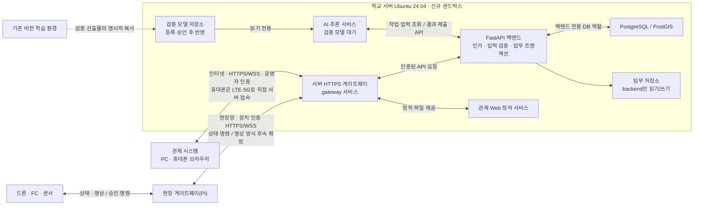

> 현재 아키텍처는 [v1.2](../../drone-server/docs/service_architecture_zero_trust_v1.2.md)를 따른다. 아래는 이전 기록이다.

# 드론 전체 시스템 구조·서비스 아키텍처·Zero Trust 구축안

- 버전: v1.1 — 드론 ↔ 현장 게이트웨이 ↔ 학교 서버 ↔ 관제 시스템 구조 반영
- 작성일: 2026-10-05
- 갱신일: 2026-10-06
- 기준: [서버 파일 구조도](server_file_structure.md), [DB 구축 설계명세서 v1.1](drone_database_design_spec_v1.1.md), [인수인계서 v1.1](drone_server_handover_v1.1.md), 현재 로컬 Compose/앱 코드
- 학교 서버: Ubuntu 24.04.4 LTS; 이번 SSH 읽기 점검에서 확인
- 기존 환경: `/home/se/sandboxes/drone-server-20261003`
- 새 환경: `/home/se/sandboxes/drone-dev`
- 구현 코드: [drone-services README](../drone-services/README.md)

## 1. 인터뷰 결정

| 항목 | 사용자 답변 / 상태 |
|---|---|
| 초기 접속 | 기존 SSH 터널로 개발·검증. 외부 접속은 이후 구성 |
| 전체 연결 구조 | 드론 ↔ 현장 게이트웨이(Pi) ↔ 학교 서버 ↔ 관제 시스템 |
| 휴대폰 관제 목표 | LTE·5G로 학교 서버의 HTTPS 주소에 직접 접속; 현장 게이트웨이·개발 PC를 거치지 않음 |
| 격리 수준 | 서비스별 컨테이너·계정·네트워크·저장소 분리 |
| 관제 Web / Pi 코드 | 미구현 |
| 이번 구현 범위 | 서비스 격리·인증·FastAPI 데이터 교환 환경과 모의 연동 검증까지 |
| 개발 관제 인증 | 관제 전용 개발 계정; 운영용 로그인은 이후 연결 |
| 컨테이너 통신 경로 | 네트워크 비활성+Unix 소켓, TLS·서비스 인증 적용 |

드론과 현장 게이트웨이(Pi)는 현장 장비다. 학교 서버에는 드론 연결 어댑터와 명령·상태 서비스가 들어간다. 모델은 학교 서버의 추론 서비스가 로드하며 학습 환경에서 검증된 산출물만 전달한다. 관제 시스템은 PC·휴대폰 브라우저에서 학교 서버가 제공한 Web 코드로 실행된다. 휴대폰 외부 접속은 목표 구조이며 이번 문서 갱신으로 외부 포트를 개방하거나 런타임을 변경하지 않는다.

## 2. 목표 구조

### 2.1 전체 시스템과 구성요소 역할

```text
드론 ↔ 현장 게이트웨이(Pi) ↔ 학교 서버 ↔ 관제 시스템(PC·휴대폰)
                               │
                          FastAPI 백엔드
                            ↕      ↕
                           DB      AI
```

| 구성요소 | 역할·배치 |
|---|---|
| 드론 | 현장 기체·비행 컨트롤러·센서; 영상·상태 송신, 승인 명령 수신 |
| 현장 게이트웨이(Pi) | 드론과 학교 서버 사이의 통신 중계; Wi-Fi·LTE·5G 등 현장망으로 서버에 연결. 실제 망·기체 인터페이스는 후속 확정 |
| 학교 서버 | HTTPS 접속 처리, FastAPI 인증·인가·업무 처리, DB 저장, AI 추론, 기체 명령 전달 |
| 관제 시스템 | PC·휴대폰의 Web 화면; 학교 서버에서 상태·영상·탐지 결과를 받아 표시하고 승인된 명령 요청 |
| 서버 HTTPS 게이트웨이(`gateway` 서비스) | 학교 서버 내부의 HTTPS·관제 인증·Web/API 중계 구성요소. 현장 게이트웨이(Pi)와 별개 |

관제 시스템은 학교 서버에 접속한다. 관제 조회가 현장 게이트웨이를 통과하지 않으며, 드론에 전달할 명령만 서버에서 현장 게이트웨이로 내려간다. 현재 서버의 `gateway` 서비스는 유지한다. 별도 게이트웨이 제품은 필수가 아니지만 향후 이를 제거하려면 TLS·인증·인가·요청 제한 책임을 다른 서버 구성요소로 이전하고 검증해야 한다.

### 2.2 목표 서비스 연결 — 외부 접속·실기체 연동은 후속 구현



DB↔백엔드는 PostgreSQL 프로토콜을 사용한다. AI↔백엔드, 관제 브라우저↔백엔드, 현장 게이트웨이↔백엔드는 FastAPI의 버전 있는 HTTP/WebSocket 계약으로 통신한다. 관제 브라우저와 현장 게이트웨이는 서버 HTTPS 게이트웨이를 통해 허용된 API에 접근한다. Web 정적 서비스는 화면 파일을 제공하며 업무 DB를 직접 조회하지 않는다. DB를 HTTP 서버로 바꾸지 않는다. 사용자·장치·작업의 권한 결정과 DB 쓰기는 백엔드가 담당한다.

### 2.3 현재 개발 연결과 휴대폰 접속 조건

```text
개발 PC 브라우저 → SSH 터널 안 HTTPS → 서버 HTTPS 게이트웨이 → Web / FastAPI
SIM 장치·vision → 허용된 Unix 소켓 + mTLS·서비스 인증 → FastAPI → 개발 DB
```

- 현재 개발 화면은 `https://localhost:18443`이며 PC에서 연 SSH 터널을 사용한다. 휴대폰의 localhost는 휴대폰 자신이므로 같은 주소로 접속할 수 없다.
- 목표 휴대폰 경로는 `휴대폰 LTE·5G → 학교 서버의 외부 HTTPS 주소 → 관제 Web / FastAPI`다. 개발 PC·현장 게이트웨이에 의존하지 않는다.
- 외부 접속에는 학교에서 허용한 외부 도달 가능 주소·포트, DNS 사용 시 도메인, 브라우저가 신뢰하는 HTTPS 인증서, 운영용 로그인·세션·권한 구성이 필요하다. 방화벽·공인 주소·외부 접속 가능 여부는 확인 전이다.
- 외부에 노출할 범위는 서버 HTTPS 진입점과 인가된 경로로 제한한다. DB·AI·내부 소켓·관리 자격증명은 공개하지 않는다. 장치용 경로와 관제용 경로의 신원·권한을 구분한다.
- 휴대폰 접속, 실제 영상·명령, 실제 Pi·드론 연동은 미구현이다. 현재 점검 화면·SIM 시험을 운영 관제 완성으로 표시하지 않는다.

서비스별 디렉터리 분리만으로 접근 통제가 되지는 않는다. 네트워크 경로, 마운트, UID, 자격증명, API 권한을 함께 제한한다. 같은 호스트·내부 연결이라는 이유로 요청을 신뢰하지 않는다. [NIST SP 800-207](https://csrc.nist.gov/pubs/sp/800/207/final)

## 3. 기존 환경과 신규 개발 환경의 차이

| 기존 환경 설정 | 신규 개발 환경에 적용한 변경 |
|---|---|
| 모든 서비스 `network_mode: host` | 각 서비스의 독립 네트워크 네임스페이스; 허용한 통신 경로만 연결 |
| API·vision·Jupyter의 전체 `./data:/data` 공유 | DB 데이터는 DB만, 임무 데이터는 backend만, 모델은 vision만 읽기 전용 |
| 공통 환경에 DATABASE_URL | backend만 전용 최소 권한 자격증명 보유; vision/Web에는 DB 비밀번호 없음 |
| 공통 UID 1001 | 서비스별 UID/GID와 파일 소유권 분리 |
| FastAPI는 환경 점검 API | 인증·인가와 모의 데이터 교환을 가진 개발 API; 실제 임무 API는 별도 구현 |
| vision은 공유 파일에 상태 기록 | 인증된 heartbeat/result API로 보고; 공유 상태 파일 제거 |
| `/health/components`가 공유 파일·호스트 포트에 의존 | 서비스 API 또는 backend의 마지막 인증 보고로 진단 |
| 학교 Jupyter와 별도 샌드박스 Jupyter 운영 | 신규 업무 서비스에 Jupyter·Docker 소켓·전체 작업 폴더 마운트 금지 |
| DB에 environment_info만 존재 | 새 drone_dev DB에 업무 18개/298컬럼과 migration 이력을 구축; 업무 API는 별도 구현 |

배포 당시 Ubuntu 버전, 기존 loopback 포트, 전용 엔진의 보안 옵션과 신규 서비스의 실제 마운트·신원을 확인했다. 확인 결과와 구현 범위는 10절 및 배포 검사 기록을 따른다. 목표 구조의 외부 접속·실기체 연동까지 검증한 것은 아니다.

## 4. 네트워크 구현 제약과 선택안

기존 전용 Docker 엔진의 시작 스크립트는 `--bridge none --iptables=false --ip-forward=false`를 사용한다. 일반 브리지를 추가하고 네트워크 이름만 나누는 것으로 접근 차단을 보장하지 않는다. 네트워크 통신 차단 시험을 통과해야 한다. [Docker 네트워크](https://docs.docker.com/compose/how-tos/networking/)

### A. 적용한 개발용 Unix 소켓 구성

- 각 컨테이너 `network_mode: none`; 외부 IP 통신과 다른 서비스 IP 직접 접근 차단.
- 허용한 상대에게만 Unix 소켓 디렉터리를 마운트한다. backend DB 소켓, AI backend 소켓, gateway backend 소켓, gateway Web 소켓만 연결.
- HTTP API는 Unix 소켓 위에서도 TLS 서버 검증과 서비스 인증을 적용한다. 사용자 요청은 SSH 터널로 전달하는 loopback 게이트웨이가 받는다.
- DB Unix 소켓에는 SCRAM 인증과 backend 전용 역할을 적용한다. PostgreSQL은 외부 TCP 포트를 열지 않는다.
- 소켓 디렉터리 마운트는 연결 경로만 제공한다. backend 임무 파일·DB 저장 디렉터리는 공유하지 않는다.
- 호스트의 loopback TCP→게이트웨이 소켓 중계는 HTTP 내용을 해석하지 않는 개발 접속 경로다. TLS는 게이트웨이에서 종단한다.
- 실제 외부 현장 게이트웨이(Pi)·관제 접속 시 서버 HTTPS 게이트웨이의 허용 포트·경로만 연결하고 내부 경계는 유지한다. UDP SRT를 채택하면 별도 경로 합의·시험이 필요하다.

### B. 후속 선택지: 일반 브리지 구성 — 미적용

- gateway↔backend, backend↔DB, backend↔vision, gateway↔Web에 별도 네트워크를 사용한다.
- DB/AI/Web 내부 포트는 host에 publish하지 않는다. 접속 게이트웨이만 loopback publish한다.
- Docker의 패킷 필터/전달 기능과 학교 서버 정책을 확인한 후 구성한다. 기존 방화벽이나 다른 프로젝트의 라우팅을 임의로 초기화하지 않는다.
- 내부 네트워크의 소속만으로 신원을 인정하지 않으며 API 인증과 DB 인증은 A안과 동일하게 적용한다.

두 안 모두 컨테이너와 호스트 관리자, 커널, GPU는 공유한다. root 또는 전용 Docker 엔진 관리자에 대한 보안 격리와 GPU 독점 할당을 보장하지 않는다. 학교 공용 SSH 계정과 OS 접근 정책은 학교 관리 영역이며 애플리케이션의 운영자 인증과 분리한다.

## 5. 최소 권한과 인증

| 주체 | 허용 | 금지 |
|---|---|---|
| 개발 운영자 | 인증 후 환경 상태·SIM 결과 조회 | DB 직접 접속, 비전 관리 자격증명, 실제 비행 활성화 |
| 서버 HTTPS gateway | Web 정적 파일 제공, 인가된 API 요청 중계 | DB 연결·원본 임무 저장소 읽기 |
| backend | 승인된 DB 함수/조회, 임무 저장, 서비스·장치별 API 인가 | 임의 SQL 실행 API, 자동 비행 재개 |
| vision | 자신에게 배정된 작업/입력 조회, 자신의 heartbeat/결과 제출 | DB 연결, 기체 명령 발행, 임의 임무 파일 열람 |
| 현장 게이트웨이(Pi) | 등록 기체의 상태/영상 제출, 해당 기체의 승인 명령 수신 | 다른 기체 가장, 다른 임무 조회, 관리자 API |
| Web 정적 서버 | 정적 파일 제공 | DB 비밀번호·서비스 토큰·장치 개인키 보유 |
| 배포 관리자 | 명시적 migration·backup·키 발급/폐기 | 일반 업무 프로세스에 관리자 자격증명 주입 |

- 개발 사용자 인증과 gateway/vision/Pi 서비스 인증은 별도 자격증명을 사용한다. OS/Jupyter 공용 비밀번호를 재사용하지 않는다.
- 내부 HTTP TLS는 CA·서버 이름 검증을 켜고 서비스용 client 인증을 적용한다. client 인증과 endpoint별 scope를 함께 검사한다. 토큰 기반 인가를 추가할 경우 서비스별 발급·회수·교체 절차를 둔다.
- proxy가 인증 결과를 헤더로 전달한다면 외부가 보낸 동일 헤더를 삭제/덮어쓰고, backend는 인증된 gateway만 그 헤더를 사용할 수 있도록 제한한다.
- Web에 서비스 토큰을 넣지 않는다. 개발 계정 인증이 있어도 실제 제어 요청에는 별도 제어권·임무 grant·Pi lease·신선도 검사가 필요하다.
- 대상 drone/mission/job 권한은 payload의 주장만 믿지 않고 서버의 등록·배정 기록과 대조한다. 개발용 SIM 식별자는 REAL 기체와 구분한다.
- payload 크기·자료형·시각·ID/hash를 검증하고 재전송은 불변 ID와 내용으로 대조한다. 로그에 비밀번호·Authorization·개인키·원본 영상 bytes를 남기지 않는다.
- 기본 권한 없음; 미등록 주체·다른 서비스 토큰·미배정 대상·만료/폐기 신원은 거부한다. 거부 로그와 자격증명 교체 시험을 포함한다.
- 호스트 `se` 계정이 읽는 비밀 파일은 호스트 관리자 경계다. Compose secrets는 서비스별 마운트 수단이며 디스크 자체 암호화나 관리자의 접근 차단을 보장하지 않는다. [Compose secrets](https://docs.docker.com/compose/how-tos/use-secrets/)

## 6. 저장소와 파일 구조

아래 디렉터리는 새 환경에 생성했다. 상세 실제 파일 목록은 [2026-10-05 서비스 구조도](server_file_structure_services_20261005.md)를 따른다. 기존 서버 파일 구조도는 2026-10-04 확인 기록으로 보존한다.

```text
/home/se/
├── JupyterLAB/                    # 기존 학교·학습 환경: 유지, 신규 서비스 마운트 금지
├── miniconda3/                    # 기존 환경: 유지
├── repos/                         # 기존 환경: 유지
└── sandboxes/
    ├── drone-server-20261003/     # 기존 개발 기반: 원 DB·녹화·Jupyter 유지
    └── drone-services-20261005/   # 새로 배포한 서비스 경계 환경
        ├── compose.yml
        ├── app/                  # backend · gateway · vision · Web 구성
        ├── db/                   # 역할·초기화·후속 migration
        ├── web/                  # 정적 파일; 자격증명 없음
        ├── scripts/              # 배포·키 발급·점검·모의 클라이언트
        ├── secrets/              # 서비스별 하위 경로; 실제 값 문서·Git 제외
        │   ├── gateway/
        │   ├── backend/
        │   ├── vision/
        │   ├── web/
        │   └── sim-device/
        ├── sockets/              # 서비스 쌍의 연결 소켓
        ├── data/
        │   ├── postgres/         # DB만 마운트
        │   ├── backend/          # backend만 읽기/쓰기
        │   ├── models/           # vision 읽기 전용; 검증 모델 등록 대기
        │   └── vision/           # vision 임시 작업만
        ├── evidence/             # 배포 버전·시험 결과; 비밀 값 제외
        └── docs/                 # 확정 설계·실제 구조·운영 절차
```

프로세스 코드는 서비스별로 읽기 전용 마운트한다. 다른 서비스의 소스/저장소를 쓰기 마운트하지 않는다. 실행 서비스 전체를 비root UID·read_only root filesystem·capability drop/no-new-privileges로 구성하고 필요한 임시 경로만 tmpfs로 둔다. CPU/RAM/로그 제한도 적용한다. GPU는 현재 신규 비전 프로세스에 연결하지 않았다. 실제 모델 연동 시 vision에만 필요한 장치를 부여하고 학습과의 공유 자원 부하를 확인한다.

## 7. 데이터 흐름과 영상 경계

아래는 목표 업무 흐름이다. 현재 구현한 SIM API는 7.1절에 별도로 기록한다.

1. **드론 상태·영상 수집:** 드론 → 현장 게이트웨이(Pi) → 현장망 → 서버 진입점 → FastAPI의 장치·기체·임무·생산 세대 검증 → DB/저장소 반영. 영상 전송 방식은 아래 영상 경계에 따라 후속 확정한다.
2. **AI 분석:** backend 작업 배정 → vision이 인증된 API로 입력 조회 → 검증 모델 추론 → 동일 작업 ID로 결과 제출 → backend가 DB v1.1의 분석 트랜잭션 적용.
3. **관제 조회·표시:** PC·휴대폰 → 서버 HTTPS 게이트웨이의 운영자 인증 → FastAPI 인가 → DB/서비스 조회 → 관제 화면에 상태·탐지 결과 표시. 현장 게이트웨이를 거치지 않는다. 실시간 갱신·영상 재생 경로는 후속 구현한다.
4. **관제 명령·응답:** 관제 → 서버 HTTPS 게이트웨이 → FastAPI의 역할·제어권·임무 grant·Pi lease·신선도 검증 → 현장 게이트웨이 → 드론. 명령 수신은 Pi가 시작한 HTTPS/WSS 세션을 사용하여 현장 NAT를 고려한다. 수신·실행 확인은 드론 → Pi → 서버 → 관제로 반환하며 전달 성공을 실행 완료로 간주하지 않는다.
5. **접근 경계:** vision은 backend 저장소 전체를 읽지 않는다. 권한 있는 frame/job만 API로 가져오며 모델 파일은 승인된 산출물만 읽기 전용 배치한다. 관제·Pi·AI는 DB에 직접 접속하지 않는다.
6. **현재 검증 범위:** 실제 모델·운용 관제·Pi 코드가 없으므로 heartbeat와 SIM 데이터 저장/조회로 경계를 검증한다. 실제 기체 명령은 제공하지 않으며 `model_loaded=false`, `flight_enabled=false`를 유지한다.

### 7.1 현재 구현한 개발 API

| API | 신원·권한 | 현재 구현 |
|---|---|---|
| GET /v1/status | gateway의 status.read | DB 연결·vision heartbeat·SIM 기록 수·미구현 경계 |
| GET /v1/probes | gateway의 probes.read | 명시적으로 허용한 sim-pi-01/vision-01 기록만 조회 |
| POST /v1/device/telemetry | sim-pi-01의 device.telemetry | SIM 기체 상태 저장, 같은 ID/내용 재전송 멱등 |
| POST /v1/vision/heartbeat | vision-01의 vision.report | 모델 검증 대기 상태 보고 |
| POST /v1/vision/sim-results | vision-01의 vision.report | 명시적인 SIM 0건 결과 전달 시험; 실제 추론 아님 |
| Web /api/v1/status, /api/v1/probes | 별도 개발 계정 + 내부 gateway 신원 | 조회만 허용; 사용자 요청의 Authorization을 내부 서비스 자격증명으로 전달하지 않음 |

내부 HTTP의 인증서 지문은 실제 TLS 연결에서 읽는다. HTTP 헤더로 주장한 인증서 정보는 사용하지 않는다. bearer token과 해당 client 인증서 지문이 모두 registry의 주체와 맞아야 한다. scope뿐 아니라 기체/worker 주체와 조회 대상 allowlist를 검사한다. 실제 frame/job 배정·파일 업로드·영상·명령·운용 인증 API는 구현 전이다.

DB는 `/var/run/postgresql`에 Unix 소켓을 생성하고 backend에는 해당 소켓만 `/run/db-socket`으로 연결한다. TCP listen은 비활성이다. backend DB 역할 drone_api는 개발 integration.probe에 SELECT/INSERT만 가지며 DDL·DELETE·CREATE ROLE은 거부한다.

영상 SRT/RTSP와 대용량 파일 전송을 일반 JSON으로 바꾸지 않는다. 모든 영상 bytes를 반드시 FastAPI가 중계해야 하는지는 원본 해상도·fps·지연·GRACE·복구 정책을 확인한 뒤 결정한다. SRT/RTSP 직접 수신을 채택하면 별도 인증된 미디어 어댑터를 backend 관리 영역에 두고 권한·임무 경로·원본 해시 계약을 동일하게 적용한다. 이 경로는 사용자 인터뷰에서 명시적으로 합의하며 무인증 우회 경로로 열지 않는다.

## 8. 단계별 구축과 합격 조건

| 단계 | 작업 | 합격 조건 |
|---|---|---|
| 1 | 위 인터뷰의 구현 범위·인증·연결 방식 확정 | 답변과 적용안 문서 기록 |
| 2 | 신규 경로·별도 DB 저장소·서비스 신원 생성 | 기존 DB/학습/학교 Jupyter 마운트 없음; 비밀 파일 서비스별 접근 |
| 3 | 컨테이너·접속 게이트웨이·인증 API 배포 | SSH 터널 HTTPS 접근; 미인증 접근 차단; backend만 DB 연결 |
| 4 | SIM Pi 입력·vision heartbeat/모의 결과·Web 조회 | 데이터가 FastAPI를 통해 왕복; 응답 유실 재시도 중복 없음; model_loaded=false·flight_enabled=false |
| 5 | 접근 차단 시험 | vision/Web의 DB 접속·raw data 접근 실패; 잘못된 신원/권한/장치 ID 거부; 잘못된 CA·서버 이름 거부 |
| 6 | 재시작·자격증명 교체·회귀 | 저장 기록 보존; 폐기 신원 차단; 서비스 복구로 비행 시작 없음; 기존 개발 서비스 정상 |
| 7 | 실제 서버 구조도·검증 보고서 | 확인 시각·실제 마운트·포트·이미지/코드 해시·미구현 기능 명시 |

18개 업무 테이블의 생성은 DB v1.1 migration·24개 인수시험·임시 복원 시험을 통과한 별도 구현 단계다. 환경 점검용 데이터 저장 성공을 업무 DB 완성으로 표시하지 않는다.

## 9. 후속 인터뷰

- 실제 Pi 망·SRT/RTSP/HTTPS 영상 방식, 해상도/fps·최대 파일/구간 크기·허용 지연.
- 실제 operator 역할/동시 인원·MFA/SSO 필요 여부·관제 제어권.
- 장치 등록·키 전달·발급 관리자·개별 폐기/갱신·인증서 만료 알림.
- 학교 허용 외부 HTTPS/WSS·UDP 또는 VPN, DNS/TLS 소유권, SSH 관리 정책.
- 검증된 모델 형식·런타임·버전·GPU 메모리 예산·학습과 동시 운용 정책.
- 저장 영속성·원본 영상 보존·디스크 한도·외부 백업 RPO/RTO.

## 10. 적용 결과와 검증 범위

- 정상 교환·권한 거부·mTLS·서버 CA/이름·ID 충돌·입력 크기·관제 인증의 개발 인수시험 25개를 통과했다. [시험 결과](../drone-services/evidence/acceptance.json)
- 실제 컨테이너 NetworkMode=none, 호스트 공개 포트 없음, 비root UID·읽기 전용 root filesystem·분리된 마운트와 DB 권한을 검사했다. [배포 검사](../drone-services/evidence/deployment-audit.json)
- 장치 scope를 일시 제거하고 거부되는 것을 확인한 뒤 원래 정책으로 복원했다. 신규 환경 재시작/재생성 후 기존 SIM 기록 보존도 확인했다.
- 기존 개발 환경의 /health/components는 ok, flight_enabled=false였다. 신규 환경에는 기존 학습·Jupyter·기존 DB 디렉터리를 마운트하지 않았다.
- 개발 PC의 SSH 터널과 HTTPS CA/localhost 이름 검증을 통과했다. 미인증 요청은 401이다. 브라우저에 개발 CA를 자동 설치하지 않았으며, 실제 운영자 로그인은 개발 계정으로 수행한다.
- BAZE quick의 경계 및 코드 검토는 정상 완료됐다. 인증 실패가 유효 운영자를 잠그는 조건을 수정하고 조회 대상을 명시적 SIM allowlist로 제한했다.

이는 개발 환경의 Zero Trust 원칙을 적용한 서비스 경계 검증이다. 운영용 Zero Trust 완성·실기체 운용·실제 추론 완료를 뜻하지 않는다. 운영 전에는 인증서/토큰 갱신·폐기와 만료 감시, 사용자 세션/MFA, 실제 업무 권한·안전 로직, 영상 경로, 중앙 감사·백업을 추가 검증한다.

## 11. 2026-10-05 SIM 업무 백엔드 추가

기존 서비스 경계를 유지한 채 `/backend/drone_backend`에 업무 코드를 배포했다. 사용자 세션·CSRF·드론별 인가, 임무/제어권, SIM Pi·미디어·AI 작업 계약, 후보/판정·snapshot/replay/WSS를 추가했다. migration 005로 기존 DB 18개 테이블·298개 컬럼에 대한 제한된 업무 함수만 추가했다. 프론트엔드·학습 코드는 변경하지 않았다.

업무 시험 32개, 실제 HTTPS/WSS 11개, 기존 서비스 회귀 26개, DB 부정 입력 41개를 통과했다. 구현 범위와 증거는 [백엔드 구축 결과](../../Backend/BE_docs/backend_implementation_20261005.md), 관제 연동은 [API 안내](../../Backend/BE_docs/frontend_api_integration_v1.0.md)와 [OpenAPI](../../Backend/BE_docs/openapi.json)를 따른다. 실기체·좌표/커버리지/belief·자동 계획·실제 추론 worker·공개 모바일 연결은 후속 통합이며 모델/비행은 비활성 상태다.

## 12. 2026-10-06 백엔드 보완

업무 백엔드 v0.1.1과 migration 006을 적용했다. 제어 세대·현재 권한을 명령 전달/활성화 시 재검사하며 권한 변경은 제어권을 회수한다. 임무 replay/WSS에는 해당 드론의 제어·장치·안전 사건도 포함한다. 실패한 분석 attempt의 입력·완료 접근을 거부하고 재시도 중복 처리는 유지한다. 작업 claim은 활성 lease를 먼저 제외하며 후보 근거 수는 전체 선택 관측을 집계한다.

미디어는 저장소별 프로세스 잠금, 업로드 제한 시간, 취소·주기적 만료 정리, 중단된 삭제 재개를 지원한다. 삭제 확인 전까지 용량을 계속 계산하고 저장된 파일은 보존한다. 지연 도착 명령 증거는 실행 권한과 별도로 기록하며 자동으로 실행 상태를 변경하지 않는다. 비밀번호 검사는 작업 수를 제한하고 비동기 게이트웨이·WSS의 동기 작업은 스레드에서 수행한다.

검증은 매번 고유 DB·별도 저장소·일회성 컨테이너에서 수행한다. 배포는 검증 소스의 지문을 고정하고 미검증/변조 migration을 거부한다. 적용 전 DB 및 전체 업무 코드 백업 후 정상·회귀 79개, 실연동 11개, 기존 서비스 26개, DB 41개와 격리 점검을 통과했다. 프론트·학습 환경은 이 변경의 대상이 아니며 운영 외부 접속·실제 모델·비행은 후속 범위를 유지한다.
