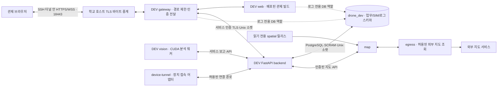
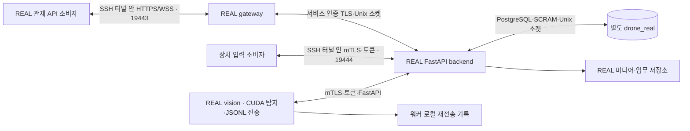

# 드론 시스템 아키텍처·서비스 경계 v1.2

기준일: 2026-10-14 (폴더·DB 기본 목록은 2026-10-09, 비전 연동은 2026-10-14 갱신), Asia/Seoul. 관련 문서: [서비스·DB·데이터셋 구조 v1.2](service_db_dataset_structure_v1.2.md), [파일 구조·운영 가이드 v1.2](server_file_structure_services_v1.2.md).

학교 서버의 현재 컨테이너·마운트·실행 명령을 다시 확인해 작성했다. 실제 서비스 구성과 향후 실기체·외부 접속 목표를 구분한다. 첨부된 2026-10-07 문서의 내용은 이전 확인 시점의 기록이며, 그 안의 명령을 이번에 실행하지 않았다.

## 1. 현재 실행 환경

```text
/home/se/sandboxes/
├── README.md                   # 폴더 역할만 설명하는 트리
├── drone-server/               # 초기 서비스 5개 + 공용 전용 Docker 엔진
├── drone-dev/                  # 개발·SIM 서비스 8개 + drone_dev DB
└── drone-real/                 # REAL 저장 서비스 4개 + drone_real DB
```

세 경로는 실제 폴더다. 날짜 이름의 이전 경로와 `drone-legacy` 바로가기는 제거됐다. 예전 `directory-organization`의 복구 자료는 `drone-server/backups/maintenance`에 관리자 전용으로 보존하고, 공유 가능한 검증 근거는 `drone-server/evidence/maintenance`에 둔다.

Docker 엔진은 `drone-server/runtime`에 있고 세 환경이 재사용한다. 17개 컨테이너가 실행 중이며 종료된 이전 일회성 컨테이너 2개도 보존한다. 프로젝트·컨테이너 식별자의 날짜 문자열은 유지하며, 폴더 경로와 같은 것으로 해석하지 않는다.

## 2. 현재 개발·관제 서비스 연결



DB는 HTTP 서버가 아니라 PostgreSQL 프로토콜을 사용한다. 지도·비전·브라우저·장치의 업무 전달은 버전 있는 API 계약을 사용한다. 호스트의 TLS 바이트 중계는 HTTP 인증을 대신하지 않으며 TLS는 내부 서비스에서 검증한다.

`web/`은 현재 배포된 화면 빌드이며 프론트 원본 저장소가 아니다. 지도 파생본은 저장된 구역·격자를 조회하는 자료다. 브라우저 접속마다 의미분할 생성·모델 학습·Unreal 실행을 시작하지 않는다. 브라우저의 외부 지도 SDK·지형 요청과 서버 egress 조회는 서로 다른 경로이며, 모든 지도 요청을 서버가 대신 수행하는 것으로 해석하지 않는다.

## 3. 별도 REAL 데이터 환경



REAL은 별도 DB 인스턴스·저장소·자격증명을 사용하는 실제 형식의 데이터 저장 환경이다. 개발 관제 Web이 REAL API를 소비하도록 전체 화면이 전환됐다는 뜻은 아니다. REAL 환경에는 별도 Web 컨테이너가 없다.

2026-10-14 REAL·SIM vision을 `python -m app.vision_ingest`로 전환했다. 별도 모델 사본·환경별 모델 ID와 CUDA/TensorRT v12_f91_swa을 검증했다. REAL은 입력 조회→탐지→JSONL→기존 전송기, SIM은 프레임 메타데이터·해시 입력→claim/attempt→completion으로 연결한다. 모델 로딩 보고에는 45초 유효시간을 적용한다. pose 누락·물리 보정 미검증 결과의 지리 좌표는 PENDING이고 실제 비행 제어는 비활성 상태다.

## 4. 서비스·저장소·권한 경계

| 환경/서비스 | 현재 네트워크 | 핵심 책임·허용 접근 |
|---|---|---|
| 초기 `api`, `jupyter`, `vision`, `database`, `media` | host | 초기 개발 진단·작업 환경. 신규 업무 환경과 같은 최소 권한 구성을 적용했다고 주장하지 않음 |
| DEV `backend` | none | 사용자·업무 권한 검증, 개발 업무 DB 최소 역할, 미디어 저장, SIM·통신 API |
| DEV `database` | none | `drone_dev`, 전용 DB 소켓·영속 데이터 |
| DEV `gateway`, `web` | none | 인가된 경로 중계·화면 제공, **통신 로그 전용 DB 접근 예외** |
| DEV `vision` | none | 자체 신원으로 보고·입력/결과 API, 모델용 위치와 자체 작업 공간 |
| DEV `map` | none | 읽기 전용 지도 파생본 조회, 업무 DB·임무 데이터에 직접 접근하지 않음 |
| DEV `egress` | host | 학교 지도 서비스를 위한 제한된 외부 조회 |
| DEV `device-tunnel` | host | 장치 접속 전달 경로. 일반 업무 DB 접근 서비스가 아님 |
| REAL `backend` | none | REAL 입력·저장·조회와 자체 업무 DB 역할 |
| REAL `database` | none | `drone_real`, 전용 소켓·영속 데이터 |
| REAL `gateway`, `vision` | none | 관제 API 중계·GPU 탐지 및 결과 전달, 업무 DB 직접 접근 없음 |

기존 설명의 “백엔드 외에는 어떤 DB에도 접근하지 않는다”는 현재 DEV 로그 구성과 맞지 않는다. 업무 DB의 임무·명령·후보 처리는 backend가 담당하지만, DEV gateway·web은 별도 `drone_log_writer` 역할로 `observability.communication_log`의 INSERT·SELECT를 수행한다. 소켓과 로그 역할을 가진 것이 업무 테이블 권한을 의미하지 않는다.

사용자 세션, 장치 신원, gateway·vision 등 서비스 신원은 구분한다. 내부 HTTP는 인증서·서버 이름·서비스 토큰과 API 권한을 검사한다. 사용자 쓰기 요청의 세션·Origin·CSRF, 신원에 대응하는 기체·임무 범위와 입력 계약을 유지한다. API 계정과 스키마 관리·백업 계정도 분리한다.

Zero Trust 경계는 폴더 이름으로 생기지 않는다. 마운트·UID·자격증명·API 권한·허용된 소켓을 함께 확인한다. 컨테이너는 호스트 커널·CPU·GPU·RAM·디스크와 관리자 권한을 공유한다. 초기 Jupyter 및 외부 학습 환경이 같은 자원을 사용할 수 있으므로 파일 격리가 성능·고장 격리를 보장하지 않는다.

## 5. 현장 통신 목표와 현재 접속 범위

사용자가 확정한 물리 연결은 다음과 같다.

```text
드론/FC/센서
  ↕ 전용 Wi-Fi 송수신기
현장 게이트웨이
  ↕ 휴대폰 테더링·이동통신 인터넷
학교 서버: 인증·업무 백엔드·DB·비전 서비스
  ↕ 인터넷 HTTPS/WSS
다른 장소의 관제 PC·휴대폰
```

학교 서버의 `gateway` 컨테이너와 현장 게이트웨이는 서로 다른 구성요소다. 관제 PC도 현장과 다른 장소에 있으므로 업무 시스템을 그 PC로 옮겨도 현장 테더링 구간은 남는다. 현재 방향은 업무 시스템·주 DB·추론 서비스를 학교 서버에 유지하되, 시간에 민감한 현장 안전 동작과 비동기 추론·영상·업무 처리를 분리하는 것이다.

현재 검증된 접속은 SSH 터널이다. 학교 서버의 새 외부 포트를 열 수 없다는 제약에 따라 Cloudflare Tunnel을 검토했지만 계정·도메인·외부 신원 정책은 준비 전이며 Tunnel은 설치·공개하지 않았다. 공개 휴대폰 HTTPS/WSS와 실기체 테더링 왕복은 목표 범위다. 터널 연결이 지연·재전송 문제를 해결했다고 주장하지 않는다.

과거 최대 약 20초 연결 공백은 폴더 정리와 무관하다. 최신 폴더 검증은 실테더링 장시간 품질·명령 지연 상한을 증명하지 않는다. 상세 분석은 로컬 `D:\Capstone1\Backend\BE_docs`의 `school_outage_root_cause_review_20261009.md`, `live_link_service_risk_review_20261009.md`에 보존했다. 서버의 현재 공개 검증 근거는 7절의 evidence 경로를 따른다.

다음은 실기체 단계의 요구사항이며 이번 문서 갱신으로 구현·시험 완료를 주장하지 않는다.

- 추론·영상 업로드가 제어권·명령·연결 상태 확인을 막지 않도록 처리 경로를 분리한다.
- 현장 게이트웨이·FC의 단절 대응은 서버·DB·추론 응답을 기다리지 않도록 설계하고 시뮬·기체에서 검증한다.
- 만료 명령·중복 명령·이전 세션·오래된 추론 결과를 검사하며 연결 복구만으로 자동 재생·재개하지 않는다.
- gateway의 서버 연결 여부와 원격 운영자의 유효 제어권·접속 생존 여부를 구분한다.
- 별도 RC 경로는 준비 예정이며, 실제 확보·단절 대응 검증 전 수동 제어 유지가 보장된 것으로 취급하지 않는다.

## 6. 저장·데이터 흐름

| 데이터 | 현재 흐름 | 저장 경계 |
|---|---|---|
| 임무·선택·관측·명령 기록 | 인가된 관제/장치 → backend → 업무 SQL·함수 | DEV와 REAL DB 분리 |
| 공간자료 | 로컬 생성·검증 → 학교 파생 파일·등록 메타데이터 → map/API | 개발 `data/spatial`과 PostGIS 참조를 구분 |
| 비전 출력 | 워커 로컬 기록 → mTLS·토큰 FastAPI → receipt·관측·후보·사건 | 워커가 DB나 backend 파일 저장소를 직접 수정하지 않음 |
| 시뮬 실험 | 관제 API·등록 worker → backend → 개발 `simulation.*` | 현재 개발 DB 스키마이며 별도 신규 시뮬 DB를 생성한 상태가 아님 |
| 통신 기록 | 서비스/클라이언트 보고 → 허용된 로그 기록 경로 | `observability` 전용 권한, 실제 서버 관측과 클라이언트 보고 구분 |
| 모델·경로 정책 | 산출물 버전·해시·검증 → 담당자 승인 → 명시적 반영 | 모델 등록만으로 로드·비행 준비를 인정하지 않음 |

시뮬에서 얻은 경로 정책·가중치를 승인한 버전만 실제 환경에 적용한다는 사용자 정책은 유지한다. 현재 SIM→REAL 산출물 자동 승격·실제 최적 경로 비행 검증 완료를 뜻하지 않는다.

## 7. 현재 확인과 후속 범위

| 구분 | 상태 |
|---|---|
| 새 실제 폴더명·기존 경로/바로가기 제거·복구 자료 통합 | 확인 완료 |
| 기존 컨테이너 ID·이미지·설정·쓰기 영역·기존 영속 데이터 보존 | 경로 이관 검증 완료 |
| 개발·REAL DB 연결 및 로그인·인증 거부·WSS | 이전 경로 정리 검증 19개 통과, 근거 보존 |
| 현재 서비스 17개·마운트·DEV 로그 접근 예외 | 이번 문서 갱신에서 다시 읽기 확인 |
| DB 테이블·컬럼·제약·명시적 역할 권한·migration 이력 | 이번 문서 갱신에서 읽기 전용 확인 |
| 신규 전체 Web·실기체·공개 접속 구축 | 후속 범위 |
| 서버 재부팅·기체·테더링·전체 화면 기능 검증 | 미실행, 최신 GPU·UE 연동 검증은 8절 |

근거: 서버 `drone-server/evidence/maintenance/architecture-v1.2.json`, `db-structure-v1.2.json`, `engine-migration-verification.json`, `final-layout-check.json`. 문서 갱신 중 서비스 설정·DB 구조·업무 데이터·모델을 변경하지 않았다.

## 8. 2026-10-14 비전 연동 적용

실제 UE CAPTURE 프레임 4장→pose 저장→SIM 분석 작업→GPU 추론→개발 DB 완료 4건을 확인했다. SIM 업로드는 별도 스레드이고 run·mission·worker·session 경계를 검사한다. REAL 운용 DB에는 실제 모델 메타데이터만 추가했다. REAL 저장 회귀 48개는 임시 DB, 단위 27개는 격리된 입력/워커 검사, TLS/WSS 12개는 실제 서비스에서 검증했다. 신규 시뮬 DB·테이블은 만들지 않았다.

추론 경로·담당자 계약은 `vision_integration_handoff_v1.2.md`, 현재 근거는 DEV/REAL `evidence/vision-pose-verification.json`과 REAL `evidence/real-vision-pose-storage-check.json`, `real-vision-pose-live-audit.json`이다. 기존 7절의 경로 이관 검증은 당시 기록이며 최신 비전 상태를 대신하지 않는다. TensorRT 인수는 v1.2에서 완료했다. 실기체 좌표 보정·비행·학습 동시 GPU 부하는 후속 검증 범위다.

## 비전 v1.2 보완 (2026-10-14)

같은 학교 서버·SIM/REAL 분리 구조를 유지하며 두 워커를 v12 TensorRT로 갱신했다. 운영자 인상착의 조건은 백엔드 API→프레임 메타데이터→워커로 전달한다. 라이브 UE 44프레임 분석을 완료했으나 지속 5fps 전송은 미충족이며, 지연과 모델 단독 22.5ms를 혼동하지 않는다. 이전 절의 4프레임·48/27검사는 v1.1 이력이다. 최신 계약·검증·미확인 항목은 [전달서](vision_integration_handoff_v1.2.md)를 따른다.
