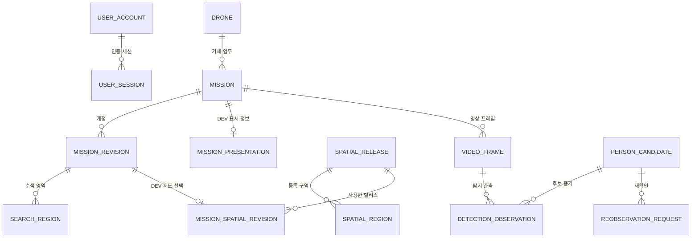
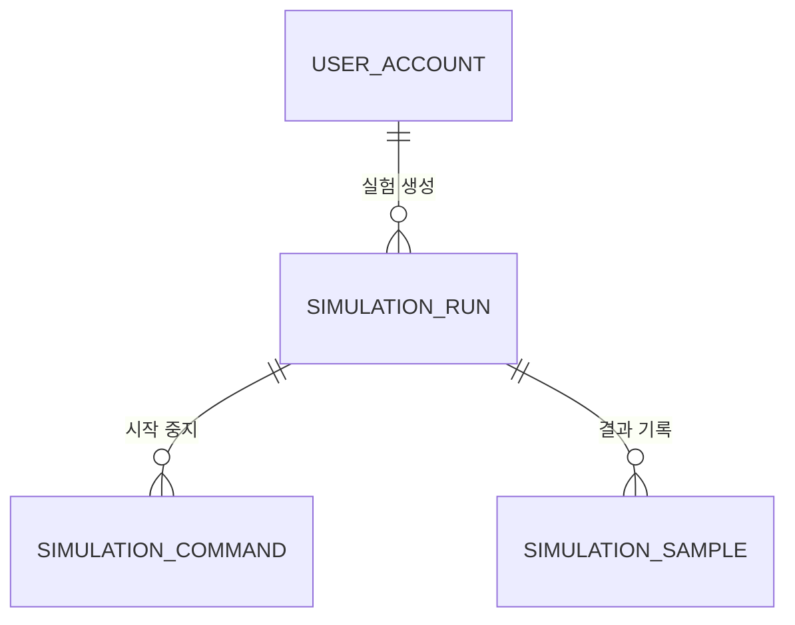

# 서비스·DB·데이터셋 구조 v1.2

기준일: 2026-10-14 (테이블 목록은 2026-10-09, 비전 저장 계약은 2026-10-14 갱신), Asia/Seoul. 관련 문서: [아키텍처 v1.2](service_architecture_zero_trust_v1.2.md), [파일 구조·운영 가이드 v1.2](server_file_structure_services_v1.2.md).

두 업무 DB의 테이블·컬럼·제약·명시적 테이블 권한·migration을 읽기 전용으로 다시 확인했다. 첨부 2026-10-07 문서의 공간자료 설명은 참고 자료이며, 지도 파일 전체 해시·셀·도형 품질을 이번에 재검증한 것은 아니다. 비밀번호·토큰·개인키·업무 행 내용은 문서와 공개 근거에 넣지 않는다.

## 1. DB와 파일 저장소의 경계

| 저장소 | 환경·접속 | 역할 |
|---|---|---|
| 초기 DB `drone` | `drone-server/data/postgres`, 호스트 loopback TCP 18432 | 초기 개발 진단·자료. 개발·REAL 업무 DB와 별도 |
| 개발 DB `drone_dev` | `drone-dev/data/postgres`, 전용 PostgreSQL Unix 소켓 | 개발 업무·지도 참조·SIM 실험·통신 기록 |
| REAL DB `drone_real` | `drone-real/data/postgres`, 별도 인스턴스·전용 Unix 소켓 | REAL 형식 임무·상태·영상 프레임·후보·명령 증거·수신 receipt |
| 개발 지도 파일 | `drone-dev/data/spatial` | 등록 릴리스의 래스터·읽기 전용 SQLite·지형·manifest |
| 업무 미디어 파일 | 각 환경의 `data/backend` | 영상·crop·clip 등 파일 내용. DB는 해시·상태·연결 메타데이터 보관 |
| 비전 작업·모델 | 각 환경의 `data/vision`, `data/models` | 자체 작업·재전송 기록, 검증된 모델 산출물용 위치 |
| 로컬 지도 생성 DB·Unreal 자료 | 담당자 로컬 프로젝트 | 원본 수집·분할·검증·실행. 학교 업무 DB를 대체하지 않음 |

DEV와 REAL은 같은 DB의 두 스키마가 아니라 별도 PostgreSQL 인스턴스·DB·파일·신원이다. 현재 `simulation`은 `drone_dev` 안의 스키마다. 별도 신규 시뮬 전용 DB 구축 설계와 실제 적용 상태를 구분한다.

## 2. 현재 테이블 수와 적용 이력

| 환경 | 스키마 | 테이블 수 | 해석 |
|---|---|---:|---|
| DEV | `drone` | 23 | 기본 업무 18 + 공간 업무 4 + migration 이력 1 |
| DEV | `simulation` | 3 | run·command·sample |
| DEV | `observability` | 1 | communication_log |
| DEV | `integration` | 1 | 초기 인증 데이터 교환용 probe |
| REAL | `drone` | 20 | 기본 업무 18 + ingest_receipt 1 + migration 이력 1 |

위는 관리 이력을 포함한 대상 스키마 수다. DEV의 대상 스키마 합계는 28개, REAL은 20개다. PostGIS의 `public`, `tiger`, `topology` 관리 객체는 업무 테이블 수에서 제외한다. 업무 API 계정의 `information_schema` 조회는 권한 때문에 관리자 조회보다 적은 객체를 보일 수 있다.

각 환경의 `drone.schema_migration`은 적용 버전·SQL checksum·적용 시각을 기록하는 관리 테이블이며 업무 18개나 실제 관측 데이터에 포함하지 않는다.

같은 migration 번호라도 DEV와 REAL의 007 이후 SQL이 다르다. 파일 번호만 보고 환경 사이에 복사·적용하지 않는다. 이미 적용한 SQL의 내용·해시를 바꾸지 않고 후속 migration으로 수정한다.

| 번호 | DEV 적용 | REAL 적용 |
|---|---|---|
| 001 | business_schema | business_schema |
| 002 | constraints_and_indexes | constraints_and_indexes |
| 003 | event_and_role_rules | event_and_role_rules |
| 004 | review_corrections | review_corrections |
| 005 | backend_business_api | backend_business_api |
| 006 | backend_review_fixes | backend_review_fixes |
| 007 | school_spatial | real_storage |
| 008 | school_quick_sim | real_environment_guards |
| 009 | unreal_simulation | real_reobservation_guard |
| 010 | communication_logs | real_appearance_event |
| 011 | communication_method_safety | 없음 |

현재 DEV 11개, REAL 10개다. 2026-10-14 REAL 010은 운영자의 인상착의 조건 변경 이벤트만 허용하는 권한 보완이며 새 테이블은 만들지 않았다.

## 3. 두 환경의 공통 업무 테이블 18개

같은 테이블 이름이 있어도 환경별 제약·함수·권한·업무 의미가 같다고 가정하지 않는다. REAL은 별도 입력 guard와 비행 제어 비활성 정책을 추가한다.

| 테이블 | 저장하는 내용 |
|---|---|
| `user_account` | 사용자·로그인·권한·상태 |
| `user_session` | 인증 세션·만료·폐기 |
| `drone` | 기체 식별자·장치 세션·제어 세대·gateway 상태 |
| `telemetry_sample` | 보고 시각·순서·위치·비행 상태·시간 근거 |
| `config_version` | 공간·정책·모델 등 설정 버전·해시·검증·승인 상태 |
| `mission` | 임무·환경·현재 초안/승인·운용 상태 |
| `mission_revision` | 임무 개정별 영역·조건·설정 참조 |
| `search_plan` | 계획 버전·경로·승인/실행 관련 상태 |
| `search_region` | 임무 개정에 속한 구역·도형·대표점 |
| `reobservation_request` | 후보의 재확인 요청과 처리 상태 |
| `video_frame` | 프레임 식별자·시각·크기·자세·분석 상태·모델 출처 |
| `media_asset` | 파일 연결·저장 위치·해시·크기·저장/보존 상태 |
| `person_candidate` | 후보 단위 증거·자동 추적·사용자 판단·버전 |
| `detection_observation` | 프레임별 탐지·후보 연결·좌표·품질 근거 |
| `observation_cell` | 임무·격자 버전에 따른 관측 상태 |
| `flight_command` | 발급·순서·만료·세션/제어권·실행 보고 |
| `alert` | 알림·중요도·확인 상태 |
| `mission_event` | 순서가 있는 임무 변경·상태·감사 사건 |

테이블이 존재하는 것과 실제 기체·모델·시뮬 엔진이 데이터를 공급하는 것은 별개다. REAL의 `flight_command` 테이블 존재가 실제 비행 명령 발급·시작·재개 활성화를 의미하지 않는다.

## 4. 개발 지도·임무 선택 테이블 4개

| 테이블 | 주요 관계 | 역할 |
|---|---|---|
| `spatial_release` | PK release_id, 설정/버전 참조 | 릴리스·환경·world/grid·좌표계·내용 해시·manifest |
| `spatial_region` | PK (release_id, source_id), 릴리스 FK | 해당 릴리스의 구역 ID·도형·대표점·원본 부가정보 |
| `mission_presentation` | PK/FK mission_id | 임무 목록의 이름·유형 |
| `mission_spatial_revision` | PK/FK (mission_id, revision), 릴리스 참조 | 개정에서 선택한 구역 ID·요청 식별자·해시 |

위는 문서 이해를 위한 주요 FK 관계의 부분도이며 모든 FK·nullable·복합키를 펼친 전체 물리 ERD가 아니다. 실제 컬럼·제약 정의는 공개 메타데이터 `db-structure-v1.2.json`에 있다.

`selected_zone_ids` JSON 배열을 ID별 SQL FK처럼 취급하지 않는다. 저장 함수·API가 존재·중복·릴리스·권한·개정 충돌을 검사한다. 선택 구역의 임무 도형 저장과 실제 관측 완료 상태는 다르며 전체 지도 셀을 임무마다 관측 테이블에 복제하지 않는다. 새 지도 릴리스가 기존 임무의 world/grid 버전을 자동 변경하지 않는다.

## 5. 개발 시뮬레이션 기록

현재 `drone_dev`에 아래 테이블이 존재한다. 첨부 10월 7일 문서의 “연결이 아직 없음”을 현재 DB·API 골격의 상태 설명으로 그대로 사용하지 않는다. 실제 담당자 PC·Unreal·실기체 왕복의 최신 완전 검증을 이번 메타데이터 확인으로 주장하지도 않는다.

| 테이블 | 주요 키·상태 | 의미 |
|---|---|---|
| `simulation.run` | PK run_id, 생성 사용자 FK, worker/session, 상태·만료·시나리오·world·seed | 한 번의 실험 요청·실행 |
| `simulation.command` | PK command_id, run FK, UNIQUE(run_id, sequence), START/STOP | 해당 실행의 제어 요청과 처리 보고 |
| `simulation.sample` | PK sample_id, run FK, UNIQUE(run_id, producer_session_id, sequence), cursor | 상태·탐지·계획·사건·지표·명령 보고 등의 원본 기록 |

현재 실행 계약은 SIM 기체 `sim-pi-01`, NED_M 좌표, 지정 world(TestField/Kumoh)를 가진다. `run`은 QUEUED/RUNNING/COMPLETED/FAILED/CANCELLED 상태를 저장하고, 입력은 불변이며 sample은 append-only다. worker·세션·순서·불변 ID/해시를 확인하고 종료 이후 데이터는 `late`로 구분한다.

NED 미터 좌표를 WGS84 경위도와 같은 값으로 쓰지 않는다. 시뮬 sample은 REAL DB의 실제 관측 증거가 아니다. SIM 결과→승인 가중치/정책→REAL 반영의 설계는 별도 담당자 산출물과 명시적 승인·검증을 필요로 하며, 현재 자동 승격·실제 최적 경로 비행 완료를 의미하지 않는다.

## 6. 통신 로그와 초기 probe

| 테이블 | 내용·권한 |
|---|---|
| `observability.communication_log` | event/request/operation/run ID, 시간·서비스·경로·method·status·duration·바이트 수·timings·오류·해시 |
| `integration.probe` | 초기 인증 데이터 교환 검증용 자료. 업무·학습의 원본 저장소로 취급하지 않음 |

통신 로그의 `source`는 SERVER 또는 CLIENT_REPORTED다. 클라이언트가 보고한 지연을 서버가 직접 측정한 처리 시간과 혼합하지 않는다. 현재 method는 일반 HTTP·WS와 `OTHER`를 허용한다. 이 상한 보완은 011 migration에 기록돼 있다.

현재 명시적 테이블 권한을 확인한 결과, `drone_api`는 로그 조회를 하며 `drone_log_writer`는 `communication_log`의 INSERT·SELECT만 가진다. DEV gateway·web의 DB 소켓·전용 로그 신원은 이 예외를 위한 것이다. 일반 사용자나 비전 워커에게 임의 SQL 실행·로그 관리자 역할을 제공하지 않는다. 시간·바이트 수·route가 있어도 패킷의 실제 손실 위치나 실기체 안전을 자동 판정하는 자료는 아니다.

## 7. REAL 수신 기록과 데이터 품질

REAL에만 있는 추가 테이블은 `drone.ingest_receipt`다.

| 항목 | 저장·검사 의미 |
|---|---|
| PK message_id | 메시지 재전송 식별 |
| producer_id, producer_session_id, kind, sequence | 생성 주체·세션·유형·순서의 유일성 |
| mission_id FK | REAL 임무에 속한 입력 |
| content_hash, body | 검증한 본문 해시와 JSON 원본 |
| received_at | 서버 수신 시각 |

현재 kind는 VISION_RESULT·COMMAND_OBSERVATION이며 receipt는 수정·삭제 불변 기록이다. 비전 결과 처리에서는 receipt·분석 상태·탐지·후보·사건을 같은 업무 트랜잭션에 반영해 부분 저장을 방지한다. 같은 메시지 ID로 내용을 바꾼 입력은 정상 재전송으로 취급하지 않는다.

REAL guard는 임무·장치·상태·영상·미디어의 환경을 REAL로 제한한다. 상태는 REAL_STATE를 요구한다. REAL DB/API에 SIM fixture를 섞어 검증하지 않고, 검증 fixture는 별도 임시 DB에 둔다. REAL migration도 개발 DB에 잘못 적용하지 않도록 환경 제한을 둔다.

같은 후보의 PENDING/ACCEPTED/EXECUTING 재관측 요청은 하나만 활성화할 수 있다. 자동 확인 신호·운영자 판정·DB 행 버전·워커 revision은 역할을 구분한다. 좌표 보류 후보도 원본 근거를 보존하며, 비전이 제출한 좌표를 물리 검증된 공식 위치로 자동 승격하지 않는다. 구조 검증과 현장 좌표 정확도 검증은 다르다.

외부 명령 관측은 receipt·사건 증거를 저장하는 경로다. 저장 성공을 실제 명령 발급·기체 실행 성공으로 해석하지 않는다. REAL API의 실제 비행 시작·명령 전달·자동 재개는 별도 활성화 검증 전 제한한다.

## 8. 공간·미디어·모델 데이터셋의 분리

| 자료 | 저장 단위 | 보존해야 할 의미 |
|---|---|---|
| 지도 원본·생성 과정 | 담당자 로컬 DB·입력·관계·보고서 | 출처·정책·좌표계·부모 구역·검증 근거 |
| 학교 지도 파생본 | catalog·manifest·SQLite·래스터·지형 파일 | world/grid/release ID·내용 해시·읽기 전용 조회 |
| 관측 증거 | DB 관측·프레임·미디어 메타데이터 + 파일 | 임무·프레임·시각·모델·원본 증거 연결 |
| 비전 재전송 | 워커 로컬 JSONL | API 확인 전 미전송 기록과 재시도, 업무 DB 직접 수정 금지 |
| 모델 산출물 | 버전 있는 가중치·메타데이터·해시 | 입력 크기·class·전처리/후처리·실행 환경·검증 결과 |
| 경로 정책·학습 결과 | 버전·실험 참조·검증·승인 | SIM 원본을 REAL 기록으로 복사하지 않고 승인 산출물만 명시적으로 반영 |

캠퍼스와 구미 지도 폴더는 현재 `data/spatial`에 존재한다. 첨부 문서는 캠퍼스 EPSG:32652·구미 EPSG:5179의 5m 격자 및 WGS84 업무 도형, 캠퍼스·구미의 서로 다른 릴리스와 대표점 보정 근거를 설명한다. 이번 갱신은 파일 존재·등록 구조를 확인했으며 수천만 셀·모든 도형·관계의 품질을 다시 검증하지 않았다.

같은 위치라도 환경·좌표계·world/grid 버전을 비교한다. 선택 구역 ID, 원본 셀 ID, 의미 부모 ID, 실제 관측 상태를 섞지 않는다. 학교 지도 SQLite를 수정 가능한 업무 DB나 학습용 전체 원본으로 취급하지 않는다.

모델 등록·승인 메타데이터와 현재 로딩·물리 준비 상태는 구분한다. 2026-10-14 REAL·SIM 워커의 CUDA/TensorRT v12_f91_swa 로딩과 실제 UE 프레임 분석을 확인했다. 비전 결과는 FastAPI로 전달하고 REAL JSONL은 워커 재전송 기록으로 유지한다. 최신 계약은 `vision_integration_handoff_v1.2.md`다. REAL 등록 DRAFT는 provenance 기록이며 물리 좌표·비행 승인을 뜻하지 않는다.

## 9. 변경·백업·검증 범위

DB 스키마 변경은 실제 적용 DB·migration 번호·기존 해시를 확인하고 임시 복원 DB에서 제약·권한·재전송·동시성 검증 후 수행한다. 초기 설치 명령을 이미 확장된 운영 환경에 반복 실행하지 않는다. 운영 DB를 오래된 dump로 덮어써 새 업무 데이터를 잃게 하지 않는다.

이번 정리의 이전 설정·DB custom dump·오프라인 엔진 사본은 `drone-server/backups/maintenance`에 관리자 전용으로 보존했다. 공유용 증거는 `drone-server/evidence/maintenance`에 둔다. 같은 디스크 사본은 외부 백업·재해 복구 보장을 뜻하지 않는다.

현재 문서의 물리 정의 근거는 `db-structure-v1.2.json`이며 테이블별 컬럼·형식·NULL 여부·PK/FK/UNIQUE/CHECK·명시적 역할 권한·migration 해시를 포함한다. 이는 카탈로그 조회이며 모든 입력·동시성·성능 시험을 다시 실행했다는 뜻은 아니다.

문서 갱신에서 DB 구조·행·역할·서비스 설정은 변경하지 않았다. 실제 기체·모델·Unreal·휴대폰 테더링·전체 GIS 품질·DB 전체 복원·장기 부하 검증은 수행하지 않았다.

## 2026-10-14 저장 계약 보완

기존 `video_frame.pose` JSONB를 사용하므로 migration·테이블을 추가하지 않았다. 신규 입력은 frame-pose/1.0으로 frame ID·capture 시각·시계·기체/카메라 자세·고도 기준·짐벌/고정 마운트·동기 오차를 검증한다. REAL 목록 API와 SIM 분석 메타데이터 API도 pose·pose_status·pose_reason을 반환한다. 미제공 값은 null이며, 공식 탐지 좌표는 물리 검증 전 PENDING으로 보존한다.

SIM은 기존 `drone_dev`에 4개 실제 UE 프레임과 분석 완료를 저장했다. 별도 시뮬 DB·새 시뮬 테이블은 생성하지 않았다. REAL 운용 DB는 실제 모델 ID `55ad2b5e-599c-515f-aa95-82d82e84e689`의 등록 메타데이터를 추가했으며 시험 임무·후보·관측을 넣지 않았다. REAL 회귀 시험은 별도 임시 DB·저장소에서 수행하고 제거했다. 현재 근거: 각 환경 `evidence/vision-pose-verification.json`.

## 비전 v1.2 저장 보완 (2026-10-14)

SIM의 appearance·reported_state는 기존 detection_observation.association_evidence, track_id는 기존 컬럼에 저장한다. 후보 조회 시 최신 관측과 결합한다. 인상착의 조건은 기존 mission_event의 MISSION_EDITED/APPEARANCE_QUERY 이벤트에 저장하며 전용 GET API로 유효 값을 조회한다. REAL 모델 ID는 `1ebaedef-8b30-593c-a894-5cb7f8b40d5d`, SIM은 `9e223e9c-bff2-5775-84bf-05b7e93818e2`다. 이전 4프레임 시험은 v1.1 기록이며 v1.2 라이브 UE에서는 44프레임/44분석 완료를 확인했다. 실제 운용 DB에는 시험 임무·관측을 넣지 않았다. 상세 한계와 재생 시험은 [전달서](vision_integration_handoff_v1.2.md)를 따른다.
