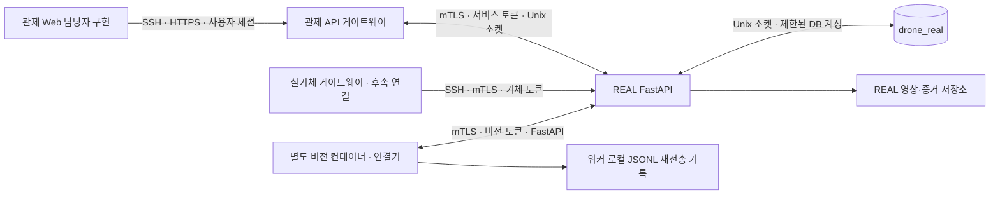

# REAL 데이터 서비스 구축 결과 — 2026-10-06

이번 구축 범위는 **SSH 터널에서 실제 형식의 임무·상태·비전·미디어·명령 결과를 인증해 저장·조회하는 서비스 환경**이다. 비행 제어 활성화와 실제 모델 추론은 포함하지 않는다. 실제 기체나 담당자의 워커 코드가 이미 연결됐다는 의미로 해석하지 않는다.

## 1. 인터뷰 결정

| 항목 | 결정 |
|---|---|
| 기존 개발 환경 | `drone_dev` 및 기존 서비스를 보존 |
| 실운용 환경 | 별도 백엔드·PostgreSQL·자격증명·CA·소켓·저장소 |
| 사용자 접속 | 기존 학교 SSH 방식 유지. REAL HTTPS는 localhost 19443 |
| 기체 서비스 접속 | SSH 터널의 localhost 19444 + 기체별 mTLS/Bearer |
| 비전 워커 | 학교 서버의 별도 컨테이너 |
| 비전 결과 전달 | FastAPI, JSONL은 워커 로컬 재전송 기록 |
| 관제 후보 표시 | 전체 후보, 자동 판정·운영자 판단·좌표 품질 구분 |
| 비행 제어 | 후속 통합. 현재 비활성 |
| 추가 SIM DB·테이블 | [설계만 보존](simulation_environment_design_v1.0.md). 배포하지 않음 |

## 2. 배포 구조



| 구성 | 배포값 |
|---|---|
| 학교 서버 OS | Ubuntu 24.04 환경 |
| 전용 경로 | `/home/se/sandboxes/drone-real` |
| Compose 프로젝트 | `drone-real-20261006` |
| PostgreSQL | `database` 컨테이너, `drone_real` DB, 스키마 `drone` |
| 업무 스키마 | 기존 업무 18개 테이블 + `ingest_receipt` 1개; migration 001–009 |
| 스키마 이력 포함 테이블 수 | 20개: 업무 19개 + `schema_migration` |
| API | `drone_backend.real:app`, v0.2.0 |
| 컨테이너 계정 | DB 999, backend 2201, vision 2202, gateway 2204 |
| 소켓 그룹 | `drone-real-transport`, GID 2500 |
| 네트워크 | 컨테이너 `network_mode: none`, 공개 포트 없음 |
| 호스트 TLS 중계 | `drone-real-relay.service`, 127.0.0.1:19443 / 19444 |
| 관제 계정 | `real-operator` — 별도 발급 비밀번호, 문서·Git에 보관하지 않음 |
| 사용자 세션 | `drone_real_session`, Secure / HttpOnly / SameSite=Strict |

REAL 계정은 SIM DB 자격증명을 갖지 않는다. 관제 게이트웨이·비전은 DB 소켓과 원본 저장소를 마운트하지 않는다. 이미지·영상·검증 파일은 API로 교환한다. 호스트 관리자와 Docker 관리자는 신뢰 경계에 포함되며 별도 VM의 격리를 제공한 것으로 주장하지 않는다. CPU/GPU/RAM/I/O는 학교 서버에서 공유한다.

## 3. 구축한 기능

사용자 로그인·CSRF·드론별 권한, REAL 임무 등록·조회, 인증된 기체 세션·텔레메트리 저장, 영상/sidecar/프레임 업로드, 프레임 조회·입력 다운로드, 비전 결과 원문 영수증·후보·관측·분석 이력 저장, crop/clip 증거 업로드·관제 조회, SYSTEM 재관측 제안, 운영자 판단, snapshot·이벤트 replay·WebSocket, 외부 기체 명령 결과의 원본 수신을 제공한다.

같은 ID·같은 본문 재전송은 멱등 처리하고 변경된 본문은 충돌로 거부한다. 실패한 결과 묶음은 트랜잭션을 되돌린다. 진행 중 재관측은 후보별 한 건으로 제한한다. 파일은 크기·SHA-256·저장 완료를 확인한 후 조회에 제공하고 다른 생산자의 파일 변경은 거부한다.

RAW 명령 결과는 `ingest_receipt`와 `mission_event`에 외부 증거로 저장한다. 아직 서버가 승인·발행한 REAL 명령과 연결하는 처리는 없다. `flight_command`에 가짜 서버 명령을 생성하거나 FC ACK를 비행 성공으로 처리하지 않는다.

현재 프레임 수신과 모델 메타데이터 등록은 물리 검증·모델 로딩 성공이 아니다. 워커 좌표는 원본 주장으로 보존하고 공식 후보 좌표는 PENDING이다. 자동 확정은 `tracking.auto_confirmed`, 운영자 판단은 `judgement`, DB 변경 판은 `row_version`으로 분리한다. 비전 컨테이너에는 모델 대신 JSONL 전송 연결기가 실행 중이다.

## 4. 검증 결과와 한계

| 검사 | 결과·범위 |
|---|---|
| REAL 저장 API | 임시 실제 PostgreSQL에서 45개 검사 통과 |
| 시험 정리 | 임시 DB·컨테이너·저장소 삭제. 실운용 DB에 비행/비전 시험 데이터 미삽입 |
| 실제 TLS·WSS | 배포된 서비스에서 12개 검사 통과 |
| 실제 호스트 중계 | HTTPS 19443 미인증 거부, 기체 mTLS 19444 인증 성공 후 dispatch 차단 응답 확인 |
| 기존 서비스 | 기존 5개 서비스 실행 시각 유지, 기존 코드·DB·학습 환경 변경 없음 |
| SIM 공유 코드 호환성 | 임시 DB에서 기존 정상·회귀 79개 검사 통과. 새 URL 분기를 반영해 시험 Request stub에 URL을 추가 |
| 백업 복원 | 별도 임시 DB에 최신 dump 복원, migration 9개·임무 0개 확인 후 임시 DB 삭제 |
| 실제 기체·실제 모델 | NOT_RUN |
| 공개 인터넷·휴대폰 서비스 | NOT_CONFIGURED |

REAL API 시험 데이터는 실제 형식의 합성 fixture다. TestClient에서는 인증서 신원 scope를 시험용으로 제공하며 실제 TLS를 사용한 것으로 집계하지 않는다. 별도 TLS/WSS 검사는 실제 인증서 검증·토큰 결합·로그인·조회·Origin 거부·로그아웃을 확인했다. 이 검사는 운영 인증 세션·감사 이벤트만 만들고 임무·영상·후보·텔레메트리 fixture는 만들지 않았다. 실제 WSS 연결 인증을 확인했으며 실기체 임무의 이벤트 스트림 전체 왕복은 후속 단계다.

증거: `evidence/real/real-storage-check.json`, `real-deployment-audit.json`, `backup-restore-check.json`. BAZE 설계 분석은 완료됐지만 Sonnet 비전/코드 검토는 길이 제한으로 잘림 또는 응답 없음이 발생해 완전한 외부 코드 검토로 집계하지 않는다. 해당 계약 차이는 로컬 소스·DB 제약·실행 검증으로 확인했다.

현재 환경은 제한된 자원으로 준비한 데이터 서비스다. 다중 워커 임대, 실제 워커의 추론 실행, 모델/좌표 물리 검증, 자동 경로 생성, 비행 허가·명령 전송, 지도·영상 스트리밍 화면, 대규모 동시 사용자·성능 목표, 외부 HTTPS 공개는 후속 통합이 필요하다.

## 5. 실행·인수인계

```bash
cd /home/se/sandboxes/drone-real
./scripts/stack.sh ps
sudo python3 tools/verify_real.py
sudo python3 tools/audit_real.py
```

`deploy_real.py`는 신규 환경용이며 기존 경로가 있으면 덮어쓰지 않고 중단한다. `launch_real.py` 역시 최초 실행용이다. 변경 배포는 백업·임시 DB 검증·소스 fingerprint 확인·실제 접속 검증 후 수행한다. 변경으로 `model_loaded`나 `flight_enabled`를 자동 활성화하지 않는다.

실제 구현 규격은 [OpenAPI](openapi-real.json), 비전 담당자는 [비전 연동 안내](vision_backend_handoff_v1.0.md), 관제 담당자는 [REAL 관제 연동 안내](frontend_real_api_integration_v1.0.md)를 따른다. 비전 원문 초안은 변경하지 않았다.
