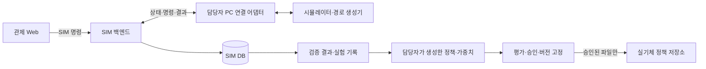

# 시뮬레이션 환경·DB 분리 설계 v1.0

- 작성일: 2026-10-06
- 상태: **설계만 보존. 신규 시뮬레이션 DB·테이블·연결기는 배포하지 않는다.**
- 목적: 실기체 시험 전에 경로 생성·판단을 검증하고, 승인된 정책·가중치를 후속 실기체 시험에 제공한다.

## 1. 확정 요구사항

| 항목 | 결정 |
|---|---|
| 시뮬레이터 위치 | 다른 담당자의 PC. 현재 준비 전 |
| 접속 | 학교 서버로 SSH 터널. 장치/서비스 인증은 SSH와 별도로 검증 |
| 검증 목표 | 관제 명령 → 백엔드 → 실제 시뮬레이터 → 결과 저장 왕복 |
| 경로 생성기 | 다른 담당자가 개발. 시스템 담당자는 알고리즘을 구현하지 않음 |
| 실기체 반영 | 승인한 정책·가중치 버전만 반영 |
| 최초 명령 범위 | 미정: 실행/중지/상태 또는 지정 경로 가상 비행 |
| 담당자 인터페이스 | 미정: Python 함수 / HTTP API / 실행 파일 |
| 결과물 | 미정: 경로·점수 설정 / 모델 가중치 / 둘 다 |

## 2. 목표 구조

학교 서버 내부 서비스는 별도 계정·컨테이너·저장소를 사용한다. 담당자 PC는 명령을 인증 후 가져오고 결과를 반환하는 방식으로 연결한다. PC에 명령 실행용 공개 포트를 열거나 임의 셸 명령을 전송하는 방식을 채택하지 않는다.

## 3. DB 경계

현재 `drone_dev`와 기존 SIM 개발 API는 기존 개발·검증 환경으로 보존한다. 이번 작업에서는 이 환경에 새 테이블을 추가하지 않는다. 새 시뮬레이션 전용 DB의 이름·보존 정책·전용 스키마는 담당자 규격 확정 후 정한다.

향후 SIM과 REAL은 동일한 업무 스키마를 재사용할 수 있지만 PostgreSQL 인스턴스·계정·소켓·저장소·백업을 분리한다. SIM 임무·텔레메트리·영상·후보·명령 결과를 REAL 업무 테이블로 복사하지 않는다. 학교 서버의 CPU·GPU·메모리·디스크 I/O는 공유하므로 자원 한도와 성능 검증이 별도로 필요하다.

실험에는 `run_id`, 시나리오·맵·시뮬레이터 버전, 난수 seed, 입력 정책 버전, 기체·센서 설정, 결과 지표, 중단 사유, 원본 증거 참조를 연결한다. 실제 기체에서 촬영한 영상을 시뮬레이션 평가에 사용하더라도 촬영 출처와 평가 환경을 별도 필드로 기록한다.

## 4. 실기체로 전달하는 결과

시뮬레이션 실행 로그와 학습된 가중치는 다른 결과물이다. 경로 담당자가 알고리즘에 맞는 학습·최적화 절차와 산출물 형식을 제공해야 한다. 시스템은 산출물을 생성하거나 효과를 임의로 판정하지 않는다.

승인 대상에는 정책 ID·버전, SHA-256, 입력 규격, 경로 생성기·런타임 호환 버전, 학습/평가 데이터 버전, 원본 실험 ID, 평가 지표, 승인자·승인 시각을 기록한다. 파일은 승인 후 수정하지 않고 새 버전으로 등록한다. 실기체 환경은 승인된 파일을 읽기 전용으로 제공받는다. 이전 버전으로 복귀할 수 있도록 활성 버전과 이력을 남긴다.

가중치 승인·복사는 비행 허가가 아니다. 실제 지도·좌표계·기체 성능·센서 보정·안전 조건을 적용해 경로를 다시 생성·검증해야 한다. 시뮬레이션에서 나온 경로 좌표를 그대로 실제 드론으로 전달하는 것으로 해석하지 않는다.

## 5. 향후 검증 판정

| 항목 | 현재 |
|---|---|
| 신규 SIM DB·테이블 배포 | NOT_IMPLEMENTED — 설계만 보존 |
| 담당자 PC 어댑터 | NOT_IMPLEMENTED |
| 실제 시뮬레이터 명령 왕복 | NOT_RUN — PC 준비 전 |
| 경로 생성기 연결 | NOT_RUN — 규격 미정 |
| 정책·가중치 승인/복사 | NOT_IMPLEMENTED |
| 실기체 경로 최적화 효과 | NOT_RUN |

실제 구축 시 명령 ID 중복, 재접속, TTL 만료, 중단, 늦은 결과, 이전 실행 결과 혼입, 권한 거부, SIM→REAL 데이터 혼입 차단을 확인한다. 단순 모의 HTTP 응답을 실제 시뮬레이터 비행 검증으로 집계하지 않는다.
