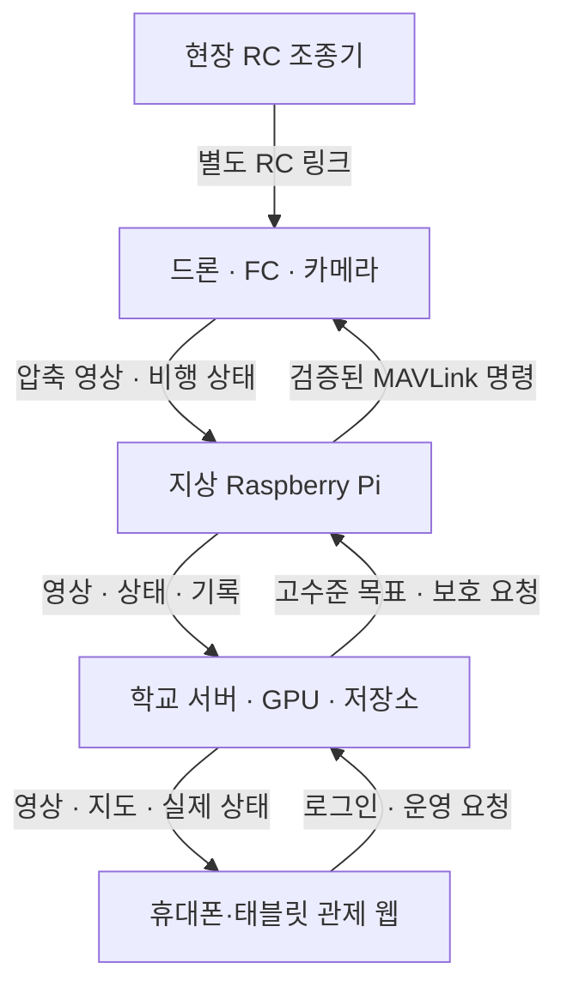

# 자율 정찰 드론 시스템 환경·통신 설계서

- 문서 버전: v1.0
- 작성일: 2026-10-03
- 기준: 설계명세서 v2.1, 운용구조·예산안 v2.1, 환경 설계 인터뷰
- 담당 범위: 드론·게이트웨이·서버 하드웨어, OS, 통신, 장애 대응
- 상태: 운용 정책 확정 / 배포 상세와 실장비 시험 일부 미완료

## 1. 설계 목표

드론과 학교 서버 사이의 통신을 지상 Raspberry Pi 게이트웨이로 중계한다.

서버는 영상 분석·탐색 계획·저장을 담당한다. Pi는 영상·비행정보 중계, 현장 기록, 명령 검증을 담당한다. FC는 자세 안정화와 실제 비행 제어를 수행한다.

영상 수신을 자동 정찰의 필수 조건으로 둔다. 최신 유효 영상이 끊기면 진행 중 자동 이동을 중단한다. 관제 웹의 재생 지연은 서버 분석용 원본 영상의 단절과 구분한다.

시연은 운영자 1명이 휴대폰 또는 태블릿의 웹에 로그인해 수행한다.

## 2. 확정 사항과 미확정 사항

| 항목 | 설계 기준 | 상태 |
|---|---|---|
| 운용 구조 | 단일 드론 ↔ 지상 Pi ↔ 학교 서버 | 확정 |
| 게이트웨이 | Raspberry Pi 4B 2GB / microSD 64GB | 예산 기준, 구매 전 |
| 게이트웨이 OS | Raspberry Pi OS Lite 64bit | 후보, 수신 드라이버 확인 후 버전 확정 |
| 서버 환경 | Ubuntu 22.04 컨테이너, JupyterLab | 사용자 확인 |
| 서버 자원 | i9-11900 / RTX 3090 / RAM 64GB | 제공 사양 |
| GPU 사용 | nvidia-smi 및 PyTorch CUDA 사용 | 사용자 확인 완료 |
| 서버 저장 공간 | 영구 저장 공간 5TB | 제공 확인, 경로·현재 가용량 미확인 |
| SSH | 외부 포트 7540, 계정 se | 확정 |
| JupyterLab | 배정된 내부 포트에 SSH 터널로 접속 | 학교 안내 기준 |
| Pi 인터넷 | Android 스마트폰 USB 테더링 | 채택 |
| 관제 단말 | 휴대폰·태블릿 반응형 웹/PWA | 확정 |
| 시연 동시 접속 | 운영자 1명 | 확정 |
| 운영자 계정 | 시연 전에 생성, 웹에는 로그인 제공 | 확정 |
| 외부 서비스 접근 | 모바일 웹과 SRT 수신 경로 | 학교 관리자 확인 필요 |
| 원본 영상 코덱 | 명세서의 H.264 기준 | 실제 장비 출력 확인 필요 |
| 개발 PC 접속 도구 | Ubuntu/WSL OpenSSH 또는 MobaXterm | 최종 선택 미지정 |

사용자 확인과 설계 결정을 기록한 문서다. 실제 서버 설정·장비 설치·비행 시험을 완료했다는 뜻은 아니다.

## 3. 구성과 책임 경계



| 구성 | 담당 기능 |
|---|---|
| 드론 FC | 자세·고도 안정화, 목표 추종, 위치·배터리·모드 보고, FC 보호 동작 |
| 드론 영상 장비 | 촬영, 압축 영상 송신 |
| 현장 RC | 자동 복귀 실패 등 비상 상황에서 제어권 인수 |
| Pi | 영상·MAVLink 중계, 시각 기록, 현장 저장, 명령 검증, 링크·실행권 감시 |
| 서버 | 영상 수신·디코딩·추론, 좌표·지도·경로 계획, 영상·결과·로그 저장 |
| 관제 웹 | 로그인, 상태·영상 확인, 임무 요청, 복귀·착륙 요청, 재개 승인 |

웹과 서버는 FC의 저수준 자세 제어를 직접 수행하지 않는다. 비행 요청은 서버의 권한 확인과 Pi의 현장 검증을 거쳐 전달한다.

## 4. 하드웨어와 현장 연결

예산안 v2.1의 품목을 기준으로 한다. 별도 라우터나 GPU 컴패니언 컴퓨터는 추가하지 않는다.

| 구간 | 예산 기준 장비·방식 | 확인할 항목 |
|---|---|---|
| FC·위치 | F450 패키지 / KoA H743 / M10 GPS | 펌웨어·보드 지원, 센서·포트 연결 |
| 거리 센서 | TF02-Pro | 전원·인터페이스·FC 설정 |
| 영상 | RunCam WiFiLink 2-G / 독립 5GHz 링크 | 지상 수신 구성, USB 장치, Linux 드라이버, 출력 코덱 |
| MAVLink | KoAFC 텔레메트리 | FC↔Pi 양방향 통신, 장치 경로·속도 |
| 비상 RC | TX12 MKII CC2500 / R81 V2 / SBUS | 모드 전환·제어권 인수·단절 보호 |
| 카메라 장착 | GM3 V2와 렌즈 비교 구성 | 물리적 호환, 하향 45° 유지, 보정 |
| WAN | 스마트폰 USB 테더링 | Pi 인식, 야외 연결, 재접속, 전원 안정성 |

R81 V2는 RC 수신기다. MAVLink 상태·명령은 KoAFC 경로로 분리한다.

영상 수신용 무선 장치와 로컬 상태 페이지용 Wi-Fi의 인터페이스 배정을 확인한다. Pi 내장 Wi-Fi 하나로 두 기능을 동시에 처리할 수 있다고 가정하지 않는다.

## 5. OS와 실행 환경

### 5.1 게이트웨이

Raspberry Pi OS Lite 64bit를 후보로 둔다. 영상 수신 장치의 드라이버·커널·수신 프로그램 호환성을 확인한 뒤 배포 버전을 확정한다.

운영 기능은 다음과 같이 구성한다.

- 영상 수신·중계·현장 기록
- MAVLink 라우팅
- 명령 검증·실행권 감시
- 링크·기체 상태 감시
- 복구 업로드
- 읽기 전용 로컬 상태 조회

Pi에서 무거운 영상 추론이나 GRACE 인코딩을 수행하지 않는다.

서비스는 부팅 시 자동 실행하고, 종료 시 자동 재시작하도록 구성한다. 서비스 재시작이나 연결 복구만으로 비행 임무를 시작·재개하지 않는다.

### 5.2 서버

제공된 Ubuntu 22.04 컨테이너와 확인된 CUDA 환경을 사용한다.

JupyterLab은 개발·실험에 사용한다. 운영 수신·API·저장 서비스는 노트북 실행 상태에 의존하지 않도록 구성한다.

FastAPI, 미디어 수신·저장, 비전 처리, 임무·안전 처리, PostgreSQL/PostGIS는 설계명세서의 책임 경계를 따른다. 패키지 버전은 실제 환경 확인 후 고정한다.

컨테이너 내부에 systemd나 Docker 실행 권한이 있다고 가정하지 않는다. 상시 실행과 컨테이너 재시작 후 자동 기동은 학교 제공 환경을 확인한 뒤 구성한다.

## 6. SSH·JupyterLab 접속

SSH 7540은 외부 접속 포트다. JupyterLab과 관제 웹의 내부 서비스 포트는 별도다.

1. 내 PC에서 학교 서버에 SSH로 접속한다.
2. 서버에서 학교 제공 JupyterLab 실행 스크립트를 실행한다.
3. 실행 결과에 표시된 정보 파일을 읽어 배정 포트를 확인한다.
4. 내 PC의 새 터미널에서 안내된 SSH 터널 명령을 실행한다.
5. 터널을 유지한 상태로 내 PC 브라우저에서 접속한다.

내 PC에서 실행:

```bash
ssh -p 7540 se@SERVER_IP
```

SSH로 접속한 서버에서, 스크립트가 있는 디렉터리에서 실행:

```bash
bash jupyter_lab_execute.sh
cat /home/se/JupyterLAB/jupyter_info_PORT_NUMBER.txt
```

PORT_NUMBER는 스크립트가 안내한 실제 숫자로 바꾼다.

터널은 서버가 아닌 내 PC의 새 터미널에서 실행한다.

```bash
ssh -p 7540 -N -L LOCAL_PORT:localhost:JUPYTER_PORT se@SERVER_IP
```

브라우저 주소는 `http://localhost:LOCAL_PORT`다. 학교 안내는 로컬 포트와 서버 Jupyter 포트를 같은 숫자로 사용한다.

MobaXterm은 접속 정보·SFTP 파일 전송·터널을 GUI로 관리하는 선택 도구다. Ubuntu/WSL이나 Windows OpenSSH로도 접속할 수 있다.

서버·JupyterLab 비밀번호, 토큰, SSH 키는 문서에 기록하지 않는다. 관제 웹의 운영자 인증은 서버 OS·JupyterLab 인증과 별도로 구성한다.

## 7. 통신 경로와 포트 조건

| 경로 | 목적 | 방식 | 확인 상태 |
|---|---|---|---|
| 드론→Pi | 영상 수신 | WiFiLink 5GHz 링크·지상 수신 장치 | 장비 호환 시험 필요 |
| FC↔Pi | 상태·명령 | KoAFC 기반 MAVLink | 장치·속도 확인 필요 |
| Pi→서버 | 압축 원본 영상 | SRT | UDP 경로 미확정 |
| Pi↔서버 | 상태·실행권·명령·결과 | WSS/API | 접속 경로 미확정 |
| 웹↔서버 | 로그인·조회·운영 요청·영상 조회 | HTTPS/WSS | 모바일 직접 접속 경로 미확정 |
| 개발 PC↔서버 | 관리·JupyterLab | SSH 7540 / TCP 포워딩 | 학교 안내로 확인 |
| 현장 단말↔Pi | WAN 장애 시 상태 조회 | 현장 로컬 웹 | 단말·인터페이스 시험 필요 |

SRT는 Pi→서버 구간에 적용한다. 드론→Pi의 무선 수신 방식과 구분한다.

SSH의 일반적인 `-L` 포워딩은 TCP 기반이다. 이 터널에 SRT의 UDP 전송을 그대로 연결하지 않는다. 학교에 UDP 포트·컨테이너 연결 경로 또는 허용되는 VPN 경로를 확인한다.

관제 웹은 휴대폰·태블릿에서 서버에 직접 접속하는 방향을 유지한다. 개발 PC의 localhost 터널을 모바일 직접 접속 경로로 간주하지 않는다.

외부 포트가 7540으로만 제한된다는 사실은 확인되지 않았다. 추가 접근이 불가능하면 전송·배포 대안을 결정하고 문서를 개정한다.

## 8. 영상 처리와 표시

1. 드론에서 받은 압축 영상을 Pi에 기록하고 서버로 중계한다.
2. 실제 출력 형식이 호환되면 Pi에서 재인코딩하지 않는다.
3. 서버가 원본을 디코딩해 탐지·좌표·관측 품질을 판정한다.
4. 서버가 영상·크롭·분석 결과를 보관한다.
5. 관제 웹은 서버가 제공하는 재생·크롭·상태 정보를 조회한다.

관제 재생은 실시간일 필요가 없다. 서버 분석·자동 이동에는 최신 원본 영상과 촬영 시각·자세 정보의 유효성을 사용한다.

초기 제공 프로파일은 `CROP_BASELINE`이다. `CROP_GRACE`는 단말 디코더 가용성, 모델·패킷 호환, 디코딩 성능을 통과한 경우에만 사용한다.

PWA나 WebCodecs가 GRACE를 기본 지원한다고 가정하지 않는다. 복원 크롭은 원본 분석 영상과 구분하고, 촬영 시각과 오래된 영상 여부를 표시한다.

1080p 30fps는 촬영·송신 목표이고, 최소 5fps는 실제 분석 목표다. 달성 여부는 장비·대역폭·저장 동시 시험으로 확인한다.

## 9. 저장과 복구 업로드

### 9.1 서버

전체 임무 영상, 탐지 결과·크롭, 비행 상태, 명령·안전·운영자 조치 로그를 저장한다.

학기 말과 최종 시연에 필요한 기록을 보호한다. 삭제 정책은 보존 기간·보호 대상·용량을 확인한 뒤 설정한다.

5TB 영구 저장 공간은 사용자 확인 사항이다. 실제 마운트 경로, 컨테이너 접근 경로, 쓰기 권한, 현재 가용량, 재생성 후 유지 조건을 확인 기록에 남긴다.

실제 저장 루트 아래에 다음 구조를 적용한다.

| 상대 경로 | 내용 |
|---|---|
| missions/<mission_id>/video/ | 임무 원본 영상 |
| missions/<mission_id>/metadata/ | 촬영 시각·자세·구간 정보 |
| missions/<mission_id>/crops/ | 원본 크롭과 표시 자료 |
| missions/<mission_id>/results/ | 탐지·좌표·임무 결과 |
| missions/<mission_id>/logs/ | 상태·명령·장애·운영자 조치 |

### 9.2 Pi

서버에 저장되지 않은 수신 영상은 `RETAIN_UNTIL_PERSISTED` 정책으로 보호한다.

- 압축 영상과 시각·상태 sidecar를 구간 단위로 확정한다.
- 구간 ID, 크기, 해시, 업로드·저장 확인 상태를 기록한다.
- 연결 복구 후 최신 영상·상태·보호 명령을 우선 처리한다.
- 누적 기록 업로드는 대역폭을 제한해 별도로 수행한다.
- 필수 파일의 서버 저장 확인 후 Pi 사본을 정리한다.
- 중복 업로드는 구간 ID·해시로 대조한다.

저장 공간이 부족해도 미저장 보호 구간을 조용히 덮어쓰지 않는다. 저장 압력 경고와 자동 정찰 제한을 적용한다. 임계값은 실제 가용량·영상 비트레이트 시험 후 확정한다.

Pi가 받지 못한 드론→Pi 영상은 재업로드로 복원할 수 없다. 장비·전원 장애에 따른 결손은 누락 구간으로 기록한다.

## 10. 상태·명령 처리

서버는 웹 사용자 권한과 제어권을 확인한다.

Pi는 다음 조건을 재검증한다.

- 기체·임무 식별자
- 명령 유효기간·세대·중복 여부
- 실행권
- 현재 비행 모드
- 위치·배터리·비행경계 조건

FC의 명령 수락과 실제 동작 수행을 구분한다. 명령 수락만으로 복귀 성공을 표시하지 않는다.

연결 복구 시 실제 FC·RC 상태를 대조하고 이전 세대의 명령을 무효화한다. 과거 영상·누적 업로드를 현재 자동 이동의 근거로 사용하지 않는다.

RC 인수 또는 FC 보호 상태에서는 서버의 자동 이동이 이를 덮어쓰지 않도록 제한한다. 재접속만으로 진행 중인 복귀·착륙을 취소하지 않는다.

## 11. 영상 우선 장애 대응

비행 중지는 공중에서 모터를 끄는 뜻이 아니다. 진행 중 자동 이동을 중단하고, 현재 상태에서 가능한 보호 동작으로 전환한다.

| 장애 | 현장 동작 | 저장·복구 | 운영자 처리 |
|---|---|---|---|
| 드론→Pi 영상 단절 | 자동 이동 중단, 가능한 경우 HOLD | 단절 구간은 Pi 임시저장도 불가 | 상태를 보고 복귀·착륙 판단 |
| Pi→서버 영상만 단절, 상태·명령 정상 | 자동 이동 중단, 가능한 경우 HOLD | Pi 기록 유지, 복구 업로드 | 상태를 보고 복귀·착륙 판단 |
| 서버/WAN·실행권 단절 | 새 원격 이동 차단, 가능한 경우 HOLD | 현장 기록 유지 | 기존 대기 후 복귀 정책 적용 |
| FC↔Pi 기체 링크 단절 | FC의 설정된 보호 동작 | 마지막 확인 상태·미확인 동작 구분 | 현장 확인·필요 시 RC 개입 |
| 웹 재생·브라우저만 단절 | 원본 영상·제어 경로가 정상이면 임무 유지 | 서버 기록 유지 | 재접속·상태 동기화 |
| 기체 상태 악화 | 가능한 경우 복귀 우선, 불가능하면 대체 보호 | 적용 동작·이유 기록 | 복귀 실패 시 RC 인수 |
| Pi 서비스 재시작 | 실행권 재확인, 실제 상태 확인 | 기록·구간 대조 | 필요 시 재개 승인 |

영상만 끊긴 HOLD 상태에서는 운영자 판단을 기다린다. 고정 시간이 지났다는 이유만으로 자동 복귀하는 정책은 채택하지 않는다.

대신 배터리·항법·경계 등 기체 보호 조건에 도달하면 운영자 승인보다 보호 동작을 우선한다.

복귀가 가능한 상태에서는 복귀를 우선한다. 위치·항법 문제로 복귀가 불가능하면 설정된 대체 보호 동작을 적용한다. 구체적인 FC 보호 조건은 펌웨어와 현장 시험으로 확정한다.

서버/WAN 단절 시의 기존 대기 후 복귀 정책은 영상만 단절된 경우와 구분한다. WAN 대기 시간은 시험 후 확정한다.

### 감지 기준

- 명세서의 영상 2초, 서버/WAN/필수 상태 3초는 장애 감지 목표다.
- 최신 유효 프레임·메시지 시각을 기준으로 판정한다.
- 무선 연결 표시나 MAVLink heartbeat만으로 서버 영상 수신 정상을 판단하지 않는다.
- 서버 영상 수신 상태를 Pi에 보고한다.
- 그 보고 자체가 끊기면 서버 연결·실행권 장애로 판정한다.
- 화면 재생 지연과 원본 수신 단절을 별도로 표시한다.
- FC·RC 보호 타이머는 별도로 확인하고 중복 동작을 시험한다.

## 12. 운영자 판단·RC 개입·재개

시연 운영자 계정은 사전에 생성한다. 로그인과 권한 확인 후 임무 시작·조회·복귀·착륙 요청을 허용한다.

영상 없는 HOLD 상태의 웹 조작은 상태 확인·복귀·착륙 요청으로 제한한다. 웹에 비상 수동 이동 기능은 추가하지 않는다.

자동 복귀가 필요한데 실제로 복귀하지 않으면 현장 조종자가 RC 조종기로 제어권을 인수한다. Pi는 RC 인수를 확인하고 원격 이동 명령·이전 실행권을 무효화한다.

영상 또는 연결 복구 후에는 실제 모드·위치·배터리·제어권·영상 품질을 재확인한다. 운영자가 재개를 승인해야 새 정찰 목표를 허용한다.

수동·복귀·착륙·미확인 상태에서는 정찰을 재개하지 않는다.

WAN 장애 시 Pi의 읽기 전용 상태 페이지를 조회하도록 설계한다. 위치·고도·배터리·모드·링크 상태와 마지막 갱신 시각을 표시한다.

USB 테더링용 스마트폰에서 Pi 로컬 Wi-Fi 접근이 가능한지는 실제 기기로 시험한다. 로컬 조회 화면은 비행 제어 경로로 사용하지 않는다.

## 13. 배포 순서

1. 서버 SSH·JupyterLab 접속과 CUDA 사용 기록 정리
2. 5TB 저장 경로·쓰기 권한·컨테이너 영속성 확인
3. 학교 관리자에게 모바일 웹·영상 UDP 경로 확인
4. 샘플 영상으로 서버 수신·저장·모바일 재생 시험
5. 영상 장비·Pi 호환 확인 후 OS 버전 확정
6. Pi 영상 수신·현장 기록·서버 중계 연결
7. MAVLink·명령 검증·RC 인수 연결
8. 자동 기동·장애 보호·복구 업로드·재개 승인 시험
9. 통합 시험 후 현장 시연 준비

서버 확인 명령:

```bash
df -hT
findmnt
nvidia-smi
```

df와 findmnt만으로 5TB 할당 정책이나 컨테이너 재생성 후 영속성을 증명하지 않는다. 학교의 저장 정책·제공 경로와 대조한다.

## 14. 시험과 완료 기준

아래는 수행할 시험이다. 현재 통과 결과로 기록하지 않는다.

| 시험 | 확인 기준 |
|---|---|
| 영상 정상 경로 | Pi 수신·서버 원본 수신·저장·웹 조회를 구분해 확인 |
| Pi 부하 | 수신·기록·중계 중 메모리·CPU·디스크 사용과 안정성 측정 |
| 드론→Pi 영상 차단 | 진행 중 이동 중단, 실제 보호 동작, 결손 기록 |
| 서버 영상 경로만 차단 | Pi 기록 유지, 자동 이동 제한, 운영자 판단 가능 |
| WAN·실행권 차단 | 현장 보호, 대기 후 복귀, 오래된 명령 차단 |
| HOLD 중 기체 상태 악화 | 운영자 대기보다 보호 우선, 복귀·대체 보호 확인 |
| 복귀 실패·RC 인수 | 실패 확인, RC 인수, 서버 자동 명령 차단 |
| 웹 종료·재접속 | 정상 임무 유지, 실제 상태 동기화, 자동 재개 없음 |
| 복구 업로드 | 최신 통신 우선, 해시 대조, 저장 확인 전 Pi 사본 보호 |
| 저장 압력 | 미저장 구간 무단 삭제 없음, 경고·임무 제한 |
| 재부팅·프로세스 종료 | 서비스 복구, 실제 상태 확인, 비행 자동 시작 없음 |
| 모바일 웹 | 로그인·권한·영상·상태·복귀 요청 확인 |
| 로컬 상태 페이지 | WAN 없이 접속, 갱신 시각 표시, 읽기 전용 |

보호·RC 시험은 시뮬레이터와 비행하지 않는 장비 시험을 먼저 수행한다. 실비행은 현장 설정·기체 상태를 확인한 뒤 진행한다.

## 15. 일정

| 기간 | 목표 |
|---|---|
| 10/03~10/09 | 서버·저장·외부 접속 확인, 영상 장비 호환·OS 검증 |
| 10/10~10/16 | 영상 수신·저장·모바일 웹·상태 통신 연결 |
| 10/17~10/23 | 명령 검증·자동 기동·장애 대응·복구 통합 |
| 10/24~10/27 | 중간발표 시연·자료 점검 |
| 10/28 | 중간발표 |
| 10/29~11/13 | 현장 시험·결함 수정·안정성 보완 |
| 11/14~11/20 | 최종 검증·시연 구성 확정 |
| 11/21~11/24 | 최종 리허설 |
| 11/25 | 최종발표 |

중간 통합 목표는 10월 23일, 최종 준비 목표는 11월 20일이다. 장비 조달·호환성·학교 네트워크 조건에 따라 상세 순서를 조정한다.

## 16. 미확정 항목

| 항목 | 필요한 확인 |
|---|---|
| 영상 장비·Pi 호환 | 송수신 구성, Linux 드라이버, 커널, USB 장치 |
| 모바일 직접 접속 | 웹 주소·포트·TLS·컨테이너 연결 경로 |
| SRT 전송 | UDP 도달 경로·컨테이너 매핑·허용 VPN |
| 5TB 저장 공간 | 경로·할당량·가용량·권한·영속성 |
| Pi OS | 수신 프로그램·드라이버 통합 시험 |
| 현장 링크 | MAVLink 장치·속도, 영상 코덱·비트레이트 |
| 기체 보호 | 배터리·항법·RC·경계 조건, 복귀 실패 판정 |
| WAN 대기 시간 | FC 정책·실행권 만료와 통합 시험 |
| 버퍼·보존 | Pi 가용량·저장 압력 기준, 서버 보존 기간 |
| 자동 기동 | Pi 서비스 설정·학교 컨테이너 운영 방식 |
| 로컬 상태 접근 | 테더링·Wi-Fi 배정·스마트폰 접근 |
| GRACE | 전용 디코더·브라우저 연계·호환·성능 |

외부 접근과 영상 수신 장비 호환성은 현장 배포 전에 해결해야 한다. 미확정 상태에서도 서버 내부 개발과 샘플 영상 시험은 진행할 수 있다.

## 17. 기존 명세서 연결

| 명세서 항목 | 본 문서의 구체화 |
|---|---|
| 실기체 3티어 구조 | 서버·Pi OS·테더링·외부 접속 조건 |
| VideoRelay / VideoProfileManager | Pi 중계, 모바일 기본 제공, GRACE 조건부 적용 |
| FieldRecorder / SegmentManifestStore | 저장 확인 전 보호, 저장 압력 대응 |
| UC-1004 / SD-1004 | 영상 단절 시 진행 중 이동 중단, 현장 보호 우선 |
| UC-1005 / SD-1005 | 실제 상태 대조, 이전 명령 무효화, 승인 후 재개 |
| 웹 제어권·RC 인수 | 시연 로그인, 웹 수동 이동 제외, 복귀 실패 시 RC |

본 문서는 환경·통신 보완 설계다. 기존 HWPX 명세서 파일 자체를 수정하거나 전체 클래스·유스케이스를 대체하지 않는다.

## 18. 기준 자료

- 설계명세서_v2.1_서식명세검토.hwpx
- 운용구조_및_예산안_v2.1.docx
- 2026-10-02~10-03 환경 설계 인터뷰와 사용자 확인
- 학교 서버 안내: https://seboard.site/server-reservation/46206
  - 사용자 제공 본문 기준. 직접 페이지 조회는 실패.
- OpenSSH: https://man.openbsd.org/ssh
- SRT: https://github.com/Haivision/srt
- Windows OpenSSH: https://learn.microsoft.com/en-us/windows-server/administration/openssh/openssh-overview
- WSL 네트워크: https://learn.microsoft.com/en-us/windows/wsl/networking
- MobaXterm: https://mobaxterm.mobatek.net/features.html