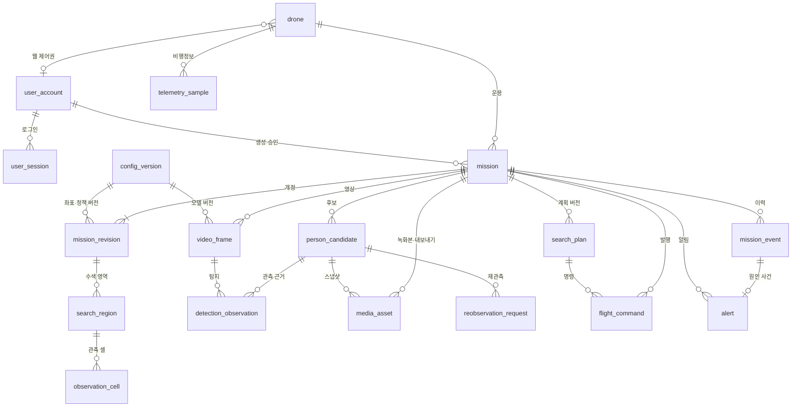

# ERD 검토 — SRS v1.7 · SDD v1.2 기준

> 대상 `ERD/drone_edit.*` (ERDCloud · SDD v1.2 2.4~2.5 와 같은 54개) · 기준 SRS v1.7 (유즈케이스 73 · NFR · EX) · 2026-09-29
> DB 절(2.1·2.4·2.5)은 SDD v1.2 와 v1.3 이 같다 (v1.3 은 비전 그림만 바꿈) → 어느 판에 적용해도 된다

## 결론

- **54개 → 18개로 줄여도 SRS 유즈케이스 73개를 모두 그대로 덮는다** (유지 16 · 병합 33 · 제외 5)
- **검증 완료** → [`ERD_18_검증_0929.md`](ERD_18_검증_0929.md) — SRS 저장 요구 96항목 · 옛 컬럼 707개 · 관계 169개를 스크립트로 대조
- 많아진 원인: DB-26~54 (29개, SDD 가 "추가 테이블"로 명시) 대부분이 **SRS 에 없는 개념** — GRACE 코덱 · 원본 회수(P4) · IPP 계획 내부 산출물 · 존재 가능성 지도의 버전·갱신 이력 · 우도 모델
- SDD 쪽수도 크게 준다 — DB 절이 **강제 쪽 나눔 75개 (문서 전체 284개 중)** → 18개면 약 **50쪽 감소** 예상

## 1. 지금 ERD 의 문제

| # | 문제 | 근거 |
|---|---|---|
| 1 | **SRS 근거 없는 테이블** | SRS v1.7 에 GRACE · 코덱 · epoch · lease · sidecar · 회수 · IPP · 사전 제보 · 우도 · 확률 · 표현(representation) 이 **한 번도 안 나옴** (0건) · "존재/검출 가능성"은 UC-0502 우선순위 요소로 1번만 → 셀 컬럼(priority · belief)이면 충분 |
| 2 | **Pi(현장) 로컬 데이터가 중앙 DB 에 있음** | field_segment · archive_* · execution_lease · gateway_session — SRS UC-1203 은 "서버 연결과 별개로" 현장 순환 기록. 서버 단절 중에도 써야 하므로 중앙 DB 에 둘 수 없다 |
| 3 | **1:1 부속 정보가 별도 테이블** | control_lease(기체당 1행) · mission_execution_grant(임무당 1개) · frame_pose_binding · analysis_job(프레임당 1건) · cell_belief(셀당 1행) |
| 4 | **이력 테이블이 사건 종류마다 따로** | command_transition · safety_event · operator_action · execution_report · stream_event_gap · mission_event → 같은 모양 (시각 · 주체 · 대상 · 내용) |
| 5 | **설정 버전 테이블이 종류마다 따로** | spatial_context · camera_calibration · coordinate_config · configuration_bundle · model_artifact · likelihood_model → 모두 "종류 · 버전 · 내용 · 해시 · 승인" |
| 6 | **drone 테이블이 없음** | `drone_id` 를 11개 테이블이 쓰는데 기준 테이블이 없다 → 기체별 현재 상태(제어권 · 링크 · 게이트웨이)가 흩어짐 |
| 7 | **SQL 과 그림 불일치** | 그림 관계선 140개 ↔ `drone_edit.sql` FK 제약 **16개** · link_state 는 관계 0 |
| 8 | **잘못된 FK** | `cell_belief.mission_id → observation_group` (대상 오류) · `mission.mission_id → mission_revision.mission_id` (유일하지 않은 컬럼 참조 · 역방향 FK 와 순환 — 의도는 `(mission_id, active_revision)` 복합 FK · 지연 검사) · `region_cell_membership.grid_version → observation_cell.grid_version` (복합 PK 일부만 참조 → 생성 실패) |
| 9 | **타입 불일치** | SDD 2.5 는 PostgreSQL (uuid · jsonb · geometry(…,4326) · timestamptz) ↔ SQL 은 MySQL 형 · timestamptz 85개가 DATETIME (시간대 손실) → **PostgreSQL + PostGIS 로 통일 권장** |

## 2. 줄이는 기준 (4가지)

1. **SRS 가 "저장/기록한다"고 요구하는 것만 테이블** — 계산 중간값은 JSON 컬럼 또는 로그
2. **1:1 · 현재값은 부모의 컬럼** — 이력은 공통 이벤트 로그로
3. **같은 모양은 하나로** — 설정 버전 → `config_version(kind)` · 사건 이력 → `mission_event(event_type)`
4. **Pi 로컬 · 연구(GRACE) 데이터는 중앙 ERD 밖** — 2.1 파일 구조에 "게이트웨이 로컬 파일/인덱스"로 적는다

## 3. 제안 — 18개 (5개 영역)

| 영역 | 새 테이블 | 핵심 컬럼 (새로 들어오는 것 **굵게**) |
|---|---|---|
| **ERD-01 사용자·기체** | DB-01 user_account | user_id · login_id · credential_hash · permissions · status |
| | DB-02 user_session | session_id · user_id · token_digest · issued/expires/revoked_at |
| | DB-03 **drone** (신규) | drone_id · name · gateway_id · **camera_config_id · control_user_id · control_session_id · control_revision · control_epoch · control_expires_at · link_state(JSON) · gateway_state(JSON)** · updated_at |
| **ERD-02 임무·설정** | DB-04 mission | mission_id · drone_id · creator · draft/active_revision · state · **readiness · appearance_query · test_conditions · grant_status · approved_by · approved_at** · started/ended_at · termination_reason |
| | DB-05 mission_revision | (mission_id, revision) · area_geom · priority_geom · **priority_sources(JSON)** · conditions · area_denominators · **spatial/coordinate/policy/model_config_id** · planner_modes · grid_version |
| | DB-06 **config_version** (통합) | config_id · **kind (SPATIAL/CAMERA/COORDINATE/MODEL/POLICY)** · version · payload(JSON) · content_hash · status · approved_by |
| **ERD-03 계획·관측** | DB-07 search_region | region_id · mission_id·revision · region_type · region_geom · total/remaining_area_m2 · state · pass_index · row_version |
| | DB-08 observation_cell | (mission_id, grid_version, cell_id) · **region_id · region_allocations** · cell_geom · state(5종) · valid_union_geom · valid_area_m2 · valid_count · last_valid_at · **priority · belief · belief_detail** · excluded_reasons |
| | DB-09 search_plan | plan_id · mission_id·revision · plan_version · plan_kind · parent/supersedes · **region_id · visit_order · task · candidates · route (JSON)** · decision_log · status |
| | DB-10 reobservation_request | request_id · candidate_id · requester_kind · requested_by · status · queue_order · plan_id · limits · usage · result_evidence · deferred_reason |
| **ERD-04 영상·탐지** | DB-11 telemetry_sample | sample_id · drone_id · mission_id · sample_time · received_at · pose · flight_state · validity |
| | DB-12 video_frame | frame_id · mission_id · **stream_id · stream_epoch** · frame_seq · capture/**gateway_received**/received_at · time_evidence · **pose(JSON) · pose_status · footprint_geom · visible_geom · coverage(JSON) · obs_group · plan_id · analysis_mode/state · model_config_id · pre/infer/post_ms · skip_reason** |
| | DB-13 media_asset | asset_id · mission_id · frame_id · **candidate_id · observation_id** · asset_type · storage_uri · content_hash · state · gaps · **retention_class** · retained_until |
| | DB-14 person_candidate | candidate_id · mission_id · first/last_seen · association_state · evidence_count · valid_group_count · latest_position · geo_status · geo_reason · ellipse · appearance · judgement · **tracking(JSON)** |
| | DB-15 detection_observation | observation_id · candidate_id · frame_id · **analysis_mode · track_id** · bbox · confidence · observation_kind · geo_result · model_config_id |
| **ERD-05 명령·이력** | DB-16 flight_command | command_id · request_hash · mission_id·revision · plan_id · **segment_order** · drone_id · control_epoch · sequence · action · payload · issued/expires_at · state · **reason_code** |
| | DB-17 alert | alert_id · mission_id · event_id · dedup_key · type · priority · raised_at · ack_user_id · acknowledged_at |
| | DB-18 mission_event (확장) | event_id · event_seq · mission_id · drone_id · **event_type · code** · use_case_id · **actor_user_id · ref_table · ref_id** · source_time/stored_at · payload · producer 3종 (중복 방지 UQ) |

`mission_event.event_type` = COMMAND_STATE · EXECUTION_REPORT · SAFETY · OPERATOR_ACTION · STREAM_GAP · LINK · GATEWAY · MISSION_STATE …

## 4. 54 → 18 대응표

| 새 ID | 새 테이블 | 옛 테이블 (처리) |
|---|---|---|
| DB-01 | **user_account** | DB-01 user_account |
| DB-02 | **user_session** | DB-02 user_session |
| DB-03 | **drone** | DB-03 control_lease → 기체당 1행 → drone.control_* 컬럼 DB-11 link_state → 현재값 → drone.link_state · 장애 이력 → mission_event DB-29 gateway_session → 현재 게이트웨이 상태 → drone.gateway_state · 이력 → 이벤트 DB-30 execution_lease → 제어 세대 → drone.control_epoch · lease 자체는 Pi 로컬 |
| DB-04 | **mission** | DB-04 mission DB-06 mission_execution_grant → 임무당 실행 승인 1개 → mission.approved_* 컬럼 |
| DB-05 | **mission_revision** | DB-05 mission_revision DB-49 prior_evidence → mission_revision.priority_sources (JSON) |
| DB-06 | **config_version** | DB-08 spatial_context → kind=SPATIAL DB-09 spatial_feature → kind=SPATIAL payload(GeoJSON) DB-26 camera_calibration → kind=CAMERA DB-27 coordinate_config → kind=COORDINATE DB-28 configuration_bundle → kind=POLICY DB-46 model_artifact → kind=MODEL (가중치 해시·임계값·평가 요약) DB-54 likelihood_model → kind=POLICY (탐지율·오탐률 표) |
| DB-07 | **search_region** | DB-34 search_region |
| DB-08 | **observation_cell** | DB-17 observation_cell DB-35 region_cell_membership → observation_cell.region_id DB-42 cell_belief → observation_cell.priority · belief 컬럼 |
| DB-09 | **search_plan** | DB-07 search_plan DB-36 region_visit → search_plan.visit_order (JSON) DB-37 region_task → search_plan (영역 작업 = 계획 항목) DB-38 view_candidate → search_plan.candidates (JSON · 점수·선택 근거) DB-39 plan_segment → search_plan.route (JSON) |
| DB-10 | **reobservation_request** | DB-16 reobservation_request |
| DB-11 | **telemetry_sample** | DB-10 telemetry_sample |
| DB-12 | **video_frame** | DB-12 video_frame DB-18 observation_evidence → 프레임별 가시 영역 → video_frame.footprint_* (선택 유지 가능) DB-31 video_stream_epoch → video_frame.stream_epoch 컬럼 · 재시작 → 이벤트 DB-33 frame_pose_binding → video_frame.pose · pose_status · pose_reason DB-40 observation_group → video_frame.obs_group (1초 관측 단위 키) DB-41 group_frame → video_frame.coverage (묶음 기여) · obs_group DB-45 analysis_job → video_frame.analysis_state · infer_ms · model_id |
| DB-13 | **media_asset** | DB-13 media_asset DB-52 candidate_snapshot → media_asset.candidate_id · observation_id |
| DB-14 | **person_candidate** | DB-14 person_candidate |
| DB-15 | **detection_observation** | DB-15 detection_observation |
| DB-16 | **flight_command** | DB-19 flight_command |
| DB-17 | **alert** | DB-22 alert |
| DB-18 | **mission_event** | DB-20 command_transition → event_type=COMMAND_STATE DB-21 safety_event → event_type=SAFETY DB-23 operator_action → event_type=OPERATOR_ACTION + actor_user_id DB-25 mission_event (공통 이벤트 로그로 확장) DB-43 belief_revision → event_type=BELIEF_UPDATE (지도 버전 헤더 → 이벤트) DB-44 belief_update → event_type=BELIEF_UPDATE (갱신 근거 → 이벤트) DB-50 execution_report → event_type=EXECUTION_REPORT DB-51 stream_event_gap → event_type=STREAM_GAP |

| 옛 ID | 테이블 | 빼는 이유 |
|---|---|---|
| DB-24 | field_segment | Pi 로컬 순환 기록 인덱스 (UC-1203) — 중앙 DB 아님 · Pi 로컬 파일 |
| DB-32 | frame_representation | GRACE 파생 표현 — SRS 에 없음 (연구 경로) |
| DB-47 | archive_manifest | Pi→서버 원본 회수(P4) — SRS 에 없음 |
| DB-48 | archive_transfer | 회수 전송 재시도 — SRS 에 없음 |
| DB-53 | codec_session | GRACE 코덱 협상 — SRS 는 H.264 (NFR-H02) |
## 5. SRS 추적 — 빠지는 기능 없음

| 유즈케이스 묶음 | SRS 가 저장을 요구하는 것 | 새 테이블 |
|---|---|---|
| UCD-01 사용자·제어권 (0101~0107) | 계정 · 세션 · "기체당 한 명의 웹 제어권 보유자와 유효 상태" | user_account · user_session · drone |
| UCD-02 기체·게이트웨이 (0201~0203) | 기체 상태 · 링크 상태 · 준비 점검 결과 | telemetry_sample · drone · mission_event |
| UCD-03 지도·공간정보 (0301~0304) | "원점·축·단위·고도 기준 저장 · 변환 버전 기록" | config_version (SPATIAL · COORDINATE) |
| UCD-04 임무 (0401~0410) | 구역 · 우선구역 · 조건 · 편집/실행 버전 구분 · 종료 사유 | mission · mission_revision |
| UCD-05 탐색 계획 (0501~0506) | 후보 영역 · 우선순위와 평가 근거 · 계획 버전 · 명령 연결 | search_region · search_plan · reobservation_request · flight_command |
| UCD-06 영상 (0601~0607) | 수신 상태 · 촬영 시각↔비행정보 · 처리율 구분 · 녹화본 · 스냅샷 | video_frame · telemetry_sample · media_asset |
| UCD-07 탐지·추적 (0701~0708) | 후보 · 탐지 근거 · 좌표/보류 사유 · 판단 · 재관측 · 인상착의 · 추적 | person_candidate · detection_observation · reobservation_request · media_asset |
| UCD-08 상황지도·관측 (0801~0806) | 가시 영역 · 셀 상태·횟수·최근 시각 · 완료도 · 우선도 | observation_cell · video_frame(footprint) · mission_revision(분모) |
| UCD-09 비행 명령 (0901~0906) | 명령 원문 · 중복 방지 · 검증/거부 사유 · 처리 결과 | flight_command · mission_event |
| UCD-10 안전·장애 (1001~1006) | 장애 시각·원인·조치 · RC 전환 · 안전 설정 점검 | mission_event (SAFETY) · config_version (POLICY) |
| UCD-11 알림 (1101~1104) | 알림 · "확인 여부를 사건 처리와 별도로" | alert |
| UCD-12 이력·결과 (1201~1206) | 임무·관측·명령·조치 이력 · 결과 · KML · 재동기화 | mission_event · media_asset(EXPORT) · 전 테이블 / **UC-1203 현장 기록은 Pi 로컬** |

- NFR 도 그대로 — V05 임계값 변경 기록 · V06 오탐 → config_version(MODEL) · detection_observation / I01 관측 완료도 → observation_cell / P02 누락률 → video_frame.frame_seq + STREAM_GAP 이벤트

## 6. SDD 고칠 곳 (오늘 마감 기준 순서)

| 순서 | 위치 | 할 일 | 양 |
|---|---|---|---|
| 1 | ERDCloud | 18개로 다시 그림 (3절 표 · mermaid 참고) → ERD-00 전체도 + ERD-01~05 그림 | 그림 6장 |
| 2 | 2.4 | ERD-01~12 → **ERD-01~05** 표 · 그림 교체 | 12절 → 5절 |
| 3 | 2.5 | DB-01~54 → **DB-01~18** 상세 표 (병합 컬럼은 3절 굵은 글씨) | 54 → 18 |
| 4 | 2.1 | `storage/migrations/` "DB-01~54" → "DB-01~18" · `gateway/` 줄에 "로컬 순환 기록·lease·회수 인덱스(파일)" 추가 | 2줄 |
| 5 | 4.4 | 클래스별 "저장: DB-xx" 39줄 → 아래 표대로 교체 | 39줄 |

| 4.4 클래스 | 지금 '저장:' | 바꿀 값 |
|---|---|---|
| C-0505 GlobalVisitPlanner | DB-07, DB-34~37 | DB-07, DB-08, DB-09 |
| C-0506 RegionTaskCoordinator | DB-34~37, DB-50 | DB-07, DB-08, DB-09, DB-18 |
| C-0507 RegionCostProvider | DB-36 | DB-09 |
| C-0508 LocalIPPPlanner | DB-07, DB-38~44 | DB-08, DB-09, DB-12, DB-18 |
| C-0509 ViewCandidateGenerator | DB-38 | DB-09 |
| C-0510 VisibilityEvaluator | DB-18, DB-38 | DB-09, DB-12 |
| C-0511 DetectionLikelihoodModel | DB-54 | DB-06 |
| C-0512 PathCostEstimator | DB-38~39 | DB-09 |
| C-0513 ReturnBudgetChecker | DB-36, DB-38~39 | DB-09 |
| C-0514 BeliefUpdater | DB-42~44 | DB-08, DB-18 |
| C-0515 BaselineCoveragePlanner | DB-17~18, DB-38~39 | DB-08, DB-09, DB-12 |
| C-0805 ObservationGroupAggregator | DB-40~41, DB-18 | DB-12 |
| C-0605 FrameIngestor | DB-12, DB-32~33, DB-45 | DB-12 |
| C-0707 TileSplitter | DB-32, DB-45 | DB-12 |
| C-0708 PersonDetector | DB-45~46 | DB-06, DB-12 |
| C-0709 DetectionMerger | DB-15, DB-45 | DB-12, DB-15 |
| C-0710 GeoResolver | DB-15, DB-26~27, DB-33 | DB-06, DB-12, DB-15 |
| C-0711 ColorProfiler | DB-14~15 | DB-14, DB-15 |
| C-0712 SnapshotWriter | DB-13, DB-52 | DB-13 |
| C-0713 CandidateRegistry | DB-14~16, DB-23, DB-52 | DB-10, DB-13, DB-14, DB-15, DB-18 |
| C-0714 ModelRegistry | DB-46 | DB-06 |
| C-0806 CameraModel | DB-26~27, DB-33 | DB-06, DB-12 |
| C-1206 FrameAnalysisLedger | DB-45 | DB-12 |
| C-0606 VideoProfileManager | DB-28, DB-31, DB-53 | DB-06, DB-12 |
| C-0607 ArchiveRecoveryService | DB-24, DB-45, DB-47~48 | DB-12 |
| C-0608 FrameQualityGate | DB-32~33, DB-45 | DB-12 |
| C-0609 GraceCodecAdapter | DB-32, DB-53 | — (DB 저장 없음 · 로컬/파일) |
| C-0610 CodecStateSync | DB-53, DB-32 | — (DB 저장 없음 · 로컬/파일) |
| C-0905 ExecutionLeaseGuard | DB-29~30 | DB-03 |
| C-0906 GatewayCommandGuard | DB-19~20, DB-29~30 | DB-03, DB-16, DB-18 |
| C-0907 CommandRecoveryReconciler | DB-19~20, DB-50 | DB-16, DB-18 |
| C-1205 SegmentManifestStore | DB-24, DB-47~48 | — (DB 저장 없음 · 로컬/파일) |
| C-0715 EngineBuilder | DB-46 | DB-06 |
| C-0716 DatasetBuilder | DB-46; 오프라인 데이터/실험 파일 | DB-06 |
| C-0717 Trainer | DB-46; 오프라인 데이터/실험 파일 | DB-06 |
| C-0718 Evaluator | DB-46; 오프라인 데이터/실험 파일 | DB-06 |
| C-0719 PairedComparator | DB-46; 오프라인 데이터/실험 파일 | DB-06 |
| C-0720 WeightSouper | DB-46; 오프라인 데이터/실험 파일 | DB-06 |
## 7. 정해야 할 것 (팀 · DB 담당 확인)

| 항목 | 기본안 | 남기자는 의견이 있으면 |
|---|---|---|
| observation_evidence (프레임별 가시 영역) | video_frame.footprint 로 병합 | 관측 완료도(NFR-I01) 감사 근거로 **별도 유지 가능** → 19개 |
| spatial_feature (건물 윤곽·높이) | config_version(SPATIAL) GeoJSON | 건물이 많아 공간 질의가 필요하면 유지 → 20개 |
| model_artifact | config_version(MODEL) | 학습·평가 이력을 DB 로 보여주고 싶으면 유지 (비전 쪽은 병합해도 무방) |
| Pi 로컬 데이터 | 중앙 ERD 에서 제외, 2.1 에 파일로 명시 | 게이트웨이 전용 소형 ERD 를 부록으로 |
| DBMS | PostgreSQL + PostGIS (SDD 2.5 타입 그대로) | MySQL 이면 geometry·jsonb·timestamptz 대응 타입을 2.5 에 적어야 함 |
