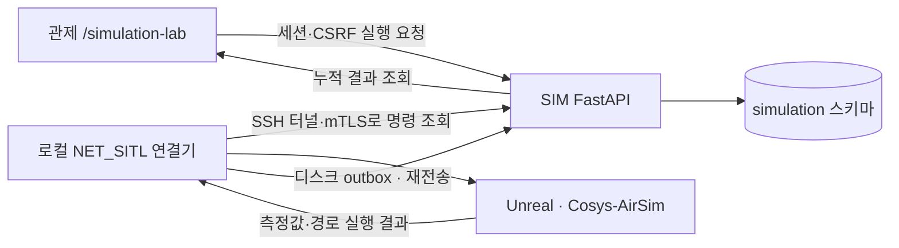

# 로컬 언리얼 시뮬레이션 — DB·관제·연결기

학교 서버 `drone-services-20261005`, PostgreSQL `drone_dev`에 전용 `simulation` 스키마를 만들었다. 업무 `drone.*`, 별도 REAL 인스턴스와 실기체 데이터는 이 경로에서 쓰지 않는다. 기존 001~008 migration은 보존하고 `009_unreal_simulation`을 추가했다.



## 생성한 테이블

| 테이블 | 저장 내용 |
|---|---|
| `simulation.run` | 실행 ID, 요청자, 대상 worker, 시나리오·맵·버전·좌표계·요청 seed, 설정 스냅샷, 요청 hash, 실행 상태·시각, 소유 worker session |
| `simulation.command` | 실행별 START/STOP 명령, 불변 ID·순번·입력 hash·payload·만료 시각, 처리 상태 |
| `simulation.sample` | 측정·탐지·경로·파이프라인 사건·지표·명령 응답·종료 결과. sample ID, 생산 session/순번, sim 시간, 수신 시각, JSON 규격 버전, hash, cursor, 늦은 수신 표시 |

결과 `kind`는 `TELEMETRY`, `DETECTION`, `PLAN`, `PIPELINE_EVENT`, `METRIC`, `COMMAND_REPORT`, `RUN_STATUS`다. `PLAN`에는 알고리즘·버전·입력 hash·경로·평가 지표를 기록해 같은 실행의 여러 계획/최적화 회차를 누적할 수 있다. 같은 실행을 반복 평가하려면 새 run ID를 만든다.

입력과 결과 이력은 불변이며 삭제하지 않는다. 백엔드 역할은 SELECT와 지정 저장 함수 EXECUTE만 가진다. 동일 ID·동일 내용 재전송은 중복으로 반환하고, 다른 내용이나 생산 순번 충돌은 거부한다. 실행별 잠금으로 요청/명령/결과를 정리하며 전역 업무 사건 잠금을 추가하지 않는다.

## 실제 관제 사용

학교 서버의 기존 관제 접속 주소에서 `/simulation-lab`을 연다. SSH 개발 접속은 `https://localhost:18443/simulation-lab`이다. 기존 관제 화면에서 로그인한 세션을 사용하며, 별도 비밀번호나 브라우저용 서비스 토큰을 만들지 않는다.

화면에서 맵과 시나리오를 선택해 **새 실행 요청**을 누른다. 요청은 DB에 QUEUED로 저장되고 연결기가 처리하면 RUNNING→COMPLETED/FAILED/CANCELLED로 바뀐다. 결과를 2초마다 조회하며 최근 30건을 표시한다. 화면 표시 범위와 별개로 DB에는 전체 수신 결과를 누적한다.

- `CAPTURE`: 기본 5초 동안 실제 AirSim 위치를 읽고 저장한다. 시동·이륙 명령을 보내지 않는다.
- `ROUTE`: NED 경로를 전달해 가상 비행 후 착륙·disarm을 확인한다. 입력점은 이륙점 기준 북/동 오프셋(m), 고도(m)이며 1~64점, ±100m, 고도 3~30m, 속도 0.5~3m/s로 제한한다.
- **동일 요청 재전송**은 기존 실행을 다시 비행시키지 않는다. 새 평가에는 새 실행 요청을 사용한다.
- **중지 요청**은 로컬 연결기가 받아 착륙 후 종료한다. 서버 연결 단절 중 즉시 중지된다고 표시하지 않는다. QUEUED 실행은 서버에서 바로 취소할 수 있다.

## 로컬 연결기

경로: `D:\Capstone1\SITL\NET_SITL\scripts\server_simulation_bridge.py`.

터널이 없는 경우 별도 터미널에서 다음을 실행한다. 현재 테스트용 터널과 중복으로 같은 포트를 바인딩하지 않는다.

```powershell
ssh -p 7540 -N -L 18443:127.0.0.1:18443 -L 18444:127.0.0.1:18444 se@<SERVER_HOST>
```

SIM 장치의 CA·client 인증서·개인키·토큰은 `runtime\server-identity`에 보관했다. Windows 현재 사용자와 SYSTEM만 읽도록 ACL을 설정했고 runtime은 Git에서 제외된다. REAL 자격증명은 사용하지 않는다. 다른 PC에는 해당 PC의 관리된 SIM 신원을 제공해야 하며 키를 Git/문서에 넣지 않는다.

```powershell
cd D:\Capstone1\SITL\NET_SITL
# 자동으로 시작한 시뮬레이터만 실행 종료 후 Stop.ps1로 정리한다.
.\.venv\Scripts\python.exe scripts\server_simulation_bridge.py `
  --identity runtime\server-identity --execute --start-simulator --profile SimpleFlight
```

이미 실행된 NET_SITL을 사용할 때는 `--start-simulator`를 생략할 수 있다. 맵과 프로파일이 관제 요청과 다르면 기존 실행을 임의로 교체하지 않고 FAILED로 기록한다. `--once`는 요청 한 건만 처리하는 시험 옵션이다. 비행 중에는 관제 중지 버튼을 사용하고 착륙 확인 후 연결기를 종료한다.

현재 로컬 WSL에는 기존 Copter-4.6.3 실행 파일이 없어 SimpleFlight를 사용한다. ArduCopter가 준비되면 `--profile ArduCopter`를 선택한다. 기존 `flight_smoke.py`의 버전·SITL·파라미터·GUIDED·LAND 확인을 유지하며 제한된 경로 JSON과 취소 플래그만 추가했다.

## 누적·재접속 계약

연결기는 실행마다 `runtime\server-simulation\<run_id>`에 생산 session, 전송 순번, JSONL 결과와 업로드 위치를 보존한다. 서버가 저장했지만 응답이 끊긴 경우 같은 sample ID와 내용으로 재전송한다. 늦게 도착한 결과도 동일 실행/worker session이면 보존하고 `late=true`로 표시한다.

불확실하게 중단된 비행은 자동 재실행하지 않는다. 로컬 실행 시작 표시가 있는데 종료 결과가 없으면 RECOVERY_REQUIRED로 남기고, 현재 가상 기체 상태를 확인한 뒤 새 실행을 발급해야 한다. 자동 worker 소유권 이전이나 임의 셸 명령 실행은 지원하지 않는다.

시뮬레이션 시간은 첫 AirSim 측정 timestamp 대비 ns이며 UTC 수신 시각과 구분한다. ns/cursor/생산 순번은 JSON에서 64비트 정수 문자열로 전달한다. 위치는 AirSim NED m이며 UE의 cm 좌표나 실제 GPS로 간주하지 않는다. 실제 맵·설정 hash·프로파일·OriginGeopoint를 준비 사건에 남긴다. 경로 요청 좌표는 이륙 위치를 기준으로 한 오프셋이고, 측정 좌표는 AirSim 원점 기준이다.

## API

| 경로 | 용도 |
|---|---|
| `POST /api/v1/simulations/runs` | 관제 실행 요청 |
| `GET /api/v1/simulations/runs`, `/{run_id}` | 실행 이력·상태 |
| `GET /api/v1/simulations/runs/{run_id}/samples?after=0&limit=100` | cursor로 누적 결과 조회; kind 필터 지원 |
| `POST /api/v1/simulations/runs/{run_id}/stop` | 관제 중지 요청, command_id로 멱등 처리 |
| `GET /device/v1/simulations/runs` | 인증된 로컬 worker의 대기/진행 실행 |
| `POST /device/v1/simulations/runs/{run_id}/claim` | 소유 worker session 확정 |
| `GET /device/v1/simulations/runs/{run_id}/commands` | 유효한 명령 조회 |
| `POST /device/v1/simulations/runs/{run_id}/samples` | 결과 누적 |

관제는 기존 HttpOnly 세션/Origin/CSRF/드론별 권한, worker는 기존 SIM 장치 mTLS·토큰·gateway 소유권을 검사한다. 영상 bytes는 이 JSON API/테이블에 넣지 않는다. payload는 64KiB로 제한된다.

## 검증과 범위

실제 DB 백업을 임시 DB에 복원해 API 검사 28개, 입력·결과 불변성, 체크섬 보존, 수정 후 백업의 두 번째 DB 복원, TLS 게이트웨이·인증 요구·화면 응답을 확인했다. 임시 DB는 제거했다. [배포 증거](../drone-services/evidence/database/unreal-simulation-20261009.json)를 참조한다.

실제 로컬 UE/Cosys-AirSim으로 왕복도 실행했다. 인증된 관제 HTTP 요청으로 CAPTURE와 5m 고도·4m 사각 ROUTE를 생성하고, 로컬 연결기가 실제 측정값을 반환했다. 성공한 CAPTURE는 결과 10건, ROUTE는 71건(텔레메트리 35건·경로 PLAN 1건 포함)을 누적했으며 ROUTE의 지면 도달·정지·disarm을 확인했다. 실행 중 CAPTURE의 관제 STOP→CANCELLED도 확인했다. [왕복 증거](../drone-services/evidence/database/unreal-roundtrip-20261009.json), [중지 증거](../drone-services/evidence/database/unreal-live-stop-20261009.json)를 참조한다.

초기 경로 시험 두 건은 착륙 확인에 실패해 FAILED로 보존했다. SimpleFlight의 landAsync 반환과 실제 지면 도달이 다름을 확인해 최신 접촉 timestamp·고도·속도로 지면 정지를 기다린 뒤 disarm 및 landed 상태를 확인하도록 수정했다. 기존 실패 행을 성공으로 바꾸거나 삭제하지 않았다.

연결기의 작은 검사는 `scripts\test_server_simulation_bridge.py`, 경로 검사는 `scripts\simulation_route.py`로 실행한다. 응답 유실 후 중복 재전송과 연결기 재시작 시 session/순번 보존을 검사한다.

서버 백업은 `backups/unreal-simulation-20261009T041248Z`(009 적용 전)와 `backups/unreal-simulation-20261009T041548Z`(최종 코드 배포)에 있다. DB를 실제 대상 위에 복원하지 않고 임시 DB에서 검증했다. 첫 배포의 코드 확인 실패 때 코드를 복원했고, DB의 추가 스키마는 보존한 뒤 같은 체크섬으로 재적용했다.

최종 왕복/중지 시험에서 누적한 데이터도 두 번째 백업 폴더의 `roundtrip.dump`에 보존했다. 실행 결과 증거에 경로와 SHA-256을 기록했다.

경로 최적화 알고리즘·실모델 추론은 새로 구현하지 않았다. 현재 연결기는 입력 경로를 실행하고 `provided_route`, `optimized=false`로 기록한다. 다른 최적화기의 PLAN은 계약에 맞춰 추가할 수 있다. 임의 `pipeline_config`와 0 이외 seed는 연결기가 거부하며, seed 0도 결정적 재현을 보장하지 않는다. 실제 프레임 분석/탐지 결과와 전체 파이프라인 성능 검증은 해당 분석기를 연결해야 한다.

SimpleFlight는 파이프라인·경로 요청 시험용이며 F450 동역학이나 ArduPilot 비행 안전성을 검증하지 않는다. SIM 결과를 실기체 비행 허가나 그대로 사용할 경로로 취급하지 않는다. BAZE quick 설계 검토는 완료됐고, Sonnet 코드 검토는 출력 한도로 본문을 받지 못해 검증 완료로 집계하지 않았다.
